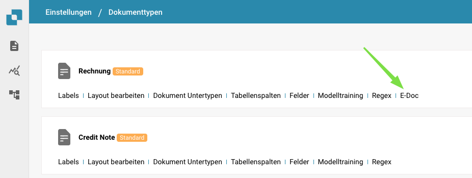
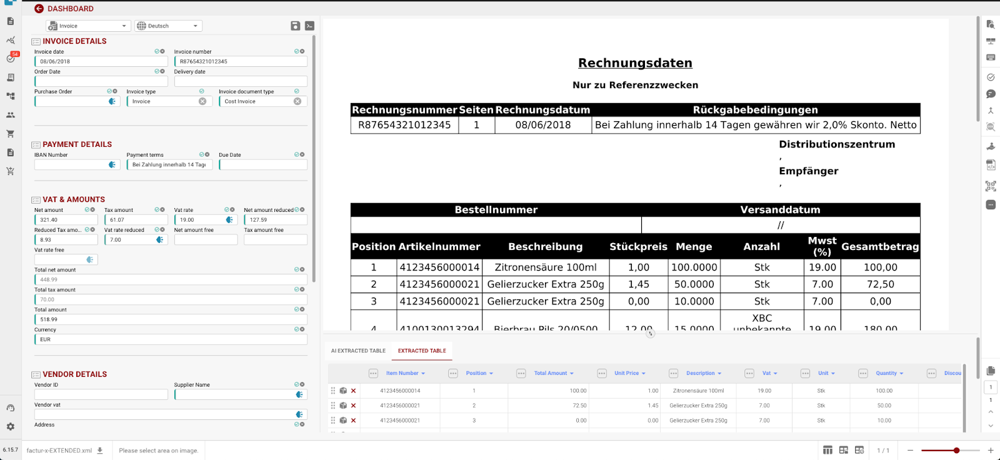

# Release-Notizen

> **Neueste Hotfix-Version:** [Hotfixes 14. Oktober 2026](incremental-updates-14-october-2026.md) (R1.0.15): der Settings Assistant als Chat auf jeder Einstellungsseite, neue KI-Stufen (Fast, Full, Nexus, Auto), die Prüfung der Kopffelder, sicherere Anmeldung und Social Login sowie Bestellabgleich für Nebenkosten. Vorherige: [Hotfixes 15. September 2026](incremental-updates-15-september-2026.md). Alle Hotfix-Seiten sind in der Navigation unter Versionshinweise aufgeführt.

## **Release R1.0 13./14. Juni 2026**

> **Sandbox-Verfügbarkeit:** 28. April 2026

### Neue Funktionen:

* **Activity Logging / Access Audit:**\
  Detailliertes Aktivitätsprotokoll und Access-Audit-Trail in der gesamten Anwendung für Compliance und Überwachung. Verschiedene Protokollierungstypen für alle Microservices und basierend auf Zeitraum.
* **Globale Schnellsuche:**\
  Drücken Sie Cmd+K / Ctrl+K von überall in der App, um in über 200 Routen und mehr als 40 In-Page-Funktionen zu suchen. Zeigt die Top-8-Ergebnisse mit Fuzzy-Matching, Navigation per Pfeiltasten und Links zur vollständigen App Index Page.
* **Sitemap (App Index Page):**\
  Durchsuchbare Indexseite, die jede navigierbare Seite und In-Page-Funktion (Dialoge, Seitenleisten, Panels) in DocBits katalogisiert. Organisiert in 18 Kategorien mit Typfiltern, Kategorie-Pills, URL-synchronisierter Suche und berechtigungsbasierten Einträgen, die für Nicht-Administratoren als gesperrt angezeigt werden.
* **Analytics Dashboard:**\
  Umfassende Analysen zur Dokumentenverarbeitung mit Executive Overview, API Metrics, Quality Metrics, Processing Performance, Document Flow Analytics, Activity Log, Event Log und Audit Trail.
* **Dashboard-Exportfunktion:**\
  Neue Dashboard-Exportfunktion, die einen Listenexport in den Formaten CSV oder XLSX ermöglicht.
* **Full-Text Search / DocSearch:**\
  KI-gesteuerte Vektorsuche über alle indizierten Dokumente mit Echtzeit-Lieferantenfilterung, "Find Similar"-Funktion und konfigurierbaren Indexierungseinstellungen.
* **Supplier Delivery Statistics:**\
  Neue Ansichten mit Einblicken in lieferantenbezogene Metriken der Dokumentenverarbeitung.
* **Debug Collector:**\
  Drücken Sie Ctrl+Shift+P, um einen vollständigen Debug-Snapshot zu erfassen, einschließlich API-Aufrufen, WebSocket-Status, Fehlern, Konsolen-Logs, Performance-Metriken und Umgebungsinformationen. Snapshots können in die Zwischenablage kopiert oder direkt als Support-Ticket mit einem HTML-formatierten Bericht und angehängter JSON-Datei gesendet werden.
* **AI Agents (DocNet):**\
  Autonome Hintergrundagenten, die eingehende E-Mails automatisch verarbeiten — Dokumente klassifizieren, extrahieren und weiterleiten, ohne manuelles Eingreifen. Agenten arbeiten zugewiesene Aufgaben selbstständig ab und eskalieren über Genehmigungsanfragen an Benutzer, wenn menschliches Urteilsvermögen erforderlich ist. Enthält ein dediziertes Agent-Dashboard zur Überwachung von Aktivität und Performance.
* **Neue E-Dokumente:**\
  Über 80 neue globale E-Invoice-Typen und mehr als 40 neue Formate, darunter XRechnung 3.0.2, ZUGFeRD 2.2/2.3.2, Factur-X-Varianten und Asia-Pacific PINT Credit Notes. 100 % Klassifizierungs- und Extraktionsabdeckung.
* **AI Script Chat:**\
  KI-gestützter Chat-Assistent für die grundlegende Skriptentwicklung mit Echtzeit-Streaming-Antworten.
* **Script Versioning:**\
  Vollständige Versionshistorie für Skripte mit Änderungsverfolgung, Vergleichs- und Wiederherstellungsfunktionen. Bietet Versionsverwaltung für Skripte ähnlich wie bei E-Docs.
* **Exporthistorie in Dashboard Actions:**\
  Zugriff auf die Exporthistorie eines Dokuments direkt aus dem Dashboard-Aktionsmenü.
* **Generic API Exporter (APS450, GLS840):**\
  Konfigurierbares generisches API-Exportziel über eine Mapping-File-Konfiguration für flexible Integration mit externen Systemen. Unterstützung für APS450 und GLS840 wurde implementiert.
* **Mehrere Export-Konfigurationen:**\
  Unterstützung für mehrere aktive Export-Konfigurationen pro Dokumententyp mit Ausführungsreihenfolge und einer Re-Export-Schaltfläche zum Wiederholen ab dem fehlgeschlagenen Schritt.
* **Neue Watchdog-Version:**\
  Vollständige Überarbeitung der WatchDog Settings-Seite. Neue Quality-of-Life-Funktionen wurden hinzugefügt, darunter der aktuelle WatchDog Status, Anleitung und Befehle für die Installation, XSLT-Template-Konfiguration und eine Einstellung für Autoupdate. Außerdem wurde die Funktionalität implementiert, dass WatchDog mehrere Konfigurationen gleichzeitig verarbeiten kann.
* **Vertex-Integration:**\
  Consumer Use Tax-Integration über Vertex für automatisierte Steuerberechnung und Compliance während der Dokumentenverarbeitung.
* **UI-Redesign & Einstellungs-Überarbeitung:**\
  Umfassende UI-Auffrischung in der gesamten Anwendung. Neu gestaltete Login- und Auth-Seiten. Neu gestalteter Einstellungsbereich mit einklappbarer Seitenleiste, organisierten Unterkategorien, ankerbasierter Navigation, Kontext-Hilfe-Panel und Status-Tracking-Badges. UI-Änderungen bei Dokumentenskripten. Neue UI für Document Flow. Verbesserte List of Values-UI.
* **Idea Board:**\
  Feature-Request-Board, auf dem Benutzer neue Funktionen, Verbesserungen, benötigte Bugfixes usw. einreichen, diskutieren und abstimmen können — mit Rich-Text-Editor und Bildunterstützung.
* **API Key Management:**\
  Dedizierte Einstellungsseite zum Erstellen, Anzeigen und Verwalten mehrerer API-Schlüssel.
* **Master Data Lookup-Suchfunktion:**\
  Verbesserte Suchfunktionen für Stammdaten durch geeignete Suchoptionen basierend auf den ausgewählten Feldern.
* **User Activity Chart:**\
  Visuelles Diagramm, das Muster der Benutzeraktivität und Engagement-Metriken anzeigt. Dashboard für Login-Aktivität mit Trendvergleichsdiagrammen, täglicher/wöchentlicher Aggregation und GeoLite2-basierter Geolokalisierung.
* **User Login History:**\
  Users Detail View mit Login-Historie.
* **Anpassbare Seitenleiste:**\
  Drag-and-drop-Neuanordnung, Umschalter zum Ein-/Ausblenden und Pin-to-top für Menüeinträge der Seitenleiste. Einstellungen werden pro Benutzer persistiert, mit einer "Reset to default"-Option. Feature-Flags werden berücksichtigt.
* **Video Carousel:**\
  Autoplay-Video-Carousel auf der Prepare-Dashboard-Seite, das kurze animierte Produkt-Tipp-Videos zeigt (Global Search, Keyboard Shortcuts, Document Upload, Table Customization). Zweispaltiges Layout mit Videos links und Dashboard-Vorbereitung rechts. Auto-Redirect pausiert, während Benutzer Videos ansehen.
* **Advanced Workflow Designer:**\
  Visueller, knotenbasierter Automatisierungs-Builder mit Drag-and-Drop-Canvas für mehrstufige Verarbeitungspipelines. Unterstützt Wait-Steps, parallele Pfade, wiederverwendbare Templates, Or-Condition-Cards, manuelle Test-/Run-Schaltfläche, "Test from Here"-Teilausführung und Ausführungslogs pro Knoten mit visueller Flow-Hervorhebung, die genau zeigt, welche Knoten ausgeführt wurden.
* **Workflow KPI Dashboard:**\
  Dashboard mit Kennzahlen zur Überwachung der Workflow-Ausführung.
* **Workflow Partner Card SDK:**\
  SDK für Drittanbieter-Entwickler zum Erstellen benutzerdefinierter Workflow-Karten, mit KI-gestützter Überprüfung, Sandbox-Validierung und Getting-Started-Dokumentation.
* **Workflow Test Manager:**\
  Automatisierter Test-Manager für Workflows, der Administratoren ermöglicht, Tests einzeln oder im Massenbetrieb zu erstellen und auszuführen.

### Verbesserungen:

* **Datenbank (alle Module) — Migration von ID-Spalten:**\
  Alle "ID"-Datenbankspalten in DocBits wurden intern von Zeichenketten auf einen dedizierten ID-Typ (UUID7) migriert. Die zugrunde liegende Postgres-Datenbank wurde auf V18 migriert, um diese Verbesserung zu unterstützen.
* **Dokumentenverarbeitung — Weitere Verbesserungen:**\
  Die Exportlogik in Bezug auf die maximale Anzahl zu berücksichtigender Seiten wurde geändert — jetzt wird das gesamte Dokument exportiert. Während der Dokumentenvalidierung hat der Benutzer die Möglichkeit, das Standardlimit für die maximale Seitenanzahl für dieses spezifische Dokument zu überschreiben. Die Berechnung des Pending Document Counter wurde verbessert.
* **Service-Versionen, Status & Bereitstellungsdatum:**\
  Der Service-Verfügbarkeitsstatus wird im "Service Versions"-Popup bereitgestellt.
* **Spracherweiterung:**\
  Unterstützung auf 22 Sprachen erweitert, mit aktualisierter Sprachauswahl.
* **Access-Control-Design auf Feldebene:**\
  Neu gestaltete/verbesserte Zugriffssteuerung mit klarerem Aktivierungszustand, Zugriff auf Feldebene, konsistenter Regelbehandlung und vereinfachten gruppenbasierten Berechtigungen. Behebt Regelkonflikte zwischen Access Control und View Permissions, zeigt den Import-Owner in der UI an und wendet die Zugriffssteuerung konsistent auf Feldvalidierung, KI-extrahierte Tabellen und alle Ansichten an.
* **Activity Stream für alle Bildschirme:**\
  Der Activity Stream ist jetzt auf allen Dokumentenverarbeitungs-Bildschirmen verfügbar (Ready for Validation, PO Matching, Accounting, Quote Details, Reject) — nicht nur bei Pending Approval. Auf eine konsistente Position im rechten Panel auf allen Bildschirmen verschoben.
* **Document-Flow-Seite:**\
  Dedizierte Seite zur Visualisierung und Nachverfolgung des Dokumentenverarbeitungsflusses, die Statusübergänge und Fortschritt durch die Pipeline anzeigt.
* **Dual Monitor Mode (Globale Benutzereinstellung):**\
  Dual Monitor Mode wurde in eine globale Benutzereinstellung verschoben und bleibt über Sitzungen hinweg bestehen.
* **Layout-Builder-Verbesserungen:**\
  Unterstützung für versteckte und schreibgeschützte Felder mit visuellen Indikatoren, größenveränderlichem Panel-Trennstrich und Einstellungen zur Feldlänge. Anwenden des Default Layouts auf mehrere Origins, ohne jedes einzeln öffnen zu müssen.

## **Release HotFix 3 16. April 2026**

### DocBits-Verbesserungen:

* **QR-Code-Extraktion für polnische Rechnungen:**\
  DocBits unterstützt jetzt die QR-Code-Extraktion speziell für polnische Rechnungen und verbessert damit die automatisierte Datenerfassung für Dokumente aus Polen.

### Fehlerbehebungen:

* Behoben: Auto-Export schlug fehl, wenn PO Matching bereits stattgefunden hatte, die Bestellung aber nicht mit dem Dokument verknüpft war.
* Behoben: Einzelpreise wurden bei Rechnungen mit Verpackungseinheiten (VPE) falsch gerundet.
* Behoben: Export-Fehlermeldungen von ION/MEC (z. B. Acknowledge.PurchaseOrder-Fehler) wurden in DocBits nicht angezeigt, und der Status "Exported" wurde angezeigt, obwohl der Export fehlgeschlagen war.
* Behoben: Der Einzelpreis auf dem Approval Screen war falsch, wenn AI Table Extraction verwendet wurde.
* Behoben: Das Total Matching-Skript warf einen Fehler auf dem Validierungsbildschirm.
* Behoben: Die Dokumentenverarbeitung schlug mit einem Fehler fehl ("UserAuthentication object has no setter for 'org\_id'").
* Behoben: Table Training funktionierte bei bestimmten Lieferanten nicht; Spalten landeten in versteckten Spalten statt in den zugeordneten Feldern.
* Behoben: PO Matching schlug bei großen Rechnungen (10+ Seiten) fehl, weil das Größenlimit für Multipart-Requests überschritten wurde.
* Behoben: Skriptbefüllte Spaltenwerte wurden nach einem Dokument-Neustart nicht beibehalten.
* Behoben: Der "Ignore Table Validation"-Toggle wurde in der UI als aktiv (grün) angezeigt, war im Hintergrund jedoch deaktiviert.
* Behoben: Die Dokumentenqualität war nach dem Import deutlich reduziert.
* Behoben: Microservice-Versionen und Bereitstellungsdaten wurden in der App nach einem vollständigen Deployment-Push über Umgebungen hinweg inkonsistent angezeigt.
* Behoben: Die Barcode-Extraktion schlug aufgrund eines Fehlers beim Erstellen des User-Authentication-Objekts aus Task-Daten fehl.
* Behoben: Kontaktdaten von Lieferanten wurden beim Speichern im Supplier Portal geleert.
* Behoben: Dokumente liefen beim Export in einen NoneType-Fehler.
* Behoben: Der E-Mail-Body wurde nicht einbezogen, wenn die erste angehängte Datei ein PNG- oder JPEG-Bild war.
* Behoben: Der E-Mail-Body fehlte bei mehreren Dokumenten.
* Behoben: Der DocBits Operator "ai-exporting" lieferte keine Exportergebnisse in den Zielsystemen (LN/D3).

## **Release HotFix 2 31. März 2026**

### DocBits-Verbesserungen:

* **Hybride PDF-Verarbeitung — Benutzergesteuerte XML-Extraktion:**\
  Wenn ein PDF eingebettete XML-Daten enthält, können Benutzer jetzt wählen, ob DocBits die eingebetteten XML-Daten für die Extraktion verwenden oder das Dokument als Standard-PDF verarbeiten soll. Dies gibt Organisationen die volle Kontrolle darüber, wie hybride Dokumente verarbeitet werden, und stellt sicher, dass die für ihren Workflow am besten geeignete Extraktionsmethode angewendet wird.
* **AP Assignment Code auf dem Approval Screen:**\
  Die AP Manager Approval-Seite enthält jetzt ein AP Assignment Code-Feld, integriert mit Infor M3 CRS620. Dies ermöglicht es Genehmigern, Assignment Codes direkt während des Genehmigungsprozesses zu überprüfen und zu bestätigen, ohne zu externen Systemen wechseln zu müssen.
* **PO-Gesamtabgleich mit Dokumentensumme:**\
  DocBits unterstützt jetzt den Abgleich der Bestellsumme mit der Gesamtsumme auf dem Dokument und bietet eine zusätzliche Validierungsebene beim PO-Matching, um Abweichungen früher im Prozess zu erkennen.
* **Aktualisierung von Lieferanten-Artikelnummer und VPE:**\
  DocBits unterstützt jetzt die Aktualisierung der Felder Lieferanten-Artikelnummer und VPE (Verpackungseinheit) während der Dokumentenverarbeitung, wobei die Werte beim Export zurück nach M3 synchronisiert werden.
* **Verbesserte Dokument-Layout-Klassifizierung:**\
  Die Dokument-Layout-ID (tfidf\_id) wird jetzt nur basierend auf dem Kopftext generiert, ohne Fußzeilentext. Dies verbessert die Klassifizierungsgenauigkeit, indem verhindert wird, dass Fußzeileninhalte die Dokumenttyp-Erkennung beeinflussen.
* **Export & Next Button:**\
  Ein neuer "Export & Next"-Button wurde hinzugefügt, der es Benutzern ermöglicht, das aktuelle Dokument zu exportieren und sofort zum nächsten in der Warteschlange überzugehen, was den Überprüfungs- und Export-Workflow optimiert.
* **Genehmigungsprozess für Kostenrechnungen:**\
  Der Genehmigungsprozess für Kostenrechnungen wurde mit verbesserter Routing- und Validierungslogik erweitert.

### Fehlerbehebungen:

* Ein Problem wurde behoben, bei dem der Infor SFTP-Export aufgrund eines falschen Library-Befehls mit einem Fehler fehlschlug.
* Ein Problem wurde behoben, bei dem boolesche Checkboxen nicht auf dem Approval Screen angezeigt werden konnten.
* Ein Problem wurde behoben, bei dem UNMU-Nachrichten gesendet wurden, obwohl keine Abweichungen in der Bestelleinheit vorlagen.
* Ein Problem wurde behoben, bei dem die Umsatzsteuer auf dem PO-Matching-Bildschirm fälschlicherweise als Zuschlag klassifiziert wurde, was zu einem negativen offenen Betrag führte.
* Ein Problem wurde behoben, bei dem der Export fehlschlug, wenn die Bestelleinheit nicht in der Auftragsbestätigung festgelegt war, aber in der Bestellung vorhanden war.
* Ein Problem wurde behoben, bei dem der E-Mail-Text bei mehreren Dokumenten fehlte.
* Ein Problem wurde behoben, bei dem die Lieferanten-Artikelnummer auf dem Approval Screen nicht sichtbar war und Aktualisierungen nicht an M3 gesendet wurden.
* Ein Problem wurde behoben, bei dem der Lieferantenexport zu Infor einen Fehler zurückgab.
* Ein Problem wurde behoben, bei dem PO-Matching während der Verarbeitung Fehler produzierte.
* Ein Problem wurde behoben, bei dem die `findAll`-Funktion in Dokumentskripten nicht korrekt funktionierte.
* Ein Problem wurde behoben, bei dem die Watchdog-Spalte "Updated By" fälschlicherweise den Fellow Admin-Benutzer anstelle des tatsächlichen Benutzers anzeigte.
* Ein Problem wurde behoben, bei dem BOD-Mapping in der Watchdog-UI nicht konfiguriert werden konnte.
* Ein Problem wurde behoben, bei dem Zuschläge fälschlicherweise als offene Beträge anstatt als Zuschläge angezeigt wurden.
* Ein Problem wurde behoben, bei dem der automatische Abgleich bei mehrzeiligen Rechnungen trotz vorhandener Abgleichskonfiguration nicht funktionierte.
* Ein Problem wurde behoben, bei dem ein Bindestrich ("-") in der Artikelnummer beim PO-Matching für die Bestellung berücksichtigt, aber auf der Rechnung ignoriert wurde, was zu einer falschen Abweichung führte.
* Ein Problem wurde behoben, bei dem sowohl PDF- als auch XML-Dateien in den Exportordner hochgeladen wurden, obwohl der "Export PDF"-Schalter deaktiviert war.
* Ein Problem wurde behoben, bei dem ein fehlender Status auf der Workflow-Karte verhinderte, dass Dokumente den Workflow durchliefen.
* Ein Problem wurde behoben, bei dem die Dokumentqualität nach dem Import erheblich verschlechtert war.
* Ein Problem wurde behoben, bei dem der PO-Match-Bildschirm einen Fehler auslöste ("Cannot read properties of null").
* Ein Problem wurde behoben, bei dem die Standard-Werteliste nicht bearbeitet werden konnte.
* Ein Problem wurde behoben, bei dem der Workflow den Feldstatus nicht korrekt lesen konnte, was zu einer fehlerhaften Weiterleitung führte.
* Ein Problem wurde behoben, bei dem eingehende E-Mail-Importe mit einem Fehler fehlschlugen.
* Ein Problem wurde behoben, bei dem fehlende Positionen beim Export nicht korrekt in M3 ankamen.
* Ein Problem wurde behoben, bei dem codierte und genehmigte Rechnungen gelegentlich nicht über die APS110-API auf den Status "genehmigt" in M3 aktualisiert wurden.
* Ein Problem mit der Multi-Banking-Konfiguration wurde behoben, die nicht korrekt funktionierte.
* Mehrere Probleme mit der Anzeige und dem Speicherverhalten von geteilten Dashboards wurden behoben.
* Ein Problem wurde behoben, bei dem das Feld Lieferanten-Artikelnummer auf 30 Zeichen begrenzt war, was die Speicherung längerer Werte verhinderte.
* Ein Problem wurde behoben, bei dem Stückpreis- und Stückpreis-pro-Werte beim Export einen Fehler verursachten.
* Ein Problem wurde behoben, bei dem PO-Positionen mit einem ausgeschlossenen Status (z. B. "Closed") auf dem PO-Matching-Bildschirm trotz Ausschluss durch Matching-Regeln weiterhin gezogen und abgeglichen werden konnten.

### Konfigurationsänderungen:

* E-Mail-Vorlagen wurden aktualisiert, um den "Go to Task"-Button zu entfernen.
* Skripte und Pflichtfeld-Einstellungen für Kostenelemente wurden angepasst.

## **Release HotFix 1 16. März 2026**

### DocBits-Verbesserungen:

* **Dokumenthistorie im SFTP-Export:**\
  DocBits unterstützt jetzt die Einbeziehung der vollständigen Dokumenthistorie als Teil der exportierten XML-Nutzlast beim Export über SFTP. Diese Funktion ist über die Export Settings konfigurierbar und stellt nachgelagerten Systemen einen vollständigen Audit-Trail aller Statusänderungen und Aktionen zur Verfügung, die an einem Dokument in DocBits vorgenommen wurden — einschließlich wer die Änderung vorgenommen hat, wann sie erfolgte und was der vorherige und aktuelle Status war. Dies ist besonders wertvoll für Compliance, Nachverfolgbarkeit und operative Analyse.
* **Zuschlagsaktualisierung bei Auftragsbestätigung für Infor On Premise:**\
  Infor On Premise-Kunden können jetzt Auftragsbestätigungen mit Zuschlägen direkt in DocBits verarbeiten. Die Zuschläge werden vollständig über den Export aktualisiert, wodurch der End-to-End-Auftragsbestätigungsprozess nahtlos wird und manuelle Anpassungen im nachgelagerten System entfallen.
*   **Standard-Layout auf alle Origins anwenden:**\
    Ein neuer **Apply Default Layout to Origins**-Button wurde im Layout-Konfigurationsbildschirm eingeführt. Administratoren können jetzt das Standard-Layout mit einer einzigen Aktion auf alle Origins innerhalb einer Organisation übertragen, wodurch der zeitaufwändige manuelle Prozess des Kopierens und Einfügens von Layout-JSON für jede Origin einzeln entfällt. Dies ist besonders nützlich beim Onboarding neuer Kunden, bei dem mehrere Origins konsistent konfiguriert werden müssen.

    <figure><figcaption></figcaption></figure>
*   **Dokumenttyp-Auswahl für FTP-Import:**\
    FTP-Import-Konfigurationen unterstützen jetzt die ordnerspezifische Dokumenttyp-Zuweisung. Bei der Konfiguration eines FTP-Imports können Benutzer angeben, welcher Dokumenttyp — wie Rechnung oder Auftragsbestätigung — auf alle aus diesem Ordner importierten Dokumente angewendet werden soll. Dokumente werden beim Import automatisch klassifiziert, wodurch eine manuelle Dokumenttyp-Zuweisung nach der Aufnahme entfällt. Dies unterstützt Organisationen, die mehrere Dokumenttypen über verschiedene Unterorganisationen und Ordner verwalten.

    <figure><figcaption></figcaption></figure>
* **Export nach GLS840 für Infor On Premise**:\
  DocBits unterstützt jetzt den Export von Dokumenten in das GLS840-Programm für Infor On Premise-Kunden und erweitert damit die Palette der unterstützten Exportziele für On-Premise-Umgebungen.
*   **UI-Verbesserungen für Watchdog und Export-Konfiguration:**\
    Die Watchdog-Konfigurations- und Export-Konfigurationsbildschirme wurden mit einer verbesserten Benutzeroberfläche aktualisiert, die ein übersichtlicheres Layout und eine intuitivere Erfahrung für Administratoren bietet, die diese Einstellungen verwalten.

    <figure><figcaption></figcaption></figure>

    <figure><figcaption></figcaption></figure>

### Fehlerbehebungen:

* Ein Problem wurde behoben, bei dem Benutzer mit gültigen Anzeigerechten keine Dokumente anzeigen konnten — die Berechtigungslogik wurde mit einer Zugriffsebenen-Prüfung anstelle des bisherigen gruppenbasierten Filteransatzes überarbeitet.
* Die Ausnahmebehandlung wurde in mehreren Bereichen der Anwendung für mehr Stabilität verbessert.
* Ein Problem wurde behoben, bei dem boolesche Spaltentypen während der Feldextraktion nicht korrekt verarbeitet wurden.
* Ein asynchrones Authentifizierungsproblem im Datei-Upload-Endpunkt wurde behoben.
* UI-Anzeigeprobleme für die PO-Tabelle auf dem Validierungsbildschirm wurden behoben.
* Die Skriptvorlage wurde aktualisiert, um Änderungsverfolgungs-Kommentare für bessere Nachvollziehbarkeit einzubeziehen.
* Ein Problem mit Dropdown-Feldern wurde behoben, die sich auf dem Validierungsbildschirm nicht korrekt verhielten.
* Ein Problem wurde behoben, bei dem das Unterorganisations-Feld beim Aktualisieren von Dokumentzuweisungen vom Dashboard nicht vorausgefüllt war.

## **Release Winter Summit 10. Dezember 2025**

### DocBits-Verbesserungen:

*   **Erweiterte Anpassung der PO-Matching-Regeln:**\
    DocBits bietet nun eine präzisere und anpassbarere Kontrolle über Bestellabgleichsregeln. Administratoren können genau festlegen, welche Spalten während des Abgleichsprozesses für jeden Dokumenttyp ausgewertet werden sollen, um sicherzustellen, dass nur die relevantesten Felder berücksichtigt werden. Zusätzlich können Toleranzen auf Spaltenebene definiert werden, was eine größere Flexibilität bei der Behandlung kleinerer Abweichungen ermöglicht. Jede Regel kann so konfiguriert werden, dass sie für manuellen Abgleich, automatischen Abgleich oder beides gilt, wodurch Teams die Möglichkeit erhalten, den Abgleichsworkflow genau an ihre betrieblichen Anforderungen anzupassen. Diese Verbesserungen erhöhen die Anpassungsfähigkeit und Präzision des Bestellabgleichsprozesses erheblich.

    <figure><figcaption></figcaption></figure>
*   **Unterstützung für mehrere Finanzkonten von Lieferanten:**\
    DocBits unterstützt nun die Verwaltung mehrerer Finanzkonten für Lieferanten über die von Infor bereitgestellte RemitToPartyMaster BOD. Diese Verbesserung ermöglicht es Organisationen, mehrere Zahlungsempfänger-Kontodatensätze für einen einzelnen Lieferanten zu verwalten, was die Flexibilität und Genauigkeit bei der Zahlungsabwicklung verbessert. Eine neue Konfigurationseinstellung wurde eingeführt, um diese Funktion zu aktivieren oder zu deaktivieren, sodass Administratoren die Funktion basierend auf ihren betrieblichen Anforderungen aktivieren können.

    <figure><figcaption></figcaption></figure>
*   **Benutzerzugriff auf OCR-Extraktionsergebnisse hinzugefügt:**\
    Die Schaltfläche **OCR View** auf dem Feldvalidierungsbildschirm ist jetzt für alle Benutzer verfügbar, die Validierungszugriff haben, und nicht mehr nur auf Administratoren beschränkt. Mit diesem Update kann jeder autorisierte Benutzer OCR-Extraktionsergebnisse direkt überprüfen, was die Validierung der Datengenauigkeit erleichtert und die Überwachung der gesamten OCR-Leistung verbessert. Diese Verbesserung fördert größere Transparenz und verbessert die Effizienz des Validierungsworkflows.

    <figure><figcaption></figcaption></figure>
* **Dynamisches Spalten-Rendering in Genehmigungsbildschirmen:**\
  Verbesserte Genehmigungsansichten zur dynamischen Anzeige nur der Spalten, die für den Vergleich in den Datenbankeinstellungen jeder Organisation konfiguriert sind. Zuvor erschienen einige organisationsspezifische Spalten leer, wenn sie nicht für den Vergleich konfiguriert waren, was zu Verwirrung führte. Jetzt zeigen Genehmigungsansichten nur Felder an, die aktiv verglichen werden. Dies bietet klarere, organisationsspezifische Genehmigungsbildschirme ohne leere oder irrelevante Spalten.
* **Bestelltypfeld zur Stammdatensuche hinzugefügt**:\
  Die Bestellkopfliste enthält nun eine Spalte "Bestelltyp" in der Stammdatensuche, die zusätzliche Kategorisierungsmöglichkeiten bietet.
* **Verbesserungen am Dashboard für benutzerdefinierte Filter:**\
  Die Dashboard-Freigabefunktion wurde verbessert, um freigegebenen Benutzern mehr Flexibilität zu bieten. Personen, für die Dashboards freigegeben wurden, können jetzt die Dashboard-Filter anpassen und bearbeiten, sodass sie die angezeigten Informationen an ihre spezifischen Bedürfnisse anpassen können. Diese Verbesserung unterstützt ein personalisierteres und interaktiveres Betrachtungserlebnis und stellt sicher, dass Benutzer die für ihre Aufgaben relevantesten Dateneinblicke einfach verfeinern können.
* **Anpassbare Präfixe für Genehmigungsbildschirmspalten:**\
  Eine neue konfigurierbare Option wurde eingeführt, um Präfixe vor Dokumentspalten auf Genehmigungsbildschirmen anzuzeigen. Diese Funktion kann direkt im Layout-Builder verwaltet werden und gibt Administratoren die volle Kontrolle darüber, ob Präfixe angezeigt werden und auf welche Dokumenttypen sie angewendet werden. Durch Aktivierung dieser Option erhalten Benutzer einen klareren Kontext und eine verbesserte Lesbarkeit beim Überprüfen von Dokumenten während des Genehmigungsprozesses.

### Allgemeine Verbesserungen

* Verbesserte Fehlerprotokollierung für schlecht trainierte Tabellen bei der Tabellenextraktion.
* Eine Freigabegrenze für Dashboards von bis zu 10 Benutzern oder 5 Gruppen wurde hinzugefügt, zusammen mit einer klaren Fehlermeldung, wenn die Grenze erreicht ist.
* Verbesserte Fehlerbehandlung für benutzerdefinierte Dashboards, wenn ein Benutzer versucht, ein Dashboard mit einem Namen zu erstellen, der bereits existiert.

### Fehlerbehebungen:

* Ein Problem wurde behoben, bei dem E-Mails erfolgreich aus dem Abschnitt Lieferantendetails gesendet zu werden schienen, aber nicht an Empfänger zugestellt wurden.
* Ein Problem wurde behoben, bei dem Dropdown-Felder, die zu Genehmigungs-/Ablehnungsbildschirmen hinzugefügt wurden, nicht angezeigt wurden.
* Ein Problem wurde behoben, bei dem alle exportierten Dokumente als zuletzt aktualisiert vom falschen Benutzer markiert wurden.
* Ein Problem wurde behoben, bei dem Dokumente den Status "Workflow in Bearbeitung" anzeigten, aber keine Workflows ausgeführt wurden und das Protokoll leer blieb.
* Ein Problem wurde behoben, bei dem nicht verwandte Benutzer Dokumenten zum Exportzeitpunkt zugewiesen wurden, ohne daran gearbeitet zu haben.
* Ein Problem wurde behoben, bei dem Benutzer mit korrekten Berechtigungen zugewiesene Dokumente nicht ablehnen konnten und Fehler erhielten.
* Ein Problem wurde behoben, bei dem Dokumentfluss-Symbole für einige Organisationen nicht angezeigt wurden.
* Ein Problem wurde behoben, bei dem ein Popup erschien, wenn Dokumente per Drag & Drop auf das Dashboard hochgeladen wurden.
* Ein Problem wurde behoben, bei dem E-TEXT-Flags in der Benutzeroberfläche als aktiviert angezeigt wurden, obwohl die API-Antwort alle Werte als falsch anzeigte.
* Ein Problem wurde behoben, bei dem ein Fehler auftrat, wenn Dokumente mit leeren Seiten hochgeladen wurden.
* Ein Problem wurde behoben, bei dem Aufgaben-Hyperlinks in E-Mail-Benachrichtigungen Benutzer nicht zum richtigen Genehmigungsbildschirm weiterleiteten.
* Ein Problem wurde behoben, bei dem die Auswahl der übergreifenden Unterorganisation dazu führte, dass die Stammdatenabfrage keine Lieferanten anzeigte. Benutzer können nun korrekt organisationsübergreifende Lieferantendaten anzeigen.

## Release Autumn Summit 22. Oktober 2025

### DocBits-Verbesserungen:

*   **Verbesserungen im E-Mail-Vorlagendesign:**

    Der E-Mail-Vorlagen-Editor wurde neu gestaltet, um eine klarere Struktur und ein reibungsloseres Erlebnis zu bieten. Die Auswahl von Dokumentfeldern ist jetzt intuitiver, und Anhänge können direkt in Vorlagen eingefügt werden. Diese Verbesserungen machen es schneller und einfacher, professionelle, maßgeschneiderte E-Mails zu erstellen.

    <figure><figcaption></figcaption></figure>
*   **Dashboard-Verbesserungen:**

    Das Dashboard wurde erweitert, um die Navigation und Anpassung zu verbessern. Mit neuen Registerkarten können Benutzer schneller zwischen verschiedenen Dokumenttypen wechseln und so die Zeit für die Suche nach der richtigen Ansicht verkürzen.

    <figure><figcaption></figcaption></figure>
*   **Benutzerdefinierte Filter-Dashboards:**\
    Darüber hinaus können Dashboards jetzt nach individuellen Vorlieben angepasst und gefiltert werden. Diese benutzerdefinierten Dashboards können auch mit Kollegen geteilt werden, um die Erstellung konsistenter teamweiter Berichtsansichten zu erleichtern.

    <figure><figcaption></figcaption></figure>
*   **E-Mail-Benachrichtigungsprotokolle:**

    Eine neue Protokollfunktion steht für alle E-Mail-Benachrichtigungen zur Verfügung. Benutzer können jetzt eine Historie der gesendeten Benachrichtigungen überprüfen, was es einfacher macht, Lieferungen zu überprüfen und Probleme zu beheben, wenn E-Mails nicht empfangen werden.
*   **E-Rechnungsunterstützung: e-SLOG 1.6 & 2.0:**

    Die Unterstützung für zusätzliche E-Rechnungsformate wurde eingeführt. Das System kann jetzt e-SLOG-Versionen 1.6 und 2.0 verarbeiten und generieren, was die Kompatibilität mit Partnern und behördlichen Anforderungen erweitert.
*   **Duplikaterkennungsverbesserungen:**

    Die Duplikaterkennung wurde mit zwei leistungsstarken Konfigurationsoptionen aktualisiert. Das **Duplicate Detection Interval** ermöglicht es Ihnen, einen Zeitraum festzulegen, um Duplikate genauer zu überprüfen, während die Einstellung **Disallow Export of Duplicates** automatisch das Exportieren von Dokumenten verhindert, die als Duplikate erkannt wurden. Zusammen bieten diese Verbesserungen mehr Kontrolle und gewährleisten eine höhere Datenpräzision.

    <figure><figcaption></figcaption></figure>
*   **Entscheidungsbaum-Verbesserungen:**

    Entscheidungsbäume sind jetzt vielseitiger und können Dokumentfeldwerte zurückgeben. Dies ermöglicht eine fortschrittlichere Automatisierungslogik, die Workflows basierend auf tatsächlichen Dokumentdaten Entscheidungen treffen lässt.
*   **Neue Workflow-Karten:**

    Zwei neue Workflow-Karten erweitern die Automatisierungsmöglichkeiten. Die erste ermöglicht es Ihnen zu überprüfen, ob ein Dokument zu einer bestimmten Unterorganisation gehört, was die Handhabung von Multi-Entity-Setups erleichtert. Die zweite führt eine Lieferdatumstoleranzprüfung ein, die Liefertermine gegen das aktuelle Datum in Arbeitstagen vergleicht, um die Verwaltung und Durchsetzung von Lieferanforderungen effektiver zu gestalten.
*   **CSV-Exportverbesserungen:**

    Die CSV-Exportfunktion wurde erheblich verbessert. Anstatt nur die auf der aktuellen Seite angezeigten Dokumente zu exportieren, exportiert das System jetzt alle Dokumente in einem Datensatz. Jeder Export erstellt einen Protokolleintrag, und die resultierende CSV wird automatisch per E-Mail gesendet, was einen vollständigeren und zuverlässigeren Exportprozess bietet.
*   **Zeitrahmen für den Löschvorgang von Bestellungen:**

    Eine neue Konfigurationsoption ermöglicht es Administratoren, einen Zeitrahmen für das Löschen von Bestellungen festzulegen. Diese Verbesserung bietet Flexibilität und Kontrolle über die Datenaufbewahrungspolitik und stellt sicher, dass Bestellungen nur entfernt werden, wenn dies angemessen ist.

### Fehlerbehebungen

* Ein Problem wurde behoben, bei dem alte Daten beim Exportieren von Dokumenten enthalten waren.
* Der Filter für Exportfehler wurde korrigiert, der zuvor auch andere Status angezeigt hatte.
* Ein Tabellenvalidierungsfehler wurde behoben, bei dem "Unit Price" Fehler auslöste, "Unit Price Per" jedoch nicht, obwohl die Werte korrekt waren.
* Ein Problem wurde behoben, bei dem das Hinzufügen einer neuen Spalte zum Dashboard fehlschlug.
* Ein Problem wurde behoben, bei dem Aufgaben in der Dashboard-Aufgabenspalte nicht sichtbar waren.
* Das zufällige Sortierverhalten wurde behoben, sodass Listen jetzt einer konsistenten Reihenfolge folgen.
* Ein Problem wurde behoben, bei dem das Ändern der Spaltenbreite nicht gestoppt werden konnte.
* Ein Fehler wurde behoben, der das manuelle Zeilenabgleichen im PO-Matching-Bildschirm verhinderte.
* Ein Problem wurde behoben, bei dem die E-Mail-Anhangsoption nach dem Speichern zurückgesetzt wurde.
* Ein Problem wurde behoben, bei dem die automatische Kontierung anfangs Datenbank-IDs anzeigte, wenn sie zum ersten Mal geöffnet wurde.
* Das unscharfe Feldverhalten wurde korrigiert, sodass Werte nicht mehr falsch überschrieben werden.
* Ein Problem wurde behoben, bei dem Felder in der automatischen Kontierung nach dem Löschen des Inhalts verschwanden.
* Ein Fehler wurde behoben, bei dem der Benutzer "First Name" und "Last Name" im Einstellungspopup nicht umbenennen konnte.
* Ein Problem wurde behoben, bei dem Dokumente im Status "Workflow in Bearbeitung" stecken bleiben konnten.
* Ein Menüsymbolfarbenproblem wurde behoben, bei dem ausgewählte Organisationsfarben nicht korrekt angewendet wurden.
* Ein Problem wurde behoben, bei dem QR-Codes manchmal nicht erkannt wurden.
* Ein Problem wurde behoben, bei dem Konten nicht mit der Rücktaste entfernt werden konnten, um ein anderes einzugeben.
* Ein Sprachproblem wurde behoben, das nach der Anmeldung im Anschluss an den Produktionspush auftrat.

## Release **Summer Bloom** Juli 2025

### DocBits-Verbesserungen:

* **Filteroption für E-Mail-Importprotokoll:**\
  Benutzer haben jetzt die Möglichkeit, die Importprotokolle zu filtern und die Tabelle zu sortieren, um einen klareren und effizienteren Überblick zu erhalten. Diese Verbesserung vereinfacht den Prozess der Identifizierung und Verwaltung von E-Mail-Einträgen, verbessert die Fehlersuche und das allgemeine Protokollmanagement.
*   **Mehrsprachige Unterstützung für Wertelisten :**\
    Wir haben die mehrsprachigen Funktionen für die Wertelisten erweitert. Administratoren können jetzt Bezeichnungen in mehreren Sprachen definieren, um sicherzustellen, dass die korrekte Bezeichnung basierend auf den Systemspracheinstellungen des Benutzers automatisch angezeigt wird. Diese Verbesserung fördert eine bessere Zugänglichkeit und Lokalisierung und erleichtert es Benutzern weltweit, mit der Plattform in ihrer Muttersprache zu interagieren.

    <figure><figcaption></figcaption></figure>
* **Benutzerdetailverbesserungen in den Einstellungen:**\
  Die Einstellungsschnittstelle zeigt jetzt umfassende Benutzerinformationen an. Administratoren können problemlos Gruppenzugehörigkeiten, Unterorganisationsdetails und zusätzliche Schlüsseldaten anzeigen, um eine bessere Verwaltung von Benutzerrollen und ein klareres Verständnis der Teamstrukturen zu ermöglichen. Außerdem können Administratoren jetzt einen System Admin für die Organisation anlegen.
* **Automatische Buchhaltungsinformationen auf dem Genehmigungsbildschirm:**\
  Der Genehmigungsbildschirm zeigt jetzt automatische Buchhaltungsdetails neben Rechnungsinformationen an. Diese Verbesserung bietet tiefere Einblicke in Transaktionsdaten, erleichtert den Überprüfungsprozess und trägt zu fundierteren Entscheidungen bezüglich Rechnungen bei.
* **Aufgabenzähler für Dokumente auf der Dashboard-Ansicht:**\
  Dokumente auf dem Dashboard können jetzt offene Aufgaben anzeigen, die mit ihnen verbunden sind, und die Gesamtzahl der ausstehenden Aufgaben anzeigen. Diese Funktion bietet Benutzern einen schnellen Überblick über ausstehende Aktionen, verbessert das Aufgabenmanagement und die Arbeitsabläufe.
* **Lieferantenbasierte KI-Modellauswahl:**\
  Benutzer können jetzt das KI-Modell für die Datenauslese auf Lieferantenbasis auswählen. Diese Verbesserung ermöglicht eine fein abgestimmte Optimierung und gewährleistet eine bessere Extraktionsgenauigkeit für verschiedene Lieferanten, was zu einer Verbesserung der Gesamtergebnisse bei der Datenverarbeitung führt. [Weitere Informationen](https://docs.docbits.com/end-user-and-partner-section/end-user-section/validation-screen#supplier-based-ai-model)
* **Verbesserte Workflow-Protokolle für Entscheidungsbaumkarten:**\
  Die Protokolle zeigen jetzt die Ausgabe des Entscheidungsbaums an, was es einfacher macht, nachzuvollziehen und zu verstehen, wie Entscheidungen innerhalb von Arbeitsabläufen getroffen wurden.
*   **Einführung eines neuen automatisierten Test-Setups zur Verbesserung der Systemfunktionalität und -stabilität:**

    Wir freuen uns, die Implementierung eines neuen automatisierten Testsystems bekannt zu geben, das entwickelt wurde, um die Gesamtfunktionalität und Zuverlässigkeit unserer Plattform zu verbessern. Dieses neue Setup führt konsistente, gründliche Überprüfungen unseres Systems durch, um Probleme zu identifizieren, bevor sie sich auf Ihre Erfahrung auswirken. Durch die Automatisierung dieser Tests können wir schnell auf potenzielle Probleme reagieren und die höchsten Qualitätsstandards für unser System aufrechterhalten.
* **Implementierung der Microservices-Architektur:**\
  Wir haben die Plattform umstrukturiert, indem wir Kernkomponenten in dedizierte Microservices aufgeteilt haben. Diese architektonische Änderung verbessert die Skalierbarkeit, die Leistung des Systems und ermöglicht schnellere, modularere Entwicklungs- und Bereitstellungszyklen.
*   **Schritt-für-Schritt-Anleitung (Walkthrough):**\
    Eine geführte Schritt-für-Schritt-Anleitung steht jetzt zur Verfügung, um Benutzern zu helfen, sich einfacher durch verschiedene Teile der Anwendung zu navigieren und zu verstehen. Dies ist besonders nützlich für die Einarbeitung neuer Benutzer oder die Erkundung von unbekannten Funktionen.

    <figure><figcaption></figcaption></figure>
* **Verbesserungen am Entscheidungsbaum:**\
  Es wurden Verbesserungen an der Benutzeroberfläche des Entscheidungsbaums vorgenommen, einschließlich einer intuitiveren Funktion zum Hinzufügen von Zeilen — jetzt oben im Baum —, um die Wartung und Bearbeitung zu vereinfachen.
* **DocOperator**\
  Neue KI-gestützte Tools wie DocOperator helfen dabei, wiederkehrende Aufgaben zu automatisieren, die Effizienz zu steigern und den manuellen Aufwand in Dokumenten-Workflows zu reduzieren.
*   **Vorschauoption für elektronische Dokumente:**\
    Eine Vorschauoption wurde für elektronische Dokumente (eDocs) hinzugefügt, die es Benutzern ermöglicht, Änderungen direkt in den Einstellungen zu testen und anzuzeigen, bevor sie bereitgestellt werden.\\

    <figure><figcaption></figcaption></figure>
* **Neue Sprachunterstützung – Chinesisch:**\
  DocBits unterstützt jetzt Chinesisch und erweitert die Zugänglichkeits- und Lokalisierungsoptionen für Benutzer auf globalen Märkten.
* **Verbessertes Aufgaben-Dashboard:**\
  Das Aufgaben-Dashboard wurde verbessert, um eine größere Anzahl von Aufgaben gleichzeitig anzuzeigen, was Benutzern einen klareren Überblick verschafft und die Aufgabenverfolgung verbessert.
*   **PO-Abgleichsverbesserungen:**

    Hinzufügen von visuellen Indikatoren für verschiedene Abgleichszustände

    Neue Einstellung, um bereits abgeglichene PO-Positionen pro Dokumenttyp zu ignorieren

    Verbesserte automatische Überprüfung von PO-Aktualisierungen, um Konsistenz sicherzustellen
* **Layout-Builder-Verbesserungen:**\
  Sie können jetzt sowohl nach Feldnamen als auch nach Feldtiteln suchen, um die Konfiguration und Lokalisierung von Layoutkomponenten schneller und einfacher zu gestalten.
* **Export- und Weiter-Button im Genehmigungsbildschirm:**\
  Ein neuer Button wurde dem Genehmigungsbildschirm hinzugefügt, der es Benutzern ermöglicht, ein Dokument zu exportieren und automatisch zum nächsten in der Warteschlange "Ready for Validation" fortzufahren.
* **Neue Workflow-Karten:**\
  Neue Workflow-Karten wurden eingeführt, darunter solche für die Ausführung von Workflows bei neuen Bestellungen und angebotsbezogenen Ereignissen. Diese bieten mehr Automatisierungsoptionen.
*   **Watchdog-Verbesserungen:**\
    Die Watchdog-Konfiguration wurde in die Hauptanwendungs-Benutzeroberfläche verschoben, um das Management zu erleichtern. Es wurden auch zusätzliche Funktionen eingeführt, um eine bessere Übersicht und Steuerung zu ermöglichen.\\

    <figure><figcaption></figcaption></figure>
* **Verbesserungen bei der Zeilenablehnung:**\
  Das Ablehnen eines Positionsartikels erfordert jetzt, dass Benutzer einen Grund angeben, um eine bessere Rückverfolgbarkeit und Verantwortlichkeit in Überprüfungs-Workflows sicherzustellen.
* **Lieferanten-KI-Modellliste in den Einstellungen:**\
  Eine neue Ansicht in den Einstellungen zeigt die den spezifischen Lieferanten zugewiesenen KI-Modelle an, zusammen mit einer Option zum Zurücksetzen. Dies verbessert die Transparenz und Verwaltbarkeit von lieferantenbasierten KI-Konfigurationen.
*   **Dokumentenprotokollverbesserungen:**\
    Die Dokumentenprotokolle enthalten jetzt detailliertere Informationen zur Unterstützung einer besseren Prüfung und Fehlerbehebung.

    <figure><figcaption></figcaption></figure>
* **PNG- und JPG-Unterstützung:**\
  Sie können jetzt PNG- und JPG-Dateien hochladen, die automatisch in das PDF-Format für die Verarbeitung konvertiert werden.
* **IDM-Exportdokumentformatkonfiguration:**\
  Das Exportformat für PDFs in IDM kann jetzt konfiguriert werden, um Benutzern mehr Kontrolle darüber zu geben, wie Dokumente generiert werden.
* **Neuer eDoc-Typ – EDIFACT INVOIC02:**\
  Wir unterstützen jetzt den elektronischen Dokumententyp EDIFACT INVOIC02, um die Kompatibilität mit standardisierten Rechnungsformaten zu erweitern.
*   **E-Mail-Benachrichtigungs- und Vorlagenoptionen**

    DocBits bietet jetzt erweiterte Kontrolle über E-Mail-Benachrichtigungen, darunter:

    * **Zeitgesteuerter erneuter Versand:** Benachrichtigungs-E-Mails werden nach einem festgelegten Zeitraum automatisch erneut gesendet, wenn keine Aktion erfolgt ist, damit keine Aufgaben übersehen werden.
    * **Erneuter Versand bei Neuzuweisung:** Benachrichtigungen können auch ausgelöst werden, wenn Aufgaben neu zugewiesen werden, sodass Benutzer über Änderungen der Zuständigkeit auf dem Laufenden bleiben.
    * **Benutzerdefinierte E-Mail-Vorlagen:** Administratoren können jetzt E-Mail-Vorlagen erstellen und verwalten, um Betreffzeilen, Nachrichteninhalt und Formatierung anzupassen. Dies ermöglicht personalisierte, kontextbezogene Benachrichtigungen, die zum Kommunikationsstil Ihrer Organisation passen.

    Diese Ergänzungen verbessern die Kommunikationseffizienz und reduzieren Verzögerungen in den Dokumenten-Workflows.
*   **PO-Status im Dashboard**

    Das Dashboard enthält jetzt eine Option, um den **Status verknüpfter Bestellungen (POs)** direkt in den Dokumentübersichten anzuzeigen. Diese Verbesserung bietet Benutzern auf einen Blick Einblick in den Fortschritt der Bestellung — etwa „erhalten“ oder „fakturiert“ — und ermöglicht schnellere Entscheidungen sowie eine bessere Abstimmung zwischen Dokumenten und Beschaffungsprozessen.

### Fehlerbehebungen

* Ein Problem wurde behoben, bei dem Aufgaben nicht auf dem Validierungs-/Genehmigungsbildschirm angezeigt wurden.
* Die Positionierung der Schaltfläche Weiter/Zurück wurde behoben, sodass sie statisch bleibt.
* Scrollprobleme in den Skript- und Entscheidungsbaumansichten wurden behoben, sodass Aktionsschaltflächen beim Scrollen stationär bleiben.
* Das Feld Ursprungsland wurde aus E-Rechnungen entfernt.
* Ein Problem mit dem Aufgabenzähler wurde behoben, der eine ungenaue Anzahl von Aufgaben anzeigte.
* Fehlende Übersetzungen wurden hinzugefügt.
* Benutzerdefinierte Felder zeigen jetzt beschreibende Namen anstelle von IDs an.
* Ein Problem wurde behoben, bei dem Dokumente mit einem falschen Dateinamen heruntergeladen wurden.
* Sortierinkonsistenzen in der Rechnungszeilentabelle beim PO-Abgleich wurden behoben.
* Ein Problem, das die Funktionalität der Aufgabenerstellung beeinträchtigte, wurde behoben.
* Ein Problem im PO-Abgleich wurde behoben, bei dem die Sortierung der Rechnungstabelle zurückgesetzt wurde, wenn eine Zeile abgeglichen wurde.
* Probleme bei der automatischen Kontierung wurden behoben, indem sichergestellt wurde, dass Buchungsreferenzen korrekt aufgeteilt werden, wenn ein Betrag geteilt wird.
* Die Informationen zum ClickHouse-Host wurden aktualisiert.
* Ein Problem wurde behoben, bei dem doppelte Dokumente nicht als Duplikate erkannt wurden.
* Exportprobleme aufgrund zu langer Buchungsreferenzen wurden behoben.
* Die Vorhersagen für die automatische Kontierung wurden korrigiert.
* Ein Problem wurde behoben, bei dem schreibgeschützte Kontrollkästchen nicht schreibgeschützt waren.
* Ein Problem wurde behoben, bei dem Benutzer zweimal einer Unterorganisation hinzugefügt werden konnten.
* Ein Problem wurde behoben, bei dem das Ändern der Unterorganisation für ein Dokument dazu führte, dass der zugewiesene Benutzer oder die zugewiesene Gruppe zurückgesetzt wurde.
* Einige Probleme mit dem Bildschirm der automatischen Kontierung wurden behoben.
* Ein Problem wurde behoben, bei dem Benutzer keine FTP-Konfiguration hinzufügen konnten.
* Ein Problem mit dem SSO-Login wurde behoben.
* Einige Probleme im Zusammenhang mit eingehenden E-Mails wurden behoben.
* Ein Problem wurde behoben, bei dem Dokumente beim Herunterladen einen falschen Namen erhielten.
* Ein Problem wurde behoben, bei dem der Entscheidungsbaum ein falsches Ergebnis zurückgibt.

## Release Hot Fix Winter Frost 10. April 2025

### DocBits-Verbesserungen:

* **Erweiterte `set_column_date_value`-Skriptfunktion:**\
  Die Funktion `set_column_date_value` unterstützt jetzt die Option `skip_weekend`, die es ermöglicht, dass Datumswerte beim Anwenden automatisch Wochenenden überspringen.
* **Verbesserte Unterstützung für Datei-Uploads:**\
  PNG- und JPEG-Dateien können jetzt direkt hochgeladen werden und werden automatisch in das PDF-Format konvertiert, um die Dokumentenverarbeitung zu optimieren.
* **Verbesserungen der Watchdog-Funktionalität:**
  * Unterstützt jetzt den Export nach **Enaio** für eine bessere Systemintegration.
  * Verbesserte Parsing-Fähigkeiten zum Extrahieren von Informationen aus `Sync.ContentDocument`-XML-Strukturen, was eine effizientere Datenverarbeitung ermöglicht.

### Fehlerbehebungen

* Ein Problem mit einer Skriptfunktion wurde behoben.
* Ein Problem wurde gelöst, bei dem Bestellungen nach ihrer Aktualisierung einen falschen Status hatten.

## Release Hot Fix Winter Frost 17. März 2025

### Fehlerbehebungen

* Die Tastenkürzel wurden verbessert.

## Release Hot Fix Winter Frost 11. März 2025

### DocBits-Verbesserungen:

* **Verbesserte Datenextraktion:** Eine Option wurde hinzugefügt, um die **Bestellnummer** oder **Artikelnummer** aus einer Zeile darüber oder darunter zu extrahieren.
* **Erweiterter Zugriff auf Cross Sub-Organizations:** Nicht-Admin-Benutzer können jetzt auch auf die Funktion **Cross Sub-Organizations** zugreifen. [Weitere Informationen](https://docs.docbits.com/administration-and-setup/settings/global-settings/groups-users-and-permissions/sub-organizations#cross-sub-organisations-access)

### **Fehlerbehebungen:**

* Ein Problem wurde behoben, bei dem Benutzer nicht zu einer Gruppe hinzugefügt werden konnten.
* Ein Problem mit E-Mail-Importfehlern wurde behoben.
* Ein Problem mit dem Feldtraining bei Dokumenten mit mehr als einer Seite wurde behoben.
* Ein Problem wurde behoben, bei dem Skripte nicht richtig funktionierten.
* Ein Problem wurde behoben, bei dem Dokumentendaten nicht korrekt angezeigt wurden.
* Ein Problem bei der Einstellung Automatische Prüfung auf PO-Aktualisierungen wurde behoben.
* Ein Problem wurde behoben, bei dem die Abonnement-Token falsch angezeigt wurden.
* Ein Problem wurde gelöst, bei dem der Aufgabenbildschirm eine veraltete Dokumentversion anzeigte.
* Ein Problem wurde behoben, das dazu führte, dass Dokumente ihren Status nicht änderten.

## Release Hot Fix Winter Frost 3. Februar 2025

### **DocBits-Verbesserungen:**

* **Unterstützung für ISO-8859-1 bei ZUGFeRD:** Verbesserte Kompatibilität für Rechnungen mit der Zeichenkodierung ISO-8859-1.
* **Optimiertes Protokollierungssystem:** Verbessertes Tracking und verbesserte Diagnose für eine schnellere Erkennung und Behebung von Problemen.

## Release Winter Frost 22. Januar 2025

#### Neue Funktionen

### Unterstützung für ZUGFeRD 2.1 und neuer

DocBits unterstützt nun vollständig die ZUGFeRD-Versionen 2.1 und höher, was eine nahtlose Handhabung und Verarbeitung elektronischer ZUGFeRD-konformer Rechnungen ermöglicht. Die Integration stellt Folgendes sicher:

* **Kompatibilität**: DocBits kann ZUGFeRD-Rechnungen sowohl in ihrer strukturierten (XML) als auch unstrukturierten (PDF) Form verwalten und erfüllt dabei EU-Standards wie EN 16931 für E-Rechnungen.
* **Effizienz**: Benutzer können ZUGFeRD-E-Rechnungen mühelos importieren, validieren und Daten extrahieren. Dadurch werden manuelle Dateneingaben minimiert und die Bearbeitungszeit verkürzt.
* **Flexibilität**: Egal ob Basis-, Komfort- oder Extended-Profil innerhalb des ZUGFeRD-Standards – DocBits bietet die passenden Werkzeuge für jede Komplexitätsstufe von Rechnungen.
* **Zukunftssicherheit**: Durch die Unterstützung neuerer ZUGFeRD-Versionen bleibt DocBits stets konform mit den sich ändernden E-Rechnungsrichtlinien in den EU-Mitgliedstaaten und darüber hinaus.

Durch die Einbindung von ZUGFeRD 2.1 und neueren Standards vereinfacht DocBits grenzüberschreitende Transaktionen und entspricht modernen Geschäftsanforderungen – ein unverzichtbares Werkzeug für Organisationen, die digitale Transformation und regulatorische Konformität priorisieren. [ZUGFeRD-Versionen und ihre DocBits-Feldzuordnungen entdecken](https://docs.docbits.com/administration-and-setup/settings/global-settings/document-types/edi/zugferd)

### Externe API-Integration zur verbesserten Dokumentenverarbeitung

DocBits bietet nun die Möglichkeit, externe APIs bei der Dokumentenverarbeitung einzubinden, um Vollständigkeit und Genauigkeit der extrahierten Daten zu erhöhen. Diese Erweiterung reduziert den manuellen Aufwand erheblich, indem fehlende Felder in Echtzeit mit aktuellen Informationen aus vertrauenswürdigen Quellen gefüllt werden. So können Dokumente schneller und konsistenter verarbeitet werden.

### Cross Sub-Organizations Access (Zugriff auf mehrere Unterorganisationen)

Für Organisationen mit mehreren aktivierten Unterorganisationen führt DocBits nun die Funktion Cross Sub-Organizations ein. Diese Erweiterung ermöglicht es Administratoren, ihre Dokumentenverwaltung über alle Unterorganisationen unter einem Dach zu vereinheitlichen. Admin-Benutzer können nun alle Dokumente jeder Unterorganisation einsehen, ohne die Unterorganisation wechseln zu müssen. Diese zentrale Sicht ermöglicht es Administratoren, alle Dokumente aller Unterorganisationen zu sehen, sodass sich bestimmte Dateien leicht finden lassen und dennoch der Überblick erhalten bleibt. [Weitere Informationen](https://docs.docbits.com/administration-and-setup/settings/global-settings/groups-users-and-permissions/sub-organizations#cross-sub-organisations-access)

<figure><figcaption></figcaption></figure>

### Dokumentensichtbarkeit basierend auf Gruppenberechtigungen

DocBits erweitert die Steuerung der Dokumentensichtbarkeit, um den Zugriff für Nicht-Admin-Benutzer über gruppenbasierte Berechtigungen präziser zu regeln. Diese Funktion ermöglicht es Administratoren festzulegen, welche Dokumente für bestimmte Benutzer oder Gruppen sichtbar sind, was für optimierte Workflows und mehr Datensicherheit sorgt. Admin-Benutzer können Dokumente bestimmten Gruppen zuweisen, sodass sie nur für Benutzer innerhalb dieser Gruppen sichtbar sind. Dadurch sehen Benutzer nur die Dokumente, die für ihre Rolle oder ihr Team relevant sind, was Unübersichtlichkeit reduziert und den Fokus verbessert. [Weitere Informationen](https://docs.docbits.com/administration-and-setup/settings/global-settings/groups-users-and-permissions/groups-and-permissions)

<figure><figcaption></figcaption></figure>

### Sequentieller Workflow und Freigabehistorie

DocBits führt die leistungsstarke Funktion Sequentieller Workflow und Freigabehistorie ein, die die Effizienz und Nachvollziehbarkeit der Dokumentenverarbeitung steigern soll. Indem Dokumente einem vordefinierten Entscheidungsbaum folgen, gewährleistet diese Funktion eine geordnete Prüfung und Freigabe und führt zugleich ein vollständiges Protokoll der durchgeführten Aktionen. Sequentielle Workflow-Steuerung:

* Dokumente können in einer vordefinierten Reihenfolge mehreren Benutzern zugewiesen werden, sodass jede Prüfungs- oder Validierungsstufe in der richtigen Reihenfolge erfolgt.
* Jeder Benutzer im Workflow wird benachrichtigt, sobald er an der Reihe ist, das Dokument zu bearbeiten, was Missverständnisse und Verzögerungen reduziert.
* Workflows lassen sich individuell an spezifische Geschäftsprozesse anpassen.

**Freigabehistorie:**

* Ein vollständiges Protokoll aller Aktionen am Dokument steht in den Ansichten Validierung und Freigabe zur Verfügung. Es enthält:
  * Benutzeraktionen (z. B. „freigegeben“, „abgelehnt“)
  * Zeitstempel für jede Aktion
  * Kommentare oder Notizen, die Benutzer während der Prüfung hinzugefügt haben
* Die Historie sorgt für Transparenz und dient als Prüfpfad für Compliance und Fehlersuche. [Weitere Informationen](https://docs.docbits.com/administration-and-setup/settings/global-settings/document-types/more-settings/approval-history)

<figure><figcaption></figcaption></figure>

### SFTP/FTP-Dokumentenarchiv-Erweiterung

Die SFTP/FTP-Dokumentenarchiv-Erweiterung in DocBits baut auf der bestehenden Importfunktionalität auf und bietet eine unkomplizierte Methode, Dateien nach ihrer Verarbeitung zu archivieren. Eine neue Einstellung in der FTP-Importkonfiguration ermöglicht es, das Archivieren von Dateien zu aktivieren oder zu deaktivieren. Sobald Dateien erfolgreich in DocBits eingelesen und verarbeitet wurden, werden sie automatisch in einem definierten Ordner auf dem SFTP/FTP-Server archiviert, sofern die Option aktiviert ist. So bleiben verarbeitete Dateien für die Aufbewahrung erhalten, ohne die aktiven Importverzeichnisse zu überfüllen. [Weitere Informationen](https://docs.docbits.com/end-user-and-partner-section/end-user-section/how-to-import-documents/ftp)

<figure><figcaption></figcaption></figure>

### Mehrere Steuerbereiche für Steuertyp und Export nach Infor ERP / SAP

Diese Funktion erweitert die Handhabung von Steuern, indem sie eine detaillierte Klassifizierung und den Export von Steuerinformationen nach Infor ERP / SAP ermöglicht (volle Steuer, reduzierte Steuer, steuerfrei). Dies unterstützt komplexe Steuerstrukturen und gewährleistet eine nahtlose Integration in Buchhaltungssysteme.

**Mehrere Steuerbereiche pro Typ**:

* DocBits unterstützt jetzt das Hinzufügen mehrerer Steuerbereiche unter jedem Steuertyp, wie:
  * Volle Steuer: Standard-Mehrwertsteuer- oder Umsatzsteuersätze.
  * Reduzierte Steuer: Niedrigere Sätze für bestimmte Waren oder Dienstleistungen (z. B. Güter des täglichen Bedarfs).
  * Steuerfrei: Befreiungen für berechtigte Transaktionen.
* Diese Bereiche ermöglichen eine präzise Kategorisierung von Steuerbeträgen und gewährleisten die Einhaltung von Steuervorschriften und Buchhaltungsstandards.

**Dynamische Auto-Accounting-Integration**:

* Anhand der während der Dokumentenverarbeitung extrahierten Daten werden die relevanten Steuerbereiche automatisch auf dem Auto-Accounting-Bildschirm angezeigt.
* Dadurch können Benutzer Steuerbuchungen ohne manuelle Berechnung oder erneute Eingabe schnell validieren und anpassen, was den Workflow vereinfacht.

**Export nach Infor ERP / SAP**:

* Die Steuerdaten, einschließlich aller relevanten Bereiche und Klassifizierungen, werden nahtlos nach Infor ERP / SAP exportiert, um die Konsistenz zwischen der Dokumentenverarbeitung in DocBits und dem ERP-System sicherzustellen.
* Exportierte Daten werden mit den jeweiligen Kostenzeilen in Infor ERP / SAP verknüpft, was eine klare Nachverfolgbarkeit und eine genaue Finanzberichterstattung gewährleistet.

<figure><figcaption></figcaption></figure>

<figure><figcaption></figcaption></figure>

### Dashboard-Verbesserungen

DocBits hat wesentliche Aktualisierungen im Dashboard vorgenommen, die sich auf Benutzerfreundlichkeit, Effizienz und bessere Datenübersicht konzentrieren. Zu den Verbesserungen gehören ein neuer „Assigned To Group“-Filter und ein optimiertes UI für Dokumentenprotokolle (Document Logs), damit Benutzer einfacher interagieren und Dokumente verwalten können.

### PO-Matching-Verbesserungen

DocBits führt mehrere Verbesserungen der Bedienbarkeit auf dem PO-Matching-Bildschirm ein, die den Abgleich von Bestellpositionen (PO) mit Rechnungen vereinfachen sollen. Diese Verbesserungen bieten intuitivere Steuerelemente für die Mehrfachauswahl von Zeilen und deutliche visuelle Hinweise für den Umgang mit veralteten PO-Daten.

**Strg + Klick für einzelne Zeilenauswahl**:

* Benutzer können mit gedrückter Strg-Taste auf bestimmte Zeilen klicken, um mehrere, nicht zusammenhängende Zeilen auf dem PO-Matching-Bildschirm auszuwählen.

**Shift + Klick für Bereichsauswahl**:

* Benutzer können einen Zeilenbereich auswählen, indem sie die Shift-Taste gedrückt halten, auf die erste Zeile und anschließend auf die letzte Zeile klicken. Alle Zeilen zwischen der ersten und der letzten Auswahl werden automatisch ausgewählt.

**Automatische Erkennung veralteter Daten**:

* Sind die einer Rechnung zugeordneten PO-Daten alt (basierend auf den Systemeinstellungen), wird ein Symbol angezeigt, um den Benutzer zu benachrichtigen. Dieser visuelle Hinweis stellt sicher, dass Benutzer veraltete Daten erkennen, die möglicherweise nicht die neuesten Aktualisierungen der Bestellung widerspiegeln.

### Fehlerbehebungen

* Ein Problem wurde behoben, um sicherzustellen, dass bei den Auto-Accounting-Prozessen alle möglichen Werte korrekt angezeigt werden
* Die Benutzeroberfläche der Workflow-Logs wurde verbessert, um die Navigation und Bedienung intuitiver zu gestalten
* Die Dokumentenfelder wurden aktualisiert und zeigen nun zusätzliche Informationen wie Pflicht- und Ausgeblendet-Flags direkt in der Benutzeroberfläche an
* Die Sichtbarkeit von Gruppenbeschreibungen in den Gruppeneinstellungen wurde hinzugefügt
* Längenbeschränkungen für Gruppennamen werden beim Erstellen angezeigt, um Fehler zu vermeiden
* Probleme in der Testfunktion des Entscheidungsbaums wurden behoben und Übersetzungsinkonsistenzen beseitigt
* Die Suchfunktion in den Workflow-Logs wurde für genauere und effektivere Suchergebnisse verbessert
* Ein Problem wurde behoben, damit Benutzer E-Dokument-Entwürfe nicht versehentlich löschen können
* Fehler im E-Mail-Importprozess wurden behoben, um eine reibungslose Integration und Datenverarbeitung zu gewährleisten
* Probleme beim Speichern von KI-generierten Tags wurden behoben, sodass die Daten konsistent erhalten bleiben
* Ein Sortierproblem, das beim Anwenden der Sortierung über verschiedene Seiten des Dashboards auftrat, wurde korrigiert
* Der Dokumentenzähler wurde verbessert und zeigt nun genau die Anzahl der von DocBits verarbeiteten Dokumente an
* Die Übersetzungen in der gesamten Anwendung wurden verbessert, um die Benutzerfreundlichkeit in verschiedenen Sprachen zu erhöhen

## Release Hot Fix Feast 17. Dezember 2024

### **DocBits-Verbesserungen:**

#### Erweiterungen beim E-Mail-Import

* Benutzer können jetzt XML- und EDI-Dateien nahtlos über die E-Mail-Importfunktion importieren.

## Release Hot Fix Feast 27. November 2024

### DocBits-Verbesserungen:

#### Erweiterte PO-Optimierung

* **Optimierter Speichervorgang**: Der Speichervorgang wurde so gestrafft, dass er erst nach Abschluss des Abgleichs durch den Benutzer erfolgt, was redundante Speicherungen reduziert und die Effizienz steigert.
* **Erweiterter asynchroner Export**: Die Exportfunktionalität wird nun asynchron ausgeführt, was für reibungslosere Abläufe und ein insgesamt verbessertes Benutzererlebnis sorgt.

#### Workflow-Verbesserungen

Die Workflow-Funktionalität wurde aktualisiert, um ein besseres Nutzererlebnis zu bieten:

* **Verbesserte Protokolle**: Die Workflow-Protokolle verfügen jetzt über eine übersichtlichere und intuitivere Oberfläche, die das Überprüfen und Verstehen von Prozessdetails erleichtert.
* **Optimierte Reaktionsfähigkeit**: Die Workflow-Ausführungsprozesse wurden für schnellere und zuverlässigere Performance optimiert, um Aufgaben zügiger abzuschließen und Verzögerungen zu minimieren.

#### Verbessertes Anwendungs-Caching

Wir haben erweiterte Caching-Strategien im gesamten System implementiert, um Daten schneller abzurufen und Ladezeiten zu verkürzen. Diese Verbesserungen sorgen für eine flüssigere Navigation und ein noch reaktionsschnelleres Benutzererlebnis, insbesondere bei häufig genutzten Funktionen.

#### Dashboard- und UI-Upgrades

* **Dashboard-Verbesserungen**: Das Dashboard wurde mit einem optimierten Layout und zusätzlichen Funktionen überarbeitet, um die Navigation zu vereinfachen und die Sichtbarkeit wichtiger Kennzahlen zu erhöhen.
* **UI-Verbesserungen**: Die Benutzeroberfläche der gesamten Anwendung wurde moderner und intuitiver gestaltet, sodass Benutzer ihre Aufgaben mit minimalem Aufwand erledigen können.

### Fehlerbehebungen:

1. Die Fuzzy-Logik wurde optimiert, um eine genauere und zuverlässigere Datenbefüllung nach der Extraktion zu gewährleisten.
2. Bekannte Probleme im Zusammenhang mit Gruppen und Berechtigungen wurden behoben, was ein reibungsloses Zugriffsmanagement und eine funktionierende Rollenzuweisung sicherstellt.
3. Inkonsistenzen in Übersetzungen wurden beseitigt, sodass die Anwendung klarer und lokalisierter ist.
4. Layout-Probleme wurden behoben, um eine konsistente und optimierte Benutzeroberfläche in allen Konfigurationen zu gewährleisten.
5. Fehler in der Stammdatensuche wurden korrigiert, was eine genaue und zuverlässige Datenabfrage sicherstellt.
6. Störungen bei der E-Mail-Import-Funktion in allen verfügbaren Optionen wurden behoben, um einen fehlerfreien Betrieb zu ermöglichen.

## Release Feast 4. November 2024

### Neue Funktionen:

#### Erweiterungen beim E-Mail-Import

IMAP-E-Mail-Einstellungen wurden so konfiguriert, dass Benachrichtigungen über Importergebnisse automatisch gesendet werden. Erfolgreiche Importbenachrichtigungen bestätigen die verarbeiteten Dateien, während Fehlermeldungen die Dateinamen und spezifische Fehlerdetails für eine schnelle Fehlersuche enthalten.

<figure><figcaption><p>E-Mail-Import-Konfigurationen</p></figcaption></figure>

#### Überarbeitung der Stammdatenabfrage

Die Einstellungen zur Stammdatenabfrage wurden mit einer verfeinerten Kategorisierung überarbeitet, sodass verschiedene Stammdatentypen schneller und genauer abgerufen werden können. Diese Verbesserung optimiert den Datenzugriff, indem Stammdaten in unterschiedliche Kategorien organisiert werden, was die Sucheffizienz und -genauigkeit erheblich steigert. Benutzer können nun die relevanten Daten schneller finden, was die Produktivität und Entscheidungsfindung in der gesamten Anwendung verbessert.

<figure><figcaption><p>Stammdaten</p></figcaption></figure>

#### Leistungsverbesserungen

Ein robuster Caching-Mechanismus wurde implementiert, um die Anwendungsleistung erheblich zu steigern, insbesondere bei hoher Anfragelast. Diese Verbesserung reduziert die Serververarbeitungszeit, indem häufig abgerufene Daten vorübergehend gespeichert werden, was schnellere Antwortzeiten und ein reibungsloseres Benutzererlebnis ermöglicht. Das neue Caching-System bewältigt erhöhten Datenverkehr effizient und sorgt für zuverlässige und skalierbare Leistung, selbst in Spitzenlastzeiten.

#### Verbesserung der Dokumentensperrfunktion

Die Funktionalität zum Sperren von Dokumenten wurde verbessert, um gleichzeitige Bearbeitung zu verhindern, die Datenintegrität zu gewährleisten und Konflikte zu minimieren. Dokumente werden nun während der aktiven Bearbeitung automatisch gesperrt, wobei den Benutzern klare Hinweise gegeben werden, wenn ein Dokument in Verwendung ist, und andere daran gehindert werden, Änderungen vorzunehmen, bis die Bearbeitung abgeschlossen ist. Diese Verbesserung optimiert die kollaborativen Arbeitsabläufe und verringert das Risiko von Datenüberschreibungen.

#### Verbesserungen bei Navigation und Benutzererfahrung

* **Breadcrumb-Navigation**: Breadcrumbs wurden auf den Seiten der Anwendung hinzugefügt, um die Navigation zu verbessern, sodass Benutzer leicht zurückverfolgen und zu vorherigen Abschnitten zurückkehren können. Dies ermöglicht ein intuitiveres Surferlebnis.
* **Optimierte Benutzeroberfläche**: Die Pop-up-Benachrichtigung "neue Version" wurde entfernt, um einen reibungsloseren, ununterbrochenen Arbeitsablauf zu schaffen. Ablenkungen werden reduziert und die allgemeine Benutzerfreundlichkeit verbessert.

### Fehlerbehebungen:

* Benutzerbezogene Probleme, wie z. B. Anhangsfehler von verschlüsselten oder signierten E-Mails, wurden behoben.
* Probleme mit der Kartenanzeige und dem Ablauf wurden behoben.
* Routing-Probleme mit den Schaltflächen "Nächste/Vorherige" wurden behoben.
* Fehler im Zusammenhang mit Entscheidungstabellen wurden behoben.
* Die Benutzeroberfläche für das Passwortfeld wurde überarbeitet, um die Benutzerfreundlichkeit zu verbessern.
* Probleme mit nicht korrekt angezeigtem Aufgabenzähler wurden behoben.
* Ein Benutzeroberflächenproblem mit der KI-Tabelle wurde behoben.
* Fehler bei der Dokumentenextraktion während des Tabellentrainings wurden behoben.
* Es wurde eine Warnung hinzugefügt, wenn eine PO während der Umformatierung abgeglichen wird, und sichergestellt, dass abgeglichene Zeilen entfernt werden.
* Das Datumsformat wurde korrigiert, sodass Daten korrekt nach Tages- und Wochenfiltern geladen werden und Dokumenttypen ordnungsgemäß angezeigt werden.
* Die Anzeige von Dokumenten auf Dual-Monitoren wurde korrigiert.
* Ein Problem, bei dem das Trennen einer PO-Zeile alle Zeilen entfernte, wurde behoben.
* Falsche Übersetzungen in der gesamten Anwendung wurden behoben.
* Ein Problem, bei dem lange Beschreibungen im Regelmanagement Scrollen in der Liste verursachten, wurde behoben.
* Feast: Die fehlende "Zuweisen"-Funktionalität für Nicht-Admin-Benutzer wurde wiederhergestellt.

## Release Harvest 9. September 2024

#### Neue Funktionen

### Behandlung doppelter Rechnungen

Mit dieser Funktion können Benutzer erkennen, ob Dokumente in ihrem System doppelt vorhanden sind. Die Funktion analysiert Dokumentfelder, die der Benutzer konfigurieren kann. Durch die Auswahl bestimmter Felder können Benutzer die Erkennungskriterien an ihre Bedürfnisse anpassen, sodass nur relevante Duplikate markiert werden. Das trägt zur Datenintegrität bei und reduziert die Unübersichtlichkeit durch redundante Dokumente, wodurch die Dokumentenverwaltung effizienter wird.



### Entscheidungsbaum

Der Entscheidungsbaum ist ein Werkzeug zur Automatisierung von Entscheidungen in einem Workflow, indem Auswahlmöglichkeiten und deren Ergebnisse abgebildet werden. Durch den Einsatz von Entscheidungsbäumen stellen Sie konsistente Entscheidungen auf Basis bestimmter Kriterien sicher, vereinfachen Prozesse und reduzieren Fehler. Dieser Ansatz steigert die Effizienz, indem komplexe Entscheidungspunkte im Workflow automatisiert werden.



### Auswahl von KI-Modellen

In DocBits können Benutzer nun zwischen verschiedenen KI-Modellen wechseln, um sie besser an ihre Bedürfnisse anzupassen. Sie können das KI-Modell wählen, das am besten zu Ihrem Anwendungsfall passt, sei es für Dokumentenanalyse, Datenextraktion oder Textklassifizierung. Diese Flexibilität ermöglicht es Ihnen, die Leistung zu optimieren und genauere Ergebnisse zu erzielen, indem die Fähigkeiten der KI auf die besonderen Anforderungen Ihrer Organisation zugeschnitten werden.



### Auswahl der OCR-Version

DocBits bietet nun die Möglichkeit, die innerhalb der Plattform verwendete OCR-Version (Optical Character Recognition) zu ändern. Benutzer können je nach ihren spezifischen Anforderungen unterschiedliche OCR-Versionen auswählen, was eine bessere Genauigkeit und Kompatibilität mit verschiedenen Dokumenttypen sicherstellt. Diese Funktion ermöglicht eine präzisere Textextraktion aus Bildern und gescannten Dokumenten und verbessert insgesamt Datenqualität und Workflow-Effizienz.



## Release Sunset 12. August 2024

### Neue Funktionen:

## Rule Manager

[rule-manager](../../administration-and-setup/settings/document-processing/rule-manager/ "mention") bietet die Flexibilität, Regeln zur Konfliktlösung zu erstellen und zu bearbeiten, die auf das DocBits-Rechnungssystem zugeschnitten sind. Diese Regeln sind darauf ausgelegt, Abweichungen zwischen Rechnungsdetails und Bestelldaten (PO) automatisch zu behandeln und so einen genauen finanziellen Abgleich sicherzustellen. Das System wendet diese Regeln auf Rechnungspositionen, Zuschläge und Steuern an und erzeugt bei Bedarf entsprechende Anpassungen oder Hinweise.

<figure><figcaption><p>Rule Manager</p></figcaption></figure>

### Datensynchronisierung per Stream

Die BOD-Synchronisierung von Infor nutzt AWS Stream für die Datenverarbeitung in Echtzeit, was die Effizienz steigert und die Synchronisierungszeit erheblich verkürzt.

### XRechnung

DocBits verarbeitet XRechnung (elektronische Rechnungen) nun nahtlos, indem zunächst ein benutzerfreundliches PDF erstellt wird, was den Rechnungsverarbeitungs-Workflow vereinfacht und strafft.

<figure><figcaption></figcaption></figure>

### Fehlerbehebungen:

1. Sichtbarkeit der PO-Match-Schaltfläche\
   Problem: Die Schaltfläche PO Match ist verfügbar, wenn keine Tabelle vorhanden ist oder die Tabelle gelöscht wurde.\
   Status: Bei der Feldvalidierung wird PO Match ausgeblendet, wenn keine Tabelle vorhanden ist oder die Tabelle gelöscht wurde
2. Sortierung der Tabelle per Drag & Drop\
   Problem: Tabellen-Drag-&-Drop zum Sortieren in allen Listen/Dashboards\
   Lösung: Benutzer können die Tabelle jetzt per Drag & Drop sortieren
3. Symbolleiste des Validierungsbildschirms\
   Problem: Validierungsbildschirm: Symbolleiste auf der rechten Seite nicht scrollbar\
   Lösung: Behoben
4. Horizontales Scrollen\
   Problem: Horizontales Scrollen auf dem Genehmigungsbildschirm\
   Lösung: Behoben
5. Entscheidung auf dem Genehmigungsbildschirm zurücksetzen\
   Problem: Möglichkeit, die Entscheidung Genehmigen/Ablehnen auf dem Genehmigungsbildschirm zurückzusetzen\
   Lösung: Behoben
6. Aufgabenanzeige auf dem Genehmigungsbildschirm\
   Problem: Aufgabe wird auf dem Genehmigungsbildschirm angezeigt\
   Lösung: Eine Symbolleiste ist verfügbar, die die Anzahl der offenen/in Bearbeitung befindlichen Aufgaben anzeigt
7. Größe der PO-Match-Tabelle\
   Problem: Die PO-Match-Tabelle wird nach dem Abgleich einer Zeile kleiner\
   Lösung: Behoben
8. Aufgabenzuweisung anhand der Artikel-Beschaffungsgruppe\
   Problem: Übersetzung für die Zuweisung der Beschaffungsgruppe\
   Lösung: Behoben
9. Lieferantenname und -ID bei der Aufgabenerstellung\
   Problem: Lieferantenname und -ID bei der Aufgabenerstellung hinzufügen\
   Lösung: Lieferantenname und -ID werden aus dem Dokument übernommen
10. Kopieren des Dokument-Untertyps\
    Problem: Das Kopieren des Dokument-Untertyps aus der Einstellung für Unter-Dokumenttypen funktionierte nicht\
    Lösung: Behoben
11. Neues Label-Feld\
    Problem: Neues Label-Feld in der Werteliste, um zusätzlich zu Wert und Synonym ein Label hinzuzufügen\
    Lösung: Behoben
12. Herkunftsland-Karte im Workflow\
    Problem: Neue Karte im Workflow, die das Herkunftsland eines Lieferanten prüft und entsprechend eine Aufgabe erstellt oder die Dokumentenverarbeitung fortsetzt\
    Lösung: Behoben
13. Dark-Mode-Korrektur in der Suchleiste der Einstellungen\
    Problem: Dieses Problem war bereits zuvor erkannt worden\
    Lösung: Behoben
14. Anzeige für die Sichtbarkeit extrahierter Tabellenspalten\
    Problem: Anzeige, ob Spalten in der extrahierten Tabelle bei der Feldvalidierung ausgeblendet sind\
    Lösung: Behoben
15. Dashboard-Zuweisung für Administratoren\
    Problem: „Zuweisen an“ im Dashboard nur für Administratoren verfügbar machen\
    Lösung: Behoben
16. Sichtbarkeit der Dokumentenaufteilung\
    Problem: Dokumentenaufteilung nur anzeigen, wenn mehr Seiten vorhanden sind\
    Lösung: Behoben
17. Spalten im Rechnungs-Dashboard\
    Problem: Zusätzliche Spalten im Rechnungs-Dashboard\
    Lösung: Behoben
18. Deaktivieren von Skripten bei der Feldvalidierung\
    Problem: Feldvalidierung – das Deaktivieren von Skripten funktionierte nicht korrekt\
    Lösung: Behoben
19. Anpassung der Schaltflächen im Genehmigungslayout\
    Problem: Schaltflächentyp und -stil lassen sich im Genehmigungs-Layout-Builder nicht ändern\
    Lösung: Behoben
20. Datensynchronisierungstabelle\
    Problem: Datensynchronisierungstabelle in den Einstellungen\
    Lösung: Behoben
21. Gesamtanzeige in den Dashboard-Analysen\
    Problem: Dashboard-Analysen – falsche Gesamtzahl wird angezeigt\
    Lösung: Behoben

## Release Firework 8. Juli 2024

### Neue Funktionen

**Export von Zeilenzuschlägen nach M3**

• Exportieren Sie Zeilenzuschläge nach M3 mit den passenden Kostenelementen entsprechend Ihren geschäftlichen Anforderungen.

**Behandlung von Abweichungen zwischen PO und Rechnung**

• Intelligente Behandlung von Abweichungen bei Menge, Preisen, Zuschlägen und Steuern.

### Wichtige Fehlerbehebungen

#### 1. Funktionalität der PO-Suche

• Problem: Die PO-Suche funktionierte nicht.

• Status: Dieses Problem wurde erkannt und wird in diesem Release nicht behoben.

#### 2. PO-Matching-Verbindung

• Problem: Die PO-Matching-Verbindung wurde nicht wie erwartet entfernt.

• Lösung: Behoben, um reibungslose PO-Matching-Vorgänge sicherzustellen.

#### 3. Warnungen bei exportierten Dokumenten

• Problem: Exportierte Dokumente hatten Warnungen zu Kostenelementen, obwohl das System dafür nicht eingerichtet war.

• Lösung: Korrigiert, um unnötige Warnungen zu vermeiden und genaue Dokumentenexporte sicherzustellen.

#### 4. EDI-Ansicht der Lieferavise

• Problem: Die EDI-Ansicht der Lieferavise zeigte IDs im Titel an.

• Lösung: Titel werden nun korrekt angezeigt, was die Lesbarkeit der Daten verbessert.

#### 5. Berechnungsfehler beim Aufteilen nach Summe

• Problem: Berechnungsfehler traten auf, wenn Zeilen weiter aufgeteilt wurden.

• Lösung: Behoben, um in allen Szenarien genaue Berechnungen sicherzustellen.

#### 6. Tabellenanzeige auf dem PO-Bildschirm

• Problem: Auf dem PO-Bildschirm wurde keine Tabelle angezeigt.

• Lösung: Anzeigeproblem behoben, sodass Tabellen korrekt erscheinen.

#### 7. Auto-Export bei Auftragsbestätigung

• Problem: Der Auto-Export funktionierte nicht.

• Lösung: Funktionalität wiederhergestellt, damit automatische Exporte reibungslos laufen.

#### 8. Abweichungsproblem bei der PO

• Problem: Auf der PO wurde eine Abweichung angezeigt, obwohl auf dem Lieferschein alles identisch war.

• Lösung: Behoben, um eine genaue Abweichungserkennung sicherzustellen.

#### 9. Probleme beim Herunterladen von Berichten

• Problem: Berichte wurden nicht heruntergeladen.

• Lösung: Behoben, um nahtlose Berichts-Downloads zu ermöglichen.

#### 10. Falsche Gesamt- und Nettobeträge

• Problem: Gesamt- und Nettobeträge zeigten falsche Werte an.

• Lösung: Werte korrigiert, um die finanzielle Genauigkeit sicherzustellen.

#### 11. Rechnungsdatumsformat im Dashboard

• Problem: Die Spalte Rechnungsdatum enthielt Werte im falschen Format.

• Lösung: Daten werden jetzt im korrekten Format angezeigt, was die Benutzerfreundlichkeit verbessert.

#### 12. Workflow-Verzögerungen bei „Ready for Validation“

• Problem: Es kam zu Workflow-Verzögerungen bei „Ready for Validation“, bis eine Rückmeldung von Doc2flow vorlag.

• Lösung: Workflow-Timing verbessert, sodass Validierungsprozesse schneller ablaufen.

## Nächstes Release Firework 8. Juli 2024

### Problem:

Dem bestehenden System fehlen automatisierte Regeln, um Rechnungszuschläge korrekt mit Bestellungen (POs) abzugleichen und zu verarbeiten. Dieser manuelle Prozess kann zu Abweichungen führen, wie die Screenshots zeigen, in denen Rechnungszuschläge und POs für eine korrekte Fakturierung abgestimmt werden müssen.

<div><figure><figcaption></figcaption></figure> <figure><figcaption><p>Rule Manager DocBits</p></figcaption></figure></div>

### Lösung:

Mit dem neuen Rule Manager in DocBits, der im Juli startet, können Sie diesen Prozess automatisieren:

#### 1. Regeln erstellen:

Definieren Sie Kriterien (z. B. Menge > PO-Menge) für Rechnungspositionen.

#### 2. Aktionen festlegen:

Ordnen Sie Felder und Aktionen zu, um Daten nahtlos nach Infor zu exportieren.

#### 3. Regeln testen:

Validieren Sie Regeln mit Beispieldaten, um die Genauigkeit sicherzustellen.

## Junebug Release Notes - 10. Juni 2024

Dieses Update bringt spannende neue Funktionen und Fehlerbehebungen für Junebug:

**Neue Funktionen:**

* **Automatisierte Zuschlagsextraktion:** Junebug extrahiert und ordnet Zuschläge in Ihren Docbit-Dokumenten jetzt automatisch zu. Das macht manuelle Dateneingabe überflüssig und optimiert Ihren Workflow.
* **Portal-Export nach Infor IDM:** Mit dem neuen Portal können Sie Lieferantendokumente mühelos direkt nach Infor IDM exportieren. Das vereinfacht die Sendungsverarbeitung und reduziert manuelle Eingriffe.
* **Herkunftserkennung (KI):** Junebug führt eine leistungsstarke KI-Funktion ein, die die Herkunft von Dokumenten automatisch lernt. Das spart Zeit und Aufwand bei der Dokumentenklassifizierung.
*

```
<div><figure><figcaption></figcaption></figure> <figure><figcaption></figcaption></figure> <figure><figcaption></figcaption></figure></div>
```

**Fehlerbehebungen:**

* **QR-Code-Korrektur:** Ein Problem, das zuvor Schwierigkeiten bei der QR-Code-Verarbeitung verursachte, wurde behoben.
* **Verarbeitung von Nicht-EDI-Dokumenten:** Junebug verarbeitet Nicht-EDI-Dokumente jetzt effektiver.

<figure><figcaption></figcaption></figure>

Hotfix - 5. Juni [**Priority System**](../../end-user-and-partner-section/end-user-section/our-document-priority-system.md)

## Nächstes Release - Junebug Release 10. Juni 2024

Sandbox Freeze - 3. Juni 2024

<figure><figcaption></figcaption></figure>

Im kommenden Release wird eine wesentliche Erweiterung der Klassifizierungs- und Extraktionsfunktionen eingeführt, die speziell auf Tabellenzeilen in Dokumenten abzielt. Mit dieser neuen Funktion können Benutzer festlegen, ob eine Zeile in einer Tabelle einen Zuschlag darstellt. Diese Funktionalität ist besonders nützlich bei detaillierten Finanzdokumenten wie Rechnungen, bei denen die Unterscheidung zwischen verschiedenen Transaktionsarten — etwa Zuschlägen, Steuern oder Gebühren — für eine genaue Verarbeitung und Aufzeichnung entscheidend ist.

**Wichtige Punkte für die Release-Notizen:**

* **Erweiterte Klassifizierung von Tabellenzeilen**: Benutzer können jetzt festlegen, ob eine bestimmte Zeile in einer Dokumenttabelle ein Zuschlag ist, was die Genauigkeit und Detailtiefe der Datenextraktion verbessert.

## Maypole Release 5.55.8.10 - ( 17. Mai )

### Release-Notizen - Web App

#### Neue Funktionen:

▪ Übersetzung von Workflow-Karten: Verbesserungen im Workflow, darunter die Übersetzung von Karten für bessere Lokalisierungsunterstützung.

▪ Protokollierung beim E-Mail-Import: Detaillierte Protokollierung für E-Mail-Importe hinzugefügt, um Fehlersuche und Überwachung zu verbessern.

▪ Korrektur des defekten Fuzzy-Bildschirms: Ein Problem mit der fehlerhaften Anzeige des Fuzzy-Bildschirms in verschiedenen Oberflächen wurde behoben.

▪ Buchhaltungs-Updates: Der Buchhaltungsprozess wurde verbessert, indem veraltete Buchungsmethoden entfernt und Zuschläge effizienter integriert wurden.

#### Verbesserungen:

▪ Ruiz-Workflow-Verbesserungen: Fehler bei der Workflow-Navigation, insbesondere bei ausgeblendeten Schritten, wurden behoben.

▪ Anpassungen der Benutzeroberfläche: Elemente der Benutzeroberfläche wie Skontobedingungen unter den Zahlungsbedingungen wurden für mehr Klarheit und ein besseres Benutzererlebnis verbessert.

▪ Leistungsverbesserungen: Verschiedene Backend-Verbesserungen für höhere Systemleistung und Stabilität.

#### Fehlerbehebungen:

▪ Problem mit dem Genehmigungsstempel: Kritische Probleme rund um den Genehmigungsstempel-Prozess wurden behoben, um Compliance und korrekte Funktionalität sicherzustellen.

▪ Wiederherstellung von Schlüsseln: Notwendige Schlüssel wurden dem System wieder hinzugefügt, um Datenintegrität und Systemfunktionalität sicherzustellen.

▪ Anpassung des Stammdatenfelds: Ein Problem im Stammdatenfeld wurde behoben, um es an die Benutzeranforderungen anzupassen.

#### Technisch:

▪ Versionsupdates: Routinemäßige Updates verschiedener Systemkomponenten, um sie an aktuelle Standards und Technologien anzupassen.

▪ Merge-Aktivitäten: Zahlreiche Merges, um Funktionen, Fehlerbehebungen und Verbesserungen aus mehreren Entwicklungszweigen in den Main-Branch zu integrieren.

### Neuigkeiten - API

▪ Verbesserungen der Cache-Verwaltung: get\_receive\_delivery\_cache wurde aktualisiert, um Leistung und Zuverlässigkeit zu verbessern.

▪ Neue Funktionen für Verkaufsaufträge: Eine Vorschaufunktion für Verkaufsaufträge wurde eingeführt, die die Visualisierung und Verwaltung von Auftragsdaten verbessert.

▪ Verbesserungen bei der Dokumentenverarbeitung: Automatisierte Testjobs für Demotest- und Sandbox-Umgebungen wurden hinzugefügt, um die Robustheit sicherzustellen.

▪ Erweiterte Cache-Funktionalität: field\_id wurde hinzugefügt, um die Caching-Mechanismen weiter zu verbessern.

#### Korrekturen und Verbesserungen

▪ Anpassungen beim Office-E-Mail-Import: Notwendige Anpassungen an der Funktion Office-E-Mail-Import wurden vorgenommen, um die Funktionalität zu verbessern.

▪ Entwicklungsverbesserungen: Mehrere Merges von dev- in main-Branches sorgen für Synchronisierung und Stabilität über alle Umgebungen hinweg.

#### Sonstiges

▪ Konfigurationsupdates: Verschiedene Updates an den Konfigurationsdateien verbessern Systemeinrichtung und Parameter.

### Release-Notizen - Workflow

#### Verbesserungen:

▪ Ein neuer Workflow-Test wurde implementiert, der jetzt beim Import aktiviert werden kann und flexiblere Testszenarien ermöglicht.

▪ Die Protokollierungsfunktion für Aktionskarten wurde verbessert, was Debugging und Überwachung effizienter macht.

▪ Die Kompatibilität für Feldvergleichskarten mit Datums- und Enum-Typen wurde verbessert, was reibungslosere Vergleiche und Validierungen sicherstellt.

▪ Die Steuerkarte wurde aktualisiert und die Rückgabeprozesse für Aktionskarten wurden angepasst, um Abläufe zu straffen.

#### Korrekturen:

▪ Probleme bei den Aktualisierungen des Dokumentstatus wurden behoben, sodass sie im System korrekt abgebildet werden.

▪ Die Berechnung der Vergleichskarte für Stückpreis und Menge wurde korrigiert, damit Abweichungen richtig behandelt werden.

▪ Mehrere kleinere Fehler wurden behoben und Stabilitätsverbesserungen vorgenommen.

#### Betriebliche Änderungen:

▪ Mehrere Entwicklungsstufen wurden in die Sandbox- und Stage-Branches gemergt, was eine umfassende Integration neuer Funktionen und Fehlerbehebungen widerspiegelt.
