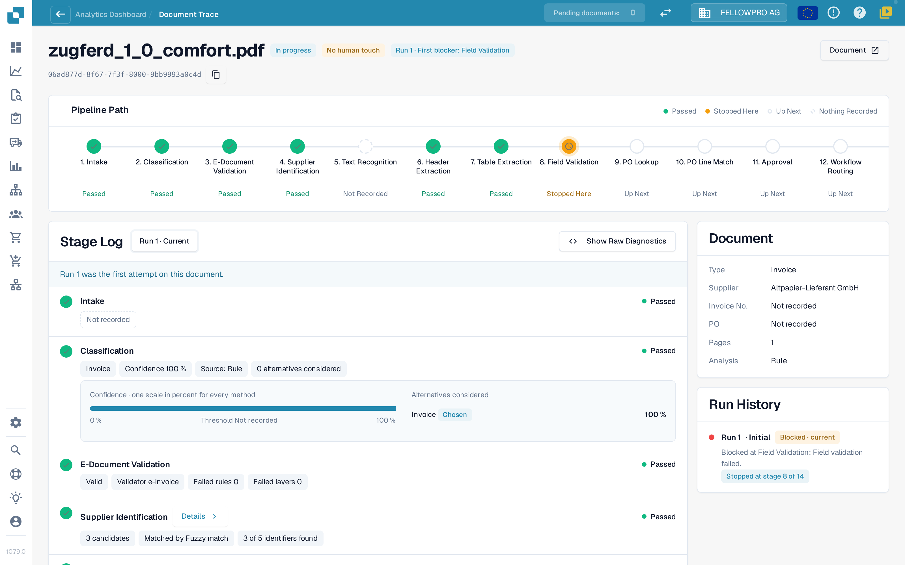
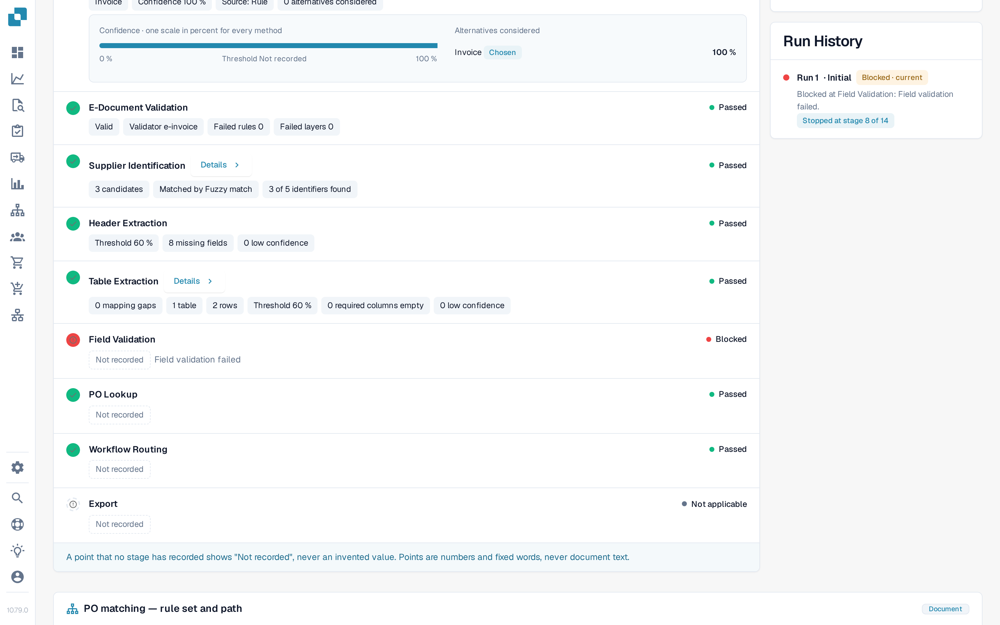

# Document Trace

Enter a document ID in **Document ID**, or open a sample document from a cluster, to see **what happened to this one document**.

The header shows the file, its status (for example **In progress**), the run you are looking at and its first blocker, and a **Document** button with the document ID.

<figure><figcaption>
The Document Trace: the Pipeline Path with every stage, and the Stage Log with the details each stage recorded.
</figcaption></figure>

The **Pipeline Path** shows 14 stages: Intake, Classification, E-Document Validation, Supplier Identification, Text Recognition, Header Extraction, Table Extraction, Field Validation, PO Lookup, PO Line Match, Approval, Workflow Routing, Export, ERP Acknowledgement. Each stage carries one state:

| State | Meaning |
| --- | --- |
| **Passed** (green) | The stage ran fine |
| **Stopped Here** (orange) | The stage blocked the document |
| **Up Next** | The document never got this far |
| **Nothing Recorded** (dashed) | No data was recorded for this stage |
| **Not applicable** | The stage does not apply to this document |

### Stage Log

The **Stage Log** below the path lists the same stages with what each one recorded. A status dot and the status word sit on the left and right of every row.

* Each value is a **point chip**: a number with its unit, for example **Confidence 100 %**, **Threshold 60 %**, **Failed rules 0**, **8 missing fields** or **0 mapping gaps**. Percentages are shown as `97 %`, never as `0.97`.
* **Details** opens the full list of points a stage recorded, including the alternatives it considered.
* The stage that blocked the document says why, for example **Field validation failed**.
* A point that no stage recorded is shown as **Not recorded**, never as an invented value. Points are numbers and fixed words, never document text.
* **Show Raw Diagnostics** switches the raw data on when support asks for it.

<figure><figcaption>
Every stage shows what it recorded; the blocked stage names its cause.
</figcaption></figure>

### Runs and changes

The run selector at the top of the Stage Log (**Run 1 · Current**) switches between the runs of the document. **Run History** on the right lists every run with its outcome and where it stopped. When a document ran more than once, choose a run in the selector to compare it with the current one: the changed points carry a badge with the difference and its unit, for example **−2 fields** or **+3 %**.

The **Document** card next to the Stage Log lists the document type, supplier, invoice number, purchase order, number of pages and whether the analysis is **Rule**-based or AI-written.

**Example.** The documents of one supplier all stop at stage 8. In the trace you see the same missing fields every time. That is not an extraction problem of single documents, it is a missing default in your field configuration: fix it once and the whole cluster is recoverable.

## Related pages

* [Touchless Intelligence](./)
* [Supplier Diagnosis and Issue Clusters](touchless-supplier-diagnosis.md)
* [PO Matching Diagnosis](touchless-po-matching-diagnosis.md)
