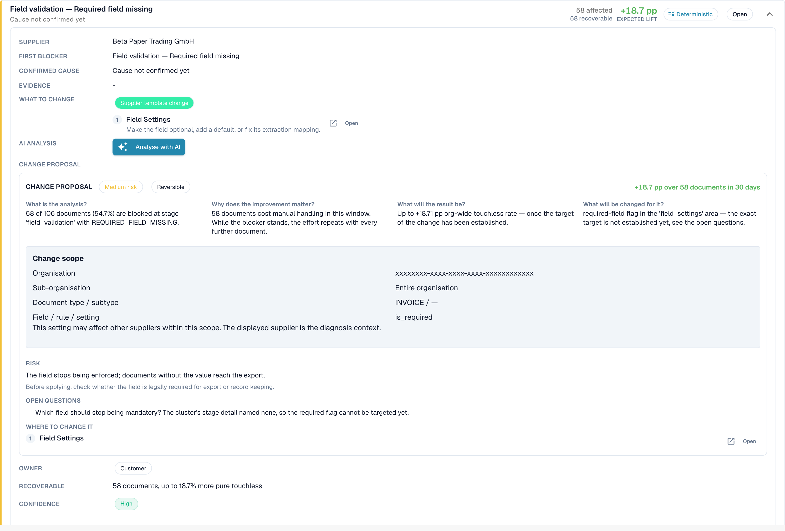

# Supplier Diagnosis and Issue Clusters

Click a supplier in the queue to open its diagnosis page.

<figure><figcaption>
The Supplier Diagnosis page: outcome tiles, trend with period selector and two issue clusters ordered by expected lift. Example organisation with demo data; supplier names are fictional.
</figcaption></figure>

The page shows:

* **Six outcome tiles** (Pure touchless, AP touchless, AP assisted, Process exception, In progress, Not eligible), each linked to the documents.
* **The trend** with its own period selector: 30 days, 90 days, 6 months, 1 year or a custom range (up to two years). This changes the chart only.
* **Issue clusters** (see below).
* **Change history**: the changes you applied for this supplier and what they did.
* **Recent examples**: sample documents, in two tabs: **Needed attention** and **Went touchless**.
* **Diagnose supplier with AI**: analyses all clusters of the supplier (administrators).

A short note explains an empty page, for example: _5 documents from this supplier are still being processed and have no analysis result yet._ or _All 40 completed documents from this supplier ran touchless: there is nothing to diagnose._

### Issue clusters

A **cluster** groups the documents of one supplier that stopped for the **same first reason**. Instead of 40 single problems you see "3 problems".

<figure><figcaption>
An opened cluster card: the first blocker, <strong>What to change</strong>, and a <strong>Change proposal</strong> with risk, scope and open questions. Here the cluster covers 58 documents and is worth +18.7 pp. Example organisation with demo data; supplier names are fictional.
</figcaption></figure>

**Example cluster (illustrative).**

* **Headline**: _Required field missing_ at stage _Field Validation_
* **Affected**: 28 documents. **Recoverable**: 28 documents. **Expected lift**: +2.8 pp
* **Suspected cause**: the supplier prints the PO number below the table, where the extraction does not look
* **What to change**: _Master data change_: add the layout of this supplier. **Open** takes you to the right settings page
* **Owner**: Consultant. **Confidence**: Medium. **Source**: Hypothesis

What a cluster card shows:

| Part                                       | Meaning                                                                                                                                                                                                                                                |
| ------------------------------------------ | ------------------------------------------------------------------------------------------------------------------------------------------------------------------------------------------------------------------------------------------------------ |
| **First blocker** and **stage**            | The reason and the pipeline stage where the documents stop. There are more than 30 reasons, for example _Supplier not identified_, _Purchase order not found_, _Unit price outside PO tolerance_, _Rejected by the ERP_, _E-invoice validation failed_ |
| **Affected / Recoverable / Expected lift** | How many documents, how many can be won back, how many percentage points it would give                                                                                                                                                                 |
| **Suspected cause / Confirmed cause**      | What DocBits thinks (or a person confirmed) is the reason                                                                                                                                                                                              |
| **Evidence** and **Missing evidence**      | What the finding is based on, and what DocBits could **not** establish. Read **Missing evidence** before you trust the rest                                                                                                                            |
| **What to change**                         | Concrete steps with **Open** links to the settings. A chip tells the type: _Configuration change_, _Master data change_, _Supplier template change_, _Process change_, _Supplier action needed_, _Not fixable_                                         |
| **Owner**                                  | DocBits, Customer, Consultant, Supplier or Unassigned                                                                                                                                                                                                  |
| **Sample documents**                       | Real documents of the cluster to look at                                                                                                                                                                                                               |

**Fixable in DocBits** and **Supplier action only** are shown in two groups. For _Supplier action only_ nothing in DocBits changes the result: the supplier has to correct the document and send it again.

### Where does a recommendation come from

Every cause shows its **source**, so you can tell a derived finding from a guess:

| Source                             | Meaning                                                                                                |
| ---------------------------------- | ------------------------------------------------------------------------------------------------------ |
| **Deterministic** / **Rule-based** | A rule derived it from the recorded pipeline evidence. No language model was involved                  |
| **Hypothesis**                     | A language model proposed it from the cluster evidence. Treat it as a lead and check it before you act |
| **Confirmed**                      | A person reviewed the evidence and confirmed the cause                                                 |

AI texts are written in your organisation's language. If a cluster was analysed in another language, use **Analyse in this language**.

## PO matching clusters

If the first blocker of a cluster is a PO matching reason (for example _PO item mismatch_ or _Purchase order not found_), the cluster card shows how DocBits tries to match the invoice to the purchase order. See [PO Matching Diagnosis](touchless-po-matching-diagnosis.md).

## Related pages

* [Touchless Intelligence](./)
* [PO Matching Diagnosis](touchless-po-matching-diagnosis.md)
* [Document Trace](touchless-document-trace.md)
* [Change Proposals and Reports](touchless-change-proposals.md)
