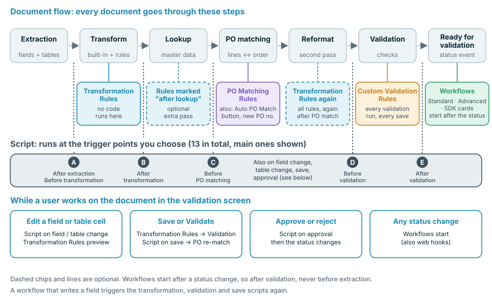
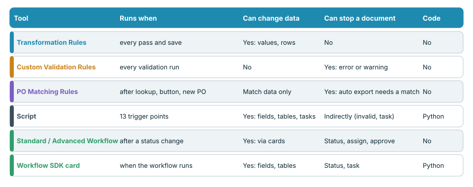
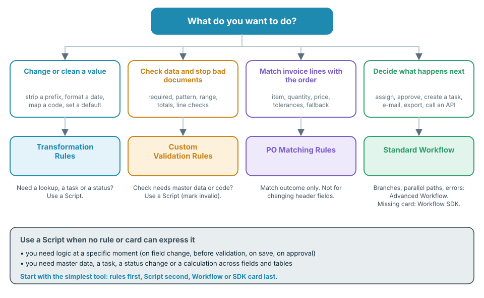

# Choose the Right Automation



The video (five minutes) walks through the same topics in four parts: **0:00** where each tool runs in the document flow, **1:27** code, workflows and the comparison, **2:33** what each tool can and cannot do, **3:33** best practices and common mistakes.

DocBits gives you several ways to change, check and route documents: **Transformation Rules**, **Custom Validation Rules**, **Purchase Order Matching Rules**, **Scripts**, **Standard Workflows**, **Advanced Workflows** and **Workflow SDK cards**. They overlap on purpose. This page tells you which one to pick, **when each one runs in the document flow**, and what it can and cannot do.

## The short answer

| I want to … | Use | Why |
| --- | --- | --- |
| Clean up or rewrite a value (trim, prefix, date format, unit mapping, default) | [Transformation Rules](settings/global-settings/document-types/transformation-rules.md) | No code, live preview, runs on every pass and save |
| Make sure data is complete and plausible, and stop documents that are not | [Custom Validation Rules](settings/global-settings/document-types/custom-validation-rules.md) | Declarative checks, error or warning, blocks auto-export |
| Match invoice lines with purchase order lines | [Purchase Order Matching Rules](settings/global-settings/document-types/more-settings/purchase-order/purchase-order-matching-rules.md) | Rule sets with tolerances, fallbacks and a visual diagram |
| Do something a rule cannot express: a lookup, a calculation across fields and tables, a task, a status change at an exact moment | [Script](settings/global-settings/document-types/script/README.md) | Python at 13 trigger points in the flow |
| Decide **what happens next** with a document: assign, approve, create a task, send an e-mail, export, call an API | [Standard Workflow](workflow/standard-workflow-builder/README.md) | When / And / Then cards on status events |
| Do the same with branches, several conditions and error paths | [Advanced Workflow](workflow/advanced-workflow-builder/README.md) | Visual node graph |
| Need an action that no built-in card offers | [Workflow SDK (Card SDK)](workflow/card-sdk.md) | Your own card, reviewed by DocBits |

**Rule of thumb: use the least powerful tool that does the job.** Rules first, Script second, Workflow or SDK card last. Rules are easier to read, easier to test and cannot break a document; code can do more and therefore needs more care.

## Where each tool runs in the document flow

Every document passes through the same steps. Each tool has its own place in that flow, and that place decides what it can see and what it can still change.

<figure><figcaption></figcaption></figure>

In words:

1. **Extraction** reads header fields and tables from the document. A Script can run **after extraction**.
2. **Transformation** applies the built-in formatting and your **Transformation Rules**. Scripts can run before and after it.
3. **Master data lookup** fills fields such as the supplier. Transformation Rules marked **run after lookup** get an extra pass here.
4. **PO matching** runs only when purchase order matching is active for the document type. **Purchase Order Matching Rules** work here. A Script can run **before PO matching**.
5. **Reformat**: all Transformation Rules run again, so values written by the lookup or the match are formatted as well.
6. **Validation** runs your **Custom Validation Rules**. Scripts can run **before** and **after** validation.
7. The document gets the status **Ready for validation**. This is the first moment a **Workflow** can start. Workflows react to status changes, so they always run **after** validation, never before extraction.

While a person works in the validation screen, more triggers apply: editing a field or a table cell runs Scripts for field and table changes and refreshes the Transformation Rules preview. **Save** and **Validate** run Transformation Rules, validation and save Scripts again, and match the purchase order again when the PO number changed. **Approve** runs approval Scripts before the status changes.


A workflow that writes a field behaves like a person saving the document: Transformation Rules, validation, Custom Validation Rules and save Scripts run again for that write. Plan for that when a workflow and a rule touch the same field.


## Compare the tools

<figure><figcaption></figcaption></figure>

| | Transformation Rules | Custom Validation Rules | PO Matching Rules | Script | Standard Workflow | Advanced Workflow | SDK card |
| --- | --- | --- | --- | --- | --- | --- | --- |
| **Runs when** | Every transform pass and every save | Every validation run | After lookup, **Auto PO Match**, new PO number | 13 trigger points | After a status change | After a status change | When its workflow runs |
| **Can read** | Header fields, table columns | Fields, table cells, totals over rows | Tables, PO numbers, purchase order lines, tolerances | The whole extracted data, lookups, users, groups, full-text search | Document data, users, groups, variables | Same, plus results of earlier nodes | Fields, tables, lookups, users, groups |
| **Can write** | Field and column values, rows, sub-organisation | Nothing: only valid / invalid markers | Match data only | Fields, tables, tasks, status | Fields, status, assignment, tasks, export, e-mail, API call | Same cards, plus logic and variables | Fields, tables, status, tasks |
| **Can stop a document** | No | Yes, errors block auto-export and **Validate** | Yes, without a full match auto-export waits when PO matching is active | Indirectly: mark a field invalid, create a task | Sets status, assigns, approves, rejects | Same | Same as the card type |
| **Needs code** | No | No | No | Yes, restricted Python | No | No | Yes, Python in a sandbox |
| **Typical use** | Normalise values | Required fields, formats, totals | Line matching | Special logic | Routing and approval | Branching routing | Partner actions |

## Decide in four questions

<figure><figcaption></figcaption></figure>

1. **Does a value need to change?** Use **Transformation Rules**. If the change needs master data, a task or a status, use a **Script**.
2. **Does a value need to be checked?** Use **Custom Validation Rules**. They stop a document, but they never change it. If the check needs master data or code, a **Script** can mark the field invalid.
3. **Do invoice lines need to be matched with an order?** Use **Purchase Order Matching Rules**. They only produce match results. To fix a header field before matching, use a Transformation Rule.
4. **Does the next step depend on the document?** Use a **Workflow**. Pick **Advanced** when you need branches, several conditions or error paths. Pick an **SDK card** only when no built-in card does what you need.

## Tool by tool

### Transformation Rules

* **Use them when** a value is correct in substance but wrong in form: prefixes, spaces, date formats, unit codes, default values, a PO number in the wrong field, or tables that must be collapsed to a total line.
* **They run** on the first transform pass, on an optional pass after the master data lookup, again after PO matching, and on every save. The validation screen shows a preview.
* **They can** change header fields, table columns and rows, and the sub-organisation. Each rule can be limited to certain suppliers or conditions.
* **They cannot** stop a document, call other systems, use master data lookups or create tasks. A rule that cannot be applied leaves the value as it is.
* **Read more:** [Transformation Rules](settings/global-settings/document-types/transformation-rules.md)

### Custom Validation Rules

* **Use them when** a document must not go on with wrong data: required fields, patterns, number ranges, allowed values, comparison between two fields, totals that must add up.
* **They run** on every validation: in the pipeline, on every save, and after a workflow wrote data.
* **They can** mark a field or a table cell as an **error** (blocks auto-export and **Validate** unless bypassed) or as a **warning** (visible, does not block).
* **They cannot** change data, look up master data or call services. Fix the data with a Transformation Rule first, then check it.
* **Read more:** [Custom Validation Rules](settings/global-settings/document-types/custom-validation-rules.md)

### Purchase Order Matching Rules

* **Use them when** invoice lines have to be matched with purchase order lines: single, multiple and total matches, tolerances for quantity and price, fallbacks when the first rule does not match.
* **They run** after the master data lookup, when you click **Auto PO Match**, and when the PO number changes on save.
* **They can** produce the match result and the data the approval needs. The diagram view shows which rule applies at which stage.
* **They cannot** rewrite header fields, set a status or run custom logic. Without a full match, auto-export waits when PO matching is active.
* **Read more:** [Purchase Order Matching Rules](settings/global-settings/document-types/more-settings/purchase-order/purchase-order-matching-rules.md)

### Script

* **Use it when** no rule can express the logic: a calculation across fields and tables, a lookup, a task for a user, a status change at an exact moment, or a reaction to an edit in the validation screen.
* **It runs** at the trigger points you choose: after extraction, before and after transformation, before PO matching, before and after validation, on field and table changes, on save and on approval.
* **It can** read the whole document, use master data lookups and full-text search, change fields, flags and tables, create tasks and change the status.
* **It cannot** import modules or call external services. It is restricted Python. An error in a script is logged and never stops the processing of the document, so a script is **not** a reliable way to block a document: mark the field invalid or create a task instead.
* **Read more:** [Script](settings/global-settings/document-types/script/README.md)

### Standard Workflow

* **Use it when** the next step depends on the document: assign to a user or group, approve or reject, create a task, send an e-mail, export, set a status, call an API.
* **It runs** when a document reaches a status you chose, that is after validation. It can also start from a web hook, a schedule or manually.
* **It can** run a chain of cards: **When** (start), **And** (conditions, all must pass), **Then** (actions in order).
* **It cannot** branch, wait for several conditions or react to an error of a card in a separate path. Use an Advanced Workflow for that.
* **Read more:** [Standard Workflow](workflow/standard-workflow-builder/README.md)

### Advanced Workflow

* **Use it when** one document needs different paths: branches by condition, several conditions combined with ALL / ANY, and a path for errors or failed conditions.
* **It runs** on the same events as a Standard Workflow. It needs the DocFlow Advanced subscription.
* **It can** use the same cards as a Standard Workflow, plus logic and variable cards, drawn as a graph.
* **It cannot** do what happens before validation: it starts after a status change. Pre-validation logic belongs in a Script or a rule.
* **Read more:** [Advanced Workflow](workflow/advanced-workflow-builder/README.md)

### Workflow SDK (Card SDK)

* **Use it when** you need a card that does not exist, for example a condition or action specific to a partner application.
* **It runs** whenever a workflow that contains the card runs.
* **It can** read and write fields and tables, save the document, change the status and create tasks.
* **It cannot** open network connections. A run is limited to 60 seconds and 200 SDK calls. A card goes live only after DocBits has reviewed and approved it.
* **Read more:** [Card SDK](workflow/card-sdk.md)

## Best practices

* **Start with the simplest tool.** A Transformation Rule beats a Script for formatting. A Custom Validation Rule beats a Script for a check. Reach for a Script or an SDK card only when a rule or built-in card cannot do it.
* **Fix first, check second, route last.** Transformation Rules and Scripts prepare the data, Custom Validation Rules judge it, Workflows decide what to do with the document. This is the order of the flow.
* **One owner per field.** If a Transformation Rule and a Script both write the same field, the result depends on the order. Give each field one owner.
* **Do not use a workflow to repair data.** Workflows start after validation, so a repair arrives late and triggers a new validation. Repair data in a rule or Script before validation.
* **Validate with a rule, not with a Script.** A Script error never stops a document. A Custom Validation Rule does.
* **Keep scripts small and named by purpose.** One script per job, with the trigger point in the name, is easy to switch off when something looks wrong.
* **Test on dev or sandbox first.** Use a few real documents, check the result in the validation screen, then enable the rule or workflow for production.
* **Check the logs.** The document log and the workflow log show what ran and what changed.

## Common mistakes

| Mistake | Better |
| --- | --- |
| A Script that trims and prefixes values | A Transformation Rule |
| A workflow that sets a field after validation | A Transformation Rule or a Script before validation |
| A Script that is expected to stop an invalid document | A Custom Validation Rule |
| A Custom Validation Rule that is expected to fix a value | A Transformation Rule, then the validation rule |
| Rewriting the PO number in a PO matching rule | A Transformation Rule on the *Purchase Order* field, before the match |
| An Advanced Workflow for a single *When → Then* | A Standard Workflow |
| An SDK card for something a built-in card can do | The built-in card |

## Related pages

* [Transformation Rules](settings/global-settings/document-types/transformation-rules.md)
* [Custom Validation Rules](settings/global-settings/document-types/custom-validation-rules.md)
* [Purchase Order Matching Rules](settings/global-settings/document-types/more-settings/purchase-order/purchase-order-matching-rules.md)
* [Script](settings/global-settings/document-types/script/README.md)
* [Workflow](workflow/README.md)
