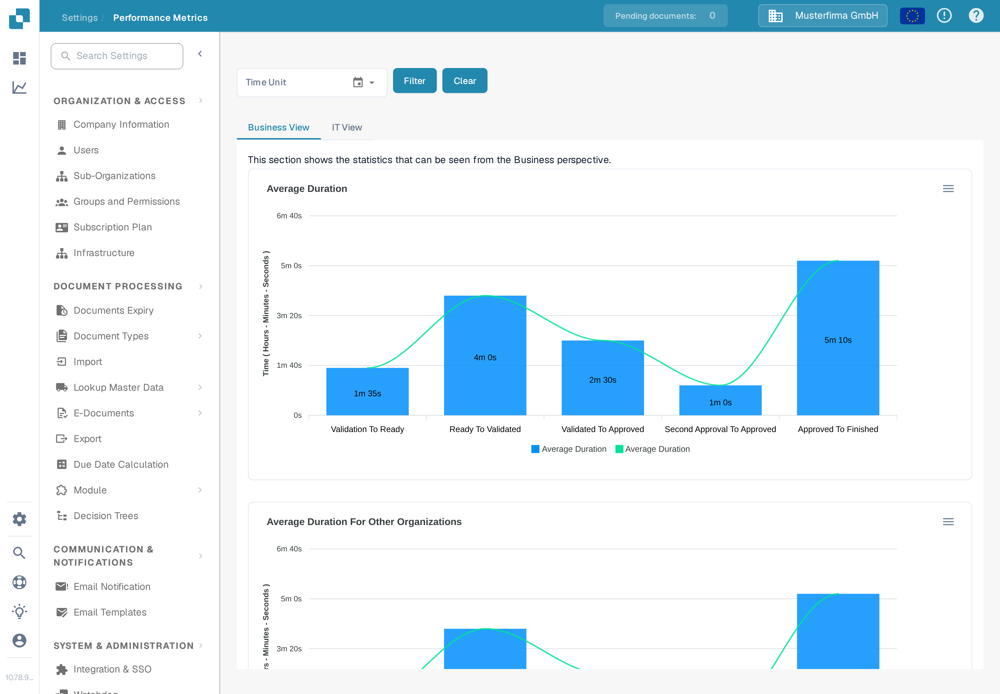
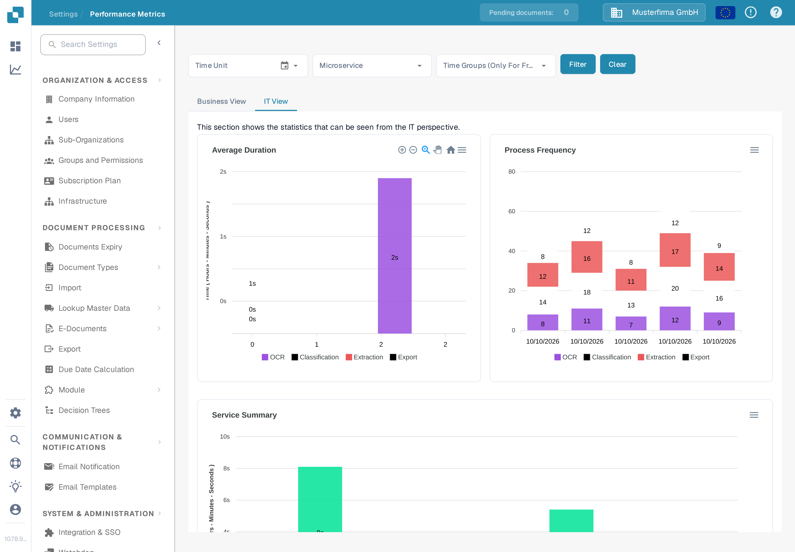

# Performance Metrics

<figure><figcaption>
The Performance Metrics page opens on the Business View tab. The figures shown come from a synthetic example organization and will differ in your organization.
</figcaption></figure>

**Performance Metrics** shows how long documents spend in each processing step and how often each service runs. Use it to answer questions like "Which step is slowest after validation?" or "How has our processing volume changed over the last weeks?"

## How to access

Performance Metrics has no entry in the Settings sidebar. Open it in one of these ways:

1. **Sitemap**: click the magnifier icon at the bottom of the left sidebar, type "Performance" in the search field, and click the **Performance Metrics** entry under **Settings — Advanced**. See [Sitemap](../end-user-and-partner-section/end-user-section/sitemap.md).
2. **Quick Search**: press **Ctrl+K** (or **Cmd+K** on a Mac) anywhere in the app, type "Performance", and open the entry with **Enter**. See [Global Quick Search](../end-user-and-partner-section/end-user-section/global-quick-search.md).
3. Directly via the address `/settings/performance-metrics`. The older address `/performance_report` still opens the same page.

The page requires administrator rights. The figures shown come from a synthetic example organization and will differ in your organization.

## Filters

The filters above the tabs define the period and — on the IT View tab — the services whose numbers you want to see.

| Filter | Description |
|--------|-------------|
| **Time Unit** | Pick the period: **Last 7 Days**, **Last 30 Days**, or **Select Time Range** for a custom period. For a custom period, click the calendar icon, choose the first and last day, then confirm with **Ok**. |
| **Microservice** | Shown on the **IT View** tab only. Pick a single service (for example OCR) to see only its numbers. Leave empty to see all services. |
| **Time Groups (Only For Frequency)** | Shown on the **IT View** tab only. Groups the Process Frequency chart by hour, day, week, or month. |
| **Filter** | Applies the selected filters and redraws the charts. |
| **Clear** | Removes all filters and shows the default view again. |

The charts do not update by themselves when you change a filter — click **Filter** afterwards.

## Business View

The **Business View** tab answers the business question: how long does a document wait at each processing step? It shows three charts:

| Chart | Description |
|-------|-------------|
| **Average Duration** | Average time per step in your organization, from **Validation To Ready** through **Ready To Validated**, **Validated To Approved**, **Second Approval To Approved**, up to **Approved To Finished**. |
| **Average Duration For Other Organizations** | The same steps for other organizations, so you can compare your durations against theirs. |
| **Service Summary** | Shortest (**Minimum**) and longest (**Maximum**) time per step — useful for spotting outliers. |

Times are shown in hours, minutes, and seconds. These are average values — a single document can be faster or slower.

## IT View

<figure><figcaption>
The IT View breaks the same data down by service. Use the Microservice filter to focus on one service.
</figcaption></figure>

The **IT View** tab answers the technical question: which service uses how much time and how often? It shows three charts:

| Chart | Description |
|-------|-------------|
| **Average Duration** | Average processing time per service: **OCR**, **Classification**, **Extraction**, and **Export**. |
| **Process Frequency** | How many documents each service processed in the selected period, grouped by the **Time Groups** setting. |
| **Service Summary** | Shortest (**Minimum**) and longest (**Maximum**) processing time per service — useful for spotting outliers. |

Each chart has a download menu (Download SVG, Download PNG, Download CSV) on its top right, so you can export a chart for a report or a support case.

## Tips

* Start with the **Business View** to see where documents wait the longest; switch to the **IT View** to see which service causes it.
* A long **Validation To Ready** or **Validated To Approved** time usually points to a manual workload (documents waiting for reviewers), while long OCR or Extraction times point to system-side processing.
* If a chart shows no data, widen the **Time Unit** period or click **Clear** and try again.

## Related pages

* [Analytics Dashboard](analytics-dashboard.md) — detailed processing times per document, supplier, and document type.
* [Log Settings](settings/log-settings/README.md) — the underlying event log with filters and export.
* [Report Page](report-page.md) — document counts, changed fields, and export statistics.
