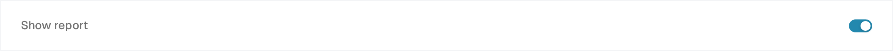
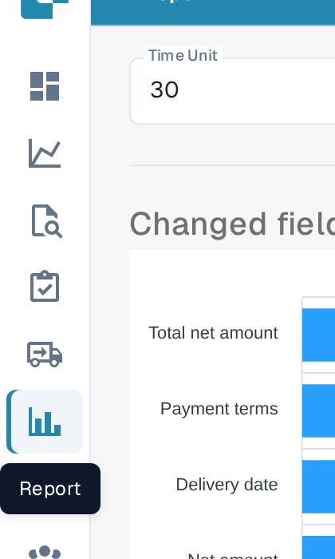
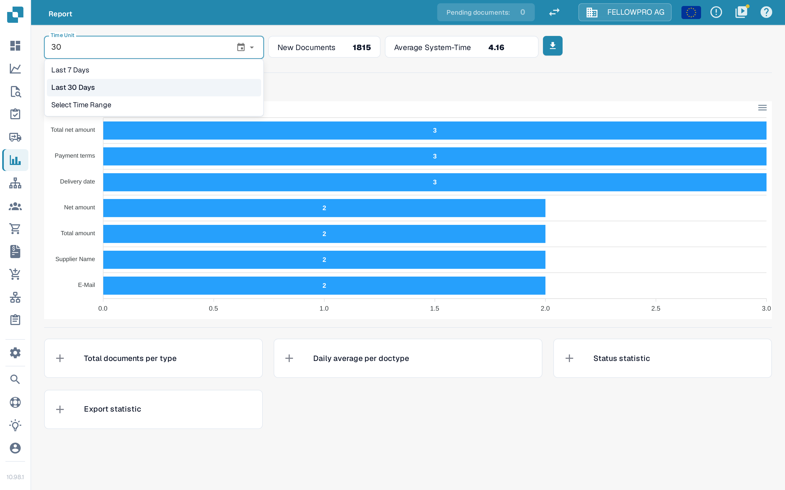
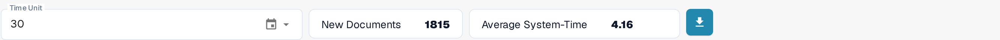
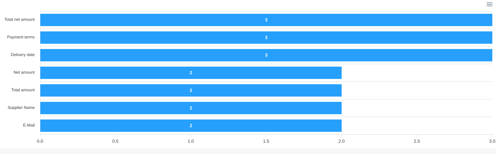
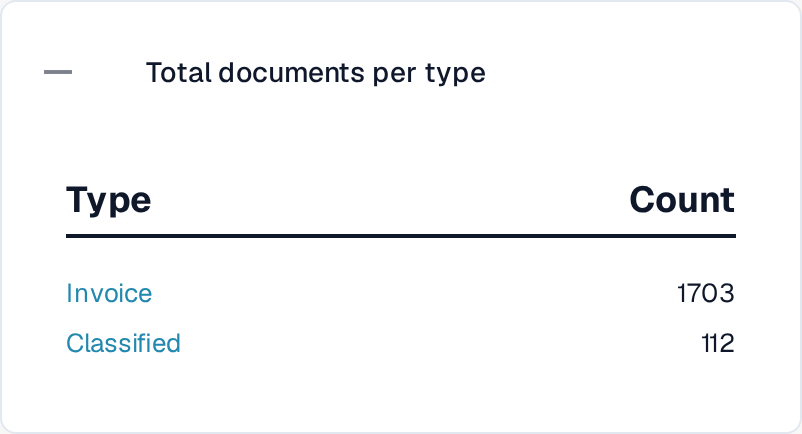
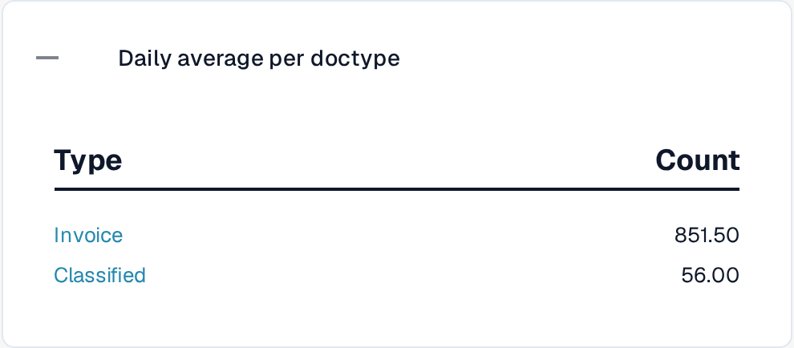
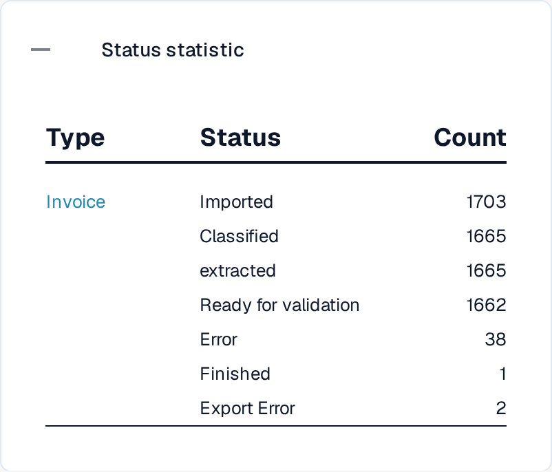
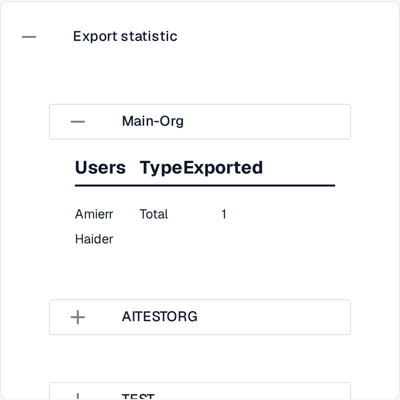

# Report Page

The **Report** page summarises how documents moved through DocBits in a period: how many arrived, how long processing took, which fields people corrected and where the documents ended up. It is meant for administrators and team leads who look at the intake and validation work as a whole, not at a single document.



## Turn the Report page on

The page is a module switch. Turn it on once for the organization:

1. Go to **Settings → Module** and open the **Document Integration** group.
2. In the **Document Type** card, turn on **Show report**.
3. The **Report** entry then appears in the sidebar for the users of the organization.

<figure><figcaption>
The <strong>Show report</strong> switch in the <strong>Document Type</strong> card.
</figcaption></figure>

## Open the Report page

Select the chart icon in the sidebar. The page opens with the time filter, the key figures of the period and the field statistics.

<figure><figcaption>
The <strong>Report</strong> entry in the sidebar.
</figcaption></figure>

## Choose the time frame

The **Time Unit** filter at the top of the page sets the period for every figure and section below it. It offers **Last 7 Days**, **Last 30 Days** and **Select Time Range**, which opens a calendar where you pick a start and an end date.

<figure><figcaption>
The three choices of the <strong>Time Unit</strong> filter.
</figcaption></figure>

## The figures next to the filter

<figure><figcaption>
<strong>Time Unit</strong>, <strong>New Documents</strong>, <strong>Average System-Time</strong> and the download button.
</figcaption></figure>

- **New Documents** shows how many documents were imported in the selected period.
- **Average System-Time** shows the average time in seconds DocBits needed to process a document in that period.
- The download button on the right of the row exports the report as an Excel file (XLSX) for the selected period.

## Changed fields

The **Changed fields** chart counts how often each field was corrected by hand in the selected period, one bar per field, so the fields your team edits most are easy to spot. The question mark next to the heading explains what the chart counts.

<figure><figcaption>
How often each field was changed manually.
</figcaption></figure>

Use the menu in the top right corner of the chart to download the diagram itself as **SVG**, **PNG** or **CSV**.

## Additional report sections

Below the chart are four cards. They are closed by default; select a header to open its table and select it again to close it.

1. **Total documents per type** lists each document type with its **Type** and the number of documents in **Count**. A type that has sub document types carries a **+** to break its number down.
2. **Daily average per doctype** shows the same list as a daily average per document type.
3. **Status statistic** breaks the documents down by processing status, with the columns **Type**, **Status** and **Count**.
4. **Export statistic** first lists the organizations of your account; expand one to see which export formats were used, with the columns **Users**, **Type** and **Exported**.

<figure><figcaption>
<strong>Total documents per type</strong>.
</figcaption></figure>

<figure><figcaption>
<strong>Daily average per doctype</strong>.
</figcaption></figure>

<figure><figcaption>
<strong>Status statistic</strong>.
</figcaption></figure>

<figure><figcaption>
<strong>Export statistic</strong>, broken down by organization.
</figcaption></figure>
