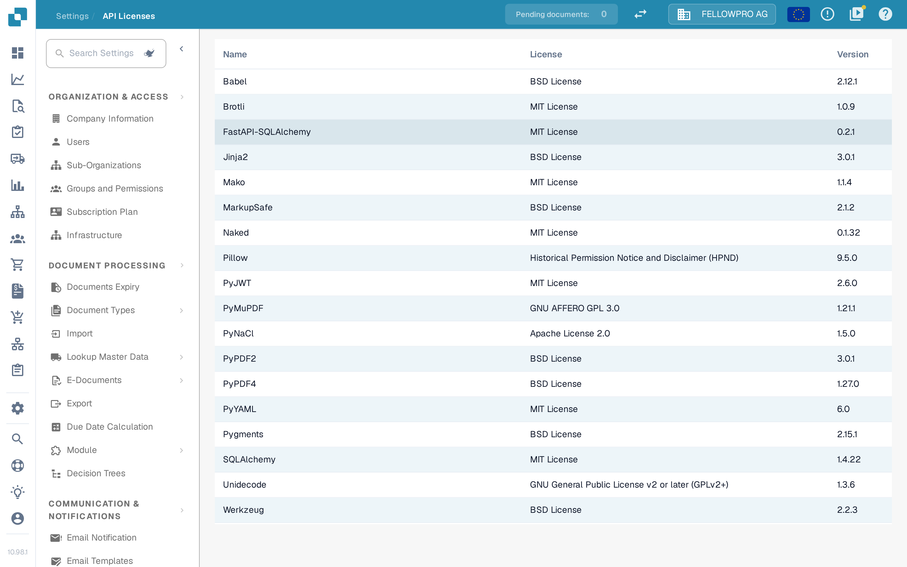

# API Licenses

<figure><figcaption>
The <strong>API Licenses</strong> page in Settings.
</figcaption></figure>

The **API Licenses** page lists all third-party software packages used by DocBits, with the **Name**, the **License** and the **Version** of each package. The page is read-only and is provided for compliance and transparency: use it to check which open-source licenses your DocBits installation uses.

You find it in **Settings** in the **System & Administration** group under **System Licenses**; the page itself is titled **API Licenses**.
