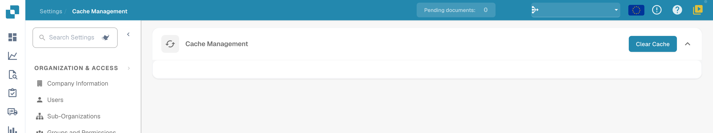

# Cache Management

Open **Settings → Cache Management** to access the current cache-maintenance action.

<figure><figcaption>
Current English Cache Management view with Clear Cache. No per-object TTL controls are shown; no cache was cleared.
</figcaption></figure>

## Clear Cache

Use **Clear Cache** when you intend to invalidate cached data. Data may need to be loaded again afterward. Check the relevant view after the action to confirm the expected result.

The illustrated version provides this global action; it does not show a table of individual cache objects, per-object switches or editable TTL values. No cache was cleared for this illustration.
