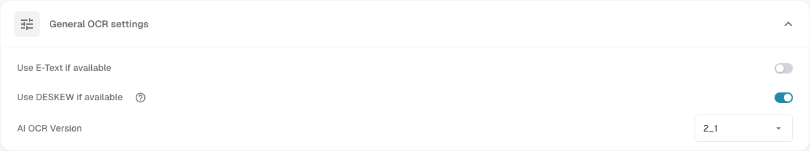

# Document Processing

The **Document Processing** settings control how DocBits reads, enriches and exports documents. Open **Settings** and choose the area you need under **Document Processing**.

* [OCR Settings](ocr-settings.md): how text is read from documents.
* [Master Data Lookup](master-data-lookup.md): how extracted values are looked up against your master data.
* [Due Date Calculation](due-date-calculation.md): how due dates are derived.
* [Export](export/README.md): where and how processed documents are exported.

For example, open **OCR Settings** to review **General OCR settings**. **Use E-Text if available** uses embedded electronic text, **Use DESKEW if available** straightens scanned pages, and **AI OCR Version** selects the recognition engine version. See [OCR Settings](ocr-settings.md#general-ocr-settings) for the detailed controls.

<figure><figcaption>
General OCR settings are one area of Document Processing. The selected values depend on your organisation.
</figcaption></figure>

Further areas in this section include [Import](import/README.md), [Classification And Extraction](classification-and-extraction/README.md), [Rule Manager](rule-manager/README.md), [List Of Values](list-of-values.md) and [Module](module/README.md).

If a setting does not behave as expected, check it with a test document first. A change here can affect every new document of the organisation.
