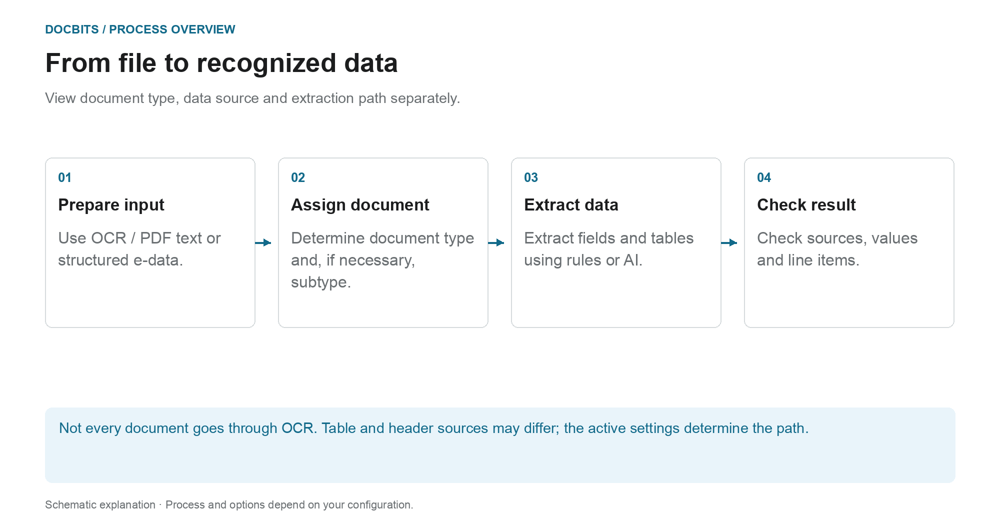
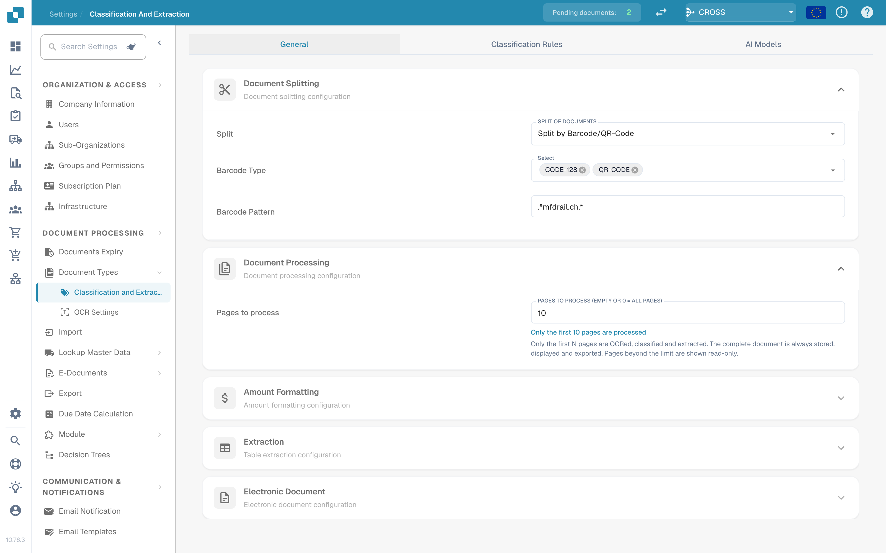
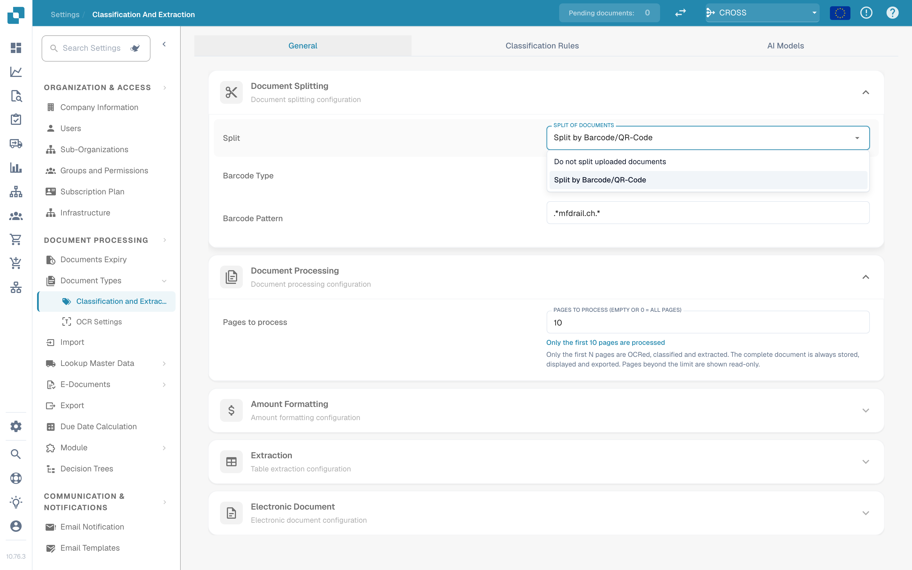
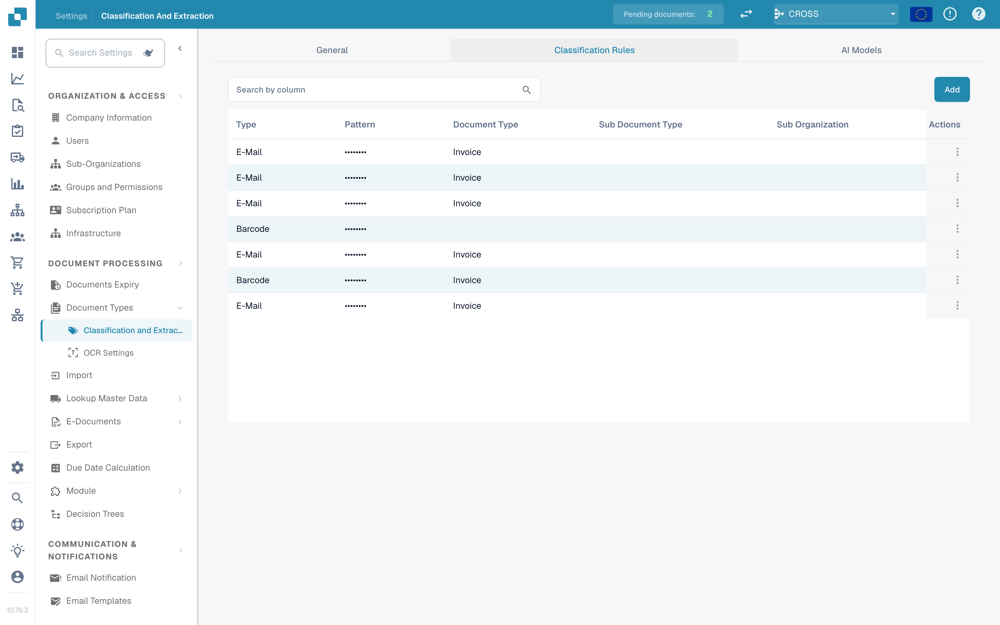
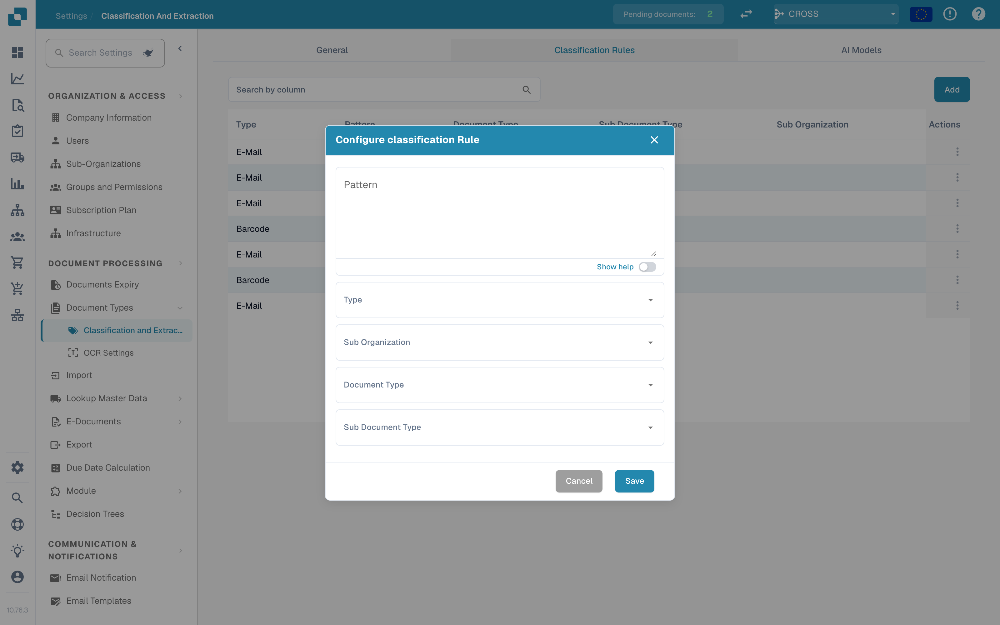
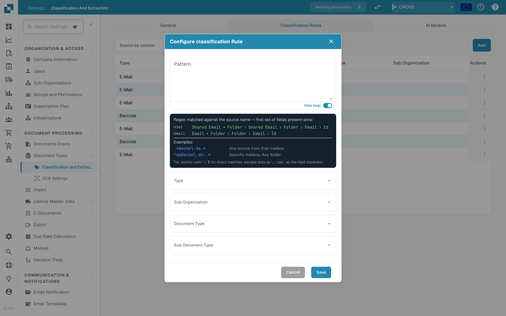
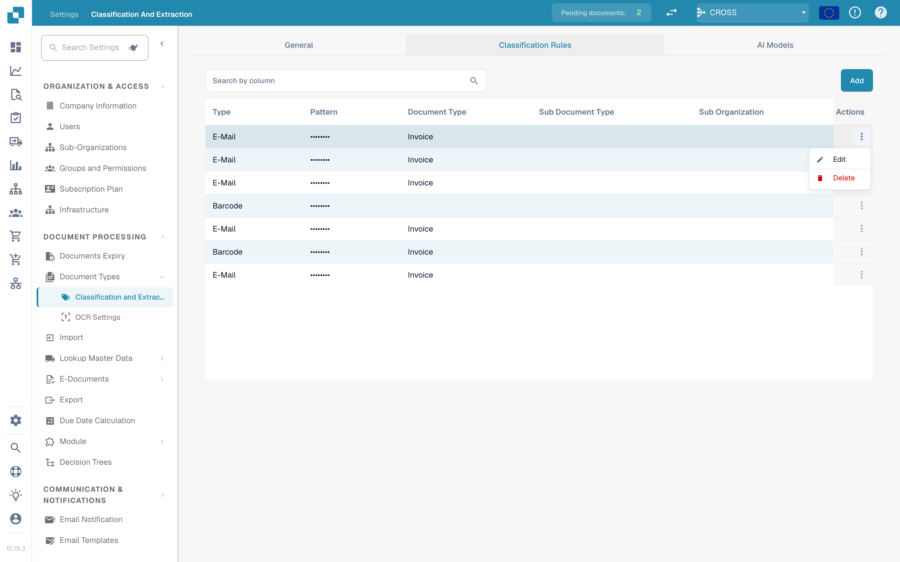
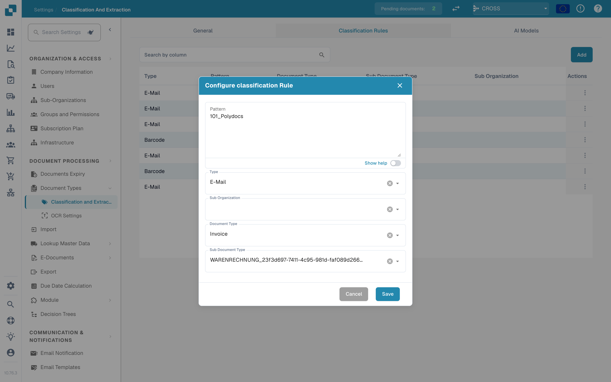
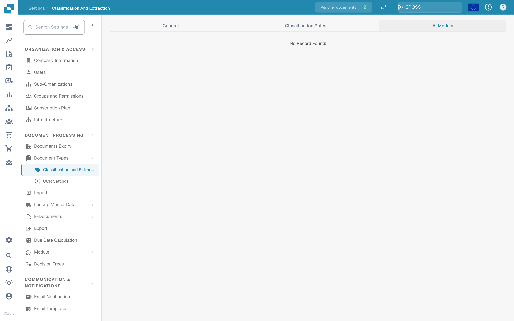

# Classification and Extraction

## Which setting works at which process step?

<figure><figcaption>
View document type, data source and extraction path separately. The diagram is schematic; the active settings of your organization determine the actual behavior.
</figcaption></figure>

Classification answers the question **“What kind of document is this?”**. Extraction answers **“What values ​​does it contain?”**. The settings on this page affect different points of processing and should not be understood as a single AI switch.

1. **Prepare input:** For PDFs, existing text or OCR can be used; supported electronic documents can provide structured values. An activated split can separate an incoming document based on the configured barcode or QR criteria.
2. **Determine document type:** Classification rules and models assign documents to a type and, if necessary, a subtype. This assignment is to be distinguished from the later field and table extraction.
3. **Extract values:** Tables can follow different paths depending on the configuration and applicable saved rules. Header fields have their own source indicators. The selected AI model alone therefore does not explain every row or field value.
4. **Trace the result:** In the validation screen, check which table tab contains the rows and which source indicator a header field has. If a processing step is missing, read the document logs before changing settings.

### Distinguish between rule path and AI path

Appropriate saved table rules can determine the table extraction for the relevant template or supplier. Without suitable rules, the AI ​​path can be used when AI table extraction is activated. Individual columns can have their own AI options. An AI source for a header field does not mean that the entire table comes from the AI.

The [Which extraction path was used?](../../../../overview-and-basics/faq/document-processing/which-extraction-path-was-used.md) diagnostic guide explains tabs, source identifiers and protocols. The page [AI model](ai-model.md) explains the organization standard and template-related overrides.

<figure><figcaption>
Classification and Extraction settings
</figcaption></figure>

## Overview

In the **Classification and Extraction** settings, you can:

* Control how uploaded documents are **split** and how many pages are processed
* Configure **amount formatting** for amount comparison
* Set up **table extraction**, including the AI model used per supplier
* Toggle processing of unsupported **ZUGFeRD** files
* Define **classification rules** that assign a document type automatically
* Review the **AI Models** and their trained labels

The page has three tabs: **General**, **Classification Rules** and **AI Models**. The *AI Models* tab is only shown when the model and label module is enabled for your organization.

| Tab | Contents |
|---|---|
| General | Document Splitting, Document Processing, Amount Formatting, Table Extraction, Electronic Document |
| Classification Rules | Regex rules that classify documents by source name |
| AI Models | Custom-trained models with their labels, document types and priority |

## Accessing Classification and Extraction Settings

Go to **Settings → Document Types → Classification and Extraction**.

## General

The **General** tab groups the settings into collapsible sections. All changes are saved immediately when you change a value; there is no separate save button.

### Document Splitting

**Split** decides whether an uploaded document is split into several documents when a barcode appears on one of its pages. The dropdown offers:

* **Do not split uploaded documents** – the default; the document is processed as one file.
* **Split by Barcode/QR-Code** – the document is split at every detected barcode.

<figure><figcaption>
Split options in the Document Splitting section
</figcaption></figure>

When **Split by Barcode/QR-Code** is selected, two more fields appear:

* **Barcode Type** – one or more barcode types to detect, for example *CODE-128* or *QR-CODE*.
* **Barcode Pattern** – a regex the barcode value must match before the split is triggered. Leave it empty to split on any barcode of the selected types. The pattern is validated before it is stored; an invalid expression is reported immediately.

After a successful split, the parent document is deleted and the pages continue as separate documents that share the same batch.

### Document Processing

**Pages to process** limits how many pages are OCRed, classified and extracted per document.

<figure><figcaption>
Pages to process in the Document Processing section
</figcaption></figure>

* Empty or **0** means all pages are processed.
* A number *N* limits OCR, classification and extraction to the first *N* pages. The complete document is still stored, displayed and exported; pages beyond the limit are shown read-only.

### Amount Formatting

Two switches control how amounts are compared against master data and purchase orders.

<figure><figcaption>
Amount Formatting section
</figcaption></figure>

* **Allow Rounding During Amount Comparison** – when enabled, a tolerance of ±0.5 is allowed. When disabled, ±0.05 applies.
* **Require Exact Match for Amount Comparison** – when enabled, amounts must match exactly, with zero tolerance. When disabled, ±0.05 applies.

Only one of the two switches can be active at a time; enabling one disables the other.

### Table Extraction


**Prerequisites for a working table extraction**

* The document type has **table columns** (Settings → Global Settings → Document Types → [Table Columns](../../global-settings/document-types/table-columns/README.md)). Without columns there is nothing to extract into.
* **Table Extraction** or **AI Table Extraction** is switched on below, for the whole organization.
* The document has readable text: OCR ran, or E-Text is used for born-digital PDFs ([OCR Settings](../ocr-settings.md)).
* Training and AI models are **per supplier**. A trained table applies only to documents of the supplier it was trained on.


You can extract tables from documents by enabling either **Table Extraction** or **AI Table Extraction**. A trained table (whether AI-based or manual) is always linked to a specific supplier.

<figure><figcaption>
Table extraction switches
</figcaption></figure>

**Table Extraction:** Activates rule-based table extraction. Tables are trained per supplier on the validation screen (*Go to table extraction view*).\
Learn more about training [here](../../../setup/document-training/training-line-fields-table-training/defining-tables-and-columns.md).

**AI Table Extraction:** Uses AI to extract the table of any supplier without training. If the results for one supplier are not accurate enough, train that supplier's table; the saved rules then take precedence over the AI for that supplier.

**Use Table Extraction Vision (AI):** The AI reads the page image instead of the text layer. Helps with scanned documents and tables without clear text structure; slower. The dropdown next to the switch chooses how aggressively the page image is used:

* **Off (text only)** – Only the text layer is used. This is the default.
* **Images only** – Only the page image is read.
* **Hybrid (text and images)** – Text layer and page image are combined in the same request.
* **Auto (decided per document)** – DocBits decides per document whether the text layer suffices.

**Use Structured Extraction (AI):** The AI returns the table in a fixed structure that maps directly onto the configured table columns. Recommended when column headers on the documents vary a lot. Clicking the setting opens a preview of exactly which fields and columns the AI will be asked for: header fields and line columns are listed with their source (requested or disabled standard fields), and the expected output mode (e.g. *strict* – no additional columns). Fields that are configured for the document type but switched off are not requested from the AI.

**Table Extraction for Costing Element:** When enabled, DocBits can extract costing elements from tables at the line level and classify them accordingly.\
Detailed explanation available [here](table-extraction-for-costing-element.md).

**Auto Extract Tax Code:** When enabled, the system automatically fills the **Tax Code** field on the Validation Screen, provided that a tax code field is configured.\
More information on this setting [here](auto-extract-tax-code.md).

**Save extraction rules (Admin only):** Only administrators can click *Save Rules* in table training. Switch it on when users keep saving rules that break a supplier's extraction.

**Extract hidden fields:** Fields marked as hidden in the field settings are extracted as well. Use it when a value is needed for a rule or an export but should not be shown on the validation screen.

**AI Model:** Sets the organization model for field and table extraction. The menu offers Full, Fast, Nexus, Nexus Flash, Auto and Auto Nexus. Check availability, quality, runtime and cost with representative documents. A tier is not always the most accurate or fastest for every document. Template overrides can replace the organization setting. The table below the selector shows:

* Which **suppliers** use which AI model
* Whether they use structured extraction (AI) and E-Text
* Options to delete an entry and thereby reset the supplier to the default

This setting is explained in detail [here](ai-model.md).

#### Why does the table look different per supplier?

Table processing depends on saved rules and settings in the relevant supplier or template context:

* **Saved rules** (table training): position of the table and mapping of its columns on that supplier's layout.
* **AI table tags and formatting rules**: hints the user saved for that supplier's AI table.
* **Template-specific AI model:** The selection made on the validation screen is saved per organization and current extraction template. It does not automatically change every template of the same supplier. Without an override, the applicable organization setting is used.

So supplier A with saved rules shows a deterministic table in the *Extracted table* tab of the validation screen, while supplier B without rules gets the *AI Extracted table*. To make supplier B behave like A, train B's table once. To reset a supplier, delete its rules on the validation screen or reset its training data in the AI Model table.

#### Preference keys

Every toggle in this section is stored as an organization preference. Use the key when you set the value through the API (`/preferences/set_preference`), a script, or the DocBits MCP (`get_preference` / `set_preference`).

| Setting (UI label) | Preference key | Values |
|---|---|---|
| Split | `SPLIT_DOCUMENT_ON_BARCODE` | `true` / `false` |
| Barcode Type | `SPLIT_DOCUMENT_BARCODE_TYPE` | list of barcode type names |
| Barcode Pattern | `SPLIT_DOCUMENT_BARCODE_PATTERN` | regex string |
| Pages to process | `RESTRICT_TO_PAGES` | number; empty or `0` = all pages |
| Allow Rounding During Amount Comparison | `AMOUNTS_ROUNDING` | `true` / `false` |
| Require Exact Match for Amount Comparison | `AMOUNTS_NO_ROUNDING` | `true` / `false` |
| Table Extraction | `TABLE_EXTRACTION_SETTING` | `true` / `false` |
| AI Table extraction | `USE_AI_TABLE_EXTRACTION` | `true` / `false` |
| Use Table Extraction Vision (AI) | `TABLE_EXTRACTION_VISION_MODE` | `off` (default), `vision`, `hybrid`, `auto` |
| Use Table Extraction Vision (AI) – legacy switch | `TABLE_EXTRACTION_USE_VISION` | `true` / `false`; effectively means `vision` |
| Use Structured Extraction (AI) | `USE_STRUCTURED_EXTRACTION` | `true` / `false` |
| Table extraction for costing element | `CHARGES_TABLE_EXTRACTION` | `true` / `false` |
| Auto extract tax code | `AUTO_EXTRACT_TAX_CODE` | `true` / `false` |
| Save extraction rules (Admin only) | `ONLY_ADMIN_CAN_SAVE_RULES` | `true` / `false` |
| Extract hidden fields | `EXTRACT_HIDDEN_FIELDS` | `true` / `false` |
| AI Model | `AI_MODEL` | `gpt-6-sol` (Full), `gpt-6-luna` (Fast), `qwen3.8-max` (Nexus), `glm-5.3-flash` (Nexus Flash), `auto` (Auto), `auto-nexus` (Auto Nexus) |
| Table extraction version (confirmation dialog) | `TBL_EXT_VERSION` | version string |
| OCR Settings → Use AI data for tables if available | `USE_AI_DATA_FOR_TABLE` | `true` / `false` |
| OCR Settings → Use E-Text if available | `USE_ETEXT_IF_AVAILABLE` | `true` / `false` |

Notes:

* Boolean preferences are stored as the strings `true` / `false`; a key that was never set counts as `false`. If you send `1` or `0`, DocBits stores `true` / `false`.
* `AI_MODEL` unset means **Fast**.
* `TABLE_EXTRACTION_VISION_MODE` unset is resolved from the legacy `TABLE_EXTRACTION_USE_VISION` switch: `true` resolves to `vision`, anything else to `off`.
* Changing a key takes effect for documents processed afterwards. Restart a document to re-extract it with the new setting.
* Template overrides differ from organization preferences. The AI Model guide explains the exact scope.

### Electronic Document

**Process Unsupported ZUGFeRD PDF:** If enabled, unsupported **ZUGFeRD** versions will be processed as standard PDFs, and the embedded XML will be ignored.

The list of supported **ZUGFeRD** versions can be found [here](../../global-settings/document-types/edi/zugferd/README.md).

## Classification Rules

The **Classification Rules** tab lists the rules that assign a document type automatically during processing. Each rule matches a **regex pattern** against the source name of the document and, on a match, sets the document type and optionally a sub document type.

Switch to the tab by clicking **Classification Rules** at the top of the page.

<figure><figcaption>
Classification Rules tab with the rule table
</figcaption></figure>

The table has one row per rule with these columns:

* **Type** – where the pattern is applied. Two types exist: **Barcode** and **E-Mail**.
* **Pattern** – the regex stored for the rule.
* **Document Type** – the document type assigned when the pattern matches.
* **Sub Document Type** – the sub document type assigned when the pattern matches.
* **Sub Organization** – the sub organization the rule is limited to. Empty means the rule applies to all sub organizations.
* **Actions** – the row menu with *Edit* and *Delete*.

The search field above the table filters all columns, including the display labels of the dropdown columns.

### Add a New Classification Rule

1.  Click **Add** above the table.

    <figure><figcaption>
Configure classification Rule dialog
</figcaption></figure>
2. Fill in the fields:
   * **Pattern** (required) – the regex the rule looks for.
   * **Type** (required) – **Barcode** or **E-Mail**. This decides which source name the pattern is matched against.
   * **Sub Organization** *(optional)* – limits the rule to one sub organization.
   * **Document Type** – the document type assigned when the pattern matches.
   * **Sub Document Type** *(optional)* – a more specific type; the list depends on the selected document type. Changing the document type clears the sub document type.
3.  Click **Save**.

The dialog validates the pattern before saving. A pattern that is already used by another rule is rejected with *Pattern already exists*; an empty pattern is rejected with the required-field message.

#### Pattern help

The **Show help** switch below the pattern field opens an inline reference with the source-name formats the pattern is matched against:

* **O365** – `Shared Email + Folder › Shared Email › Folder › Email › Id`
* **Gmail** – `Email + Folder › Folder › Email › Id`

<figure><figcaption>
Pattern help panel inside the rule dialog
</figcaption></figure>

Examples given in the panel:

* `.*@acme\.de.*` – any source from that mailbox
* `^ap@acme\.de:.*` – a specific mailbox, any folder

Tip: anchor with `^` / `$` for exact matches, escape dots as `\.`, and use `:` as the field separator. The first set of fields present in the source name wins.

If you use the **E-Mail** type, the pattern is matched against the mailbox and folder names of the imported mail, not against the document content.

### Edit a Classification Rule

1.  Click the three dots in the **Actions** column of the rule you want to change.

    <figure><figcaption>
Row menu with Edit and Delete
</figcaption></figure>
2.  Select **Edit**. The dialog opens with the rule's current values.

    <figure><figcaption>
Editing an existing classification rule
</figcaption></figure>
3. Make your changes to the pattern, type, sub organization, document type or sub document type.
4.  Click **Save**.

The same validation applies as when adding a rule: the pattern must not be empty and must not duplicate another rule's pattern.

### Delete a Classification Rule

1. Click the three dots in the **Actions** column.
2. Select **Delete**.

The rule is removed from the list immediately. Deleting a rule does not change documents that were already classified with it.

## AI Models

The **AI Models** tab shows the custom-trained models available for document classification and their labels. It only appears when the model and label module is enabled for your organization.

<figure><figcaption>
AI Models tab
</figcaption></figure>

If no custom model is available for the organization, the tab shows *No Record Found!*.

### Models

Each model is an expandable entry with:

* The **model name** and a badge **Default** on the model that is used when nothing else applies.
* The number of **labels** trained for that model.
* Per model, once expanded: **Type**, **First page only** and **Version**.

Below that information, the labels of the model are listed.

### Labels

Labels are what the model learns. Each label maps a pattern the model recognises to a document type.

* **Name** – the label's name.
* **Next model** – a model that continues processing the output of this label.
* **DOC TYPE** – the document type assigned by the label.
* **Sub Document Type** – a more specific type for the label.
* **Priority** – the order in which the labels are evaluated; lower numbers first.

The search field above the label table filters the labels of the selected model.

### Editing a label

Click the pen icon on a label row to open the edit dialog. It offers **Next model** and **Document Type**; set one of them, since the dialog requires either a next model or a document type. Click **Save** to apply the change.

## Related pages

* [AI Model](ai-model.md) – the six extraction tiers and how a supplier gets its own model
* [Auto Extract Tax Code](auto-extract-tax-code.md)
* [Table Extraction for Costing Element](table-extraction-for-costing-element.md)
* [OCR Settings](../ocr-settings.md)
