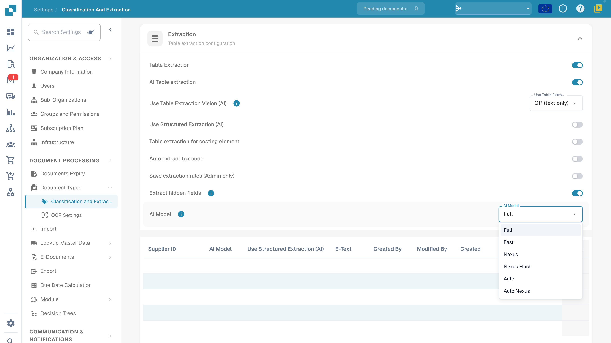
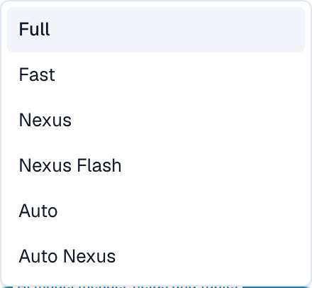

# AI Model

## Overview

The **AI Model** setting allows you to define which AI model is used by default for **field extraction** and **table extraction** during document processing.\
Use the current model selector and template-preference table to review the organization setting and overrides. For charges, consult the information available in your environment and subscription terms.

## How to Access

1.  Navigate to **Settings** → **Document Types** → **Classification and Extraction** → **General**

    <figure><figcaption>
Current English Extraction settings and AI Model menu: Full, Fast, Nexus, Nexus Flash, Auto and Auto Nexus. Private table values are hidden; no model selected or preferences deleted.
</figcaption></figure>
2.  Expand **Extraction** and locate the **AI Model** setting.

## AI Model Options

The current menu offers **Full**, **Fast**, **Nexus**, **Nexus Flash**, **Auto** and **Auto Nexus**. These are product tier names. Available options, underlying models and token charges can change; check the information shown in your current environment and your subscription terms rather than relying on a historical provider-model name or fixed price.

<figure><figcaption>
Detail of the six extraction tiers in the current English Dev menu. Opening and closing the menu left the existing selection unchanged.
</figcaption></figure>

| Option | What to verify with representative documents |
| --- | --- |
| **Full** | Extraction results for complex layouts, processing time and cost. |
| **Fast** | Results and processing time for everyday documents; the name is not a guarantee for every document. |
| **Nexus** | Compare this alternative option with the same document sample. |
| **Nexus Flash** | Check both quality and latency on your actual layouts. |
| **Auto** | Check the results and charges of automatic selection. |
| **Auto Nexus** | Check the results and charges of the Nexus automatic-selection option. |

When the current extraction template has no override, its model setting falls back to the organization's configuration. An unset supplier-specific value does not universally mean Fast. Compare a fixed sample before changing models; a model change alone does not guarantee field validation, PO matching, approval or export success.

## AI Model Assignment Table

The **Validation screen** provides a supplier-specific model entry point. Its override is stored for the organization and current extraction template (`tfidf_id`); it does not unconditionally update every template or historical document belonging to the same supplier.\
\
For more information, please refer to the corresponding documentation [here](../../../../end-user-and-partner-section/end-user-section/validation-screen/supplier-specific-ai-model-for-field-and-table-extraction.md).

The assignment table summarizes template-related extraction preferences. Columns vary by product version; use the current headers to inspect supplier association, model, extraction options and audit information:

* **Supplier ID** – The unique identifier of the supplier
* **AI Model** – The tier configured for this template entry
* **Use Structured Extraction (AI)**, where present – The structured-extraction preference for this entry
* **E-Text** – Indicates whether the E-Text feature is enabled
* **Created By / Modified By / Created On / Modified On** – Who set the entry and when
* **Action** – Contains the option to delete the entry

### Delete Entry – Remove Template Overrides

Before an administrator deletes an entry, identify its extraction template and all preferences it contains. Deletion can remove several template overrides, not only the model setting:

1.  Click the three dots in the **Action** column next to the supplier entry and select **Delete**.

2.  A confirmation dialog will appear—confirm that you want to delete the entry.

After deletion, subsequent processing reads the applicable organization configuration and fallback values for this template. Other templates associated with the same supplier may retain independent overrides. Deletion does not automatically reprocess historical documents. No deletion or resulting extraction was performed for this guide.
