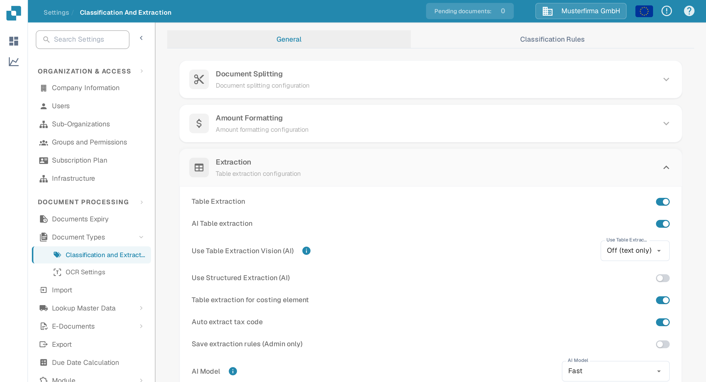
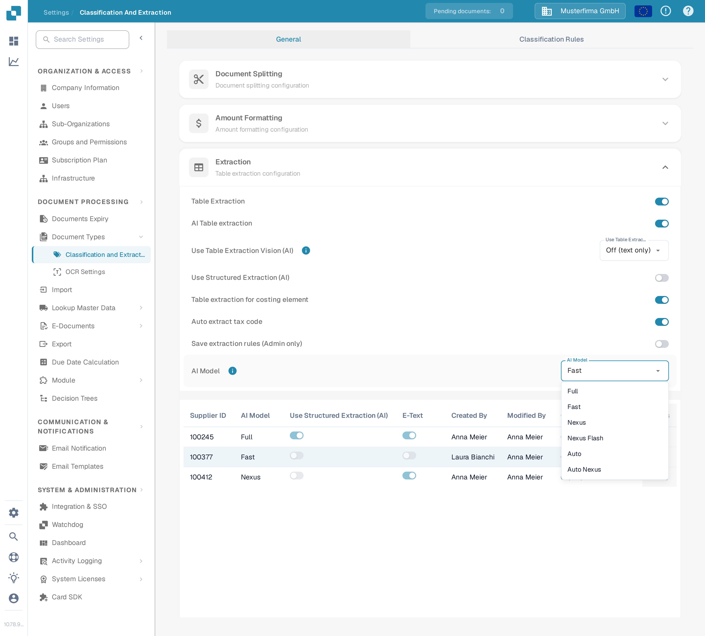
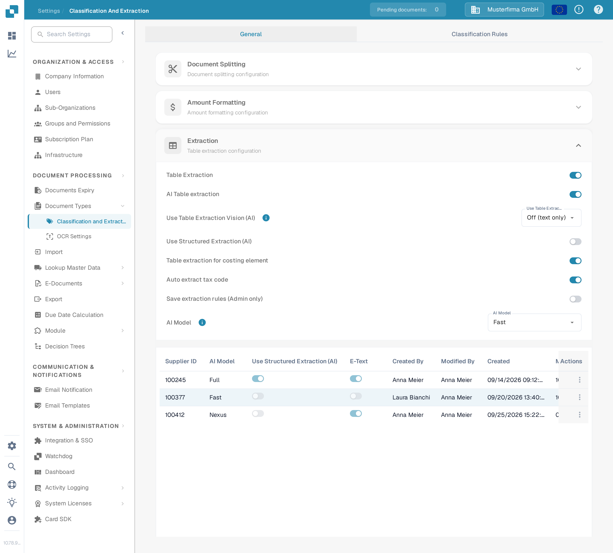
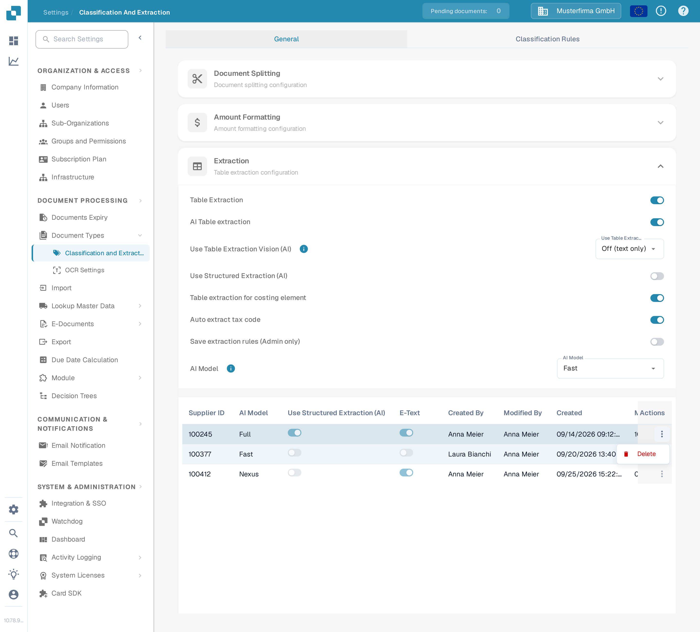

# AI Model

## Overview

The **AI Model** setting allows you to define which AI model is used by default for **field extraction** and **table extraction** during document processing.\
In this section, you can review the token cost for each model and see which model is currently assigned to each supplier.

## How to Access

1.  Navigate to **Settings** → **Document Processing** → **Classification and Extraction**

    <figure><figcaption>
Open <strong>Settings → Document Processing → Classification and Extraction</strong>.
</figcaption></figure>
2.  Scroll down to the **Table Extraction** section

    <figure><figcaption>
The <strong>Extraction</strong> section contains the <strong>AI Model</strong> setting and the supplier assignment table.
</figcaption></figure>

## AI Model Options

DocBits offers six AI model options for field and table extraction. They differ in the balance between **extraction accuracy**, **processing speed**, and **token cost per document** — so you can match the option to the kind of documents you process. Hover over the info icon next to the setting to see the token cost for the currently selected option. If no model is set for a supplier, unset means Fast is used.

* **Full** – The most thorough option, with the highest extraction accuracy. Best for complex layouts, low-quality scans, or documents where precision matters most. As the most powerful option it is also the slowest, at **2 tokens per document**.
* **Fast** – A balanced option that combines strong accuracy with quicker processing at a lower cost. This is the default tier: suppliers without their own AI model setting use Fast, at **1 token per document**.
* **Nexus** – An opt-in option that runs on a different model family (Qwen 3.8 Max). Useful when you want a second opinion for suppliers where Fast and Full disagree, or when the alternative model reads a particular layout better, at **1 token per document**.
* **Nexus Flash** – A faster tier of the Nexus family (GLM-5.3 Flash). It processes documents more quickly than Nexus at the same token cost, at **1 token per document**.
* **Auto** – Not a model of its own: per document, DocBits decides whether Fast suffices or Full is needed, so complex documents get the stronger model automatically, at **1 token per document**.
* **Auto Nexus** – Like Auto, but restricted to the Nexus model family (Nexus Flash and Nexus). Documents stay off the standard model family entirely, at **1 token per document**.

| Option | Best for | Accuracy | Speed | Token cost |
|--------|----------|----------|-------|------------|
| **Full** | Complex layouts, poor scans, high-precision needs | Highest | Slowest | 2 / document |
| **Fast** | Everyday documents (default when nothing is set) | High | Fast | 1 / document |
| **Nexus** | Suppliers where the alternative model family performs better (opt-in) | High | Fast | 1 / document |
| **Nexus Flash** | Nexus quality with faster processing | High | Faster | 1 / document |
| **Auto** | Mixed document quality without manual tuning | Per document | Per document | 1 / document |
| **Auto Nexus** | Auto decisions limited to the Nexus family | Per document | Per document | 1 / document |

<figure><figcaption>
The <strong>AI Model</strong> dropdown with the six available options.
</figcaption></figure>

## AI Model Assignment Table

You can also configure supplier-specific **AI models** directly in the **Validation screen**, allowing you to fine-tune extraction accuracy for individual suppliers.\
\
For more information, please refer to the corresponding documentation [here](../../../../end-user-and-partner-section/end-user-section/validation-screen/supplier-specific-ai-model-for-field-and-table-extraction.md).

The assignment table displays the AI model settings for each supplier and includes the following details:

* **Supplier ID** – The unique identifier of the supplier
* **AI Model** – The AI model tier currently assigned to the supplier
* **Use Structured Extraction (AI)** – Whether structured extraction is enabled for that supplier
* **E-Text** – Indicates whether the E-Text feature is enabled
* **Created By / Modified By / Created On / Modified On** – Who set the entry and when
* **Action** – Contains the option to delete the entry

<figure><figcaption>
The assignment table shows the tier label per supplier, never the raw model ID.
</figcaption></figure>

### Delete Entry – Reset Supplier-Specific Settings

To reset a supplier's AI model setting to the default:

1.  Click the three dots in the **Action** column next to the supplier entry and select **Delete**.

    <figure><figcaption>
Open the row action menu and choose <strong>Delete</strong>.
</figcaption></figure>
2.  A confirmation dialog will appear—confirm that you want to delete the entry.

    <figure><figcaption>
Confirm the deletion in the dialog.
</figcaption></figure>

Once deleted, the supplier will revert to using the default **AI model** for **field extraction** and **table extraction**.
