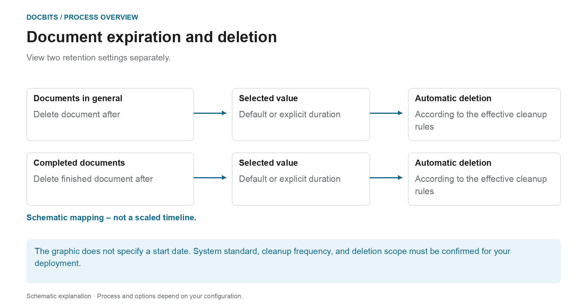
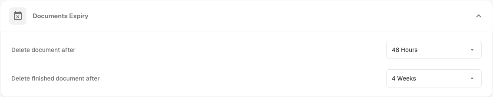

# Documents Expiry

## Two retention rules instead of a general deletion period

<figure><figcaption>
View two retention settings separately. The diagram is schematic; the active settings of your organization determine the actual behavior.
</figcaption></figure>

Document expiration distinguishes general document retention from completed document retention. Check both settings together with the requirements of your process and the intended target archive.

| Setting | What you should clarify |
| --- | --- |
| **Delete document after** | Which document retention value is actually effective in your organization. |
| **Delete finished document after** | Which value applies to completed, fully processed and exported documents. |
| **Default** | Which system standard is stored in your deployment. The name alone does not indicate duration. |

The diagram is **not a timeline drawn to scale**. It specifies neither the technical start of the retention period nor which setting takes precedence. A dropdown value alone does not establish a deletion time accurate to the second. For reliable planning, also confirm how often cleanup runs.

### Separate export, retention and backups

A successful export does not prove that the DocBits copy has already been deleted. Conversely, deleting a document in DocBits does not remove an independently stored ERP or archive copy. Backups may have separate retention rules; deleting a document from the live system does not prove that every backup copy has been removed at the same time.

Check the deadlines before making changes and agree on the target archive and the handling of backups. The [Data storage, retention and deletion](../../../security/data-storage-and-retention.md) overview explains the differences between documents, OCR intermediate files, logs and backups.

<figure><figcaption>
Documents Expiry settings
</figcaption></figure>

Under Document Processing → Documents Expiry, configure document retention. Check the effective settings, the target archive and the deletion scope for your organization before changing them.

Two settings control the automatic deletion:

| Setting | What it controls |
|---------|------------------|
| **Delete document after** | How long any processed document is kept before it is automatically deleted. |
| **Delete finished document after** | How long a finished (fully processed and exported) document is kept before it is automatically deleted. |

For each setting you choose a time frame from the dropdown:

<figure><figcaption>
Available retention periods
</figcaption></figure>

| Option | Meaning |
|--------|---------|
| **Default** | Use the system default retention period (no custom override). |
| **48 Hours** | Explicit retention value of 48 hours; confirm the start of the period and cleanup schedule separately. |
| **1 Week** | Explicit retention value of one week. |
| **2 Weeks** | Explicit retention value of two weeks. |
| **4 Weeks** | Explicit retention value of four weeks. |

These settings support planned document retention. They do not replace confirming the effective retention periods, target archive and treatment of backups for your organization.
