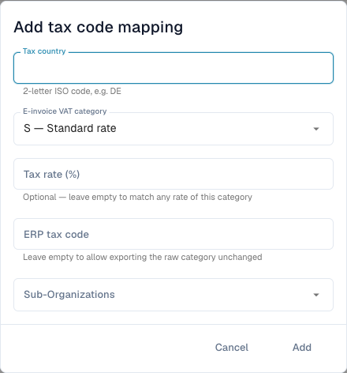

# Map e-invoice VAT categories to ERP tax codes

Electronic invoices can carry a VAT category such as **S** rather than the ERP's tax code. **eDoc Tax Code Mapping** defines the intended conversion. It is separate from editing tax amounts or e-invoice validation rules.

<figure><figcaption>
The tax-code mapping form before any entry is saved.
</figcaption></figure>

## Before you start

You need administrative access, invoice tax country/category/rate and a valid ERP code agreed with your ERP administrator. Confirm organization and sub-organization. The page must be available in your deployed release.

## Add and check a mapping

1. Open **Settings → E-Documents → Tax Code Mapping** and review existing entries.
2. Choose **Add Mapping**.
3. Enter the **Tax country** as a two-letter ISO code, for example `DE`.
4. Select **E-invoice VAT category**. Examples: **S — Standard rate**, **Z — Zero rated**, **E — Exempt from tax**, **O — Outside scope of tax**. These have different meanings; do not interchange them to bypass an error.
5. Enter **Tax rate (%)** for a specific rate. Empty matches any rate in that category, as indicated by the form.
6. Enter **ERP tax code** and select the relevant **Sub-Organizations** where applicable. An empty ERP code explicitly permits the raw category to be exported unchanged; use it only if the destination accepts that category.
7. Choose **Add**. Check the stored country, category, rate, ERP code, scope and active state.
8. Test a representative e-invoice with a controlled export target. Verify the actual ERP code and response. Also test a missing/wrong mapping to check the failure path.

For example, a German invoice with category `S` and rate `19` needs the ERP code configured for that case. Obtain the actual code from your ERP configuration; a demonstration code is not a production default.

## Resolve an error

For a missing-mapping error, compare actual country, category, rate, scope and active entry. Check the integration response before repeating an export with an uncertain destination result. Removing a mapping changes future matching; it does not undo earlier exports.

See [E-Invoice Validation](validation-rules/README.md) and [Export](../export/README.md).
