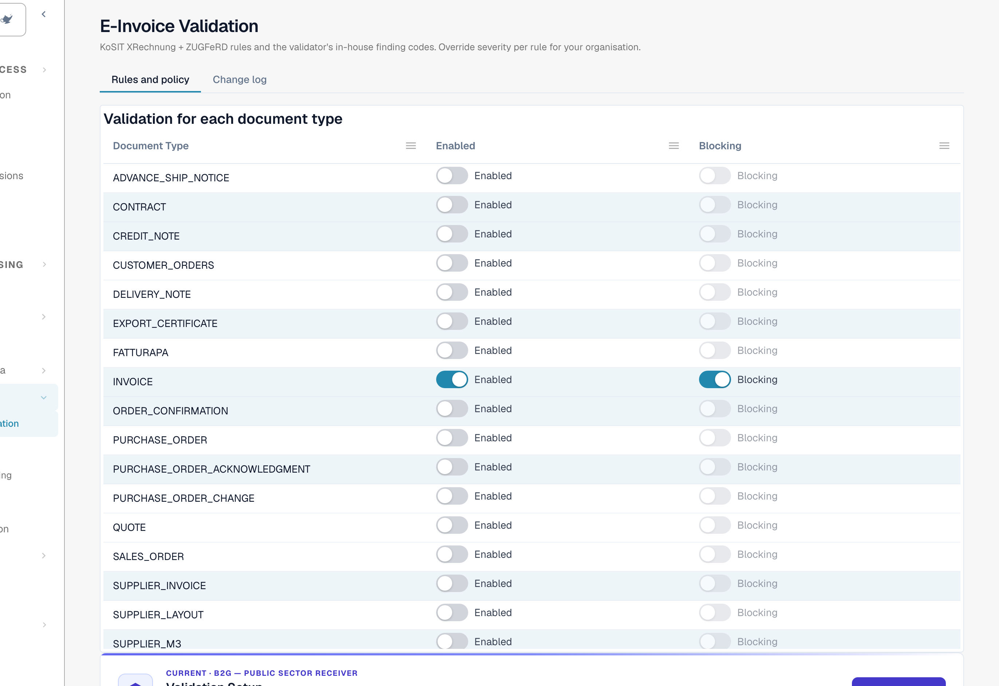
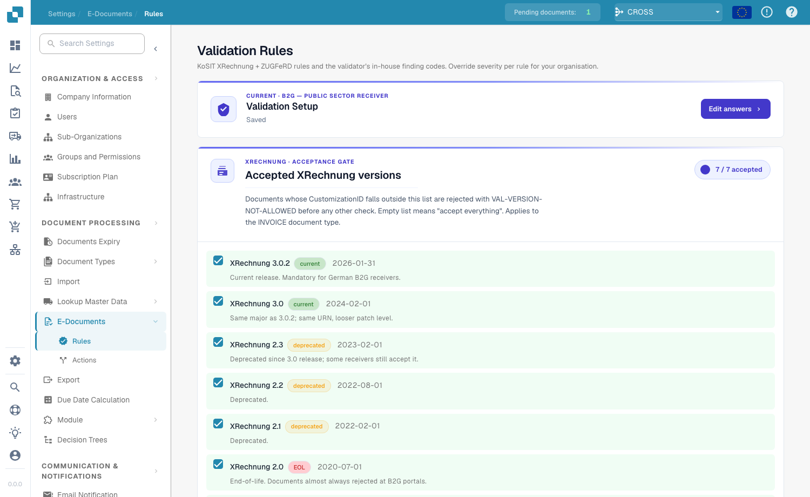
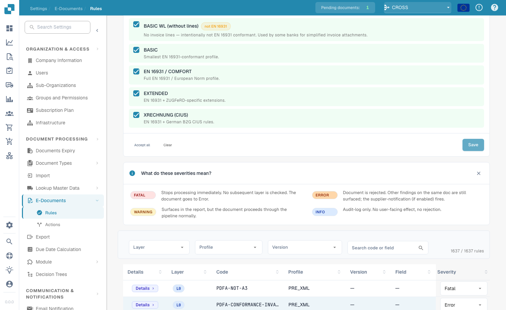
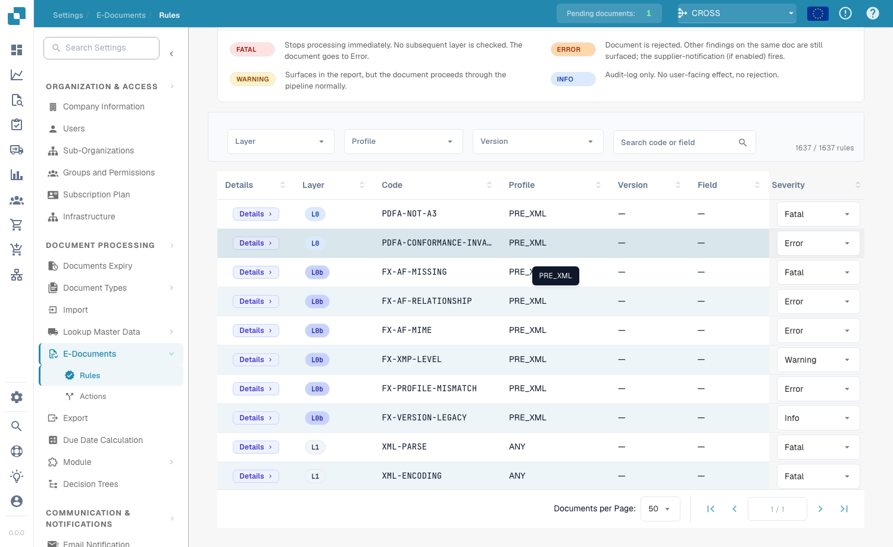

# E-Invoice Validation

The **E-Invoice Validation** page (**Settings → E-Documents → E-Invoice Validation**, path `/settings/einvoice-validation`; earlier called *Validation Rules*) controls how DocBits validates incoming e-invoices. It is based on the official **KoSIT XRechnung + ZUGFeRD** rule set plus the validator's in-house finding codes, and lets you override the severity of each rule for your organization.

> This page is for **e-invoices** (XRechnung, ZUGFeRD, Factur-X). It is not the same as **Data Validation Rules**, which check extracted document fields.

## What is on this page

<figure><figcaption>
The E-Invoice Validation page. The tab <strong>Rules and policy</strong> starts with the table <strong>Validation for each document type</strong>. Example organisation.
</figcaption></figure>

| Part | What it does | Who | Details |
| --- | --- | --- | --- |
| **Validation for each document type** | Turn validation on (**Enabled**) and decide whether a failed check stops the document (**Blocking**) for each document type. Every change needs a confirmation. | Organisation administrators | [Validation for each document type](validation-per-document-type.md) |
| **Change log** (tab) | Lists every change: when, who, which rule, from → to, and the action. | Organisation administrators | [Change log](validation-per-document-type.md#change-log) |
| **Validation Setup** and **Accepted versions and profiles** | The setup wizard, the accepted XRechnung versions and ZUGFeRD / Factur-X profiles. See the sections below. | Organisation administrators | This page |
| **Rule table** | The severity of each rule for your organisation. See the section below. | Organisation administrators | This page |
| **Validation report** | What a user sees when an invoice fails: the findings in plain language, the next step, downloads and **Reject document**. It opens from the document, not from this page. | Everyone who processes invoices | [Validation report](validation-report.md) |

<figure><figcaption>
The <a href="validation-report.md">validation report</a> of a document. Example invoice with fictional names.
</figcaption></figure>

Organisation administrators see all parts. Other users see the table read-only, or do not see it.

## Validation Setup

<figure><figcaption>
Validation setup and accepted XRechnung versions
</figcaption></figure>

The **Validation Setup** card shows your current validation profile (for example *B2G — Public Sector Receiver*). Click **Edit answers** to re-run the setup wizard and change which standard you validate against.

## Accepted XRechnung versions

The **Accepted XRechnung versions** gate lists every XRechnung version. Tick the versions you accept — documents whose CustomizationID falls outside this list are rejected with `VAL-VERSION-NOT-ALLOWED` before any other check. An empty list means "accept everything". Each version is tagged **current**, **deprecated** or **EOL** together with its release date.

## Accepted profiles and severity model

<figure><figcaption>
Accepted profiles and what each severity means
</figcaption></figure>

Choose which **profiles** you accept (BASIC WL, BASIC, EN 16931 / COMFORT, EXTENDED, XRECHNUNG (CIUS)) using **Accept all** / **Clear**, then **Save**.

Each validation rule has a **severity** that decides what happens when it fires:

| Severity | Effect |
|----------|--------|
| **FATAL** | Stops processing immediately. No subsequent layer is checked; the document goes to Error. |
| **ERROR** | The document is rejected. Other findings on the same document are still surfaced; the supplier notification (if enabled) fires. |
| **WARNING** | Surfaces in the validation report, but the document proceeds through the pipeline normally. |
| **INFO** | Audit-log only. No user-facing effect and no rejection. |

## Overriding rule severities

<figure><figcaption>
The full rule table with per-rule severity override
</figcaption></figure>

The rule table lists every validation rule (over 1,600 in total). Filter by **Layer**, **Profile** or **Version**, or search by code or field. For each rule you can override the **Severity** from the dropdown to match your organization's policy — for example, downgrading a rule from `ERROR` to `WARNING` so it no longer rejects the document.
