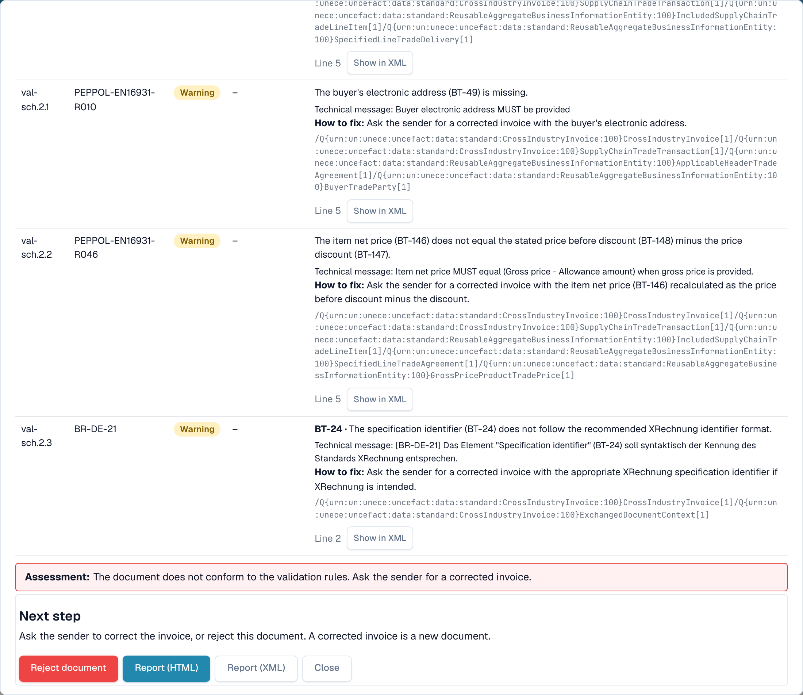

# Next step and reject a document

After you read the [validation report](validation-report.md), the report tells you what to do. You can also reject the document.

## What to do next

<figure><figcaption>
The assessment, the next step and the buttons at the end of the report
</figcaption></figure>

The **Assessment** says in one sentence whether the invoice conforms. The block **Next step** tells you what to do:

| Result                 | Next step                                                                                              |
| ---------------------- | ------------------------------------------------------------------------------------------------------ |
| At least one **error** | Ask the sender for a corrected invoice, or reject the document. A corrected invoice is a new document. |
| Only **warnings**      | You can continue with the document.                                                                    |

The buttons at the end of the report:

* **Reject document**: opens the reject dialog (see below).
* **Report (HTML)** and **Report (XML)**: download the report, for example to send it to the supplier.
* **Close** (or **Back to document**): return to the document.

## Reject a document

<figure><figcaption>
The reason is filled from the errors in the report. You can edit it.
</figcaption></figure>

1. In the report, select **Reject document**.
2. Check the **Reason**. DocBits fills it from the errors in the report. You can edit the text.
3. Select **Reject document** to confirm. The status changes to **Rejected**. The reason is saved as a note, and the report stays with the document.

Select **Cancel** to keep the document as it is.

> Only users who are allowed to edit documents see **Reject document**. The button is hidden when the document is already rejected or completed.
