# Export

<figure>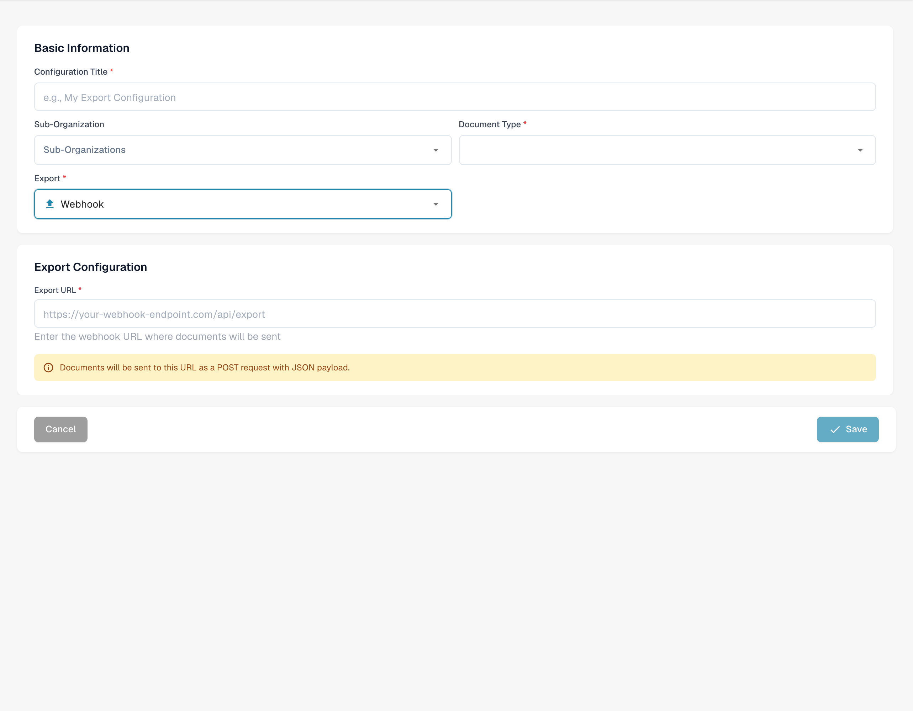<figcaption>
Unsaved Webhook export configuration.
</figcaption></figure>

<figure>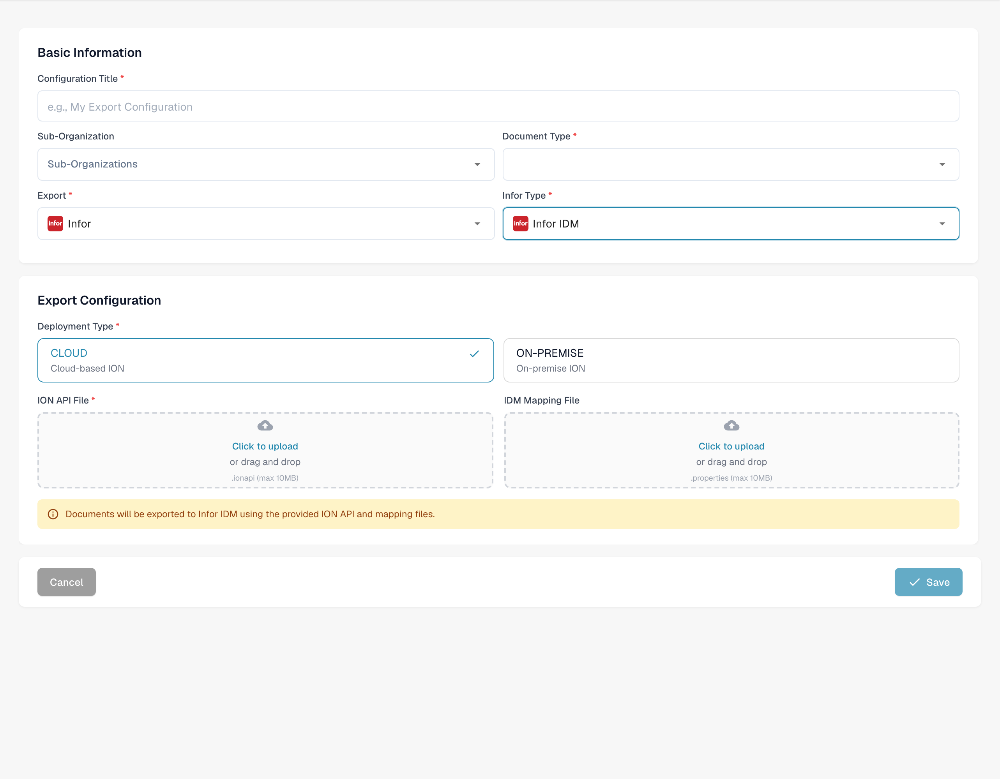<figcaption>
Unsaved Infor IDM export configuration.
</figcaption></figure>

## Overview

The Export page displays all configured export setups, including whether they are active or inactive. From here, users can:

* View and manage existing export configurations
* Create new export connections (e.g., to **Infor**, **Infor & IDM**, **Webhook**, or **SFTP**)
* Edit or delete existing export configurations

## Where to Find It

You can find it under: **Settings** → **Document Processing** → **Export**

<figure>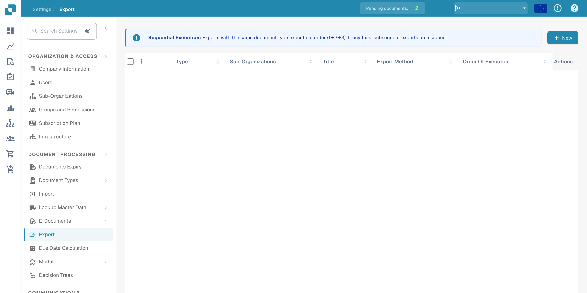<figcaption>
Open export configuration from the English settings.
</figcaption></figure>

## **Using the Export Page**

When you open the Export page, you’ll see a list of all existing export configurations.

Each row in the list shows:

* **Status Indicator**
  * **Green** means the export is active
  * **Red** means the export is deactivated
* **Name** – the name of the export configuration
* **Document Type** – the type of document the export is configured for
* **Sub-Organization** – if the export is limited to a specific sub-organization
* **Export Method** – where the document will be sent (e.g., Infor, IDM, SFTP)
* **Actions** – buttons to **edit, delete** or **activate/deactivate** the configuration

#### **Important Rules for Export Configuration**

For each **document type** **within a given organization or sub-organization**, the following rules apply:

* You can have **only one active Infor export**
* You can have **only one active non-Infor export** (e.g., Webhook, SFTP)

However, it is possible to have:

* **One active Infor export** _and_ **one active non-Infor export** at the same time for the same document type
* **Different export configurations for different sub-organizations** — for example, one Infor export for Sub-Org A and another Infor export for Sub-Org B

## **Creating a New Export**

To create a new export:

1. Click on the **“New”** button.

<figure>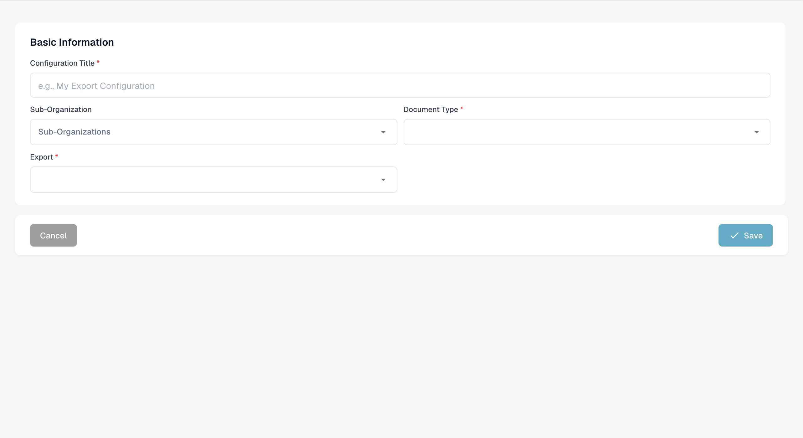<figcaption>
Unsaved new export configuration showing its basic information.
</figcaption></figure>
2. Select the **Export Type** you want to configure (e.g., Infor, IDM, SFTP).
3. Fill in the required fields based on the export type.
4. Save the configuration.

## Export Options

#### Webhook

Webhook

<figure><figcaption></figcaption></figure>

**Field Descriptions**

* **Title** The name of the export configuration. This will appear in the export list.
* **Sub-Organization** _(optional)_ A dropdown with all available sub-organizations.
  * If left empty: applies to the main organization.
  * If selected: the export will only apply to the chosen sub-organization.
* **Document Type** Dropdown listing all available document types. This determines which type of document this export configuration applies to.
* **Export URL** The destination URL where the document should be exported.

#### SFTP

SFTP

<figure>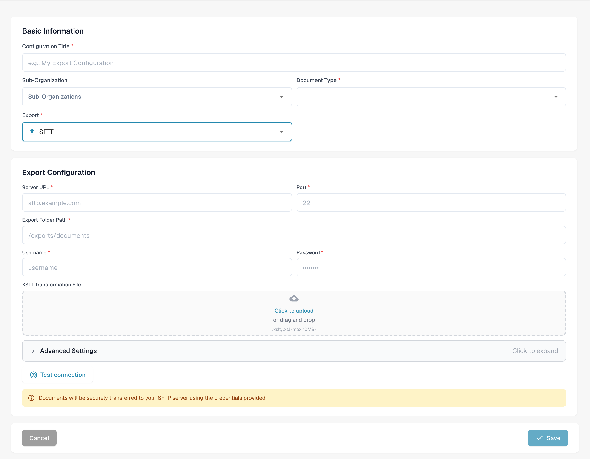<figcaption>
Unsaved SFTP export configuration.
</figcaption></figure>

**Field Descriptions**

* **Title** The name of the export configuration. This will appear in the export list.
* **Sub-Organization** _(optional)_ A dropdown with all available sub-organizations.
  * If left empty: applies to the main organization.
  * If selected: the export will only apply to the chosen sub-organization.
* **Document Type** Dropdown listing all available document types. This determines which type of document this export configuration applies to.
* **Username** The username used to authenticate against the SFTP server.
* **Password** The corresponding password for the SFTP account. Ensure the account has write access to the specified folder.
* **Server URL** The hostname or IP address of the target SFTP server.
* **Port** The port used to connect to the SFTP server.
* **Folder** The path on the SFTP server where documents should be uploaded (e.g., `/incoming/invoices/`). Must exist and be writable.
*   **XSLT File (Optional)**

    The **XSLT file** allows for transformation of the default DocBits export format.

    * **When to use:** Only if the receiving system requires a different structure or specific formatting that differs from the DocBits default.
    * **Leave it empty** if the default export format meets the requirements.

**Advanced Settings:**

* **Filename Export Mode** Specifies whether the exported file retains its original filename or is renamed using the DocBits document ID.
* **Include Document History** When enabled, the exported file will include the document history based on the logs available on the dashboard.

<figure>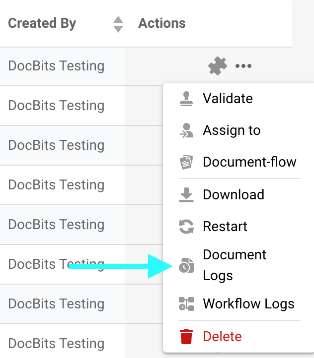<figcaption></figcaption></figure>

<figure>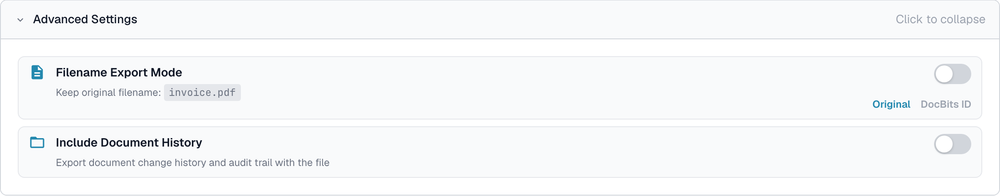<figcaption>
Unsaved advanced SFTP export options.
</figcaption></figure>

#### Infor Export to SFTP

Infor Export to SFTP

<figure>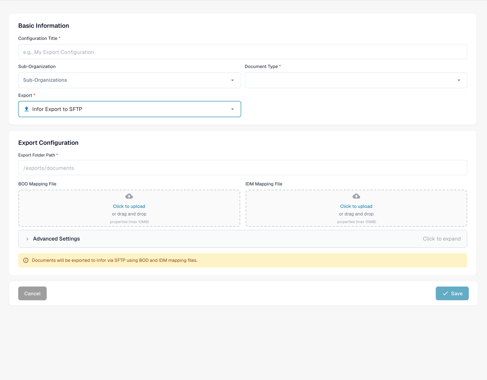<figcaption>
Unsaved Infor SFTP export configuration.
</figcaption></figure>

**Field Descriptions**

* **Title** The name of the export configuration. This will appear in the export list.
* **Sub-Organization** _(optional)_ A dropdown with all available sub-organizations.
  * If left empty: applies to the main organization.
  * If selected: the export will only apply to the chosen sub-organization.
* **Document Type** Dropdown listing all available document types. This determines which type of document this export configuration applies to.
* **IDM Mapping File** Select a mapping file from the file manager. [Need help creating one? View the IDM Mapping Guide](../../../../infor-integration-and-configuration/exporting-to-infor/creating-an-idm-mapping-file.md)
* **BOD Mapping File** Select a mapping file from the file manager. [Need help creating one? View the BOD Mapping Guide](../../../../infor-integration-and-configuration/exporting-to-infor/creating-a-bod-mapping-file.md)
* **Folder** The path on the SFTP server where documents should be uploaded (e.g., `/incoming/invoices/`). Must exist and be writable.

#### **SMB**

SMB

<figure>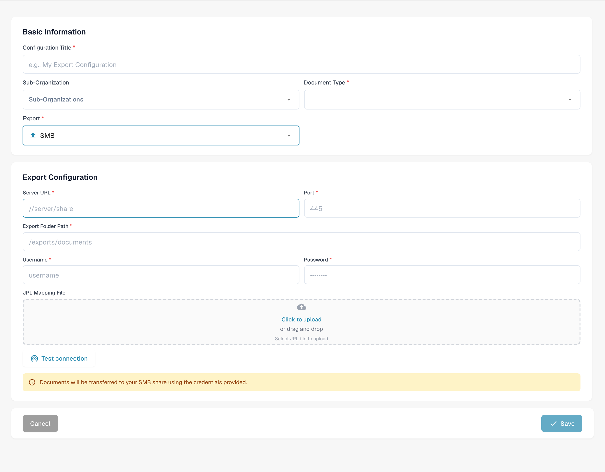<figcaption>
Unsaved SMB export configuration.
</figcaption></figure>

**Field Descriptions**

* **Title** The name of the export configuration. This will appear in the export list.
* **Sub-Organization** _(optional)_ A dropdown with all available sub-organizations.
  * If left empty: applies to the main organization.
  * If selected: the export will only apply to the chosen sub-organization.
* **Document Type** Dropdown listing all available document types. This determines which type of document this export configuration applies to.
* **Username** The username used to connect to the SMB share.
* **Password** The corresponding password for SMB authentication.
* **Server URL** The address of the SMB server.
* **Port** Port number used to access the SMB share.
* **Folder** The folder path within the SMB share where documents should be saved(e.g., `/incoming/invoices/`). Must exist and be writable.
*   **JPL Mapping File (Optional)**

    The **JPL file** is used to define a transformation of the exported data before it is written to the SMB share.

    * **When to use:** Only when the exported document data needs to be adjusted to match external formatting or system expectations.
    * **Leave it empty** if no transformation is necessary.

#### **Infor IDM**

Infor IDM

<figure><figcaption></figcaption></figure>

**Field Descriptions**

* **Title** The name of the export configuration. This will appear in the export list.
* **Sub-Organization** _(optional)_ A dropdown with all available sub-organizations.
  * If left empty: applies to the main organization.
  * If selected: the export will only apply to the chosen sub-organization.
* **Document Type** Dropdown listing all available document types. This determines which type of document this export configuration applies to.
* **ION Mapping File** Select a mapping file from the file manager.
* **IDM Mapping File** Select a mapping file from the file manager. [Need help creating one? View the IDM Mapping Guide](../../../../infor-integration-and-configuration/exporting-to-infor/creating-an-idm-mapping-file.md)
* **Cloud / On-Prem Toggle** A switch to indicate the Infor deployment type:
  * **Cloud**: Select this if Infor CloudSuite customer.
  * **On-Prem**: Select this if Infor is self-hosted.

#### **Infor ION**

Infor ION

<figure>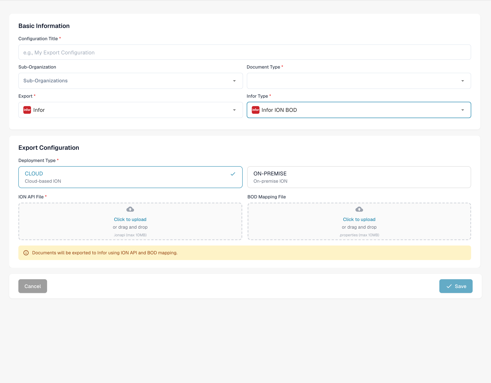<figcaption>
Unsaved Infor ION export configuration.
</figcaption></figure>

**Field Descriptions**

* **Title** The name of the export configuration. This will appear in the export list.
* **Sub-Organization** _(optional)_ A dropdown with all available sub-organizations.
  * If left empty: applies to the main organization.
  * If selected: the export will only apply to the chosen sub-organization.
* **Document Type** Dropdown listing all available document types. This determines which type of document this export configuration applies to.
* **ION Mapping File** Select a mapping file from the file manager.
* **BOD Mapping File** Select a mapping file from the file manager. [Need help creating one? View the BOD Mapping Guide](../../../../infor-integration-and-configuration/exporting-to-infor/creating-a-bod-mapping-file.md)
* **Cloud / On-Prem Toggle** A switch to indicate the Infor deployment type:
  * **Cloud**: Select this if Infor CloudSuite customer.
  * **On-Prem**: Select this if Infor is self-hosted.

#### Infor IDM + ION BOD

Infor IDM + ION BOD

<figure>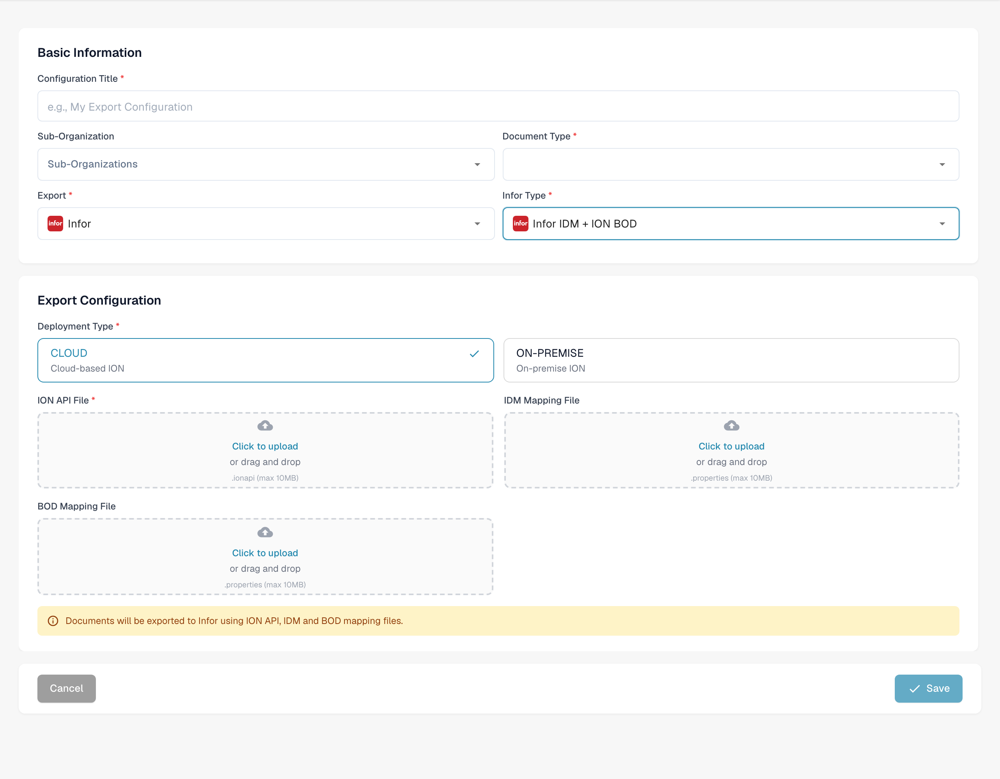<figcaption>
Unsaved Infor IDM ION BOD export configuration.
</figcaption></figure>

**Field Descriptions**

* **Title** The name of the export configuration. This will appear in the export list.
* **Sub-Organization** _(optional)_ A dropdown with all available sub-organizations.
  * If left empty: applies to the main organization.
  * If selected: the export will only apply to the chosen sub-organization.
* **Document Type** Dropdown listing all available document types. This determines which type of document this export configuration applies to.
* **ION Mapping File** Select a mapping file from the file manager.
* **IDM Mapping File** Select a mapping file from the file manager. [Need help creating one? View the IDM Mapping Guide](../../../../infor-integration-and-configuration/exporting-to-infor/creating-an-idm-mapping-file.md)
* **BOD Mapping File** Select a mapping file from the file manager. [Need help creating one? View the BOD Mapping Guide](../../../../infor-integration-and-configuration/exporting-to-infor/creating-a-bod-mapping-file.md)
* **Cloud / On-Prem Toggle** A switch to indicate the Infor deployment type:
  * **Cloud**: Select this if Infor CloudSuite customer.
  * **On-Prem**: Select this if Infor is self-hosted.

### For Infor CloudSuite customers

#### Infor IDM + LN

Infor IDM + LN

<figure>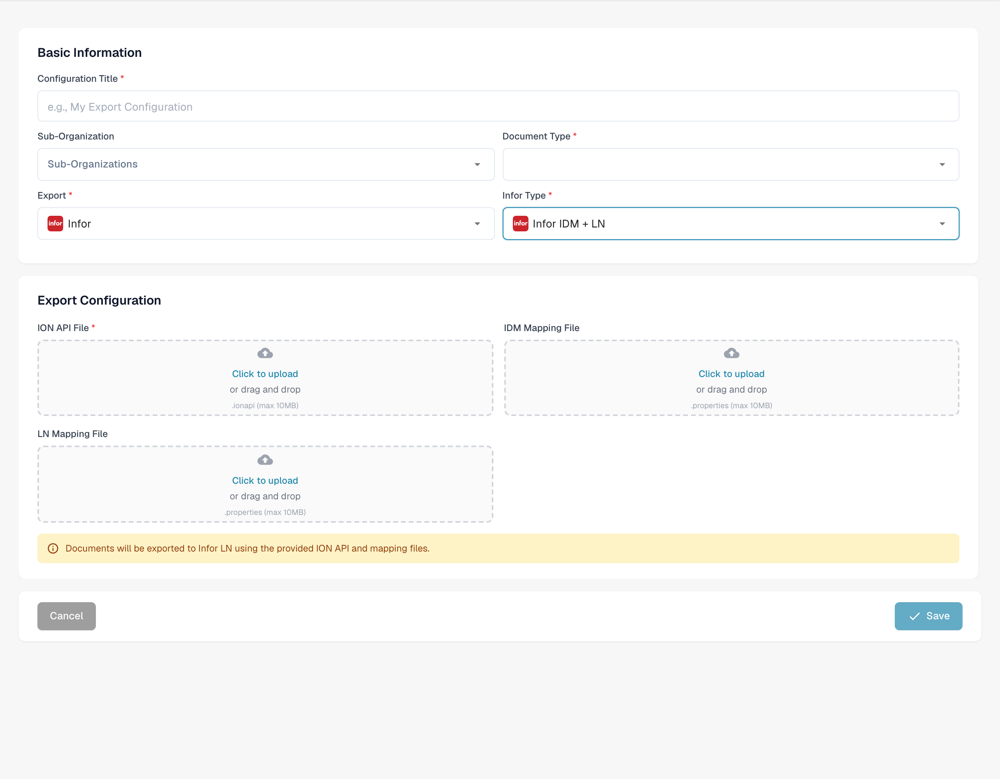<figcaption>
Unsaved Infor IDM LN export configuration.
</figcaption></figure>

**Field Descriptions**

* **Title** The name of the export configuration. This will appear in the export list.
* **Sub-Organization** _(optional)_ A dropdown with all available sub-organizations.
  * If left empty: applies to the main organization.
  * If selected: the export will only apply to the chosen sub-organization.
* **Document Type** Dropdown listing all available document types. This determines which type of document this export configuration applies to.
* **ION Mapping File** Select a mapping file from the file manager.
* **IDM Mapping File** Select a mapping file from the file manager. [Need help creating one? View the IDM Mapping Guide](../../../../infor-integration-and-configuration/exporting-to-infor/creating-an-idm-mapping-file.md)
* **LN Mapping File** Select a mapping file from the file manager. [Need help creating one? View the LN Mapping Example](../../../../infor-integration-and-configuration/exporting-to-infor/ln/example-export-ln/)

#### Infor IDM + M3

Infor IDM + M3

<figure><figcaption>
Unsaved Infor IDM M3 export configuration.
</figcaption></figure>

**Field Descriptions**

* **Title** The name of the export configuration. This will appear in the export list.
* **Sub-Organization** _(optional)_ A dropdown with all available sub-organizations.
  * If left empty: applies to the main organization.
  * If selected: the export will only apply to the chosen sub-organization.
* **Document Type** Dropdown listing all available document types. This determines which type of document this export configuration applies to.
* **ION Mapping File** Select a mapping file from the file manager.
* **IDM Mapping File** Select a mapping file from the file manager. [Need help creating one? View the IDM Mapping Guide](../../../../infor-integration-and-configuration/exporting-to-infor/creating-an-idm-mapping-file.md)
* **M3 Mapping File** Select a mapping file from the file manager. [Need help creating one? View the M3 Mapping Example](../../../../infor-integration-and-configuration/exporting-to-infor/m3/example-export-m3.md)

#### Infor IDM + M3 (toml)

Infor IDM + M3 (toml)

<figure>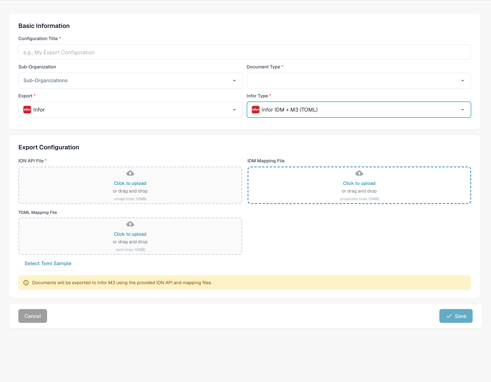<figcaption>
Unsaved Infor IDM M3 export configuration with TOML.
</figcaption></figure>

**Field Descriptions**

* **Title** The name of the export configuration. This will appear in the export list.
* **Sub-Organization** _(optional)_ A dropdown with all available sub-organizations.
  * If left empty: applies to the main organization.
  * If selected: the export will only apply to the chosen sub-organization.
* **Document Type** Dropdown listing all available document types. This determines which type of document this export configuration applies to.
* **ION Mapping File** Select a mapping file from the file manager.
* **IDM Mapping File** Select a mapping file from the file manager. [Need help creating one? View the IDM Mapping Guide](../../../../infor-integration-and-configuration/exporting-to-infor/creating-an-idm-mapping-file.md)
* **M3 toml Mapping File** Select a mapping file from the file manager or use the select Toml option to use a toml created with the rule manager. [Need help creating one? View the Rule Manager Guide](../rule-manager/)

## Video tutorial: Configure and test an ERP export


Configure and test an ERP export


[Watch with subtitles and chapter navigation](https://docbits-videos.fra1.cdn.digitaloceanspaces.com/settings-assistant/erp-export-admin/v1/en.html)

Some native product labels may remain in another language. Technical field IDs are preserved.

I use a dedicated test configuration and document type. These invoices are synthetic. Our test receiver checks data transmission and makes no postings in a production ERP. I leave the other integrations alone.

In the export configuration, I check the document type, the organization, and the export type. This example uses Generic API in the cloud. Credentials JSON and TOML field mapping are separate files. In real projects, the target system, permissions, and sub-organization must match the intended process.

<figure>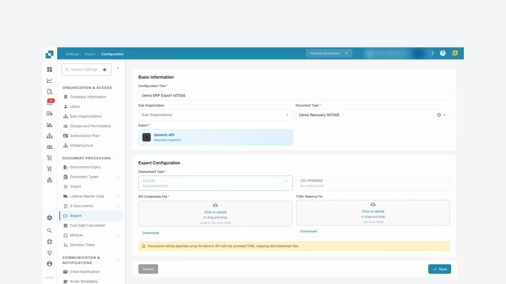<figcaption>
Export configuration scoped to the training document type
</figcaption></figure>

In the corrected mapping, the DocBits field invoice_id supplies the invoice number sent to our test receiver. Supplier, total amount and currency are mapped too. This test covers header data. Line items and ERP postings need their own business checks for each project.

I upload the corrected TOML file and save the configuration. Then I reopen it and check that the change was saved. I keep the prepared test credentials; production credentials must stay out of the recording.

Now I return to the invoice with the failed export and restart the export exactly once. I wait for processing to finish. An accepted request alone would not prove a successful transfer.

DocBits now shows the invoice as finished. I also check the receipt from our test receiver. The invoice number, supplier, amount and currency match the test invoice. Authentication and transfer succeeded. The test receiver does not confirm an ERP posting.

<figure>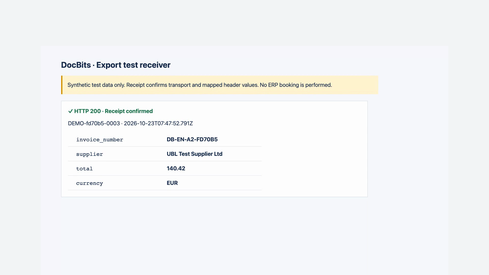<figcaption>
Actual receipt at the test receiver; no ERP posting
</figcaption></figure>
