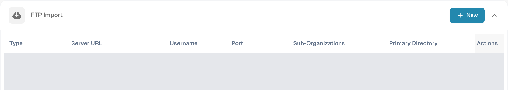
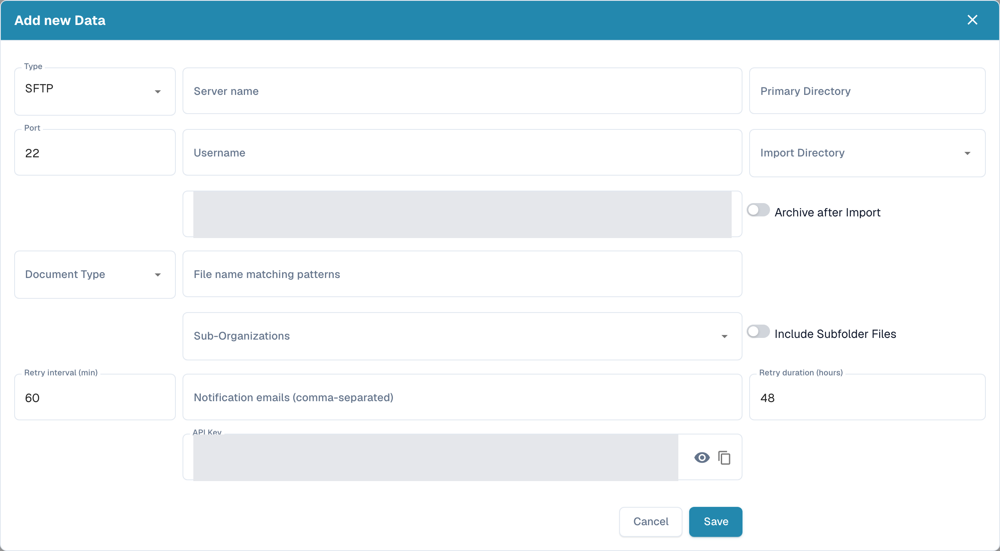
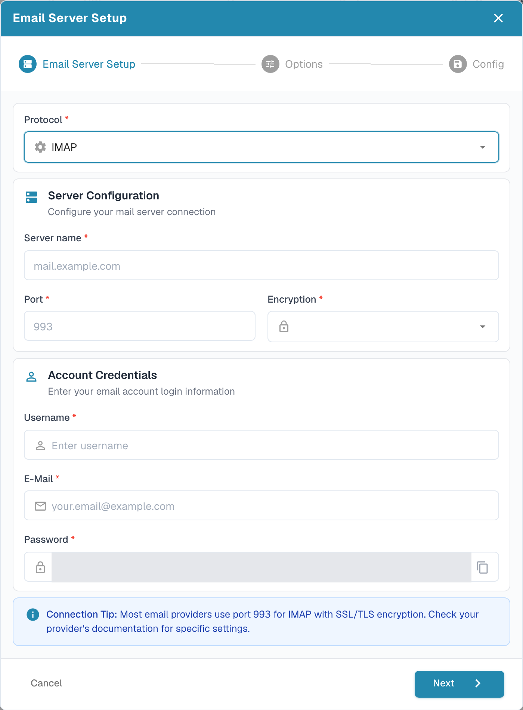
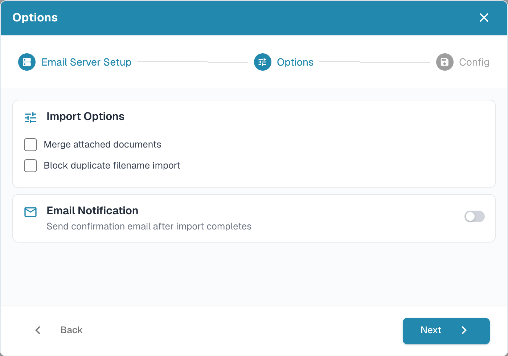
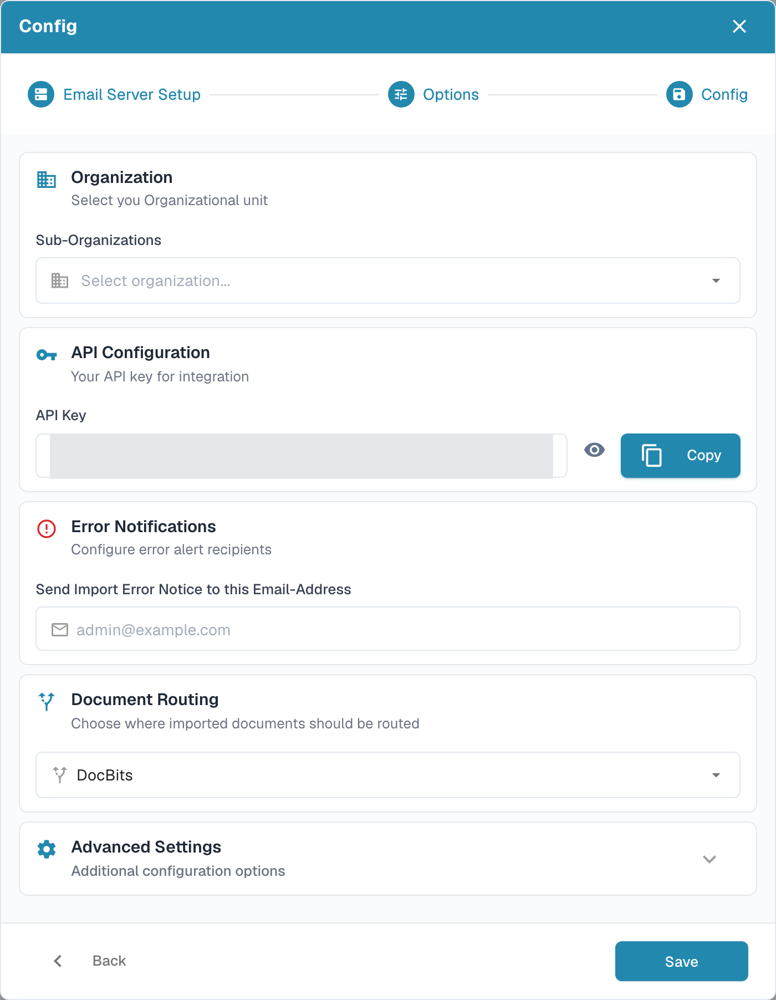
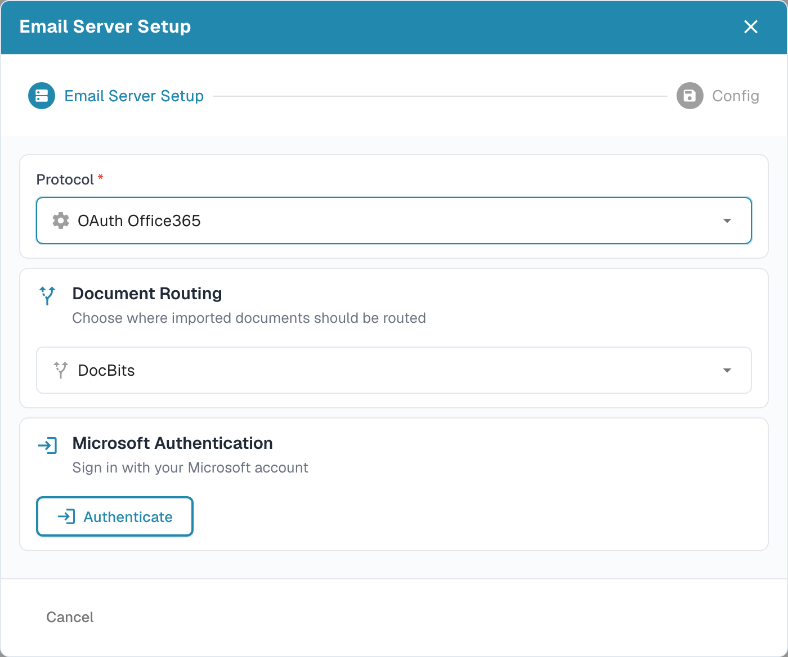
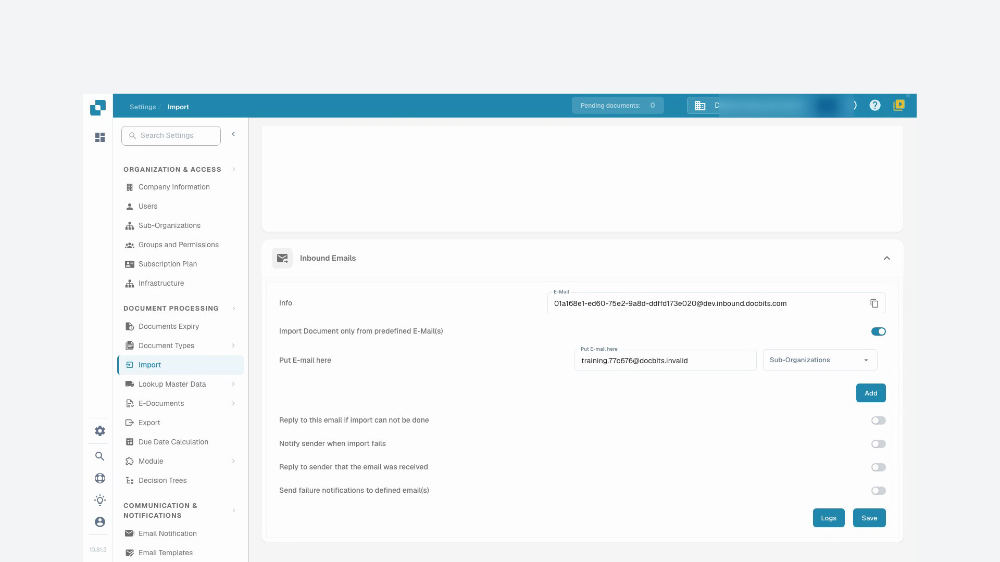
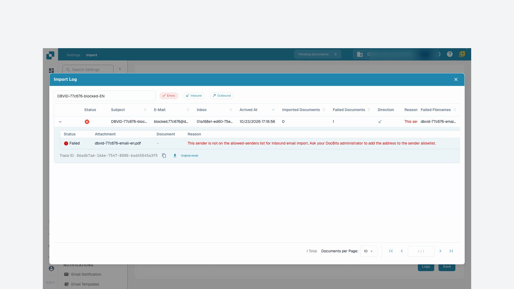

# Import

## Overview

Use **Import** to configure automated document import from an FTP/SFTP server, a connected mailbox, or the incoming DocBits email address. Check the current organization and environment before entering connection details.

## How to Access

1. Navigate to **Settings** → **Document Processing** → **Import**.
2. Expand the required section. **FTP Import** and **Email Import** each have their own **New** button.

## **Document Settings**

The current Import page contains **Import Pipeline**, **FTP Import**, **Email Import**, and, when enabled, **Inbound Emails**. Page trimming, default payment terms, and date-pattern fields are not controls in this Import view.

**Import Pipeline** shows the FTP/SFTP routing topology, including the source and target regions. Check any displayed advisory before changing a connection. The **Email** pipeline tab currently displays a coming-soon message; it does not show an email processing diagram.

## **FTP Import**

<figure><figcaption>
Use New in FTP Import to add a server connection. Existing connection rows are obscured in this example.
</figcaption></figure>

### Requirements

* An FTP, FTPS, or SFTP server reachable by the import service.
* The server address, protocol, port, username, and password supplied by your administrator.
* An import directory and, if archiving is required, an approved archive directory.

### Add new connection

1. Click **New** in **FTP Import**.
2. Enter the connection settings. A new form starts with **SFTP** and port **22**; replace these values when your server uses another protocol or port.

<figure><figcaption>
Enter the server and login details, then check directories, routing and retry settings. Password and API key fields are obscured; this example has not been saved.
</figcaption></figure>

* **Type**, **Server name**, **Port**, **Username**, and **Password** identify and authenticate the server connection.
* **Primary Directory** sets the base directory. **Import Directory** selects the folder to process; folder selection becomes available after the connection is saved.
* **Document Type** and **Sub-Organizations** control assignment. **File name matching patterns** limits which filenames are considered.
* **Archive after Import** enables moving processed files to the specified archive directory. **Include Subfolder Files** extends processing to subfolders.
* **Retry interval (min)**, **Retry duration (hours)**, and **Notification emails (comma-separated)** control retry and notification behavior. The illustrated defaults are 60 minutes and 48 hours.
* **API Key** uses the organization's existing app-subscription key. The eye icon shows or hides that key; the copy icon copies it to the clipboard. These controls do not create a new key. Keep it confidential; do not include it in screenshots or support messages.

Use **Cancel** or the close icon to leave a new connection form without saving it.

3. Review the values and click **Save** when the connection is ready to be created.
4. In the saved row's **Actions** menu, choose **Activate** when imports are authorized to run.

### Actions for FTP

The saved connection's **Actions** menu provides:

* **Test Connection**: contact the configured server to check the connection.
* **Connection Logs**: inspect connection attempts and errors.
* **Activate/Deactivate**: enable or stop automatic processing for this connection.
* **Edit**: change its configuration.
* **Delete**: remove the connection.

Testing, activation, editing, and deletion affect a real connection. Verify the selected row and organization before using them.

## **Email Import**

A connected mailbox is separate from the incoming DocBits email address described in the tutorial below. Choose the method that fits your process.

<figure><figcaption>
Use New for a mailbox connection or the log icon to review imports. Existing connection rows and the informational link are obscured.
</figcaption></figure>

<mark style="color:red;">**Note**</mark>: Only documents with the following file types will be imported:

* `.pdf`
* `.tiff` / `.tif`
* `.eml`
* `.dat`
* `.xml`
* `.edi`
* `.purchaseorder`


**How attachments are recognised**

In addition to the file extensions listed above, DocBits also identifies a document by its **actual file content** (file signature), not only by the content type declared by the sending mail system. This matters for **forwarded** mails: intermediate mail servers/gateways frequently re-label an attachment with a generic type (`application/octet-stream`) instead of, for example, `application/pdf` or `application/xml`. DocBits still recognises and imports such attachments correctly.

* **Forwarded `.eml`** messages and Outlook **`winmail.dat`** (TNEF) attachments are unpacked and the documents inside them are imported.
* **XML encoding:** When an XML invoice is re-labelled with a generic type (`application/octet-stream`), DocBits recognises it by its `<?xml` declaration, tolerating a leading **UTF-8** or **UTF-16** (LE/BE) byte-order mark (BOM) — currently only these BOM encodings are auto-detected from content. An attachment that keeps a `.xml` filename is imported regardless of its encoding.
* **Ignored:** inline images that ride along in a mail (signature logos / embedded graphics — PNG, JPG, GIF, BMP) are skipped silently and are **not** counted as failed imports.

If an attachment cannot be imported and the option **“Reply to this email if import can not be done”** is enabled for the inbound address, the configured reply address is notified.


### Add new IMAP connection

1. Click **New** in **Email Import** and select **IMAP** under **Protocol**.
2. In **Email Server Setup**, enter the server name, port, encryption, username, email address, and password. Use the values required by your mail provider; the displayed 993 is a port example, not a completed setting.

<figure><figcaption>
Complete the required server and account fields before Next. The password area is obscured; no mailbox credentials have been submitted in this example.
</figcaption></figure>

The copy icon beside **Password** copies the entered password to the clipboard. **Cancel** or the close icon leaves this new connection wizard without saving it.

3. Click **Next** to open **Options**. Choose whether to **Merge attached documents** or **Block duplicate filename import**. **Email Notification** enables a confirmation email after import; enable it only when that behavior is intended.

<figure><figcaption>
Options separates import behavior from email notification. Both checkboxes and the notification switch are off in this unsaved example.
</figcaption></figure>

4. Click **Next** to open **Config**. Select the required **Sub-Organizations**, review the existing **API Key**, set the recipient for import errors, and check **Document Routing**. Expand **Advanced Settings** only when the process needs additional options.

<figure><figcaption>
Config brings together organization assignment, the existing key, error notifications and routing. The key is obscured and Save has not been used.
</figcaption></figure>

In **Config**, the eye icon shows or hides the existing **API Key**, and **Copy** copies it to the clipboard. Neither control generates a new key.

5. Click **Save** when the configuration is ready. Then use **Activate** in the saved connection's **Actions** menu to start automatic processing.

For a saved IMAP connection, **Edit** provides folder and post-import handling options. Select the source folder and the destination folder for moved emails only after the connection has been created and the available folders can be loaded.

### Actions for IMAP

The saved connection's **Actions** menu provides **Test Connection**, **Connection Logs**, **Import Log**, **Activate/Deactivate**, **Edit**, and **Delete**. Connection testing contacts the configured mailbox; activation enables processing. Review logs before retrying a failed import.

### Add new OAuth Office365 connection

1. Click **New** in **Email Import** and select **OAuth Office365** under **Protocol**. For an administrator-managed tenant application, select **OAuth Office365 - Tenant** and follow [O365 Tenant](o365-tenant.md).
2. Review **Document Routing** before authentication.

<figure><figcaption>
Select the route before Authenticate. This view is before sign-in; no Microsoft authentication has been started.
</figcaption></figure>

3. Click **Authenticate** when the mailbox connection is authorized. Complete the Microsoft device-code sign-in using the code shown by DocBits, then return and select **Finish Authentication**.
4. After authentication, review the organization, folder, shared-mailbox, move-folder, and error-notification options offered for the connection. Use **Next** to continue to **Config** when it becomes available, then save the intended settings.
5. Activate the saved connection when automatic imports should run. **Import**, where offered for a saved connection, starts an actual import; use it deliberately.

### Actions for OAuth Office365

The saved connection's **Actions** menu provides **Connection Logs**, **Import Log**, **Activate/Deactivate**, **Edit**, and **Delete**. Deactivation stops automatic processing; deletion removes the configuration.

### Import Log

Use the log icon at the top right of **Email Import** to review imports across the configured mailbox connections. Use a saved row's **Import Log** action for that connection. Inspect the subject, sender, status, and available error details before deciding whether to retry.

## Inbound Emails

The two tutorial screenshots below show the incoming DocBits address and its logs. This is separate from the mailbox connections above.

* Use the copy icon beside **E-Mail** to copy the receiving address displayed for the current organization and environment.
* **Add** inserts another permitted-sender row in the form. Choose its sender and any intended sub-organization, then use **Save** to persist the configuration. Adding a row alone does not save it.
* **Logs** opens the inbound email log. **Errors** filters for errors; **Inbound** and **Outbound** select the message direction.
* Expand a log row with its chevron to inspect attachment details. The copy icon beside the trace ID copies that ID for troubleshooting. **Original email**, when available for an inbound row, downloads the selected original message as an `.eml` file; it does not retry the import.

## Video tutorial: Email Inbox and Error Troubleshooting


Email Inbox and Error Troubleshooting


[Watch with subtitles and chapter navigation](https://docbits-videos.fra1.cdn.digitaloceanspaces.com/settings-assistant/email-import-admin/v2/en.html)

Some native product labels may remain in another language. Technical field IDs are preserved.

Under settings and import, I use the incoming DocBits address in this example. A directly connected mailbox is a separate import method. For this training, I work in a dedicated demo organization with synthetic invoices. Notifications remain turned off.

First, I check the displayed receiving address and the scope. The address belongs exactly to this organization and its environment. For a different company or a production environment, I always use the address actually displayed there.

Here I restrict the inbox to our approved test sender. I only select the assignment to a sub-organization if it belongs to the intended process. I save the setting and open it again. The allowed sender has been kept; automatic reply emails remain turned off in this training.

<figure><figcaption>
Allowed sender saved with notifications off
</figcaption></figure>

For this training, a test message was submitted directly to DocBits inbound processing. This test does not confirm external email delivery. In the log, I check the matching subject, sender, and imported attachment. I then check the document that was actually created.

I open the corresponding document and compare the PDF attachment with the invoice in DocBits. File name, invoice number, supplier, and amount must match. A successful import says nothing about an approval or an ERP booking.

A second controlled test comes from an unapproved sender. In the log, I specifically search for this inbound and activate the error filter. The details name the rejected sender. I check the cause using the subject and the trace ID, instead of triggering the import multiple times.

In a real case, I first clarify whether this sender is even authorized. An approved change to the sender list is saved and checked again. Afterward, I verify a new unique test inbound all the way to the created document. For technical errors, I hand over the trace ID and the concrete error message.

<figure><figcaption>
Failed import with attachment, reason and trace
</figcaption></figure>
