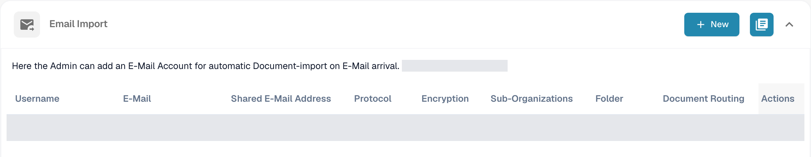
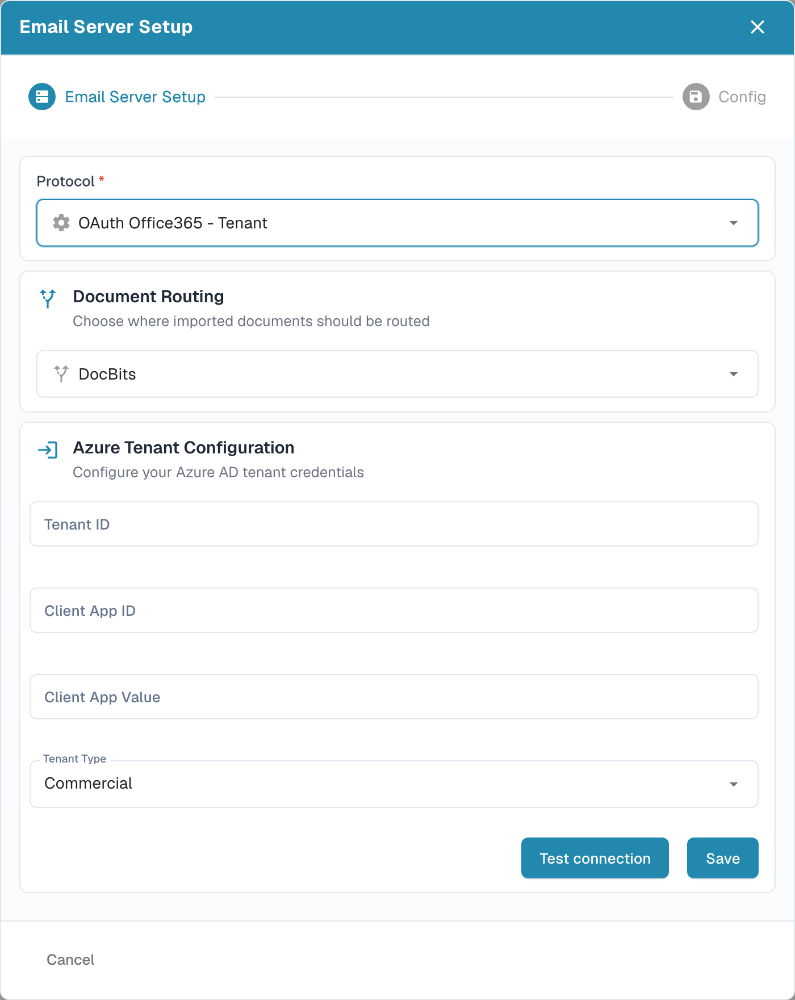

# Microsoft 365 tenant email import

Use this guide to connect an organisation-owned Microsoft 365 mailbox through a Microsoft Entra application. An administrator needs access to the intended Entra tenant and the matching DocBits organisation. Agree on the mailbox, document destination and credential owner before enabling import.

## 1. Prepare the Entra application

In the [Microsoft Entra admin center](https://entra.microsoft.com/), open **Identity → Applications → App registrations → New registration** in the intended tenant. Choose a recognisable name and the account type approved by your identity administrator. An application used only within your organisation normally uses the single-tenant account option. Record its **Directory (tenant) ID** and **Application (client) ID**. Follow Microsoft's [current registration instructions](https://learn.microsoft.com/en-us/graph/auth-register-app-v2) for the portal steps.

The DocBits tenant form asks for a client secret. Under **Certificates & secrets**, create the secret using the approved expiry policy and record its **Value** while it is available. Store it securely and assign responsibility for rotation before expiry. Enter this Value into **Client App Value** in DocBits. Keep secrets out of screenshots, tickets and documentation.

Leave public-client flows disabled for this secret-based setup unless your identity administrator has established a separate requirement. Microsoft's [client-type guidance](https://learn.microsoft.com/en-us/entra/identity-platform/msal-client-applications) explains why public-client applications cannot safely hold application secrets.

## 2. Approve permission and mailbox scope

Have the Microsoft 365 administrator approve the mail operations and mailbox scope for this application. The Microsoft Graph **Mail.ReadWrite application permission** allows mail access and changes without a signed-in user and requires administrator consent. An unscoped grant covers mailboxes across the organisation. Mail.ReadWrite does not grant permission to send mail; sending features require a separate permission review. See the [Microsoft Graph permission reference](https://learn.microsoft.com/en-us/graph/permissions-reference#mailreadwrite).

Review restricted mailbox access with the Exchange administrator using [RBAC for Applications](https://learn.microsoft.com/en-us/exchange/permissions-exo/application-rbac). Entra permission grants and Exchange RBAC grants combine: adding a scoped RBAC grant alone does not narrow an existing tenant-wide Entra grant. Have the administrator confirm the effective access to the intended mailbox before enabling the source.

## 3. Configure the DocBits tenant connection

Open **Settings → Import → Email Import** in the intended DocBits organisation and select **New**.

<figure><figcaption>
New opens the email setup wizard. Existing table data and the generated inbound address are covered in this documentation image.
</figcaption></figure>

Select **OAuth Office365 - Tenant** under **Protocol** and choose **Document Routing** for the intended destination. Complete the tenant fields supplied by your administrator:

| DocBits field | Enter |
| --- | --- |
| Tenant ID | Directory (tenant) ID of the intended Entra tenant. |
| Client App ID | Application (client) ID of the registered application. |
| Client App Value | The client secret Value from that registration. |
| Tenant Type | The cloud environment for the tenant, such as Commercial or GCC High. |

<figure><figcaption>
The Tenant variant has its own credential form. This example uses the DocBits route and Commercial tenant type; all three credential fields are blank. Test connection and Save were not used for this documentation capture.
</figcaption></figure>

Use **Test connection** with the authorised tenant credentials before **Save**. Testing contacts the configured service; Save submits the tenant configuration. A successful connection test does not prove that a message or document was imported. If you are only inspecting the form, use **Cancel** or the close control.

## 4. Verify the saved source

For an authorised rollout, use a designated test mailbox and a harmless sample attachment. After saving the source, send a test message to that mailbox, inspect the Email Import list and import logs, and confirm that the document arrives at the selected destination. Review shared-mailbox and message-move options with the administrator as needed. Record the route, mailbox and secret-expiry owner in the internal runbook without the secret.

The documentation check covered the current English menu path, list and blank Tenant wizard. No Entra application, credential, permission, mailbox or import source was created or changed. No connection, tenant authentication or mail-import test was performed. Use the linked Microsoft instructions for its current administration interface.
