# List Of Values

## Overview

The **List of Values** feature allows you to create and manage predefined sets of values. This is particularly useful for configuring dropdown menus in the [**Fields**](../global-settings/document-types/fields/) section, which can later be used in **Field Validation**.

These lists can be customized for different sub-organizations and support multiple languages, providing flexibility across **DocBits**.

## How to Access?

You can access the **List of Values** by navigating to **Settings → Document Processing → List of Values**.

<figure>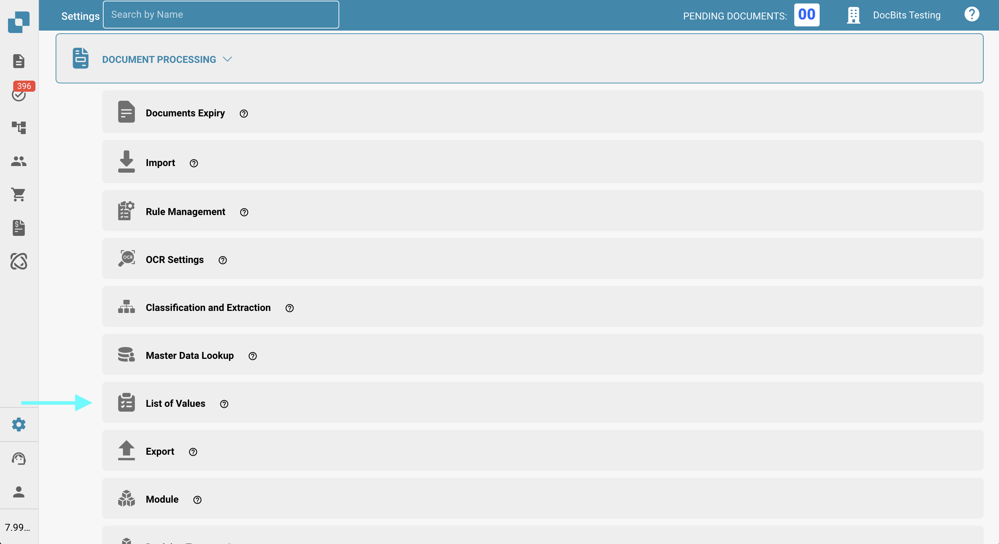<figcaption></figcaption></figure>

## How to Add or Delete a List

### Create a New List of Values

1.  Click **New** in the upper-right corner of the screen.

    <figure><figcaption>
English list-of-values overview with configured list names hidden.
</figcaption></figure>
2. Enter a **Name** for your list.
3. _(Optional)_ Select a **Sub-Organization** for which the list should be active.
4.  Click **Save** to create the list.

    <figure>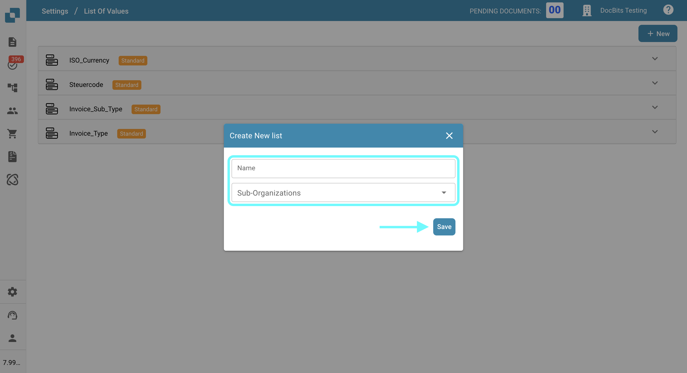<figcaption></figcaption></figure>

### How to Delete a List

To delete a list, click the trash can icon next to the corresponding list.

<figure><figcaption></figcaption></figure>

<mark style="color:red;">**Note**</mark>: The list will be deleted immediately. Lists marked with the [**Standard**](list-of-values.md#system-defined-lists-and-rows) tag cannot be deleted.

## How to Add, Edit, or Remove Values from an Existing List

You can manage values in an existing **List of Values** using one of the following methods:

* [**Manually add values**](list-of-values.md#manually-add-values) – Enter values individually through the interface.
* [**Import values from a CSV file**](list-of-values.md#import-values-from-a-csv-file) – Upload a CSV file to add multiple values at once.

### Manually Add Values

1.  Click on the list you want to modify.

    <figure>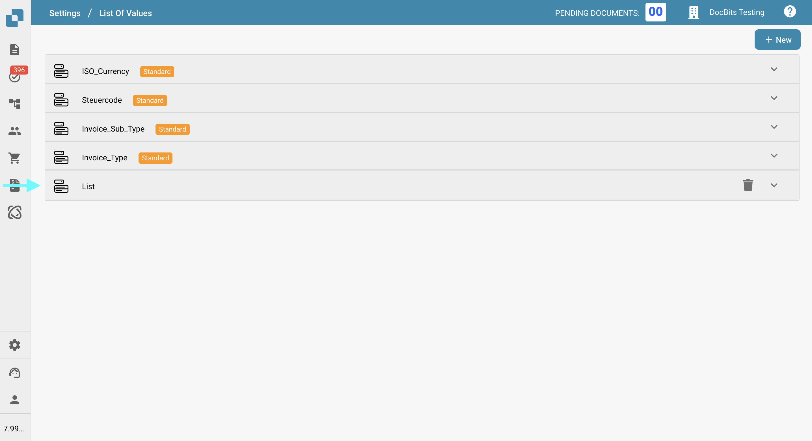<figcaption></figcaption></figure>
2.  Click on **Actions.**

    <figure>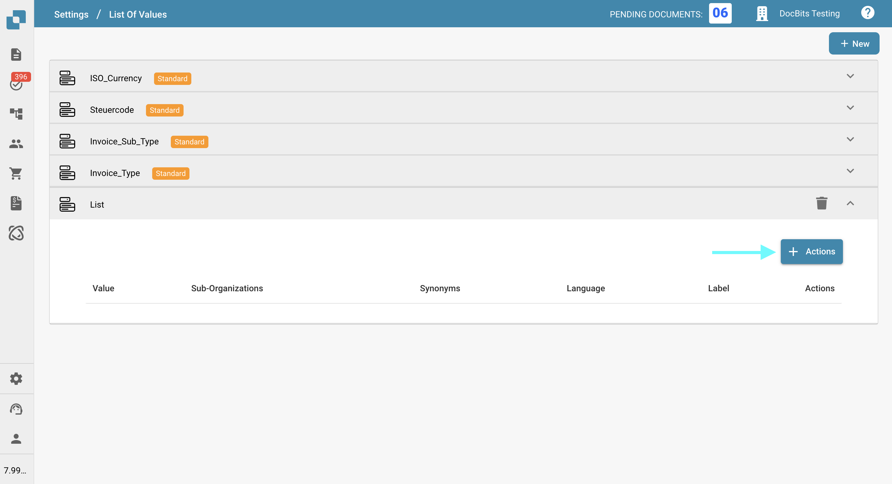<figcaption></figcaption></figure>
3.  Click on **Add Row.**

    <figure>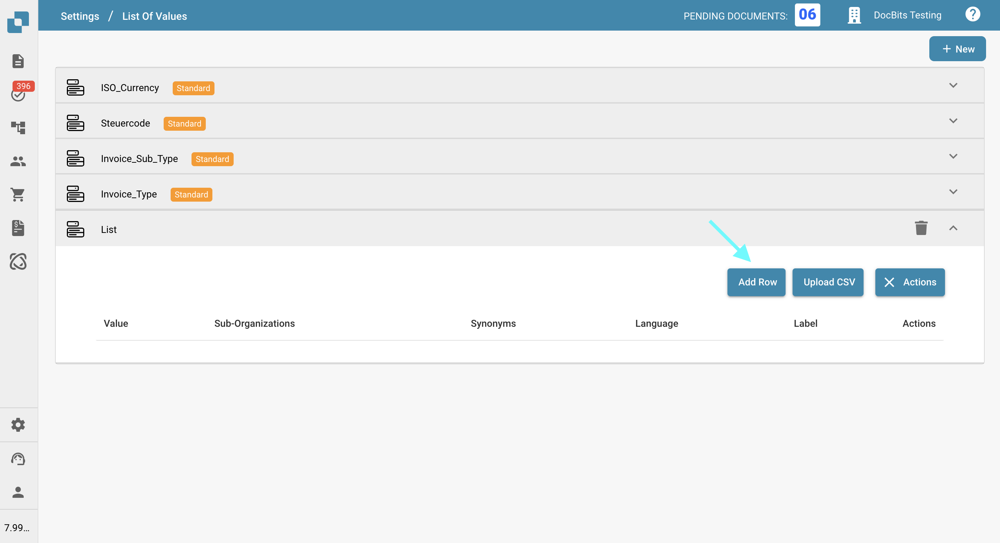<figcaption></figcaption></figure>

Now you can specify multiple properties for each entry:

<figure>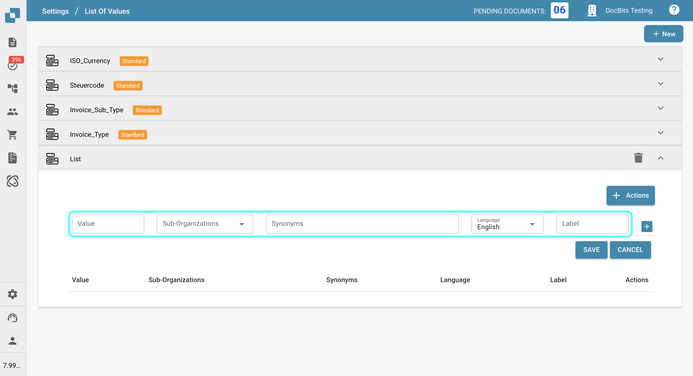<figcaption></figcaption></figure>

**Value**: This is how the item will be stored internally within **DocBits**. It remains the same across all languages and also serves as the default display text during field validation if no label is specified for the selected language.

**Label**: This is the text displayed on the validation screen, based on the selected language. If no label is available for the active language in DocBits, the system will default to displaying the **Value**.

**Language**: Specifies the language in which the label will be displayed.\
A more detailed explanation can be found [here](list-of-values.md#add-translations-to-your-values).

**Sub-Organizations**: Specifies which **sub-organization** the row should be active for. If left blank, the row will be available for all organizations.

**Synonyms**: Here you can specify additional values that help train your document.\
For example, if **EUR** is your primary **value**, you can add EURO and € as **synonyms**. When the document is trained using any of these **synonyms**, **DocBits** will automatically recognize and select EUR as the corresponding value from your list.\
<mark style="color:red;">**Note**</mark>: Each synonym must be confirmed by pressing **Enter** to add it to the list.

4.  After entering all desired properties, click the **Save** button to add the row.

    <figure><figcaption></figcaption></figure>

### Import Values from a CSV File

<mark style="color:red;">**Note:**</mark> When importing a CSV file, only the following columns are processed: **Value**, **Sub-Organization**, **Synonyms**, **Language**, and **Label**.\
Any additional columns included in the CSV file are **ignored** during the import.

To add multiple values at once via CSV import:

1.  Click on the list you want to update.

    <figure><figcaption></figcaption></figure>
2.  Click **Actions**.

    <figure><figcaption></figcaption></figure>
3.  Click on **Upload CSV**.

    <figure><figcaption></figcaption></figure>
4. Click **File** to browse and select the CSV file you want to upload.
5. Choose the appropriate **Delimiter** used in the CSV file (`;` or `,`).
6.  Click **Upload** to import the values.

    <figure><figcaption></figcaption></figure>

### Edit Existing Values

1. Locate the row you want to edit.
2. Click the three dots in the **Actions** column.
3.  Select **Edit** from the dropdown menu.

    <figure><figcaption></figcaption></figure>
4. Make the required changes.
5.  Click **Save** to apply your changes.

    <figure><figcaption></figcaption></figure>

### Delete Values

1. Locate the row you want to delete.
2. Click the three dots in the **Actions** column.
3.  Select **Delete** from the dropdown menu.

    <figure><figcaption></figcaption></figure>

<mark style="color:red;">**Note**</mark>: The row will be deleted immediately. Rows marked with the [**Default**](list-of-values.md#system-defined-lists-and-rows) tag cannot be deleted.

## Add Translations to Your Values

You can add as many translations as there are supported languages in **DocBits**.

To add a translation:

1.  Click the plus (+) icon.

    <figure>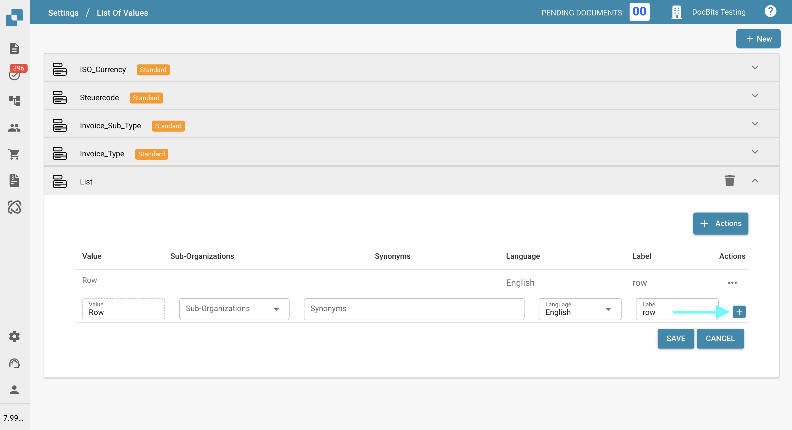<figcaption></figcaption></figure>
2.  Select a language from the dropdown menu.

    <figure>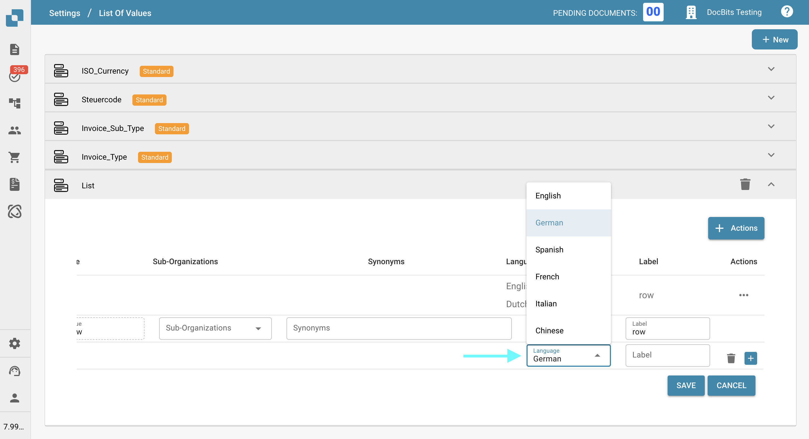<figcaption></figcaption></figure>
3.  Enter the desired translation in the **Label** field.

    <figure><figcaption></figcaption></figure>
4.  To add another translation, click the plus (+) icon again.

    <figure><figcaption></figcaption></figure>
5.  To remove a translation, click the trash can icon.

    <figure>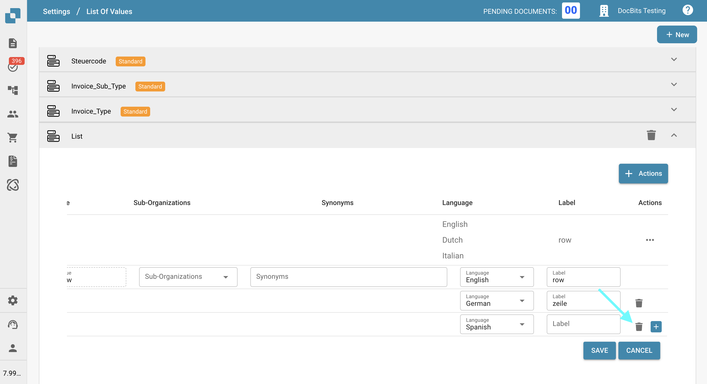<figcaption></figcaption></figure>
6.  When finished, click the **Save** button to save your translations.

    <figure>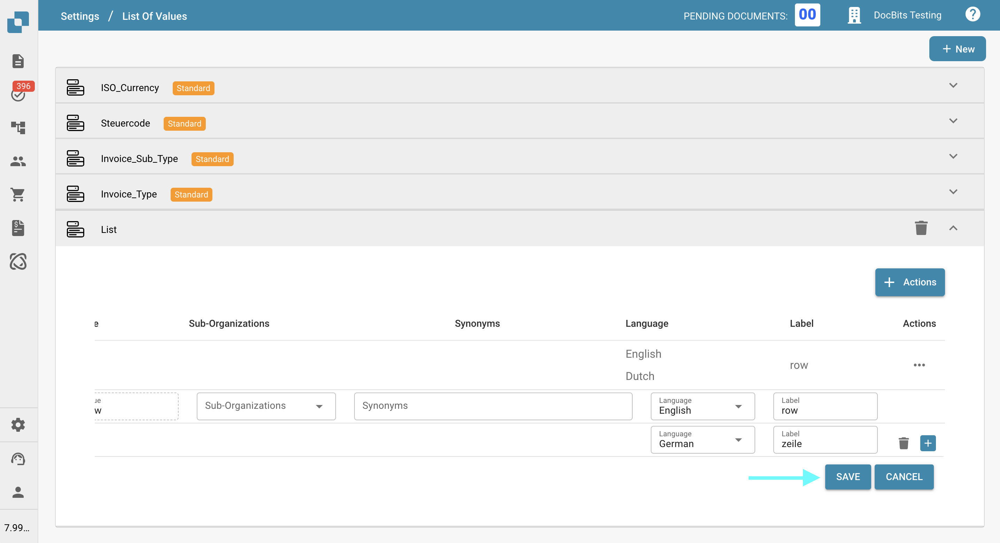<figcaption></figcaption></figure>

<mark style="color:red;">**Note**</mark>: If no **Label** is available for the active language, DocBits will default to displaying the **Value**.

## System-Defined Lists and Rows

Some lists are pre-created by the system and are marked with the **Standard** tag. These lists cannot be deleted, but you can add new rows to them and remove those newly added rows if necessary.

<figure>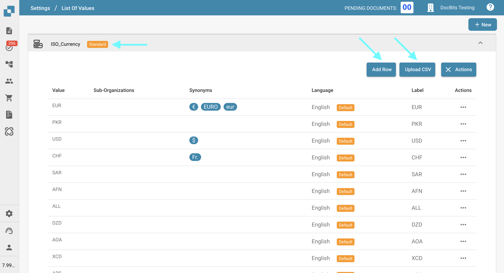<figcaption></figcaption></figure>

Within these standard lists, certain rows are marked with the **Default** tag—these are system-defined entries. You can add new **labels** in different languages, but these default rows cannot be deleted.

<figure><figcaption></figcaption></figure>
