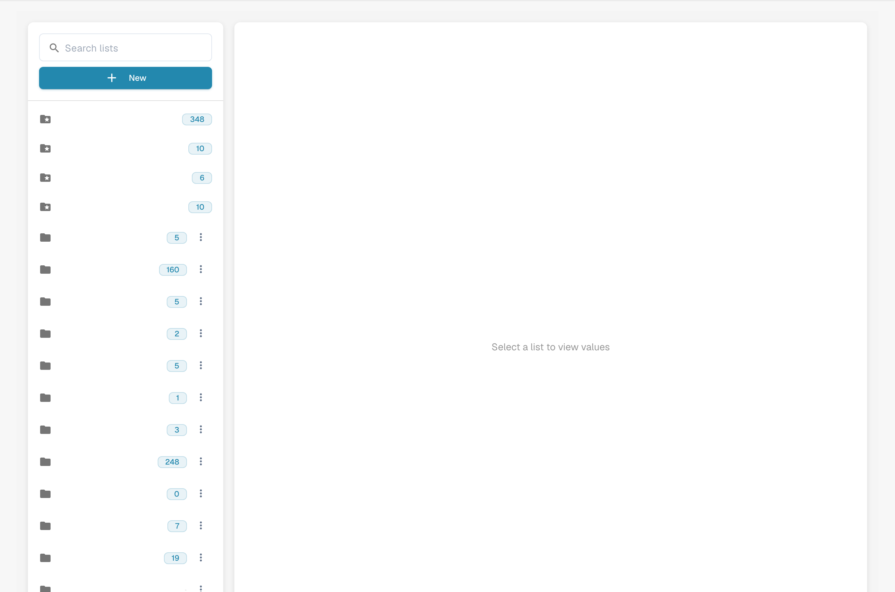
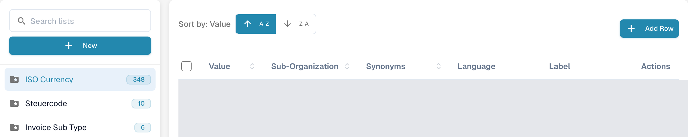
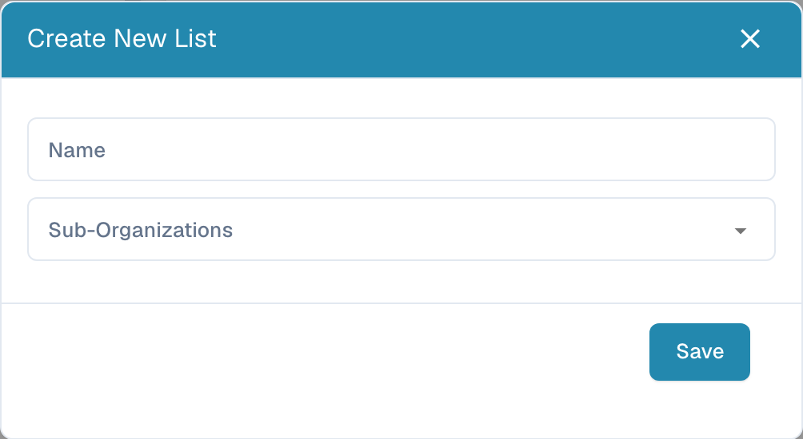
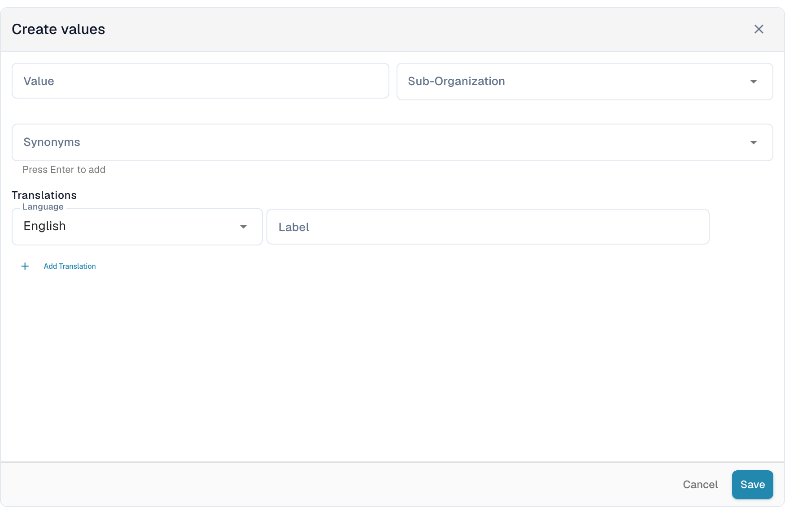

# List Of Values

## Video tutorial: Master data and lists of values


Master data sources, lists of values and master data settings in DocBits


The video shows the master data sources, the lists of values and the master data settings of a document type.

## Overview

A list of values supplies predefined choices for a field, such as invoice types or currencies. Each entry has a stored **Value** and can have **Synonyms** and translated **Labels**. Use lists when configuring dropdowns in [Fields](../global-settings/document-types/fields/) and field validation.

Lists and entries can be scoped to a sub-organization. Translations control the label displayed for a language; the underlying value stays the same. If no label is available for the user's language, the underlying value provides the fallback.

## How to Access?

Open **Settings**. Under **Document Processing**, expand **Lookup Master Data** and select **List of Values**.

Use **Search lists** in the left panel to find a list, then select its name. Its entries appear on the right. A number beside the list name shows its loaded entry count. The folder-with-star icon identifies a system-defined list.

<figure><figcaption>
Find and select a list in the left panel to open its entries. Configured list names are hidden in this overview.
</figcaption></figure>

<figure><figcaption>
Selecting an existing list opens the entry table. A-Z and Z-A sort its values; Add Row opens a new entry form. Table-body values are hidden in this real Dev view, and its count is an example from the test environment.
</figcaption></figure>

## How to Add or Delete a List

### Create a New List of Values

1. Select **New** above the list names in the left panel.
2. Enter a **Name**.
3. Optionally select **Sub-Organizations** to scope the list.
4. Select **Save** to create it. Close the dialog with **X** to leave without creating a list.

<figure><figcaption>
New opens this dialog. Name identifies the list; Sub-Organizations limits its scope. Save creates the list.
</figcaption></figure>

### How to Delete a List

For a list created by your organization, open the three-dot menu beside its name and select **Delete**. A confirmation dialog asks whether to remove it. Confirm only the intended list. System-defined lists have no delete menu.

## How to Add, Edit, or Remove Values from an Existing List

### Manually Add Values

1. Select the list in the left panel.
2. Select **Add Row** above its table. The **Create values** form opens below the table.
3. Enter the stored **Value** and, if needed, its **Sub-Organization**.
4. Optionally add **Synonyms**. Press **Enter** after each one so it becomes a chip.
5. Under **Translations**, select a **Language** and enter a nonempty **Label**. A new entry needs at least one completed translation.
6. Select **Save** to store the entry, or **Cancel** to close the form without saving it.

<figure><figcaption>
Add Row opens the entry form below the table. Enter the value and at least one language label before saving; Cancel leaves the form without storing an entry.
</figcaption></figure>

### Import Values from a CSV File

This layout does not include the former **Actions → Upload CSV** command. The older CSV-upload steps do not apply to this screen. Use **Add Row** to enter values here.

### Edit Existing Values

Select a row to open its edit form below the table, or use **Edit** in the row's **Actions** menu. Update the editable fields and save the form. **Cancel** discards the unsaved edit. Protected fields remain read-only; the stored Value can also be locked once translations exist.

The row menu also offers **Duplicate**. To duplicate several entries, select their checkboxes and use the copy control above the table. Duplication creates additional entries.

### Delete Values

For an entry created by your organization, the row's **Actions** menu includes **Delete**. This action removes the entry, so choose it only for an entry you intend to remove. System-defined entries do not offer this action.

## Add Translations to Your Values

In the entry form, choose **Language** and enter its **Label**. Select **Add Translation** for another language and label. Complete or remove additional empty translation rows before saving. When a removable translation row is present, its trash control removes that translation from the form; save the form to store the change.

## System-Defined Lists and Rows

System lists are marked with a folder-with-star icon and cannot be deleted. They can contain additional entries created by your organization.

System-defined entries and inherited translations have protected fields. Use the editable controls for your organization's own entries and translations. The absence of a Delete action identifies a protected entry; a system list can contain both protected and organization-created entries.
