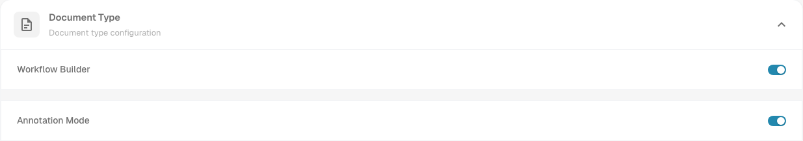
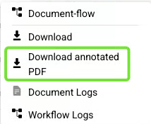

# Annotation Mode

## Overview

The **Annotation Mode** setting allows users to create and manage annotations directly on the PDF. If a document contains annotations, they will be included when **exporting to IDM**.

## Location

You can find this setting under: **Settings → Module → Document Integration → Document Type → Annotation Mode**

<figure><figcaption>
The Document Type section under Settings → Module → Document Integration. Annotation Mode is shown enabled in this example.
</figcaption></figure>


DocBits Annotation Mode Tutorial: Add Notes in Validation & Download With/Without Annotations


## How to Use Annotation Mode

### 1. Enabling Annotation Mode

* Navigate to the **Validation Screen**.
* Click on the **speech bubble** icon on the right to enter Annotation Mode.

<figure><figcaption>
Earlier interface: the speech bubble on the right opens annotation mode.
</figcaption></figure>

### 2. Creating an Annotation

* Select an area on the PDF where you want to place an annotation.
* Click the **pen** icon to write text.
* Click the **save (disk)** icon to save the annotation.
* Click the **trash can** icon to delete the annotation.

<figure><figcaption>
Earlier interface: the pencil edits the note, the disk saves it, and the trash can deletes it.
</figcaption></figure>

*   Customize the text using:

    * **Size** adjustment
    * **Bold**
    * _**Italic**_
    * <mark style="color:purple;">**Color**</mark>
    * **Font selection**

    
<figure><figcaption>
Earlier interface: choose the font, size, emphasis and text color, then enter the note. Cancel closes the dialog; Save stores the note.
</figcaption></figure>

### 3. Managing Annotations

* **Move an annotation** by clicking and holding the left mouse button.
* **Create multiple annotations** within the same document.
* **Annotations are only visible** when Annotation Mode is enabled.
* Annotations **will be included** when exporting the document to **IDM.**
* Some earlier interfaces show an **exclamation mark** beside the **speech bubble icon** when annotations are present; the older screenshot below illustrates that indicator.

<figure><figcaption>
Earlier interface: an exclamation mark beside the speech bubble indicates annotations.
</figcaption></figure>

<mark style="color:red;">**Note:**</mark> Annotations can also be viewed, added, and modified directly within the **Approval Screen**, allowing users to make necessary adjustments during the approval process.

### 4. Downloading PDFs with or without Annotations

* If a document has annotations, you can choose to download the PDF either with or without the annotations.
* To do this, go to the **Dashboard**.
* Click on the **three dots** in the **Action** column.
* Select one of the two available download options:
  * **Download** for the regular document.
  * **Download annotated PDF**, when an annotated version is available for the document.

<figure><figcaption>
Earlier interface: Download and Download annotated PDF are separate entries in the document action menu.
</figcaption></figure>

By enabling and using Annotation Mode, users can efficiently add, edit, and manage annotations directly on PDFs, enhancing document collaboration and review.
