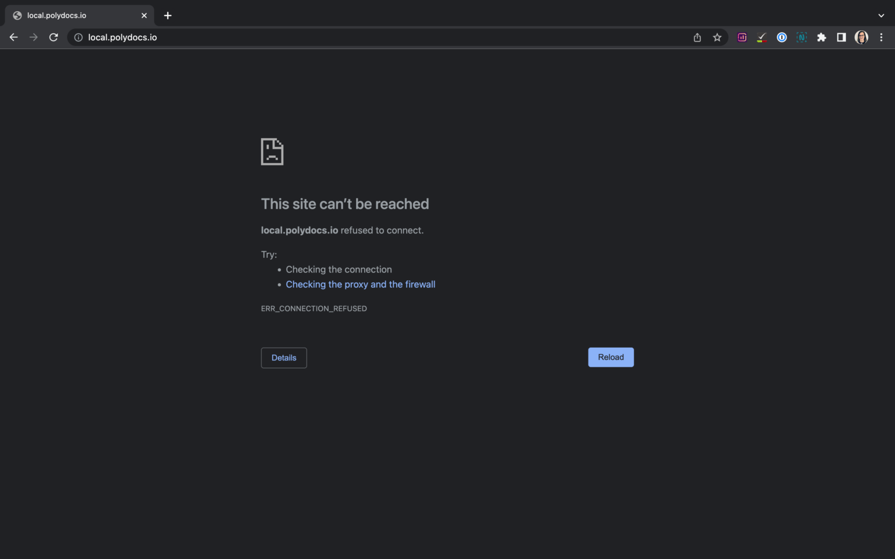
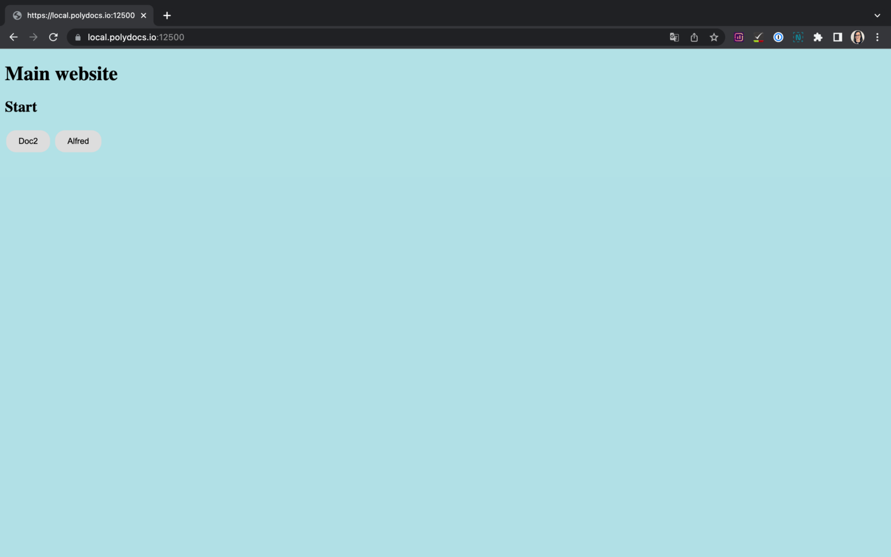
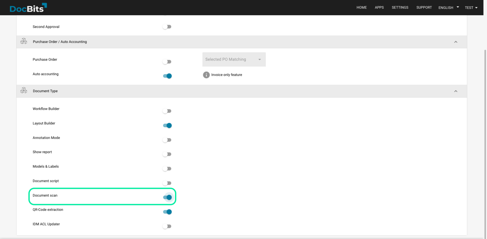

# Doc Scan

## Download and install the scanner software

On the DocBits dashboard, click Scan Document.

<figure><figcaption></figcaption></figure>

If the local scanner software is not installed, DocBits displays a download prompt. Choose the download for your operating system.

<figure><figcaption></figcaption></figure>

Open the downloaded installation file. The illustrated installer is for macOS; follow the instructions for your operating system.

<figure><figcaption></figcaption></figure>

In the illustrated installer, click Continue, accept the software license with Agree, and continue. Check the destination and required space, then click Install. The displayed 33.6 MB applies to that installer version; the space required can change with the version.

When installation is complete, close the installer.

<figure><figcaption></figcaption></figure>

Open https://local.polydocs.io:12500/ in your browser to test the local service. If the browser cannot reach it and you use a FRITZ!Box, check the DNS rebind settings described below.

<figure><figcaption></figcaption></figure>

When the local service page appears, click DocBits to open DocBits.

<figure><figcaption></figcaption></figure>

Sign in on the DocBits login page to access your dashboard.

<figure><figcaption></figcaption></figure>

Activate Doc Scan in the settings under Modules.

<figure><figcaption></figcaption></figure>

## FRITZ!Box network settings

If https://local.polydocs.io:12500/ cannot be reached because a FRITZ!Box blocks DNS responses referring to private addresses, the browser may report a DNS timeout. The FRITZ!Box uses this protection against DNS rebinding. For this local service, add a hostname exception:

1. In the German FRITZ!Box interface, open Heimnetz (home network), then Netzwerk (network).
2. Open the Netzwerkeinstellungen (network settings) tab.
3. Under DNS-Rebind-Schutz (DNS rebind protection), add local.polydocs.io to the hostname exceptions.
4. Click Übernehmen (apply) and test the local service again.

## Uninstall Doc2Scan Service Manager

To uninstall Doc2Scan Manager on macOS, run:

```javascript
sudo bash /Library/doc2scan/uninstall.sh
```

## Scanner compatibility

sane-airscan is a SANE backend for Apple AirScan/eSCL and Microsoft WSD (WS-Scan, Web Services for Devices). These are network scanning protocols.

Consult the [maintained sane-airscan compatibility information](https://github.com/alexpevzner/sane-airscan) for reported device and protocol support. Protocol availability or a report for sane-airscan does not guarantee that every device feature works in Doc Scan. Test your scanner with the required Doc Scan workflow.
