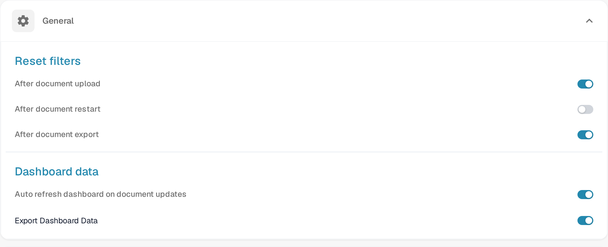
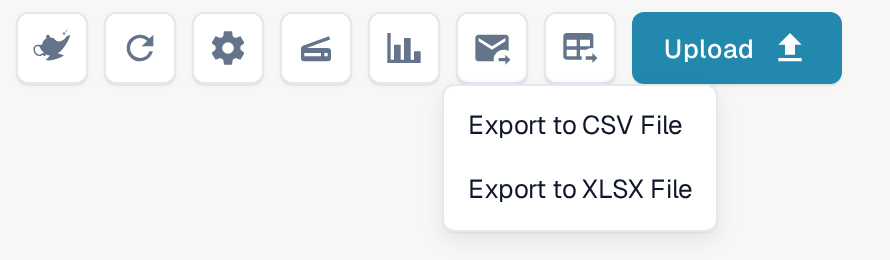
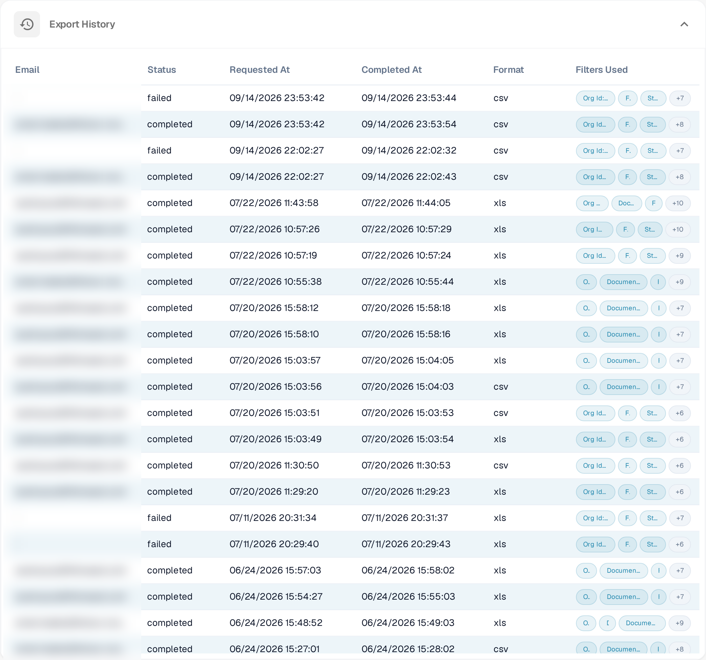

# Export Dashboard Data

The **Dashboard** can hand its list to you as a spreadsheet. Once the option is switched on, an export button sits in the dashboard toolbar; every request is queued, prepared in the background and listed in the **Export History** of the dashboard settings.

## Switch the export on

1. Go to **Settings → System & Administration → Dashboard**.
2. Open the **General** panel and scroll to **Dashboard data**.
3. Switch **Export Dashboard Data** on. **Auto refresh dashboard on document updates** above it is a separate option and does not affect the export.

<figure><figcaption>
The Export Dashboard Data switch in Settings → Dashboard
</figcaption></figure>

## Export the list you are looking at

1. Open the **Dashboard** and set the filters, the quick search and the columns you want in the file.
2. Select the **export button** in the toolbar — the icon with a table and an arrow.
3. Choose **Export to CSV File** or **Export to XLSX File**.

<figure><figcaption>
The export menu in the dashboard toolbar
</figcaption></figure>

DocBits confirms the request with *Your export request has been received. You will receive an email with the download link shortly.* You can keep working; the file is prepared in the background.

The export is not a copy of the screen. It uses:

- the **filters and the quick search** that are applied when you start it — the Export History later shows which filters were used,
- the **columns of the selected dashboard**. Column changes you have not saved yet are not in the file: when the dashboard has unsaved changes, DocBits warns you and exports the last saved version. Save the dashboard first if the export should follow your new arrangement.

## Follow an export in the Export History

**Settings → System & Administration → Dashboard → Export History** lists every export request of the organisation:

| Column           | Meaning                                                                     |
| ---------------- | --------------------------------------------------------------------------- |
| **Email**        | The address the download link was sent to.                                  |
| **Status**       | `completed` when the file was built, `failed` when the export did not work. |
| **Requested At** | When the export was started.                                                |
| **Completed At** | When the file was ready.                                                    |
| **Format**       | `csv` or `xls`, depending on the option you chose.                          |
| **Filters Used** | The filters that were applied to the list. **+n** shows the rest of them.   |

<figure><figcaption>
The Export History of the dashboard settings
</figcaption></figure>

If an export stays on `failed`, start it again — a very large list or an interrupted background job is the usual cause. The dashboard itself is unaffected by a failed export.
