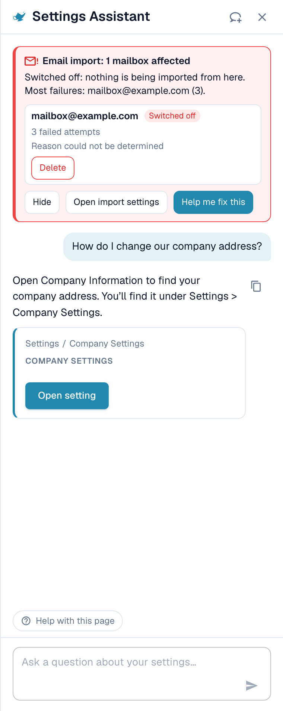
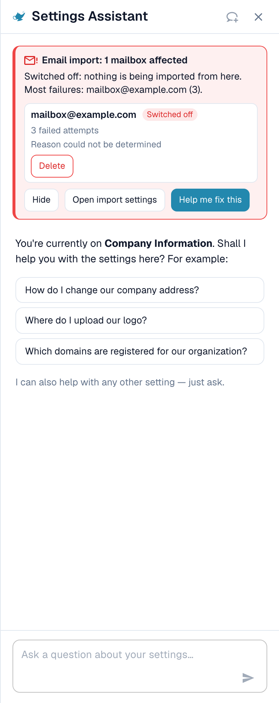

# Settings Assistant

## Overview

The **Settings Assistant** is a chat panel inside the Settings area. You ask a question in plain language, and it reads the configuration of your organisation, answers, and takes you straight to the right setting. It can also warn you when something in your setup has stopped working, and, with your confirmation, change a setting for you.

It helps most when you know **what** you want ("stop splitting documents on barcodes") but not **where** the setting lives, or when you wonder **why** something does not happen ("Why isn't PO matching active?").

<figure><figcaption>
The Settings Assistant on the Company Information page: a finding at the top, a greeting for the current page, three example questions and the question field.
</figcaption></figure>

### What it can do

| You want to… | Example | What you get |
| --- | --- | --- |
| Find a setting | "Where do I find the email import settings?" | The path (for example Settings / Import), an **Open setting** button that jumps to the setting and highlights it |
| Understand a setting | "How do I enable barcode detection?" | A short explanation of each matching setting: when to switch it on, when to leave it off |
| Check your configuration | "Why isn't PO matching active?" | The current value of each related setting in your organisation (**Current: On** or **Current: Off**) and which one blocks you |
| Spot a broken import | A red card at the top of the panel | Which mailbox or FTP connection fails, how often, and a likely reason |
| Change a setting safely | **Switch off** on a failing mailbox in a finding card | A preview of the change. Nothing is saved until you confirm. Every change can be undone. |
| Learn a page | **Watch video explanation** | A short video for the page you are on (available for selected pages) |


The assistant runs on the **Fast** AI tier. There is no organisation setting to choose a different model.


## Who can use it

* The **organisation administrator** switches the assistant on or off for the whole organisation.
* Once it is on, every administrator who can open **Settings** can show or hide the panel for themselves.
* Changes (applying a recommendation, switching off or deleting an import connection, creating a rule) are limited to **organisation administrators**. Other users get the message *Available to administrators only.*

## Turn it on

1. Go to **Settings → Global Settings → Company Information**.
2. Open the **Assistants** section.
3. Turn on **Enable the settings assistant**.

<figure><figcaption>
The Assistants section. The settings assistant has its own switch. The validation assistant and the explainer voice-over are separate features.
</figcaption></figure>

A short message confirms **Settings assistant enabled**. The setting is off by default. While it is off, the panel and its button do not appear anywhere.


The **Validation assistant** in the same section is a different feature. It explains blocking fields inside a document and cannot change any setting. Switching one of the two does not affect the other.


## Open and close the panel

On every page of the Settings area you find a small **genie-lamp button** next to the settings search field. Click it to **show** or **hide** the assistant.

* The panel remembers your choice per user, so it stays open the next time you come back.
* On a wide screen (1280 pixels and more) it sits next to the page. You can drag its edge to change the width.
* On a narrow screen it opens as an overlay. **Esc** or a click outside closes it.
* **New chat** (the speech-bubble icon in the header) clears the conversation. The conversation also survives a page reload, but not a closed browser tab.

## Ask questions

Type a question in the field at the bottom ("Ask a question about your settings…") and press **Enter**. The assistant shows what it is doing ("Reading configuration…", "Searching documentation…", "Writing answer…") and you can stop it at any time with **Stop**.

### The panel knows which page you are on

When you open the panel on a settings page, it greets you for **that page** and offers three questions that fit it. These are real examples:

| Page | Example questions |
| --- | --- |
| Company Information | "How do I change our company address?", "Where do I upload our logo?", "Which domains are registered for our organization?" |
| Import | "Is email import active for us?", "Which email address do we send documents to?", "How do I set up an FTP or SFTP import?" |
| Classify & Extract | "Which AI model is used for extraction?", "Is splitting documents on barcodes active for us?", "Can I use a different AI model for one supplier?" |
| Users | "How do I invite a new user?", "How do I make a user an administrator?", "How do I deactivate a user?" |
| Settings overview | "How do I enable barcode detection?", "Why isn't PO matching active?", "Where do I find the email import settings?" |

Click a question and it is sent immediately. Below the three questions the panel says *I can also help with any other setting — just ask.* During a conversation, the chip **Help with this page** stays at the bottom and asks "What can I configure on this page?".

### Example 1: Find a setting

You ask **"How do I change our company address?"**

<figure><figcaption>
The answer names the place, and the card gives you the exact path and an <strong>Open setting</strong> button.
</figcaption></figure>

The answer says where the address lives. The card below shows the path (**Settings / Company Settings**) and the **Open setting** button. Click it: DocBits opens the page, scrolls to the setting and highlights it for a few seconds.

### Example 2: Understand a setting that has several names

You ask **"How do I enable barcode detection?"**

<figure><figcaption>
When a word fits several settings, the assistant lists each one with <strong>Enable when</strong> and <strong>Leave off when</strong>.
</figcaption></figure>

"Barcode detection" can mean three different settings, so the assistant asks *Did you mean: QR Code Extraction, Barcode Assignment, or Split Document on Barcode?* and explains each:

* **QR Code Extraction**: reads supported barcodes and QR codes automatically during processing. Enable it when your documents carry useful codes.
* **Barcode Assignment**: lets a reviewer assign decoded barcode values to fields by hand during validation. It needs extraction to detect the code first and does not make processing touchless.
* **Split Document on Barcode**: splits one uploaded file into separate documents at separator pages. Use it only when the separator codes are reliable.

### Example 3: Find out why something does not happen

You ask **"Why isn't PO matching active?"**

<figure><figcaption>
For a "why" question the assistant reads your configuration and shows each setting with its <strong>Current</strong> value.
</figcaption></figure>

The assistant reads the settings of your organisation and reports what it found. In this example PO Matching is **On** for all four document types, and the setting **Auto export if PO matched 100%** is **Off**, so automatic matching and export do not run. Each card shows **Current: On / Off** and an **Open setting** button, so you can fix it right away.

### Example 4: More questions to try

* "Which AI model is used for extraction?"
* "Is splitting documents on barcodes active for us?"
* "How do I deactivate a user?"
* "Where do I set how long documents are kept?"
* "Which settings affect the touchless rate?"
* "Show me a screenshot of the supplier portal settings."


If a question is outside the settings area, or the assistant finds nothing about it in the DocBits information it has, it says so. For example, a question about something that is not a setting returns *I can't find anything about … in the DocBits information available here* together with a link to the closest page. It does not guess.


### Links and screenshots in answers

* Answers can contain **View documentation** links. They only point to docs.docbits.com and open in a new tab. Documentation links appear when the documentation search is available for your environment.
* Answers can show **screenshots** from the documentation. Click a thumbnail to enlarge it.
* **Copy answer** (the small copy icon next to an answer) copies the text.

## Findings: the assistant warns you

When something in your setup has stopped working, a **red card** appears at the top of the panel. You do not have to ask. The assistant checks again whenever you open the panel and whenever you return to the browser tab.

<figure><figcaption>
An expanded finding: the mailbox, its state (<strong>Switched off</strong>), the number of failed attempts and the reason.
</figcaption></figure>

There are currently two checks:

| Check | Card title | What it counts |
| --- | --- | --- |
| Email import | "Email import: 1 mailbox affected" / "Email import: 3 mailboxes affected" | Mailboxes with failed sign-ins |
| FTP import | "FTP import: 1 connection affected" / "FTP import: 2 connections affected" | Connections with failed connection or sign-in attempts |

Each card has three buttons:

* **Show errors** (then **Hide**): lists the affected mailboxes or connections, up to ten, with the state (**Switched off** or **Retrying**), the number of failed attempts and the reason.
* **Open import settings**: opens **Settings → Import**.
* **Help me fix this**: starts a chat. The assistant asks itself "My email import has stopped working. Can you help me fix it?" and walks you through the reason.

The summary line tells you how bad it is:

| Summary line | Meaning |
| --- | --- |
| *Switched off: nothing is being imported from here.* | All affected mailboxes are switched off. Nothing arrives. |
| *Still being retried, but imports are probably failing.* | DocBits keeps trying, but the sign-in does not work. |
| *1 switched off, 2 still being retried.* | A mix of both. |

### Reasons you may see

The assistant translates the technical error into one of these reasons:

| Reason shown | What to do |
| --- | --- |
| Sign-in blocked by policy (e.g. basic authentication disabled, or an app password/MFA is required) | Ask your mail administrator for an app password or switch the mailbox to modern authentication |
| Sign-in rejected (check username and password) | The password changed. Enter the new one in the import settings |
| Mailbox or path not found | The mailbox was renamed or deleted. Check the address or folder |
| Server not reachable | Check the server name and your firewall |
| Timeout while connecting | The server is slow or blocked. Try again later |
| Certificate or TLS connection failed | Check the encryption setting and the server certificate |
| Reason could not be determined | Open the import settings and test the connection |

### Switch off or delete a failing connection

On an expanded row you can use **Switch off** (only shown if it is still on) or **Delete**. Both follow the same safe flow:

1. You click the button. The assistant asks *Switch off (name)? Nothing will be imported from this mailbox until it is switched on again.* or *Delete (name)? It is removed permanently and cannot be undone.*
2. You confirm with **Yes, switch off** or **Yes, delete**, or you click **Cancel**.
3. The result line appears: *(name) was switched off.* with an **Undo** button. A deleted connection has no **Undo**, because delete is permanent.

If someone else changed the mailbox in the meantime, you see *This mailbox was changed in the meantime. Please check it and try again.* Nothing is changed.

## Changing settings safely

The assistant never changes anything on its own. Every change follows the same four steps:

1. **Preview**: you see the setting, its scope (**Organization**) and the **current → proposed** value. Nothing is saved yet.
2. **Your confirmation**: you click **Confirm** (or **Yes**). Only an organisation administrator can do this.
3. **Result line**: the chat shows **Changed: (setting) → (value)**.
4. **Undo**: a button with a countdown ("14 min left") lets you take the change back. The change is also recorded in the log.

**Example (illustrative).** A recommendation card for a setting the assistant is allowed to write shows an **Apply** button next to **Open setting**. Say the card is about **Auto export if PO matched 100%**. You click **Apply**. The dialog **Apply this change?** shows *Current: Off → Proposed: On*. You click **Confirm**. A message **Setting updated.** appears with an **Undo** button. If you notice a mistake within about 15 minutes, you click **Undo** and the old value is back. Cards without an **Apply** button are for navigation only: use **Open setting** and change the value yourself.

If the value changed since you opened the dialog, you see *This setting changed since you opened this dialog. Preview it again.* and nothing is applied.

### What the assistant can change

| Change | Example request (illustrative) |
| --- | --- |
| A single organisation setting (**Apply** on a recommendation) | "Switch on automatic PO match and export" |
| Document types on or off | "Deactivate document type Delivery Note" |
| Rename an access group | "Rename the group Buyers to Purchasing" |
| Search mode of a lookup field (Auto or Manual) | "Search suppliers manually instead of automatically" |
| Delete a field | "Delete the field Cost Center" |
| Create an inactive validation rule from a catalogue | "Create a rule that checks the invoice date is not in the future" |
| Create an inactive transformation rule | "Create a rule that removes dashes from the supplier VAT number" |
| Switch off or delete an import connection | Use the buttons in the finding card |

### Rule drafts

If you ask for a **transformation rule**, the assistant shows a **Rule preview** first:

* the rule name and a plain sentence ("Remove dashes from the supplier VAT number"),
* the target (header field, column of a table, rows of a table, document attribute),
* a test on sample documents: **Applies to 4 of 5 samples**, with each document marked **Applies**, **Does not apply** or **Applies, no change**.

With **Create rule** you save it. The rule is created **inactive**: you activate it yourself after checking it. You can undo the creation for **15 minutes**. After that, delete the rule in the rule list. At most **10 rules per hour** can be created through the assistant.

## Video explanations

On selected pages (currently **Layouts**, **Users** and **Sub-Organizations**) the assistant offers **Watch video explanation**. The video plays in the panel, has captions and a transcript (**Show transcript**), and uses your language when a version exists.

## Limits and messages

| Message | Meaning |
| --- | --- |
| Too many requests. Please wait a moment. | You sent many questions quickly. **Retry** becomes active after a short wait. |
| Available to administrators only. | Your account is not an organisation administrator. |
| The assistant is temporarily unavailable. | Try again in a few minutes. |
| The assistant is taking too long to respond. | The answer did not start in time. Click **Retry**. |
| Something went wrong. Please try again. | A general error. The **Error ID** can be copied for support. |
| The assistant is being set up | The feature is not yet available in your environment. |
| You've switched organizations — this response no longer applies here. | You changed organisation while an answer or a change was open. |

A conversation keeps the last 50 turns in your browser. A question can have up to 4000 characters.

## Tips

* Ask for **one thing at a time**. "Where is the email import and is it on?" works better as two questions.
* Use the **page greeting**. The three questions are written for the page you are on, and they are the fastest start.
* Say **what you want to achieve**, not the name of a setting. "I want invoices to be exported without anyone looking at them" finds the right settings.
* Check the **preview** before you confirm, especially the **current → proposed** values.
* You are not sure? Use **Open setting** and look at the page. The assistant never hides where a setting lives.

## Related pages

* [Company Preferences](company-preferences.md)
* [Analytics Dashboard](../../../analytics-dashboard.md)
* [DocBits MCP](../../../../advanced-functions-and-tools/docbits-mcp/README.md)

<!-- Source notes (not shown): facts read from the doc2app code on dev (SettingsAssistant, AssistantChat components) and checked in the dev UI on 14 Oct 2026. "Fast tier, no organisation switch" and "documentation search not configured on Sandbox yet" come from the feature team (CORE-6379). Strings for the apply/action cards not verified in the UI are described, not quoted. -->
