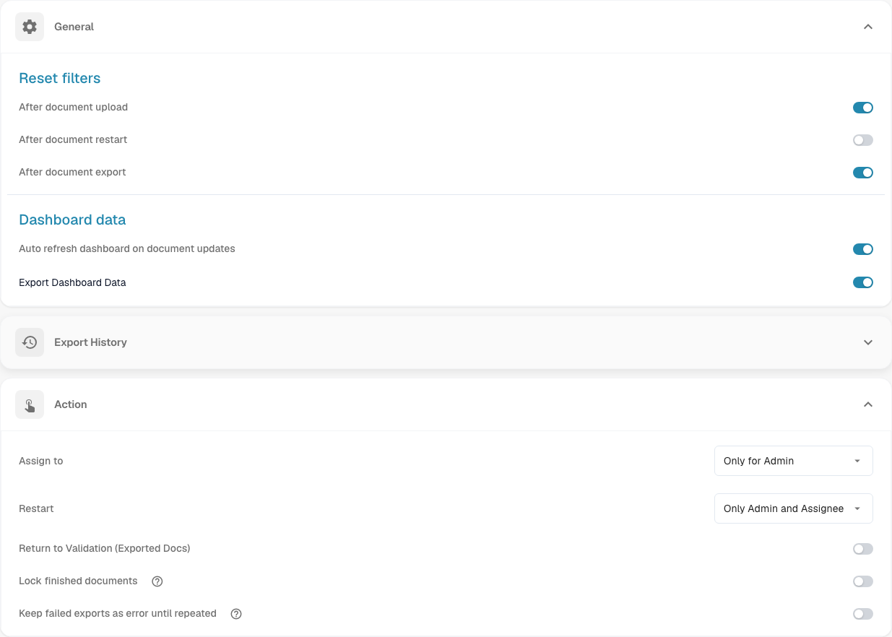
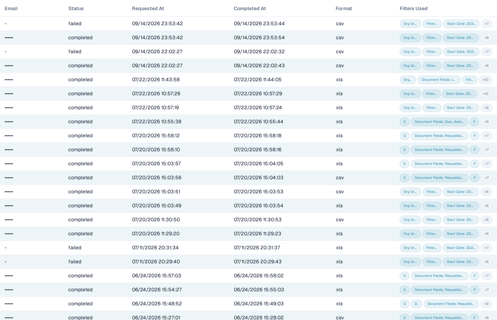
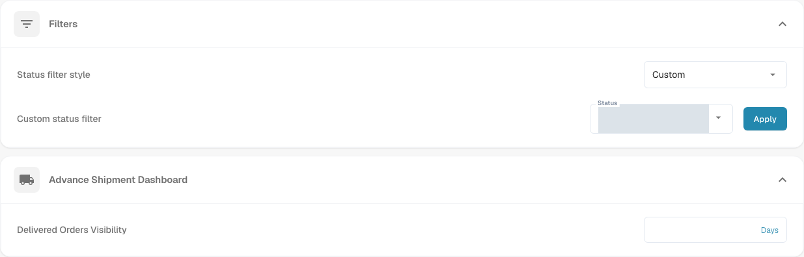

# Dashboard

## Overview

The Dashboard settings are designed to help administrators control the data presentation and interaction within the DocBits dashboard. These settings determine what information is immediately available upon logging in, ensuring that users have quick access to the most relevant data for their tasks.

<figure><figcaption>
Current English General and Action settings. Export History is collapsed; the visible values are the existing test settings.
</figcaption></figure>

## Accessing the Dashboard Settings

To access the dashboard settings, navigate to:\
**Settings → Dashboard**

Expand a section to review its controls. Settings are saved when a switch, selection or number value is changed; **Apply** saves the custom status selection.

## **General**

* **Reset filters**: Allows for the configuration of when dashboard filters should reset, such as after document upload, document restart, or document export. This helps in maintaining a clean slate for data viewing according to specific workflow stages.
* **Dashboard data**:
  * **Auto refresh dashboard on document updates**: A toggle switch that controls whether the dashboard automatically reloads its data when documents are updated. When enabled, changes to documents — for example a status change made by another user — are picked up automatically, so the list always shows the current state without a manual refresh.
  * **Export Dashboard Data**: This feature adds a new **Export** button to the dashboard toolbar, allowing you to export the current dashboard view as a **.csv** or **.xlsx** file. For a step-by-step guide, see [Export Dashboard Data](../../document-processing/module/export-dashboard-data.md).

## **Export History**

In the **Export History**, you will see a table listing all past exports along with key information about each request.

<figure><figcaption>
Compact Export History rows with filter chips and +N counters for additional filters. Recipient addresses and organization IDs are masked in this dev capture.
</figcaption></figure>

The following details are included:

* **Email**: The recipient email address recorded for the export.
* **Status**: The current status of the export (Pending, Completed, or Failed).
* **Requested At**: The date and time when the export was initiated.
* **Completed At**: The date and time when the export was completed.
* **Format**: The file format used for the export (CSV, XLSX).
* **Filters Used**: Up to three active filters appear as chips on one line. If more filters were applied, a **+N** chip shows how many more there are. Point to the filter cell to see the full list in a tooltip. Filters with the value **None** are omitted.

<mark style="color:red;">**Note**</mark>: To export tables the option Export Dashboard data in the [General](./#general) Section must be active

## **Action**

* **Assign to**: This feature allows users to define permissions for document assignment
  * **Only for Admin**: Only admin-users can assign documents, regardless of permissions granted to non-admin users.
  * **All Users**: All users who have been granted the necessary [permissions](../groups-users-and-permissions/groups-and-permissions/activating-permissions.md) can assign documents.
* **Restart**: This feature allows users to define permissions for restarting documents
  * **Only for Admin**: Only users with Admin privileges can restart documents, regardless of permissions granted to non-admin users.
  * **Only Admin and Assignee**: Only users with Admin privileges and the assigned user can restart the document.
  * **All Users**: All users who have been granted the necessary [permissions](../groups-users-and-permissions/groups-and-permissions/activating-permissions.md) can restart documents.

* **Return to Validation (Exported Docs)**: Controls the return-to-validation action for exported documents.
* **Lock finished documents**: The help text explains that finished documents can only be archived or set to an error status once locked. Workflows that must continue after export use the **Exported** status.
* **Keep failed exports as error until repeated**: For an inactive export configuration started by a workflow, retains **export error** until that configuration exports successfully again. Restarting the export alone does not clear the failure, as explained in the control's help text.

## **Filters**

* **Status filter style**: Choose **All**, **Static** or **Custom** to control which status filters are offered. **Custom** displays the status selection and **Apply** control.
* **Custom status filter**: Enables the creation and application of custom filters that can target specific document statuses like "New", "Validating", or "Exporting". This allows users to quickly access documents in specific stages of processing.

<figure><figcaption>
Current English Filters and Advance Shipment Dashboard. Existing custom-status selections are masked.
</figcaption></figure>

For the steps to choose **Custom**, select statuses, apply the selection or return to **All**, see [Custom status filters](page-1.md).

## Advance Shipment Dashboard

* **Delivered Orders Visibility**: This feature allows the user to specify the duration for which delivered orders will be visible.

These dashboard settings are crucial for ensuring that the DocBits platform is as responsive and useful as possible, providing users with a powerful tool to monitor and manage document processing activities directly from the dashboard.
