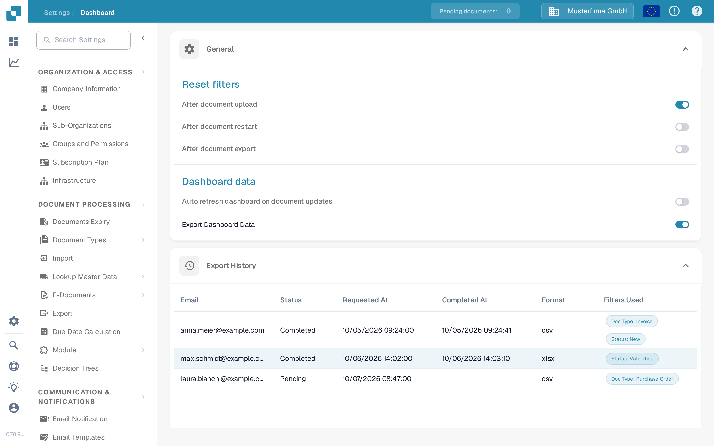
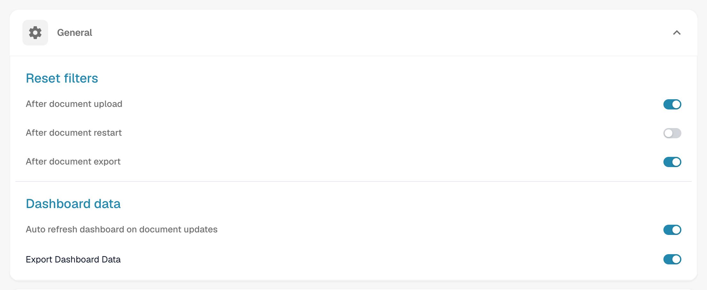
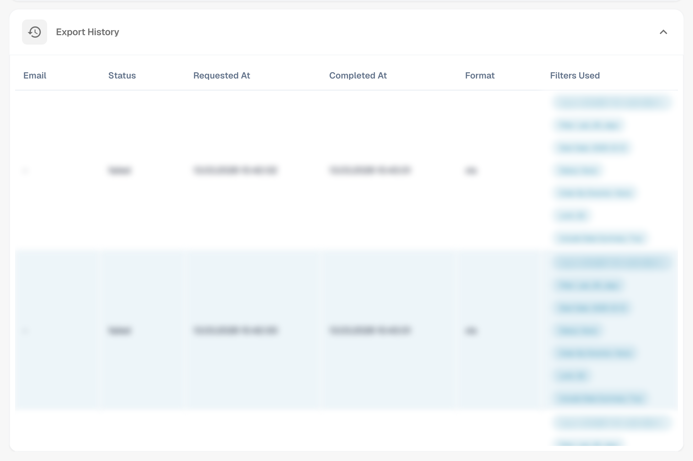
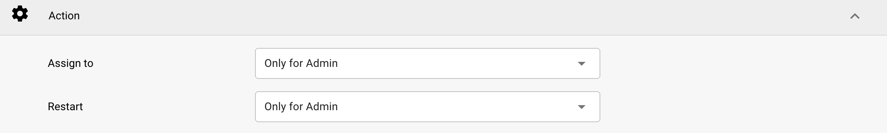
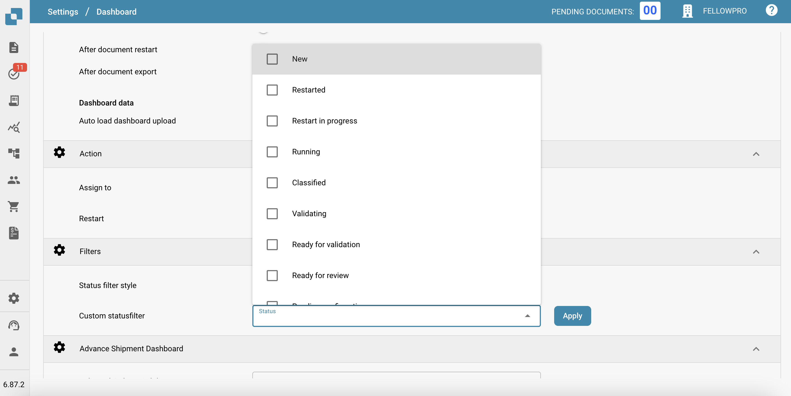
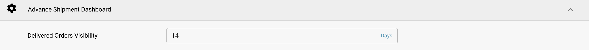

# Dashboard

## Overview

The Dashboard settings are designed to help administrators control the data presentation and interaction within the DocBits dashboard. These settings determine what information is immediately available upon logging in, ensuring that users have quick access to the most relevant data for their tasks.

<figure><figcaption>
Dashboard Settings Page
</figcaption></figure>

## Accessing the Dashboard Settings

To access the dashboard settings, navigate to:\
**Settings → System & Administration → Dashboard**

## **General**

* **Reset filters**: Allows for the configuration of when dashboard filters should reset, such as after document upload, document restart, or document export. This helps in maintaining a clean slate for data viewing according to specific workflow stages.
* **Dashboard data**:
  * **Auto refresh dashboard on document updates**: A toggle switch that controls whether the dashboard automatically reloads its data when documents are updated. When enabled, changes to documents — for example a status change made by another user — are picked up automatically, so the list always shows the current state without a manual refresh. This is a personal (user) setting and only affects your own dashboard view.
  * **Export Dashboard Data**: This feature adds a new **Export** button to the dashboard toolbar, allowing you to export the current dashboard view as a **.csv** or **.xlsx** file. For a step-by-step guide, see [Export Dashboard Data](../../document-processing/module/export-dashboard-data.md).

      <figure><figcaption>
Dashboard data settings
</figcaption></figure>

## **Export History**

In the **Export History**, you will see a table listing all past exports along with key information about each request.

<figure><figcaption>
Export History
</figcaption></figure>

The following details are included:

* **Email**: The email address from which the export was requested.
* **Status**: The current status of the export (Pending, Completed).
* **Requested At**: The date and time when the export was initiated.
* **Completed At**: The date and time when the export was completed.
* **Format**: The file format used for the export (CSV, XLSX).
* **Filters Used**: Any filters that were applied to the dashboard at the time of export.

<mark style="color:red;">**Note**</mark>: To export tables the option Export Dashboard data in the [General](./#general) Section must be active

## **Action**

* **Assign to**: This feature allows users to define permissions for document assignment
  * **Only for Admin**: Only admin-users can assign documents, regardless of permissions granted to non-admin users.
  * **All Users**: All users who have been granted the necessary [permissions](../groups-users-and-permissions/groups-and-permissions/activating-permissions.md) can assign documents.
* **Restart**: This feature allows users to define permissions for restarting documents
  * **Only for Admin**: Only users with Admin privileges can restart documents, regardless of permissions granted to non-admin users.
  * **Only Admin and Assignee**: Only users with Admin privileges and the assigned user can restart the document.
  * **All Users**: All users who have been granted the necessary [permissions](../groups-users-and-permissions/groups-and-permissions/activating-permissions.md) can restart documents.

<figure><figcaption>
Action settings
</figcaption></figure>

## **Filters**

* **Status filter style**: Determines the presentation style of status filters, which can be set to default or customized according to the operational focus of the users.
* **Custom status filter**: Enables the creation and application of custom filters that can target specific document statuses like "New", "Validating", or "Exporting". This allows users to quickly access documents in specific stages of processing.

<figure><figcaption>
Filters
</figcaption></figure>

## Advance Shipment Dashboard

* **Delivered Orders Visibility**: This feature allows the user to specify the duration for which delivered orders will be visible.

<figure><figcaption>
Advance Shipment Dashboard
</figcaption></figure>

These dashboard settings are crucial for ensuring that the DocBits platform is as responsive and useful as possible, providing users with a powerful tool to monitor and manage document processing activities directly from the dashboard.
