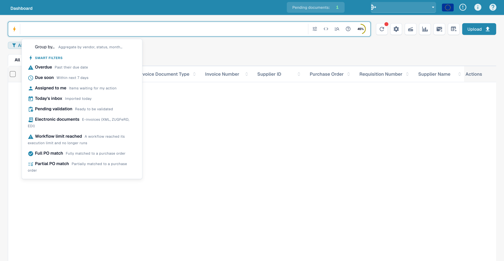
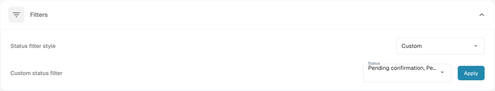

# Customizing Filters

Use dashboard filters to narrow the visible document list. Dashboard search criteria and the status-filter configuration are separate controls.

## Filter the document list

Open the dashboard and use the search field or filter controls. The smart-filter menu includes shortcuts such as **Overdue**, **Due soon**, **Assigned to me**, **Pending validation**, **Full PO match** and **Partial PO match**. Select the filter appropriate to your search and inspect the resulting list.

<figure><figcaption>
Document search and quick filters with document values hidden.
</figcaption></figure>

Combine criteria using the controls available in your version. Verify the displayed results when combining filters; selecting a filter does not change a document’s extracted values, approval or export status.

To remove a criterion, use its visible X/remove control or the available clear-filter action. Check that the list now reflects the remaining criteria.

## Configure the status filter

Open **Settings → Dashboard → Filters**. Choose **Status filter style**. If you select **Custom**, choose the statuses to expose through **Custom status filter**, then use **Apply** to save this configuration. Changing this setting is different from filtering the list for one search.

Organization administrators update the organization default. Where these controls are available to other users, the selection is saved as their personal preference instead. A personal preference takes precedence over the organization default.

Changing **Status filter style** saves the style immediately. **Apply** saves the custom status list; applying an empty list restores **All**. Choosing **All** directly restores the standard style and hides the custom selector and its **Apply** button.

<figure><figcaption>
Dashboard status-filter settings; displayed values were not changed.
</figcaption></figure>

The illustrations show the controls only. No filter configuration was applied and no document was modified for these screenshots.
