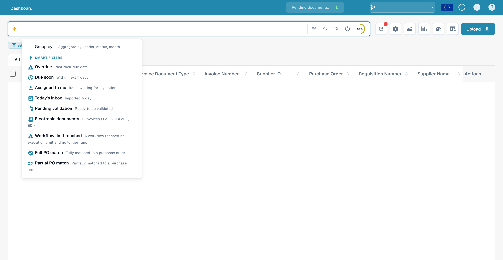
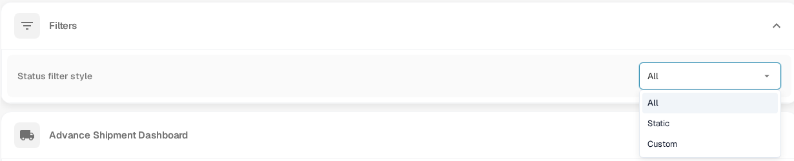
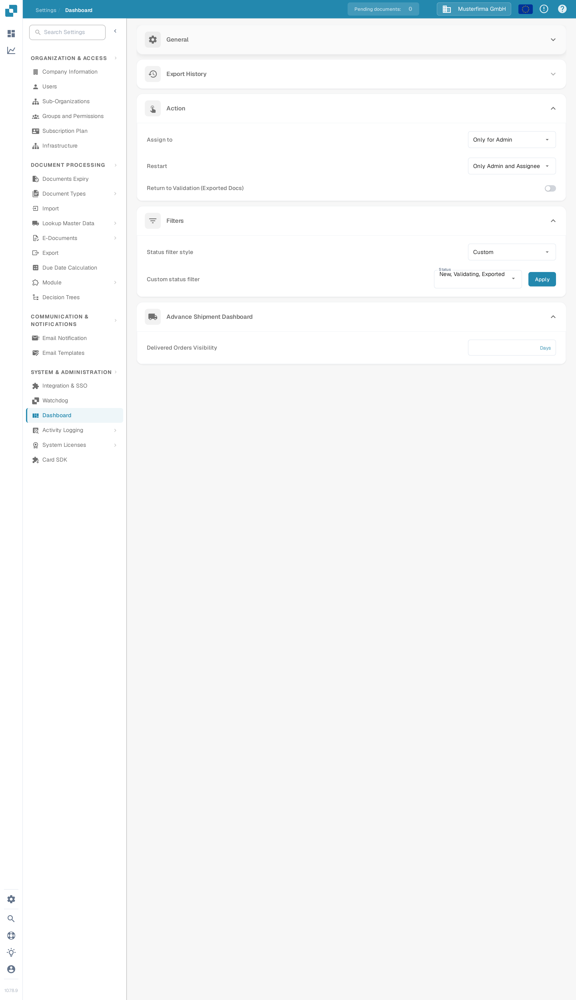

# Customizing Filters

Dashboard filters narrow the document list for your current search. The **status filter** setting is separate: it decides which statuses the dashboard's status filter offers in the first place.

## Filter the document list

Open the dashboard and use the search field or the filter controls. The smart-filter menu offers shortcuts such as **Overdue**, **Due soon**, **Assigned to me**, **Pending validation**, **Full PO match** and **Partial PO match**.

<figure><figcaption>
Document search and quick filters.
</figcaption></figure>

You can combine several filters. To remove one, click the **X** on its chip. Filtering only changes which documents you see; it does not change a document's extracted values, approval or export status.

## Configure the status filter

Open **Settings → Dashboard → Filters** and choose a **Status filter style**:

* **All** shows the full status list.
* **Static** shows a predefined, shorter list.
* **Custom** lets you choose the statuses your organization needs.

<figure><figcaption>
The three status filter styles.
</figcaption></figure>

Changing the style saves it immediately. With **Custom**, pick the statuses under **Custom status filter** and click **Apply**. Applying an empty list switches the style back to **All**.

<figure><figcaption>
The status filter setting in Dashboard settings.
</figcaption></figure>

Organization administrators set the default for the organization. Where other users have access to these controls, their selection is saved as a personal preference, which takes precedence over the organization default.
