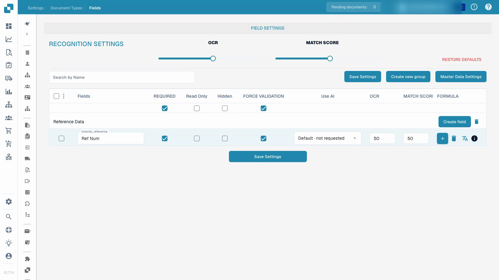

# Document Types

Configure the reference field in an isolated custom test type, save its label and required-review settings, and verify them after reloading.


Document Types


[Watch with subtitles](https://docbits-videos.fra1.cdn.digitaloceanspaces.com/settings-assistant/document-types-fields-admin/v1/en.html)

The recording shows the actual test interface. Configured values and technical labels retain their original meaning.

## Overview

Document types define the configuration used for different kinds of documents. DocBits provides standard types such as invoices and credit notes. Custom types let an administrator define fields and processing settings for another document category. Standard types cannot be deleted; manage custom types within the organization's permissions.

## Controls on a document type card

| Control | Purpose |
| --- | --- |
| Activate | Enable or disable the document type for processing. |
| Extraction | Choose the extraction mode shown by the native control: Flex or Fix. This is a mode selection, separate from the Activate switch. |
| Settings, shown as a gear | Open further configuration for that document type. |

The available links depend on the type, permissions and enabled modules. The current interface can offer layouts, fields, tables, scripts, model training and document subtypes. Transformation rules, validation rules and electronic document configuration are available where their respective features apply. Other configuration options can be inside the document type's settings rather than a separate tab below every card.

## Configure fields and required information

The video uses an already-created, isolated custom test type. It changes that type's reference field; it does not change the existing invoice configuration.

1. Open the document type and select its fields.
2. Check the field group and stable technical field name. A readable display label is a separate setting; changing it does not create a new field ID.
3. Make the reference field required while keeping it visible and editable. Required information must be supplied; the setting does not invent a missing value or guarantee correct extraction.
4. Configure explicit field review separately from the required value. Read-only, hidden, OCR thresholds and Match Score thresholds have their own effects; they are not interchangeable switches.
5. Save the configuration, reopen it and verify the stored display label and flags.

<figure><figcaption>
Saved field settings in an isolated custom test type.
</figcaption></figure>

The demonstrated result proves that the field configuration was saved and reloaded. It does not constitute model training, invoice approval, export or a downstream validation test. Before using a configuration in production, test representative documents and the intended ordinary-user workflow.

## Custom validation rules

Where this feature is available, open the document type's validation rules. To reuse an existing rule, follow [Duplicate a Custom Validation Rule](duplicate-a-custom-validation-rule.md). This is separate from the individual field flags shown in the video.

## Create a custom document type

Open the custom document types section, choose New and enter a clear name. Complete the offered setup steps for the intended extraction mode, fields, groups and any tables. Model training and extraction configuration are separate from merely saving a required-field flag.


See [Setup Document Type](../../../setup/document-types/) for the setup procedure.


## Additional recording


Document Types

