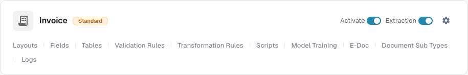
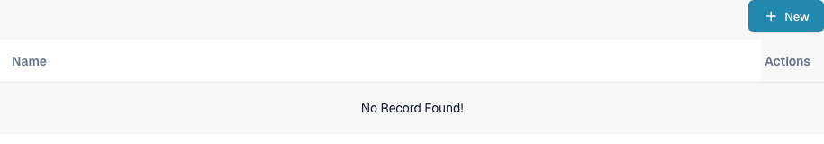
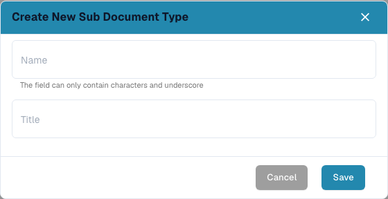

# Creating a new Sub Type

Create a document subtype when one type of document needs its own field settings, validation layout, or scripts. You need access to **Settings → Document Types**.

## 1. Open the document type

Open **Settings → Document Types**. In the card for the relevant document type, select **Document Sub Types**. The example below uses **Invoice**; choose the type that matches your documents. Other links in the card lead to settings for the whole document type.

<figure><figcaption>
Open subtypes for the document type you want to configure.
</figcaption></figure>

## 2. Start a new subtype

On **Document Sub Types**, select **+ New**. Existing subtypes, when present, appear in the list; the three-dot **Actions** menu is for an existing row.

<figure><figcaption>
The list is empty in this test organization. Select + New to open the creation dialog.
</figcaption></figure>

## 3. Name and save it

Enter a **Name** using letters and underscores, then enter a descriptive **Title**. Both fields are required. The screenshot shows the empty dialog before any values are entered. Select **Save** to create the subtype, or **Cancel** to leave without creating it.

<figure><figcaption>
The dialog is shown before entering values. Cancel closes it without creating a subtype.
</figcaption></figure>

After saving, the new subtype appears in the list. To set its fields, layout, or scripts, open its **Actions** menu and follow [Configure subtypes](configure-subtypes.md). These settings are made after creation, not in the **+ New** dialog.
