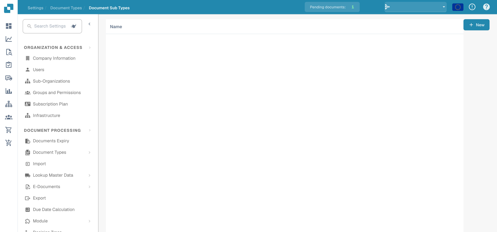

# Document Sub Types

<figure><figcaption>
English document-subtype overview.
</figcaption></figure>

<figure><figcaption></figcaption></figure>

#### Overview

Document Sub Types are essentially specialized versions of the main document types. For example, under the main document type "Invoice", there might be sub-types like "Standard Invoice", "Pro-forma Invoice", and "Credit Invoice", each with slightly different data requirements or processing rules.

**Here are some reasons why subtypes are important:**

* **Specific processing requirements:** Often, different variations of the same document type require different processing requirements. For example, different types of invoices may require specific fields, approval workflows, or validation rules based on a company's internal policies or the requirements of external partners.
* **Organizational customization:** Using subtypes allows organizations to customize their document processing to their specific needs. They can create subtypes that are tailored precisely to their individual business processes, rather than relying on generic solutions that may not meet all requirements.
* **Clear structuring:** Using subtypes allows for clearer structuring of document management. Users can more easily navigate between different variations of a document type and find the specific information they need without being distracted by irrelevant data or options.
* **Consistency and accuracy:** Subtypes can help ensure consistency and accuracy in document capture and processing. By standardizing subtypes, organizations can ensure that all relevant information is captured and that data is structured in a uniform manner.
* **Efficient processing:** Using subtypes can increase efficiency in document processing because users have access to pre-built templates and workflows optimized for specific types of documents. This reduces manual effort and minimizes errors or delays in the process.

Document subtypes in Docbits allow for more flexible and tailored management of document variations, resulting in improved efficiency, accuracy and adaptability. They provide a powerful way to manage the complexity of document processing and increase productivity within an organization.

#### Key Features and Options

1. **List of Sub Types**:
   * Each row represents a sub-type of a primary document type.
   * Includes the name of the sub-type and a set of actions that can be performed on it.
2. **Actions**:

<figure><figcaption>
Document subtypes in English administration.
</figcaption></figure>

* **Fields**: Configure which data fields are included in the sub-type and how they are managed.
* **Edit Layout**: Modify the visual layout for how information is displayed and entered for this sub-type.
* **Scripts**: Attach or edit scripts that execute specific operations when documents of this sub-type are processed.
* **Copy**: Duplicate an existing sub-type configuration to use as a basis for a new one.
* **Editing document Sub Type:** Edit the name or title of the sub-type.
* **Delete**: Remove the sub-type if it is no longer needed.

**Adding New Sub Types**:

* The "+ New" button allows administrators to create new sub-types, defining unique properties and rules as needed.
