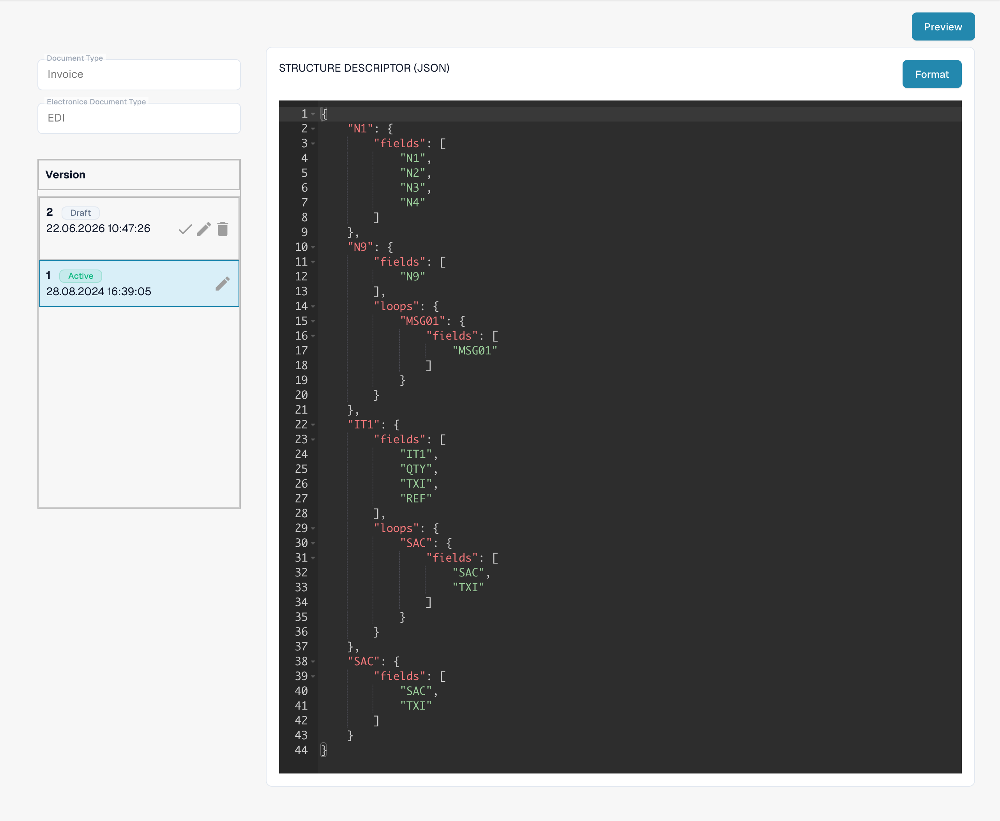

# Electronic documents and EDI configuration


DocBits E-Invoice Tutorial: Process XRechnung / ZUGFeRD (Factur-X), Validate Data & Automate Workflows


Select the document type and electronic format in the E-Documents settings. The configuration below processes incoming EDI messages; it is not an outbound EDI transmission setup.

<figure><figcaption>
Existing EDI format with its four configured attributes.
</figcaption></figure>

* STRUCTUREDESCRIPTOR: a JSON structure descriptor parses the raw EDI message into JSON. DocBits then creates intermediate XML.

* TRANSFORMATION: an XSLT stylesheet transforms the intermediate XML into the standard XML used for subsequent processing.

* PREVIEW: an XSLT stylesheet creates the human-readable presentation from the transformed XML. The editor screenshot shows the stylesheet, not the rendered document.

* EXTRACTIONPATHS: JSON configuration maps document fields and table columns to XPath expressions evaluated against the transformed XML.

<figure><figcaption>
Active STRUCTUREDESCRIPTOR attribute: JSON structure descriptor in the read-only editor.
</figcaption></figure>

## Effective rules and activation

If an electronic credit note appears as Invoice, follow the [classification troubleshooting guide](credit-note-recognized-as-invoice.md). It covers the effective custom/default source, type codes, Extraction Paths and safe activation.

## Country guides

See the country guides for exact format labels, syntax, version limits and the inspected configuration state. [eDocs formats, versions and country guides](supported-electronic-documents/README.md).

The views show an existing configuration and version. Settings vary by document type and format. Validate changes in a draft before activation.
