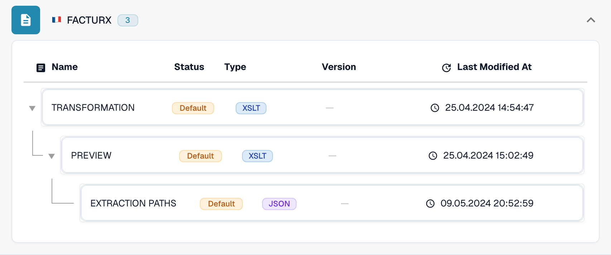

# Electronic credit note is recognized as an invoice

An electronic credit note can appear as **Invoice** even when its original XML contains a credit note code. Check the effective configuration before treating this as a product defect. An organization-specific **TRANSFORMATION** takes precedence over the default for that eDoc format. A constant such as `<INVOICE_TYPE>Invoice</INVOICE_TYPE>` can therefore override the default classification.

## Check electronic credit note classification

The video shows a read-only check in DocBits using FACTURX 1.0.05 / ZUGFeRD 2.1 as an example. Mappings and versions can differ in your organisation. Always check the active Transformation for the detected format.

The older example XSLT shown in the video contains branches for 381 and 389. Check the actual Transformation to establish which codes this specific version preserves; the general code list does not prove coverage in every historical mapping.


Check electronic credit note classification



WebVTT


## Check the document code

Read the type code in the original XML, not only the PDF or the document title. The location depends on the XML syntax. CII uses `ExchangedDocument/TypeCode`; UBL uses `InvoiceTypeCode` or `CreditNoteTypeCode`. Keep the XML namespaces in mind when checking an XPath.

| Code | Meaning | Classification check |
| --- | --- | --- |
| `380` | Commercial invoice | Invoice |
| `381` | Credit note | Credit Note |
| `261` | Self-billed credit note | Credit Note in the default mapping (FACTURX/ZUGFeRD) |
| `383` | Debit note | Do not map to Credit Note merely because it adjusts an invoice |
| `384` | Corrected invoice | Do not map to Credit Note merely because it corrects an invoice |

The FACTURX/ZUGFeRD default credit note mapping includes **381 and 261**. A business requirement that only mentions 381 does not make 383 or 384 credit note codes. Check any intended deviation with the owner of your accounting integration.

## Find where the value changes

1. **Identify the actual format.** Open **Settings → Document Types → Invoice → E-Doc**. Select the format detected for the affected document, for example **FACTURX**. A ZUGFeRD PDF can contain Factur-X XML; checking a different format's rules will not explain this document.
2. **Check the effective source and version.** Inspect **TRANSFORMATION**. The list distinguishes **Default** and **Custom**. Open the rule and record the active version and its source. A newer draft is not necessarily active. For a historical document, identify the source and version used during that processing run; today’s active version may be different. Compare the organization's custom source with the default; do not assume the default is being used.

<figure><figcaption>The status identifies the source of each rule. This example uses defaults.</figcaption></figure>

3. **Inspect the transformed XML.** For FACTURX/ZUGFeRD, search the effective XSLT for `INVOICE_TYPE`. For an original code of 381, a fixed output of `<INVOICE_TYPE>Invoice</INVOICE_TYPE>` is a configuration problem. Test the candidate transformation and inspect its output; the intended credit note result is `Credit Note`. Preserve all other required organization-specific mappings.
4. **Check Extraction Paths.** Confirm that the DocBits field ID `invoice_type` reads the intended classification node from the **transformed XML**. FACTURX/ZUGFeRD commonly uses `INVOICE_TYPE`; XRechnung can retain `TypeCode` (CII), `InvoiceTypeCode` or `CreditNoteTypeCode` (UBL). Inspect the effective source and output before choosing a path. After restructuring XML, paths into the original file may no longer be valid. Consult the [Extraction Paths guide](edi/edi-extraction-paths-file-guide.md).
5. **Check later processing.** Inspect scripts that can assign `invoice_type`, then compare the persisted field, dashboard and export payload. A correct transformation alone does not prove that a later script preserves the value. A rendered **Preview** shows presentation; it does not prove the stored classification.

<figure><figcaption>Inspect the selected source and version before creating or activating a change.</figcaption></figure>

The [eDocs MCP tools](../../../../../advanced-functions-and-tools/docbits-mcp/edocs-mcp/README.md) support the same checks: `list_edoc_custom_attributes`, `get_edoc_attribute_source` and `list_edoc_attribute_versions` identify the source; `compare_edoc_extraction` compares default, custom and candidate behavior. Use `test_electronic_document` for a dry run before activation.

## Correct and activate safely

1. Record the current active version and retain its source for rollback.
2. Create a **draft** with the pencil icon. Change the classification condition or extraction path that the diagnosis identified. Avoid replacing the complete transformation just to fix one field.
3. Select the draft and **Save** it. Saving a draft does **not** activate it.
4. Test the draft in a development or test organization with representative documents: codes 380 and 381. Include 261, 383 and 384 where the detected format and your workflow accept them. Check the classification, amounts and other custom fields. Compare against the active version.
5. After the checks pass, use the draft's **checkmark** to activate it. Confirm that the intended version now shows **Active**. With MCP, activation uses `activate_edoc_attribute_version`; it is a separate change from a dry run.
6. Process a new test document. Verify the persisted `invoice_type`, dashboard, amounts and export to **Infor ERP / SAP** or your target system. Keep the previous version available for rollback.


Do not reset an organization's rules to defaults without comparing and preserving its required customizations. Do not restart historical documents in bulk. A restart deletes extracted data and export logs and can repeat approval or export processing. Check export state, approvals and manual edits for each document before deciding how to reprocess it.


## Check the monetary sign separately

Classification and monetary signs are related checks. [Set Negative Sign for Credit Notes](../../../document-processing/module/set-negative-sign-for-credit-notes.md) is enabled by default but can be disabled. When enabled, it stores credit note amounts as negative values. Verify the actual organization setting and the receiving system's sign convention; do not infer the document type from the sign alone.

If the result remains wrong with the verified active source, retain the original XML, detected format, version IDs, transformed output, extraction mapping and any later script changes for support. These show whether the discrepancy comes from configuration or needs further product investigation.

<!-- Internal evidence: TRL-72. The organization-specific constant is a likely cause; later scripts/effective historical versions were not conclusively excluded. -->
