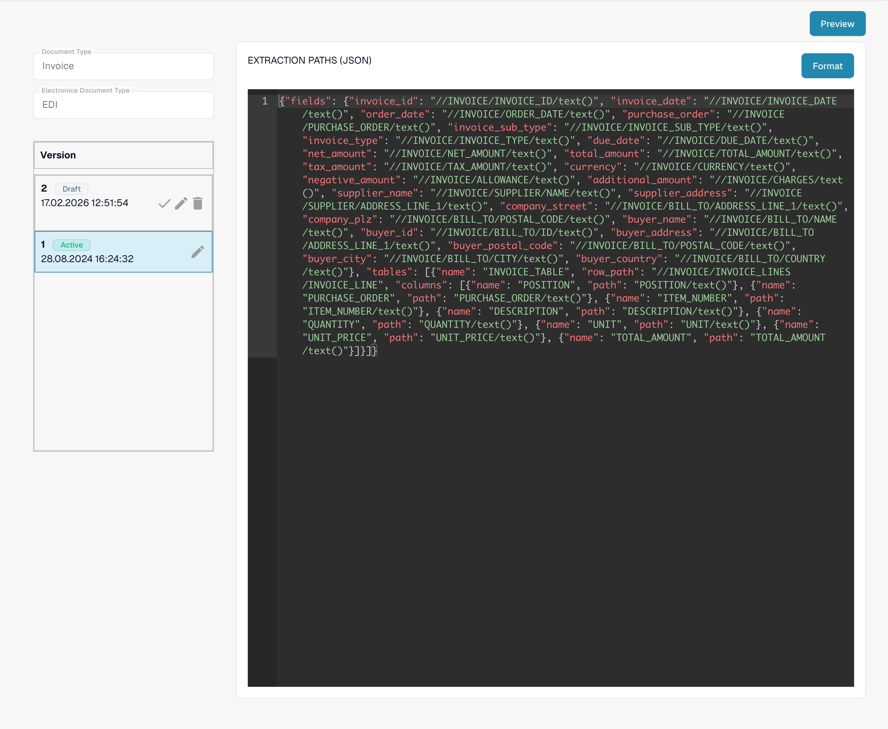

# EDI Extraction Paths File Guide

## 1. Overview

The **Extraction Paths File** defines how data is extracted from the **structured XML** into specific document fields and tables within the interface.\
It maps **field IDs** to **XPath expressions**, which are evaluated to pull values from the XML into the corresponding document fields.\
This file plays a critical role in ensuring that extracted data appears correctly during field validation and downstream processing.

## 2. Purpose and Function

* Maps each document field and table column to a specific location in the structured XML using XPath expressions.
* Ensures that the correct values are populated into fields such as `order_number`, `supplier_name`, and `total_amount`.
* Supports both **single fields** (via a `fields` object) and **tables** (via a `tables` array with row paths and column mappings).
* Enables precise control over how data is retrieved from the XML, including the use of XPath functions like `sum()`.

Example field mapping:

```json
"order_number": "//PURCHASE_ORDER/PURCHASE_ORDER/text()"
```

## 3. Access & Basic Editing

#### **Accessing the File:**

1.  Go to **Settings** → **Document Type** → _\[Your Document (e.g., Purchase Order)]_ → **E-Doc**.\\

    <figure><figcaption><p>Existing EDI format with its four configured attributes.</p></figcaption></figure>
2. Under the **E-Doc** tab, select your format (e.g., **EDI**).
3.  Click **Extraction Paths** to view or edit the file.\\

    <figure><figcaption><p>Active EXTRACTIONPATHS attribute: JSON configuration containing XPath extraction expressions.</p></figcaption></figure>

#### **Draft Management:**

* **Create a Draft:** Click the ✏️ pencil icon.
* **Delete Drafts:** Use the 🗑️ trashcan icon to remove unused drafts.
* **Activate Changes:** Click the ✅ checkmark to publish a version.
  * <mark style="color:red;">**Note**</mark>: Activating a new version will **automatically deactivate** the previous one.

## 4. Editor & Syntax

The Extraction Paths File is written in **JSON** and contains two main components:

* **fields**: A dictionary where each key is a field ID and each value is an XPath expression that defines how to extract the data.
* **tables**: A list of table definitions that include:
  * `name`: The table’s ID.
  * `row_path`: An XPath that identifies each row of the table.
  * `columns`: A list of column mappings (`name`, `path`).

You can also use XPath functions (e.g., `sum()`) and expressions to calculate values dynamically from repeating elements.

```json
"total_net_amount": "sum(//PURCHASE_ORDER/ORDER_LINES/ORDER_LINE/SUB_TOTAL)"
```

## 5. Preview Function (Evaluate Extraction)

The **Preview Function** allows you to simulate how the extraction paths will behave with a real uploaded document.

**Usage:**

* Upload an EDI file through the standard upload process.
* Copy the **Document ID**.
* Go to the **Extraction Paths** interface.
* Open the **Preview Function**.\
  \

* Enter the Document ID and click **Test**.
* The result will show how each field and table is populated based on the configured paths.

This feature is essential for verifying that your XPath expressions are correctly defined and pulling the expected values before activating the draft.


## 6. Video Walkthrough

A video guide for this file type is available on the [Videos page.](edi-videos.md)\
Use it to follow along with setup, editing, and previewing.

## Effective rules and activation

If an electronic credit note appears as Invoice, follow the [classification troubleshooting guide](../credit-note-recognized-as-invoice.md). It covers the effective custom/default source, type codes, Extraction Paths and safe activation.


The views show an existing configuration and version. Settings vary by document type and format. Validate changes in a draft before activation.
