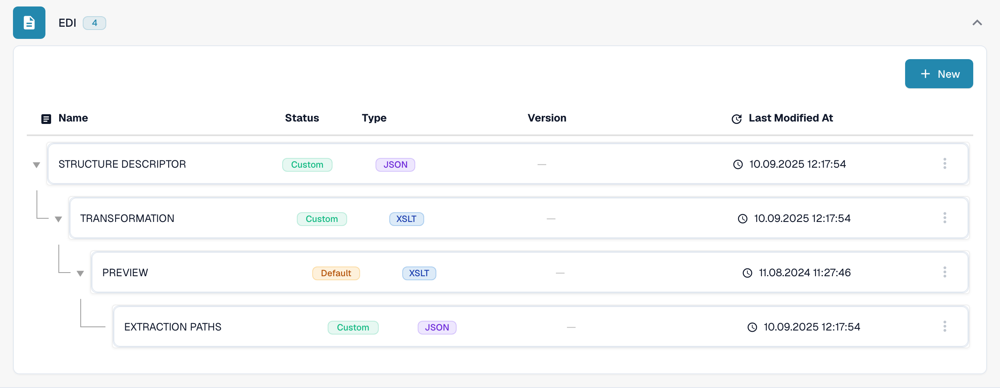

# EDI Mappings

The EDI mapping pages list how DocBits fields relate to fields of common EDI message types. Use them as a reference when you prepare or review the transformation for an EDI document type; see [EDI Settings: Overview & Benefits](../README.md) for how EDI is configured.

To find the mapping hierarchy in the current application:

1. Open **Settings → Document Types** and find the document type you use for the electronic document, such as **Invoice**.
2. Select **E-Doc** in that document type's card. The next view groups the available mapping parts by electronic document format.
3. Find **EDI** in the format list and expand the group. The illustrated hierarchy contains **Structure Descriptor**, **Transformation**, **Preview**, and **Extraction Paths**. The columns show each part's name, status, type, version, and last modification date.

<figure><figcaption>Select E-Doc on the relevant document type card. This example uses Invoice in the current English Dev test environment.</figcaption></figure>

<figure><figcaption>The expanded EDI group in the English Dev test environment. Custom and Default badges describe the displayed test configuration; no mapping was edited or EDI exchange tested.</figcaption></figure>

Open the page for the message type you work with:

* [EDI 810 (Invoice) Mapping](edi-810-invoice-mapping.md)
* [EDI 850 (Purchase Order) Mapping](edi-850-purchase-order-mapping.md)
* [EDI 855 (Purchase Order Acknowledgement) Mapping](edi-855-purchase-order-acknowledgement-mapping.md)
* [EDI 856 (Advance Shipment Notice) Mapping](edi-856-advance-shipment-notice-mapping.md)

Check each mapping against your partner's implementation guide and test with a representative file before relying on it.
