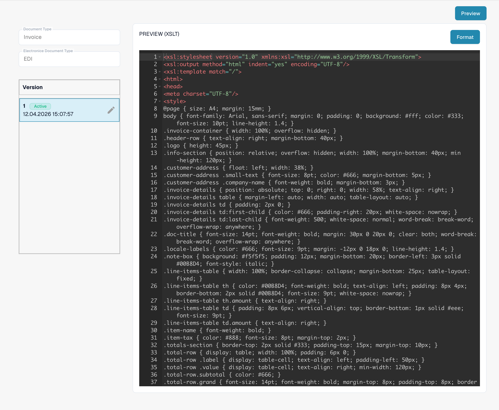

# EDI Preview File Guide

## 1. Overview

The **Preview File** defines how structured XML data is rendered into a human-readable, PDF-style format. It combines **HTML and CSS** for visual presentation and uses **XSLT `select` statements** to dynamically insert data from the Custom XML.\
This preview is displayed during **field validation** and is also included when documents are exported to **IDM**.

## 2. Purpose and Function

* Converts machine-readable Custom XML into a visually formatted preview (PDF).
* Enables human-friendly review and validation of extracted data.
* Ensures consistent rendering of key document fields such as headers, tables, totals, etc.
* Built using **HTML + CSS** for layout and design, and **XSLT** for binding data to the layout.

## 3. Access & Basic Editing

#### **Accessing the File:**

1.  Go to **Settings** → **Document Type** → _\[Your Document (e.g., Purchase Order)]_ → **E-Doc**.\\

    <figure><figcaption><p>Existing EDI format with its four configured attributes.</p></figcaption></figure>
2. Under the **E-Doc** tab, select your format (e.g., **EDI**).
3.  Click **Preview** to view or edit the file.\\

    <figure><figcaption><p>Active PREVIEW attribute: XSLT source in the editor; this view does not show the rendered document preview.</p></figcaption></figure>

#### **Draft Management:**

* **Create a Draft:** Click the ✏️ pencil icon.
* **Delete Drafts:** Use the 🗑️ trashcan icon to remove unused drafts.
* **Activate Changes:** Click the ✅ checkmark to publish a version.
  * <mark style="color:red;">**Note**</mark>: Activating a new version will **automatically deactivate** the previous one.

## 4. HTML/XSLT/CSS Editor

The **Preview File** is edited in a dedicated editor that supports HTML, XSLT, and CSS.

* **HTML** defines the structure of the output document (e.g., tables, divs, layout).
* **CSS** controls the styling (e.g., fonts, spacing, colors, alignment).
*   **XSLT `select` statements** are used to dynamically populate fields from the Custom XML, such as:

    ```xml
    <xsl:value-of select="/PURCHASE_ORDER/PURCHASE_ORDER_NUMBER/text()" />
    ```
* You can also use **XSLT logic** (`<xsl:if>`, `<xsl:for-each>`, etc.) to handle conditional display or iterate over line items.

## 5. Preview Function (Render Output)

The Preview Function allows you to test and verify how an EDI document is rendered with the current Preview File.

#### **Usage:**

* Upload an EDI file through the standard upload process.
* Copy the **Document ID** of the uploaded file.
* Navigate to the **Preview** interface.
* Open the **Preview Function**.\
  \

* Enter the Document ID and click **Test**.
* The rendered PDF-style preview will be displayed using the HTML/CSS/XSLT setup.

This feature is crucial for debugging data bindings, refining layout, and ensuring the document is both accurate and visually clear for users and downstream systems like **IDM**.


## 6. Video Walkthrough

A video guide for this file type is available on the [Videos page.](edi-videos.md)\
Use it to follow along with setup, editing, and previewing.


The views show an existing configuration and version. Settings vary by document type and format. Validate changes in a draft before activation.
