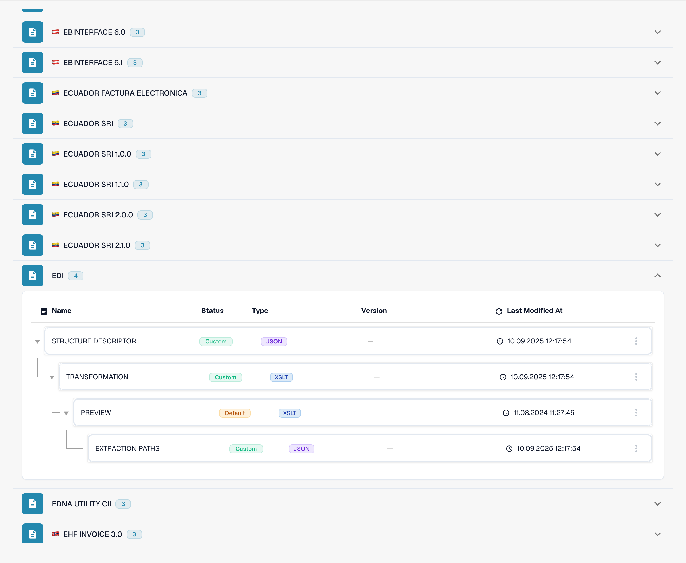
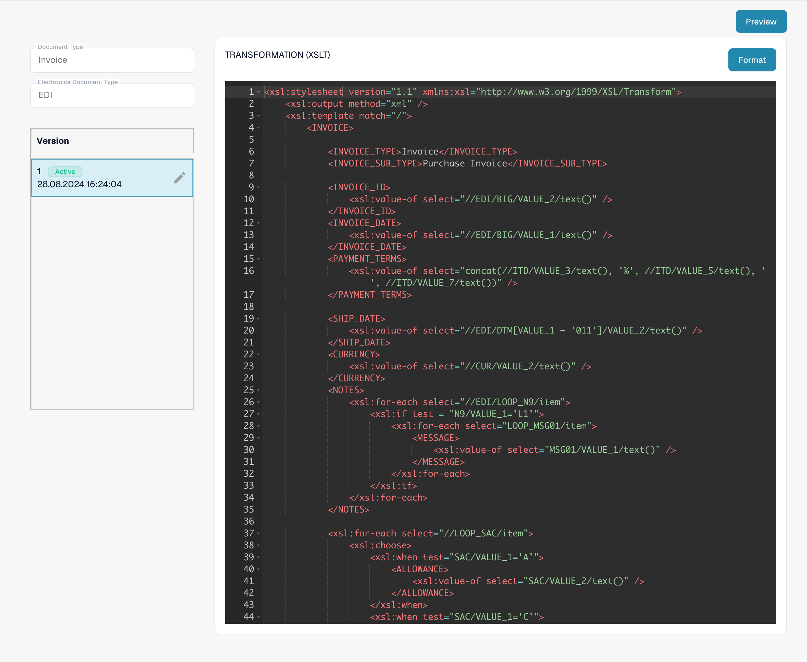

# EDI Transformation File Guide

## 1. Overview

The **Transformation File** defines how the structured XML—created using the **Structure Descriptor File**—is converted into a custom XML format that matches your organization's specific document type or form requirements.

This transformation is performed using **XSLT (Extensible Stylesheet Language Transformations)**, which can be authored and maintained through the **XSLT Editor** in the DocBits interface.

## 2. Purpose and Function

* Transforms the **intermediate XML** (output from the Structure Descriptor) into a **final XML** aligned with your document schema.
* Enables flexibility to accommodate varying EDI partner formats and internal system requirements.
* Built using **XSLT rules**, which allow you to define mappings, value formatting, conditional logic, and structure.

## 3. Access & Basic Editing

#### Accessing the File

1.  Go to **Settings → Document Type** → \[Your Document (e.g., _Purchase Order_)] → **E-Doc.**\\

    <figure><figcaption>
Existing EDI format with its four configured attributes.
</figcaption></figure>
2. Under the **E-Doc** tab, select your format (e.g., **EDI** ).
3.  Click **Transformation** to view or edit.\\

    <figure><figcaption>
Active TRANSFORMATION attribute: XSLT source for transforming the intermediate XML.
</figcaption></figure>

#### Draft Management

* **Create a Draft**: Click the ✏️ pencil icon.
* **Delete Drafts**: Use the 🗑️ trashcan icon to remove unused drafts.
* **Activate Changes**: Click the ✅ checkmark to publish a version.
  * <mark style="color:red;">**Note**</mark>: Activating a new version will **automatically deactivate** the previous one.

## 4. XSLT Editor

The Transformation File is edited using an embedded **XSLT Editor** that supports syntax highlighting and validation.

* Add templates to map specific paths from the input XML to the desired structure.
* Use conditional logic (e.g., `<xsl:if>`, `<xsl:choose>`) to handle optional or varying data formats.
* Apply formatting functions as needed (e.g., string manipulation, date formatting).

## 5. Preview Function (Preview Transformed XML)

The **Preview Function** allows you to test and preview how an uploaded EDI file is processed using the current **Transformation File**.

#### Usage

* Upload an EDI file via the standard upload flow.
* Copy the **Document ID** of the uploaded file.
* Navigate to the **Transformation File** interface.
*   Open the **Preview Function**.\\

    

* Enter the **Document ID** into the field and press **Test**.
* The resulting **transformed XML output** will be displayed.

This is especially useful for debugging XSLT mappings and ensuring the final XML structure meets your format requirements.

## 6. Video Walkthrough

A video guide for this file type is available on the [Videos page.](edi-videos.md)\
Use it to follow along with setup, editing, and previewing.\
\\

## Effective rules and activation

Organization-specific rules take precedence over defaults for the detected eDoc format. Check the active TRANSFORMATION and check which node supplies invoice_type in the transformed XML; the path depends on the format. Save stores a draft; use the checkmark to activate it after testing. A rendered Preview does not prove the stored document type. See the [classification troubleshooting guide](../credit-note-recognized-as-invoice.md) for codes 381/261, later scripts and reprocessing safeguards.

The views show an existing configuration and version. Settings vary by document type and format. Validate changes in a draft before activation.
