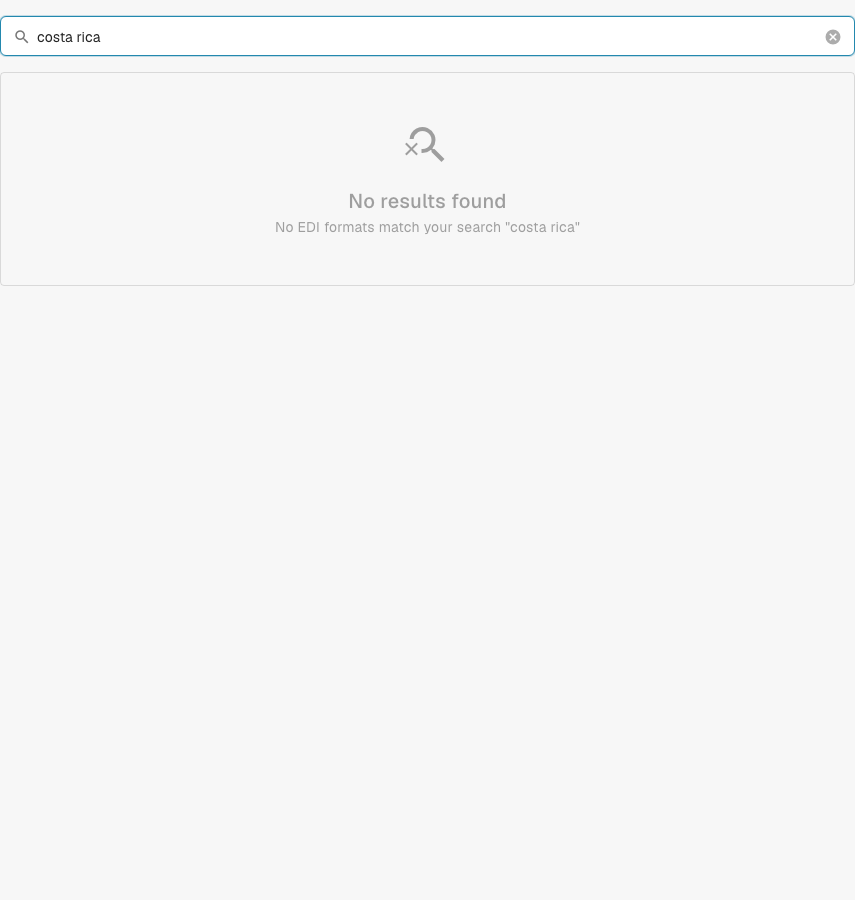

# Costa Rica

Use this guide to identify the configured family and version scope before testing a source file.

[All countries and support scope](../README.md)

## Variants and version limits

The older documentation names Costa Rica, but no matching classification or configuration entry was found in the inspected development catalogue.

**Syntax:** Not confirmed

Current built-in processing is not confirmed by this check. Ask support to verify the deployed mapping and test a representative source file before rollout.

The tables record a development-catalogue check on 17 October 2026 and the corresponding processing code. They describe available rules and configuration components, not a certification of every file, legal requirement or production rollout. Your organization can override the defaults.

## Inspected rule and component matrix

No matching classification or configuration entry was found. Current built-in support is not confirmed by this check.

## Find the mapping in DocBits

<figure><figcaption>
Real development UI: searching this country name returned no matching configuration entry in the inspected catalogue.
</figcaption></figure>

## Country explainer

Localized narration and WebVTT captions explain format selection, configuration and acceptance checks.


Costa Rica — Country explainer



WebVTT


## Acceptance checks

A component check confirms configuration presence. It is not an end-to-end processing test for every version. Test the exact payload and the invoice or credit-note path required by your integration.

## Check a format in your organization

1. Keep the original XML or the PDF with its embedded XML. Read the namespace, schema or customization identifier and the declared version/profile.

2. Open Settings → Document Types → E-Doc for the applicable business document. Search for the exact electronic-document format shown in the guide.

3. Check the effective Default or Custom source and its active configuration version. Inspect Transformation, Preview and Extraction Paths. Saving a draft does not activate it.

4. Test representative source files for each syntax, version and business document you need. Verify key fields, amounts, tax, invoice/credit-note classification and the ERP export.

5. Confirm validation policy and transport separately. Preserve custom mappings and check approvals and export history before restarting existing documents.

## Related format reference

- [🇨🇷 COSTA RICA](../costa-rica.md)
