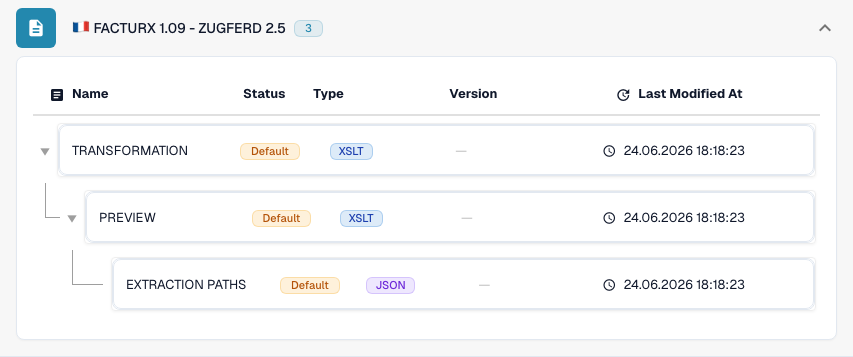

# France

Use this guide to identify the configured family and version scope before testing a source file.

[All countries and support scope](../README.md)

## Variants and version limits

Factur-X has generic and release-specific entries, including 1.0.05, 1.08 and 1.09. VRBL FR CIUS 1.0 is separate.

**Syntax:** CII / PDF + XML

The XML marker 1p0 and Factur-X XMP Version 1.0 do not identify a publication release. Keep the generic label when the release is unknown.

The tables record a development-catalogue check on 17 October 2026 and the corresponding processing code. They describe available rules and configuration components, not a certification of every file, legal requirement or production rollout. Your organization can override the defaults.

## Inspected rule and component matrix

| Exact format label | Rule document key | Available components |
| --- | --- | --- |
| `FACTURX` | `INVOICE` | C / T / P / E |
| `FACTURX 1.0.05 - ZUGFERD 2.1` | `INVOICE` | C / T / P / E |
| `FACTURX 1.0.05 BASIC` | `INVOICE` | C / T / P / E |
| `FACTURX 1.0.05 EN16931` | `INVOICE` | C / T / P / E |
| `FACTURX 1.0.05 EXTENDED` | `INVOICE` | C / T / P / E |
| `FACTURX 1.08 - ZUGFERD 2.4` | `INVOICE` | C / T / P / E |
| `FACTURX 1.09 - ZUGFERD 2.5` | `INVOICE` | C / T / P / E |
| `VRBL FR CIUS 1.0` | `INVOICE` | C / T / P / E |

C = classification, T = Transformation, P = Preview, E = Extraction Paths. The document key is the rule/configuration lookup key; it does not guarantee the final stored invoice_type. A transformation can classify a credit note through an INVOICE mapping.

A dash means the status check did not report a dedicated component for this exact format/document key. It does not rule out a shared or fallback mapping. Verify the effective resolver and a representative file before relying on that path.

### Additional configuration labels

These labels have configuration entries but no standalone classification rule in the inspected catalogue. A generic family or identity refinement may select a compatible path. Their presence alone does not prove automatic detection of that publication or profile.

- `FACTURX 1.0.05 BASIC WL`
- `FACTURX 1.0.05 MINIMUM`
- `FACTURX 1.0.06 BASIC`
- `FACTURX 1.0.06 BASIC WL`
- `FACTURX 1.0.06 EN16931`
- `FACTURX 1.0.06 EXTENDED`
- `FACTURX 1.0.06 MINIMUM`
- `FACTURX 1.0.07 BASIC`
- `FACTURX 1.0.07 BASIC WL`
- `FACTURX 1.0.07 EN16931`
- `FACTURX 1.0.07 EXTENDED`
- `FACTURX 1.0.07 MINIMUM`
- `FACTURX 1.0.07.2 - ZUGFERD 2.3.2`
- `FACTURX 1.0.07.2 BASIC`
- `FACTURX 1.0.07.2 BASIC WL`
- `FACTURX 1.0.07.2 EN16931`
- `FACTURX 1.0.07.2 EXTENDED`
- `FACTURX 1.0.07.2 MINIMUM`
- `FACTURX 1.08 BASIC`
- `FACTURX 1.08 BASIC WL`
- `FACTURX 1.08 EN16931`
- `FACTURX 1.08 EXTENDED`
- `FACTURX 1.08 MINIMUM`
- `FACTURX 1.09 BASIC`
- `FACTURX 1.09 BASIC WL`
- `FACTURX 1.09 EN16931`
- `FACTURX 1.09 EXTENDED`
- `FACTURX 1.09 MINIMUM`

### Factur-X / ZUGFeRD: do not invent a publication version

A harmonized CII Guideline ID can identify a family and profile while sharing the same 1p0 marker across several releases. Factur-X XMP Version 1.0 is a schema marker, not a publication such as 1.08 or 1.09. ZUGFeRD XMP can declare its version. When authoritative metadata is absent, keep the generic family result and confirm the original file with the sender.

MINIMUM and BASIC WL can omit line-item information needed downstream. BASIC, EN16931/COMFORT and EXTENDED offer different data coverage. A more extensive profile can carry fields that your extraction mapping does not use. Check required fields with actual examples.

## Find the mapping in DocBits

<figure><figcaption>
Real development UI: the representative format and its available configuration components. Other versions are listed in the matrix.
</figcaption></figure>

## Country explainer

Localized narration and WebVTT captions explain format selection, configuration and acceptance checks.


France — Country explainer



WebVTT


## Acceptance checks

A component check confirms configuration presence. It is not an end-to-end processing test for every version. Test the exact payload and the invoice or credit-note path required by your integration.

## Check a format in your organization

1. Keep the original XML or the PDF with its embedded XML. Read the namespace, schema or customization identifier and the declared version/profile.

2. Open Settings → Document Types → E-Doc for the applicable business document. Search for the exact electronic-document format shown in the guide.

3. Check the effective Default or Custom source and its active configuration version. Inspect Transformation, Preview and Extraction Paths. Saving a draft does not activate it.

4. Test representative source files for each syntax, version and business document you need. Verify key fields, amounts, tax, invoice/credit-note classification and the ERP export.

5. Confirm validation policy and transport separately. Preserve custom mappings and check approvals and export history before restarting existing documents.

## Related format reference

- [🇫🇷 FACTURX](../facturx.md)
- [🇫🇷 FACTURX 1.0.05 - ZUGFERD 2.1](../facturx-1-0-05-zugferd-2-1.md)
- [🇫🇷 FACTURX 1.0.07.2 - ZUGFERD 2.3.2](../facturx-1-0-07-2-zugferd-2-3-2.md)
- [🇫🇷 FACTURX 1.09 - ZUGFERD 2.5](../facturx-1-09-zugferd-2-5.md)
