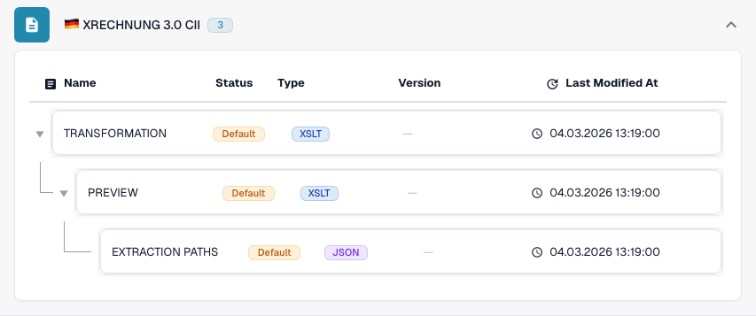

# Germany

Use this guide to identify the configured family and version scope before testing a source file.

[All countries and support scope](../README.md)

## Variants and version limits

XRechnung has thirteen version labels from 1.0 to 3.0.2, each in CII and UBL. ZUGFeRD includes legacy profiles and 2.5 CII and UBL entries.

**Syntax:** CII / UBL / PDF + XML

Syntax, publication version and profile are different choices. Do not infer a Factur-X publication from the shared 1p0 marker.

The tables record a development-catalogue check on 17 October 2026 and the corresponding processing code. They describe available rules and configuration components, not a certification of every file, legal requirement or production rollout. Your organization can override the defaults.

## Inspected rule and component matrix

| Exact format label | Rule document key | Available components |
| --- | --- | --- |
| `EDNA UTILITY CII` | `INVOICE` | C / T / P / E |
| `XRECHNUNG 1.0 CII` | `INVOICE` | C / T / P / E |
| `XRECHNUNG 1.0 UBL` | `INVOICE` | C / T / P / E |
| `XRECHNUNG 1.1 CII` | `INVOICE` | C / T / P / E |
| `XRECHNUNG 1.1 UBL` | `INVOICE` | C / T / P / E |
| `XRECHNUNG 1.2 CII` | `INVOICE` | C / T / P / E |
| `XRECHNUNG 1.2 UBL` | `INVOICE` | C / T / P / E |
| `XRECHNUNG 1.2.1 CII` | `INVOICE` | C / T / P / E |
| `XRECHNUNG 1.2.1 UBL` | `INVOICE` | C / T / P / E |
| `XRECHNUNG 1.2.2 CII` | `INVOICE` | C / T / P / E |
| `XRECHNUNG 1.2.2 UBL` | `INVOICE` | C / T / P / E |
| `XRECHNUNG 2.0 CII` | `INVOICE` | C / T / P / E |
| `XRECHNUNG 2.0 UBL` | `INVOICE` | C / T / P / E |
| `XRECHNUNG 2.0.1 CII` | `INVOICE` | C / T / P / E |
| `XRECHNUNG 2.0.1 UBL` | `INVOICE` | C / T / P / E |
| `XRECHNUNG 2.1 CII` | `INVOICE` | C / T / P / E |
| `XRECHNUNG 2.1 UBL` | `INVOICE` | C / T / P / E |
| `XRECHNUNG 2.2 CII` | `INVOICE` | C / T / P / E |
| `XRECHNUNG 2.2 UBL` | `INVOICE` | C / T / P / E |
| `XRECHNUNG 2.3 CII` | `INVOICE` | C / T / P / E |
| `XRECHNUNG 2.3 UBL` | `INVOICE` | C / T / P / E |
| `XRECHNUNG 3.0 CII` | `INVOICE` | C / T / P / E |
| `XRECHNUNG 3.0 CII CREDITNOTE` | `CREDIT_NOTE` | C / T / P / E |
| `XRECHNUNG 3.0 UBL` | `INVOICE` | C / T / P / E |
| `XRECHNUNG 3.0.1 CII` | `INVOICE` | C / T / P / E |
| `XRECHNUNG 3.0.1 CII CREDITNOTE` | `CREDIT_NOTE` | C / T / P / E |
| `XRECHNUNG 3.0.1 UBL` | `INVOICE` | C / T / P / E |
| `XRECHNUNG 3.0.2 CII` | `INVOICE` | C / T / P / E |
| `XRECHNUNG 3.0.2 CII CREDITNOTE` | `CREDIT_NOTE` | C / T / P / E |
| `XRECHNUNG 3.0.2 UBL` | `INVOICE` | C / T / P / E |
| `XRECHNUNG ORDER` | `PURCHASE_ORDER` | C / T / P / E |
| `XRECHNUNG ORDER RESPONSE` | `ORDER_CONFIRMATION` | C / T / P / E |
| `ZUGFERD 1.0 BASIC` | `INVOICE` | C / T / P / E |
| `ZUGFERD 1.0 COMFORT` | `INVOICE` | C / T / P / E |
| `ZUGFERD 1.0 EXTENDED` | `INVOICE` | C / T / P / E |
| `ZUGFERD 2.2` | `INVOICE` | C / T / P / E |
| `ZUGFERD 2.3.2` | `INVOICE` | C / T / P / E |
| `ZUGFERD 2.4` | `INVOICE` | C / T / P / E |
| `ZUGFERD 2.5 CII` | `INVOICE` | C / T / P / E |
| `ZUGFERD 2.5 UBL` | `INVOICE` | C / T / P / E |

C = classification, T = Transformation, P = Preview, E = Extraction Paths. The document key is the rule/configuration lookup key; it does not guarantee the final stored invoice_type. A transformation can classify a credit note through an INVOICE mapping.

A dash means the status check did not report a dedicated component for this exact format/document key. It does not rule out a shared or fallback mapping. Verify the effective resolver and a representative file before relying on that path.

### Additional configuration labels

These labels have configuration entries but no standalone classification rule in the inspected catalogue. A generic family or identity refinement may select a compatible path. Their presence alone does not prove automatic detection of that publication or profile.

- `ZUGFERD 1.0`
- `ZUGFERD 2.1 BASIC`
- `ZUGFERD 2.1 BASIC WL`
- `ZUGFERD 2.1 EN16931`
- `ZUGFERD 2.1 EXTENDED`
- `ZUGFERD 2.1 MINIMUM`
- `ZUGFERD 2.2 BASIC`
- `ZUGFERD 2.2 BASIC WL`
- `ZUGFERD 2.2 EN16931`
- `ZUGFERD 2.2 EXTENDED`
- `ZUGFERD 2.2 MINIMUM`
- `ZUGFERD 2.3`
- `ZUGFERD 2.3 BASIC`
- `ZUGFERD 2.3 BASIC WL`
- `ZUGFERD 2.3 EN16931`
- `ZUGFERD 2.3 EXTENDED`
- `ZUGFERD 2.3 MINIMUM`
- `ZUGFERD 2.3.2 BASIC`
- `ZUGFERD 2.3.2 BASIC WL`
- `ZUGFERD 2.3.2 EN16931`
- `ZUGFERD 2.3.2 EXTENDED`
- `ZUGFERD 2.3.2 MINIMUM`
- `ZUGFERD 2.4 BASIC`
- `ZUGFERD 2.4 BASIC WL`
- `ZUGFERD 2.4 EN16931`
- `ZUGFERD 2.4 EXTENDED`
- `ZUGFERD 2.4 MINIMUM`
- `ZUGFERD 2.5 CII BASIC`
- `ZUGFERD 2.5 CII BASIC WL`
- `ZUGFERD 2.5 CII EN16931`
- `ZUGFERD 2.5 CII EXTENDED`
- `ZUGFERD 2.5 CII MINIMUM`
- `ZUGFERD 2.5 UBL BASIC`
- `ZUGFERD 2.5 UBL BASIC WL`
- `ZUGFERD 2.5 UBL EN16931`
- `ZUGFERD 2.5 UBL EXTENDED`
- `ZUGFERD 2.5 UBL MINIMUM`

### Factur-X / ZUGFeRD: do not invent a publication version

A harmonized CII Guideline ID can identify a family and profile while sharing the same 1p0 marker across several releases. Factur-X XMP Version 1.0 is a schema marker, not a publication such as 1.08 or 1.09. ZUGFeRD XMP can declare its version. When authoritative metadata is absent, keep the generic family result and confirm the original file with the sender.

MINIMUM and BASIC WL can omit line-item information needed downstream. BASIC, EN16931/COMFORT and EXTENDED offer different data coverage. A more extensive profile can carry fields that your extraction mapping does not use. Check required fields with actual examples.

## Find the mapping in DocBits

<figure><figcaption>
Real development UI: the representative format and its available configuration components. Other versions are listed in the matrix.
</figcaption></figure>

## Country explainer

Localized narration and WebVTT captions explain format selection, configuration and acceptance checks.

This read-only walkthrough shows the country’s existing DocBits configuration. Check the effective source and active version, then validate representative invoices, credit notes and exports in your own organisation.


Germany — Country explainer



WebVTT


## Acceptance checks

A component check confirms configuration presence. It is not an end-to-end processing test for every version. Test the exact payload and the invoice or credit-note path required by your integration.

## Check a format in your organization

1. Keep the original XML or the PDF with its embedded XML. Read the namespace, schema or customization identifier and the declared version/profile.

2. Open Settings → Document Types → E-Doc for the applicable business document. Search for the exact electronic-document format shown in the guide.

3. Check the effective Default or Custom source and its active configuration version. Inspect Transformation, Preview and Extraction Paths. Saving a draft does not activate it.

4. Test representative source files for each syntax, version and business document you need. Verify key fields, amounts, tax, invoice/credit-note classification and the ERP export.

5. Confirm validation policy and transport separately. Preserve custom mappings and check approvals and export history before restarting existing documents.

## Related format reference

- [🇩🇪 XRECHNUNG 1.0 CII](../xrechnung-1-0-cii.md)
- [🇩🇪 XRECHNUNG 1.0 UBL](../xrechnung-1-0-ubl.md)
- [🇩🇪 XRECHNUNG 1.1 CII](../xrechnung-1-1-cii.md)
- [🇩🇪 XRECHNUNG 1.1 UBL](../xrechnung-1-1-ubl.md)
- [🇩🇪 XRECHNUNG 1.2 CII](../xrechnung-1-2-cii.md)
- [🇩🇪 XRECHNUNG 1.2 UBL](../xrechnung-1-2-ubl.md)
- [🇩🇪 XRECHNUNG 1.2.1 CII](../xrechnung-1-2-1-cii.md)
- [🇩🇪 XRECHNUNG 1.2.1 UBL](../xrechnung-1-2-1-ubl.md)
- [🇩🇪 XRECHNUNG 1.2.2 CII](../xrechnung-1-2-2-cii.md)
- [🇩🇪 XRECHNUNG 1.2.2 UBL](../xrechnung-1-2-2-ubl.md)
- [🇩🇪 XRECHNUNG 2.0 CII](../xrechnung-2-0-cii.md)
- [🇩🇪 XRECHNUNG 2.0 UBL](../xrechnung-2-0-ubl.md)
- [🇩🇪 XRECHNUNG 2.0.1 CII](../xrechnung-2-0-1-cii.md)
- [🇩🇪 XRECHNUNG 2.0.1 UBL](../xrechnung-2-0-1-ubl.md)
- [🇩🇪 XRECHNUNG 2.1 CII](../xrechnung-2-1-cii.md)
- [🇩🇪 XRECHNUNG 2.1 UBL](../xrechnung-2-1-ubl.md)
- [🇩🇪 XRECHNUNG 2.2 CII](../xrechnung-2-2-cii.md)
- [🇩🇪 XRECHNUNG 2.2 UBL](../xrechnung-2-2-ubl.md)
- [🇩🇪 XRECHNUNG 2.3 CII](../xrechnung-2-3-cii.md)
- [🇩🇪 XRECHNUNG 2.3 UBL](../xrechnung-2-3-ubl.md)
- [🇩🇪 XRECHNUNG 3.0 CII](../xrechnung-3-0-cii.md)
- [🇩🇪 XRECHNUNG 3.0 UBL](../xrechnung-3-0-ubl.md)
- [🇩🇪 XRECHNUNG 3.0.1 CII](../xrechnung-3-0-1-cii.md)
- [🇩🇪 XRECHNUNG 3.0.1 UBL](../xrechnung-3-0-1-ubl.md)
- [🇩🇪 XRECHNUNG 3.0.2 CII](../xrechnung-3-0-2-cii.md)
- [🇩🇪 XRECHNUNG 3.0.2 UBL](../xrechnung-3-0-2-ubl.md)
- [🇩🇪 ZUGFERD 1.0](../zugferd-1-0.md)
- [🇩🇪 ZUGFERD 1.0 BASIC](../zugferd-1-0-basic.md)
- [🇩🇪 ZUGFERD 1.0 COMFORT](../zugferd-1-0-comfort.md)
- [🇩🇪 ZUGFERD 1.0 EXTENDED](../zugferd-1-0-extended.md)
- [🇩🇪 ZUGFERD 2.2](../zugferd-2-2.md)
- [🇩🇪 ZUGFERD 2.3](../zugferd-2-3.md)
- [🇩🇪 ZUGFERD 2.3.2](../zugferd-2-3-2.md)
- [🇩🇪 ZUGFERD 2.5](../zugferd-2-5.md)
