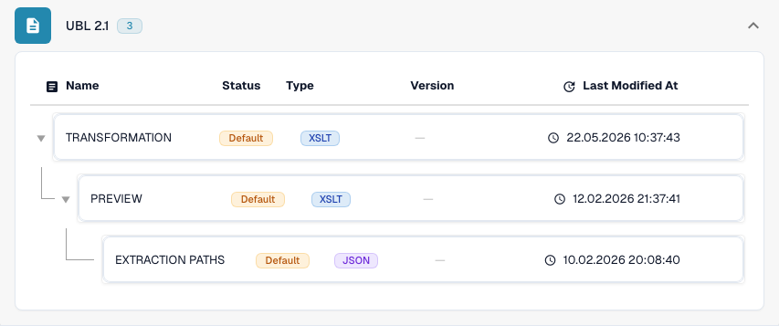

# International

Use this guide to identify the configured family and version scope before testing a source file.

[All countries and support scope](../README.md)

## Country explainer

Localized narration and WebVTT captions explain format selection, configuration and acceptance checks.

This read-only walkthrough shows the country’s existing DocBits configuration. Check the effective source and active version, then validate representative invoices, credit notes and exports in your own organisation.



[International — Country explainer](https://docbits-videos.fra1.cdn.digitaloceanspaces.com/settings-assistant/edocs_country_international/v2/en.mp4)

[WebVTT](https://docbits-videos.fra1.cdn.digitaloceanspaces.com/settings-assistant/edocs_country_international/v2/en.vtt)

## Variants and version limits

International entries include Peppol BIS 3.0, UBL 2.1, pure CII, EDI, INVOIC02, cXML, OCI, BOD and SPS Commerce RSX 7.7.4.

**Syntax:** UBL / CII / EDI / cXML

Invoice, order, response and despatch mappings are distinct. File processing does not itself provide a Peppol access point or trading-partner connectivity.

The tables record a development-catalogue check on 17 October 2026 and the corresponding processing code. They describe available rules and configuration components, not a certification of every file, legal requirement or production rollout. Your organization can override the defaults.

## Inspected rule and component matrix

| Exact format label | Rule document key | Available components |
| --- | --- | --- |
| `BOD` | `PURCHASE_ORDER` | C / — / — / — |
| `CXML ORDER CONFIRMATION` | `ORDER_CONFIRMATION` | C / T / P / E |
| `CXML PURCHASE ORDER` | `PURCHASE_ORDER` | C / T / P / E |
| `EDI` | `PURCHASE_ORDER` | C / T / P / E |
| `EDI` | `ORDER_CONFIRMATION` | C / T / P / E |
| `EDI` | `INVOICE` | C / T / P / E |
| `INVOIC02` | `INVOICE` | C / T / P / E |
| `OCI CATALOG ORDER` | `PURCHASE_ORDER` | C / T / P / E |
| `PEPPOL BIS 3.0` | `INVOICE` | C / T / P / E |
| `PEPPOL DESPATCH ADVICE 3.0` | `DELIVERY_NOTE` | C / T / P / E |
| `PEPPOL ORDER 3.0` | `PURCHASE_ORDER` | C / T / P / E |
| `PEPPOL ORDER RESPONSE 3.0` | `ORDER_CONFIRMATION` | C / T / P / E |
| `PURCHASE ORDER BOD` | `PURCHASE_ORDER` | C / T / P / E |
| `PURE CII D16B EU` | `INVOICE` | C / T / P / E |
| `PURE CII D16B EU CREDITNOTE` | `CREDIT_NOTE` | C / T / P / E |
| `PURE CII D16B NON-EU` | `INVOICE` | C / T / P / E |
| `PURE CII D16B NON-EU CREDITNOTE` | `CREDIT_NOTE` | C / T / P / E |
| `PURE CII D22B EU` | `INVOICE` | C / T / P / E |
| `PURE CII D22B EU CREDITNOTE` | `CREDIT_NOTE` | C / T / P / E |
| `PURE CII D22B NON-EU` | `INVOICE` | C / T / P / E |
| `PURE CII D22B NON-EU CREDITNOTE` | `CREDIT_NOTE` | C / T / P / E |
| `PURE CII D23B EU` | `INVOICE` | C / T / P / E |
| `PURE CII D23B EU CREDITNOTE` | `CREDIT_NOTE` | C / T / P / E |
| `PURE CII D23B NON-EU` | `INVOICE` | C / T / P / E |
| `PURE CII D23B NON-EU CREDITNOTE` | `CREDIT_NOTE` | C / T / P / E |
| `PURE CII D24B EU` | `INVOICE` | C / T / P / E |
| `PURE CII D24B EU CREDITNOTE` | `CREDIT_NOTE` | C / T / P / E |
| `PURE CII D24B NON-EU` | `INVOICE` | C / T / P / E |
| `PURE CII D24B NON-EU CREDITNOTE` | `CREDIT_NOTE` | C / T / P / E |
| `PURE CII V1 EU` | `INVOICE` | C / T / P / E |
| `PURE CII V1 EU CREDITNOTE` | `CREDIT_NOTE` | C / T / P / E |
| `PURE CII V1 NON-EU` | `INVOICE` | C / T / P / E |
| `PURE CII V1 NON-EU CREDITNOTE` | `CREDIT_NOTE` | C / T / P / E |
| `SPS COMMERCE RSX 7.7.4` | `PURCHASE_ORDER_ACKNOWLEDGMENT` | C / T / P / E |
| `SPS COMMERCE RSX 7.7.4` | `ADVANCE_SHIP_NOTICE` | C / T / P / E |
| `SPS COMMERCE RSX 7.7.4` | `PURCHASE_ORDER` | C / T / P / E |
| `SPS COMMERCE RSX 7.7.4` | `INVOICE` | C / T / P / E |
| `SPS COMMERCE RSX 7.7.4` | `PURCHASE_ORDER_CHANGE` | C / T / P / E |
| `UBL 2.1` | `INVOICE` | C / T / P / E |
| `UBL 2.1 CREDITNOTE` | `CREDIT_NOTE` | C / T / P / E |
| `UBL 2.1 DESPATCH ADVICE` | `DELIVERY_NOTE` | C / T / P / E |
| `UBL 2.1 ORDER` | `PURCHASE_ORDER` | C / T / P / E |
| `UBL 2.1 ORDER RESPONSE` | `ORDER_CONFIRMATION` | C / T / P / E |

C = classification, T = Transformation, P = Preview, E = Extraction Paths. The document key is the rule/configuration lookup key; it does not guarantee the final stored invoice_type. A transformation can classify a credit note through an INVOICE mapping.

A dash means the status check did not report a dedicated component for this exact format/document key. It does not rule out a shared or fallback mapping. Verify the effective resolver and a representative file before relying on that path.

## Find the mapping in DocBits

<figure><figcaption>
Real development UI: the representative format and its available configuration components. Other versions are listed in the matrix.
</figcaption></figure>

## Acceptance checks

A component check confirms configuration presence. It is not an end-to-end processing test for every version. Test the exact payload and the invoice or credit-note path required by your integration.

## Check a format in your organization

1. Keep the original XML or the PDF with its embedded XML. Read the namespace, schema or customization identifier and the declared version/profile.

2. Open Settings → Document Types → E-Doc for the applicable business document. Search for the exact electronic-document format shown in the guide.

3. Check the effective Default or Custom source and its active configuration version. Inspect Transformation, Preview and Extraction Paths. Saving a draft does not activate it.

4. Test representative source files for each syntax, version and business document you need. Verify key fields, amounts, tax, invoice/credit-note classification and the ERP export.

5. Confirm validation policy and transport separately. Preserve custom mappings and check approvals and export history before restarting existing documents.

## Related format reference

- [INVOIC02](../invoic02.md)
- [🇪🇺 PEPPOL BIS 3.0](../peppol-bis-3-0.md)
- [SPS COMMERCE RSX 7.7.4](../sps-commerce-rsx-7-7-4.md)
- [UBL 2.1](../ubl-2-1.md)
