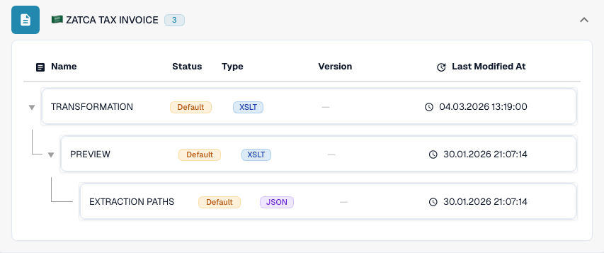

# Saudi Arabia

Use this guide to identify the configured family and version scope before testing a source file.

[All countries and support scope](../README.md)

## Variants and version limits

ZATCA Fatoorah, Reporting, Simplified and Tax Invoice have separate entries.

**Syntax:** UBL XML

These labels describe different processes and invoice variants. Parsing does not prove signing, clearance or reporting through ZATCA.

The tables record a development-catalogue check on 17 October 2026 and the corresponding processing code. They describe available rules and configuration components, not a certification of every file, legal requirement or production rollout. Your organization can override the defaults.

## Inspected rule and component matrix

| Exact format label | Rule document key | Available components |
| --- | --- | --- |
| `ZATCA FATOORAH` | `INVOICE` | C / T / P / E |
| `ZATCA REPORTING` | `INVOICE` | C / T / P / E |
| `ZATCA SIMPLIFIED` | `INVOICE` | C / T / P / E |
| `ZATCA TAX INVOICE` | `INVOICE` | C / T / P / E |

C = classification, T = Transformation, P = Preview, E = Extraction Paths. The document key is the rule/configuration lookup key; it does not guarantee the final stored invoice_type. A transformation can classify a credit note through an INVOICE mapping.

A dash means the status check did not report a dedicated component for this exact format/document key. It does not rule out a shared or fallback mapping. Verify the effective resolver and a representative file before relying on that path.

## Find the mapping in DocBits

<figure><figcaption>
Real development UI: the representative format and its available configuration components. Other versions are listed in the matrix.
</figcaption></figure>

## Country explainer

Localized narration and WebVTT captions explain format selection, configuration and acceptance checks.

This read-only walkthrough shows the country’s existing DocBits configuration. Check the effective source and active version, then validate representative invoices, credit notes and exports in your own organisation.


Saudi Arabia — Country explainer



WebVTT


## Acceptance checks

A component check confirms configuration presence. It is not an end-to-end processing test for every version. Test the exact payload and the invoice or credit-note path required by your integration.

## Check a format in your organization

1. Keep the original XML or the PDF with its embedded XML. Read the namespace, schema or customization identifier and the declared version/profile.

2. Open Settings → Document Types → E-Doc for the applicable business document. Search for the exact electronic-document format shown in the guide.

3. Check the effective Default or Custom source and its active configuration version. Inspect Transformation, Preview and Extraction Paths. Saving a draft does not activate it.

4. Test representative source files for each syntax, version and business document you need. Verify key fields, amounts, tax, invoice/credit-note classification and the ERP export.

5. Confirm validation policy and transport separately. Preserve custom mappings and check approvals and export history before restarting existing documents.

## Related format reference

- [🇸🇦 ZATCA FATOORAH](../zatca-fatoorah.md)
- [🇸🇦 ZATCA REPORTING](../zatca-reporting.md)
- [🇸🇦 ZATCA SIMPLIFIED](../zatca-simplified.md)
- [🇸🇦 ZATCA TAX INVOICE](../zatca-tax-invoice.md)
