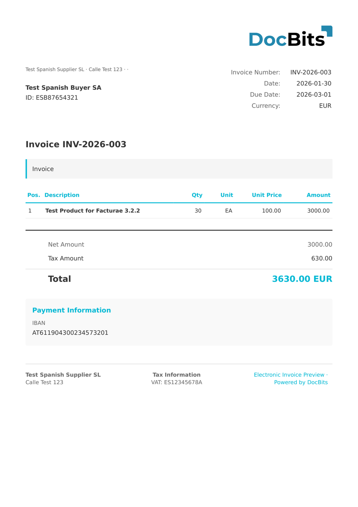

# 🇪🇸 FACTURAE

<!-- edocs-country-scope -->


Check the country guide for version limits, effective configuration and the country explainer. [Spain](countries/spain.md). Check the namespace and schema version. Extracting a signed XML file does not by itself verify its signature or its acceptance by FACe.


| Property             | Value                                    |
| -------------------- | ---------------------------------------- |
| **Country / Region** | Spain                                    |
| **Document Types**   | Invoice, Credit Note, Corrective Invoice |
| **Format**           | XML                                      |
| **Standard**         | Facturae                                 |

Facturae is the Spanish electronic invoicing standard mandated for B2G transactions through the FACe portal (Punto General de Entrada de Facturas Electrónicas). DocBits supports versions 3.2, 3.2.1, and 3.2.2 of the standard.

## Support Status

| Component        | Status      |
| ---------------- | ----------- |
| Preview          | ✅ Supported |
| Field Extraction | ✅ Supported |
| Transformation   | ✅ Supported |

## Default Preview

<figure><figcaption>
Default DocBits preview for a Spain Facturae invoice
</figcaption></figure>

## Related

* [Supported Electronic Documents](./)
* [Facturae 3.2](facturae-3-2.md)
* [Facturae 3.2.1](facturae-3-2-1.md)
* [Facturae 3.2.2](facturae-3-2-2.md)
