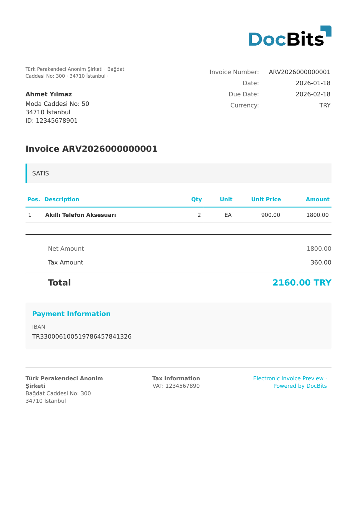

# 🇹🇷 TURKEY E-ARSIV

<!-- edocs-country-scope -->


Check the country guide for version limits, effective configuration and the country explainer. [Turkey](countries/turkey.md). Check the source profile and document structure. The family label does not identify every UBL-TR release or establish delivery through the tax platform.


| Property             | Value                                         |
| -------------------- | --------------------------------------------- |
| **Country / Region** | Turkey                                        |
| **Document Types**   | Archive Invoice                               |
| **Format**           | UBL-TR XML                                    |
| **Standard**         | e-Arşiv Fatura (GİB - Revenue Administration) |

Turkey e-Arşiv (e-Archive) is the electronic invoice format used for invoices issued to recipients who are not registered in the Turkish e-Fatura system. e-Arşiv invoices are stored on the GİB (Gelir İdaresi Başkanlığı) platform and can be delivered to recipients as PDF or paper. DocBits processes the UBL-TR XML format.

## Support Status

| Component        | Status      |
| ---------------- | ----------- |
| Preview          | ✅ Supported |
| Field Extraction | ✅ Supported |
| Transformation   | ✅ Supported |

## Default Preview

<figure><figcaption>
Default DocBits preview for a Turkey E-Arsiv invoice
</figcaption></figure>

## Related

* [Supported Electronic Documents](./)
* [TURKEY E-FATURA](turkey-e-fatura.md)
