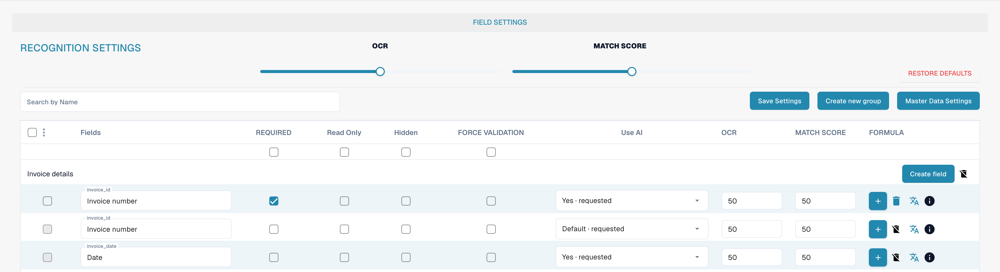

# Fields

Fields define the data collected for a document type and how it is checked. Open the document type in settings, then its fields.

<figure><figcaption>
English invoice document-type field overview.
</figcaption></figure>

## Properties and recognition

* **Required** requires a value for validation.
* **Read Only** prevents editing; **Hidden** removes the field from the normal view.
* **Force Validation** requires an explicit check of the field. It does not create a comparison rule or regular expression; configure custom validation rules separately.
* **OCR** sets a numeric recognition-confidence threshold. It is not an on/off switch for OCR.
* **Match Score** sets a numeric matching threshold. It is neither reference text nor a list of values.
* The **AI** option controls the extraction requested for the field.

Search for a field by name and check its row before changing properties. You can organize groups, add fields, and open formula or master-data options. Available actions depend on the field and your permissions; standard fields may have deletion restrictions.

Save only intended changes and test validation with representative documents. The images do not demonstrate saved changes.

See [Field properties](configuring-field-properties-1.md), [Validation and Match Score](setting-validation-and-match-score.md), and [Fields with additional charges](new-fields-with-charges.md).
