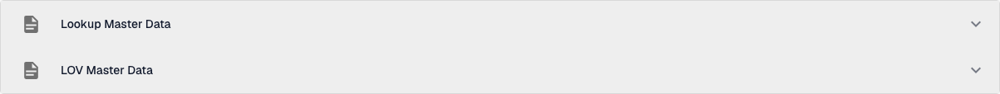
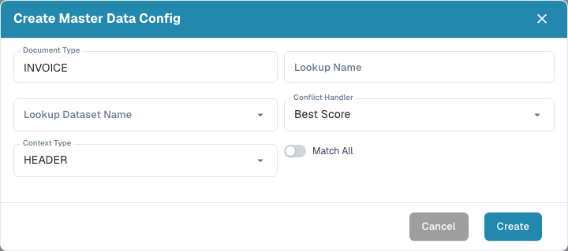
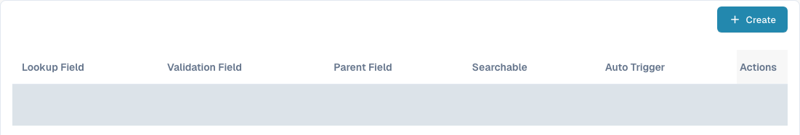
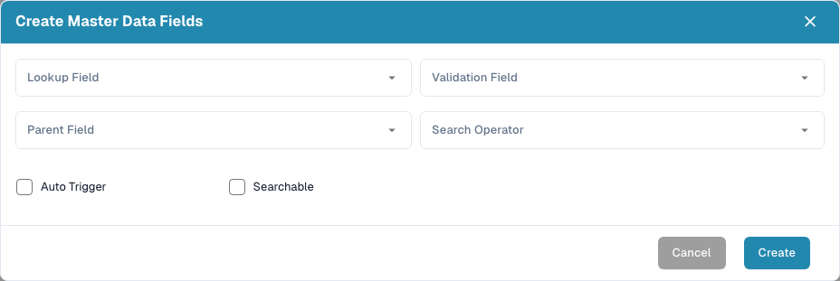
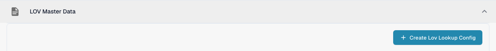
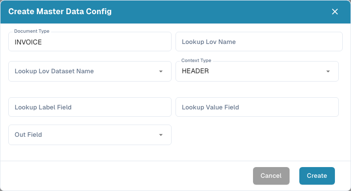

# Master Data Settings

## Video tutorial: Master data and lists of values


Master data sources, lists of values and master data settings in DocBits


The video shows the master data sources, the lists of values and the master data settings of a document type.

Master Data Settings connect a document's validation fields to data stored under [Lookup Master Data](../../../document-processing/master-data-lookup.md). Use **Lookup Master Data** to find and fill matching records. Use **LOV Master Data** to offer a list of values from a dataset.

The form screenshots show the initial values before any entries are made. Existing mapping values are hidden in the table screenshot.

## Open the settings

1. In **Settings**, open **Document Processing → Document Types**.
2. Open the document type you want to configure, such as **Invoice**, and select **Fields**.
3. Select **Master Data Settings**. The page contains separate **Lookup Master Data** and **LOV Master Data** sections. Select a section heading to expand it.

<figure><figcaption>
Select a section heading to expand the lookup or list-of-values settings.
</figcaption></figure>

## Match a record with Lookup Master Data

**Lookup Master Data** configurations search a dataset and map a matching record to document fields. The list shows each configuration's name and whether it is active. A **Default** badge identifies a DocBits configuration; you can deactivate it, but you cannot edit or delete it.

### Create a lookup configuration

1. Select **Create Lookup Config**.
2. Enter a **Lookup Name** and choose the **Lookup Dataset Name** that contains the records to search.
3. Choose a **Conflict Handler** for cases where several records match:
   * **Best Score** chooses the strongest match.
   * **Return None** leaves the result empty for a user to decide.
   * **Return First** uses the first result.
4. Choose **HEADER** for document fields or **LINE** for fields in a document table. For **LINE**, also choose **Context Detail**, the table where the lookup applies.
5. Turn on **Match All** if every configured search field must match a record. Leave it off if one matching field is enough. Select **Create**.

<figure><figcaption>
The lookup form initially shows INVOICE, Best Score and HEADER; complete the fields for your intended configuration.
</figcaption></figure>

**Match All** and **Conflict Handler** affect automatic supplier recognition. See [Fuzzy data configuration with master data](../../../../setup/document-types/fuzzy-data-configuration-with-master-data.md) for worked examples.

### Map fields in a configuration

Expand a configuration to see its mapped fields. The columns identify the dataset field, the document validation field, an optional parent field, and whether the mapping is searchable or triggers a lookup automatically. Your organisation's mappings may differ.

<figure><figcaption>
Inspect the mapping columns before adding a field. Existing values are hidden in this screenshot.
</figcaption></figure>

Select **Create** inside the expanded configuration to add a mapping:

* **Lookup Field** is the dataset column to search.
* **Validation Field** is the document field that receives the result.
* **Parent Field** optionally checks the result against a related field.
* **Search Operator** controls how text is compared. **Smart** ignores spaces and punctuation; the other choices include Contains, Starts With, Ends With and Exact.
* **Auto Trigger** starts a lookup when this field is filled. **Searchable** lets the field participate in searches and supports manual lookup during validation.

Select **Create** to add the mapping. Use the three-dot **Actions** menu on a row to edit or delete an editable mapping. Default mappings can only be viewed.

<figure><figcaption>
Choose how a dataset column maps to a document field.
</figcaption></figure>

Use the three-dot menu on a configuration to activate or deactivate it, duplicate it, or edit it. A default configuration offers **View** in place of **Edit** and cannot be deleted. Deleting a custom configuration or field removes its mapping; check which document fields depend on it first.

## Offer a list with LOV Master Data

**LOV Master Data** creates dropdown choices from a master data dataset. You can also add filter fields so an earlier selection narrows the choices shown next.

Expand **LOV Master Data**, then select **Create Lov Lookup Config**. If no configuration exists, the section shows only this button.

<figure><figcaption>
Use Create Lov Lookup Config to open the list-of-values configuration form.
</figcaption></figure>

In the form, enter **Lookup Lov Name**, choose **Lookup Lov Dataset Name**, and set **Context Type** to **HEADER** or **LINE**. For **LINE**, select **Context Detail** to identify the document table. Then choose:

* **Lookup Label Field**: the value users see in the dropdown.
* **Lookup Value Field**: the value stored for the selection and used for filtering.
* **Out Field**: the document field filled by the selected label.

Select **Create** to save the configuration. Expand it to inspect its fields, or use its three-dot menu to activate, duplicate, edit or delete it.

<figure><figcaption>
Connect a dataset value and its visible label to a document field.
</figcaption></figure>

To make dependent dropdowns, select **Create** inside an expanded LOV configuration and choose a **Lookup Field** and **Filter Field**. The filter field's value narrows the choices returned by the lookup. You can also set a static **Filter Value** and mark a field **Required**. Use the row's three-dot menu to edit or delete a custom filter field.
