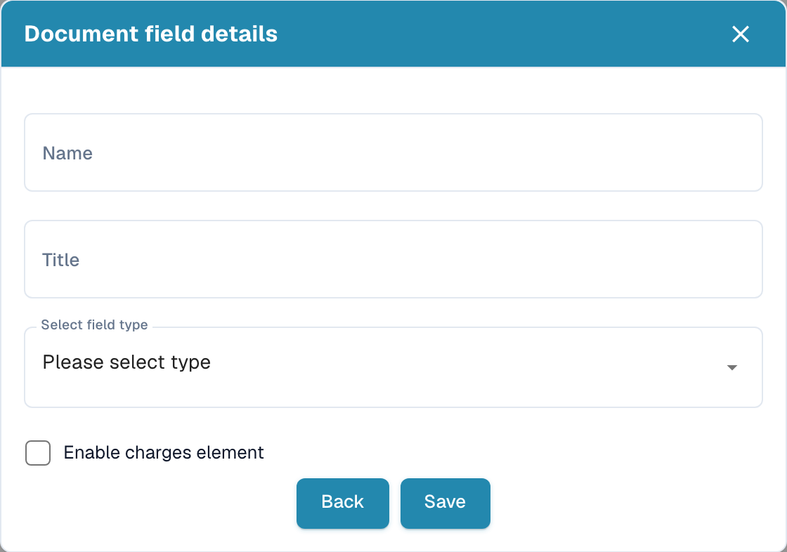
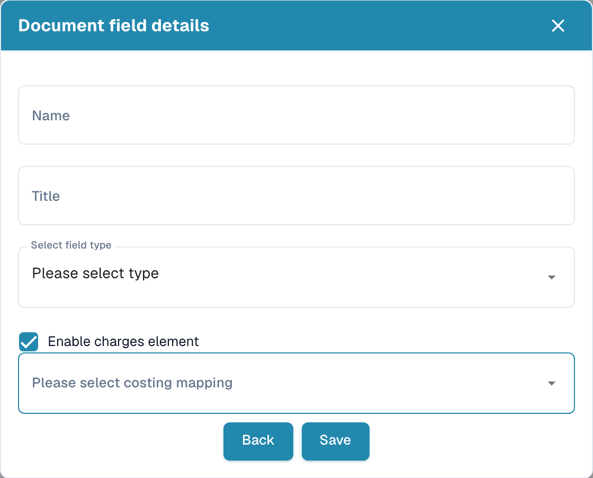

# New fields with charges

## Open field settings

Open **Settings → Document Types**, choose the document type and select **Fields**. In the appropriate field group, select **Create Field**.

<figure><figcaption>
Document field details dialog before creating a field.
</figcaption></figure>

## Assign charges

1. In **Document field details**, enter a technical **Name** and a readable **Title**.
2. Choose the appropriate data type under **Select field type**.
3. Select **Enable charges element**. The **Please select costing mapping** selector appears.
4. Choose the mapping intended for the charge. Available entries depend on your configuration.

<figure><figcaption>
Unsaved field draft with Enable charges element selected.
</figcaption></figure>

The example is an unsaved draft. **Save** creates the field; **Back** leaves the dialog. Review the field's **Required**, **OCR** and **Match Score** properties in the field list, then use **Save Settings** to retain intended configuration changes.
