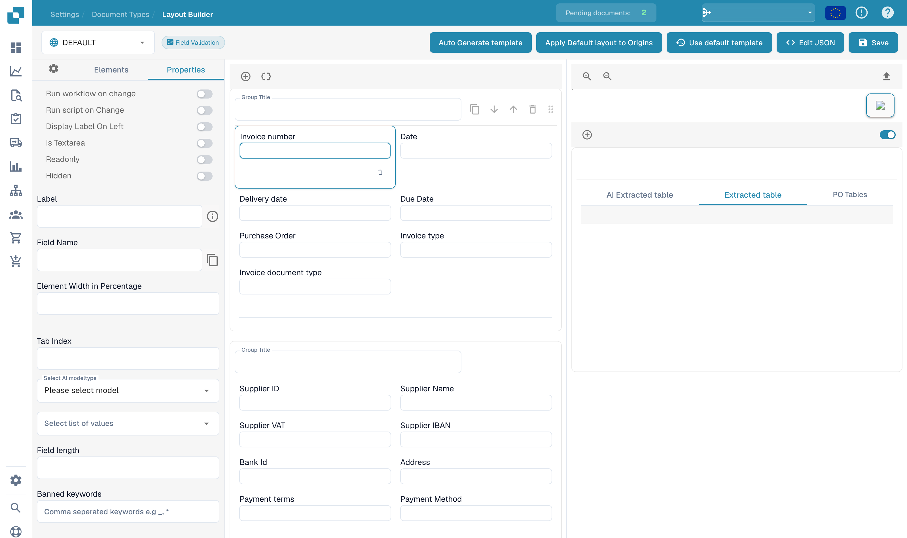

# Configuring field properties

In **Layout Builder**, select an existing layout and click a field in the preview. The **Properties** panel shows the controls available for that element.

<figure><figcaption>
Field properties in the English Layout Builder.
</figcaption></figure>

Review the field's **Label**, technical **Field Name**, **Element Width in Percentage** and **Tab Index**. Depending on the element, you can also set **Readonly**, **Hidden**, **Display Label On Left**, **Is Textarea**, or whether a workflow or script runs when the value changes.

Choose a suitable AI model type or list of values where the field supports those selectors. **Field Length** and **Banned Keywords** provide further input constraints. Technical field names and configured origin names are not translated automatically.

Check the preview after changing a property. Save the layout only when you intend to retain the changes, then test the resulting validation screen with representative documents. For document-type validation and recognition thresholds, see [Setting Validation and Match Score](../fields/setting-validation-and-match-score.md).
