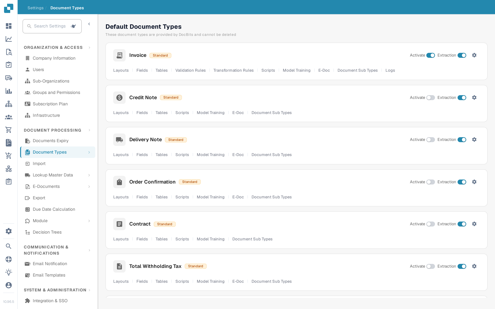
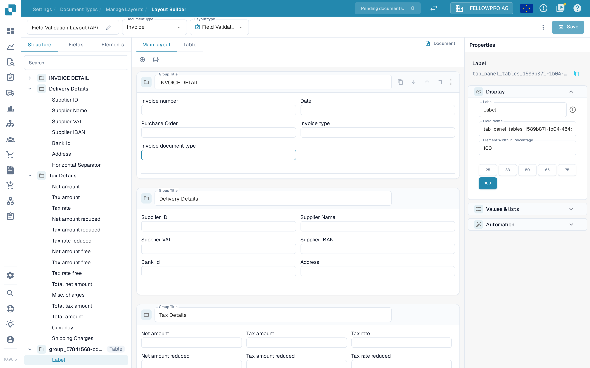
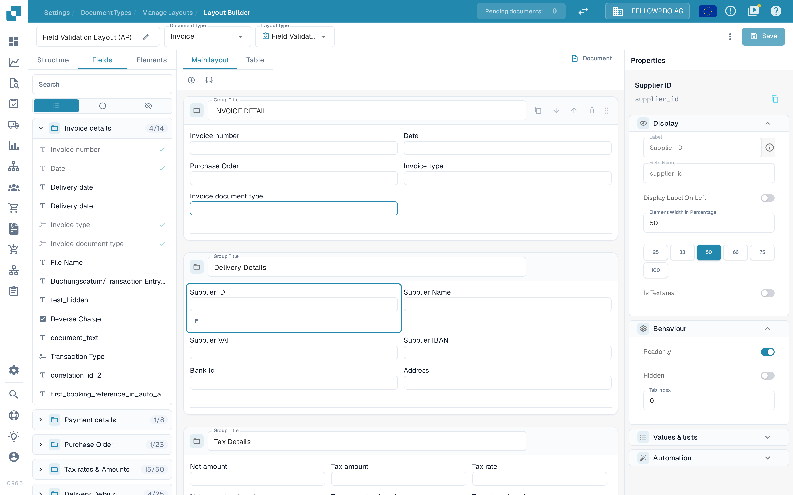
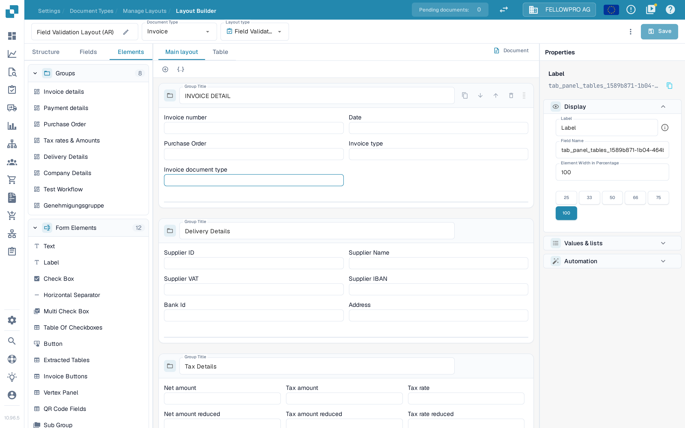

# Navigating the Layout Builder

Use the **Layout Builder** to arrange the groups and fields that people see on a document. This guide uses the English **Invoice** layout in a sandbox organization.

## Open the Invoice layout

1. Go to **Settings → Document Types**.
2. Find **Invoice** and select **Layouts** in the row of links under its name.
3. In the list of layouts, select **Edit** on the layout you want to work on. The Layout Builder opens for that document type.

<figure><figcaption>Select **Layouts** on the Invoice card.</figcaption></figure>

The header of the builder shows the name of the layout with a pencil icon to rename it, the **Document Type** and the **Layout type** of the layout.

## Work with the three panel tabs

The panel on the left has three tabs: **Structure**, **Fields** and **Elements**. The builder opens on **Fields**.

**Structure** shows the layout as a tree, in the same order as the groups and fields appear on the document. Expand a group with its chevron to see the fields it contains. The search box filters the tree, and selecting a row selects the same element on the canvas.

<figure><figcaption>The Structure tree next to the canvas.</figcaption></figure>

**Fields** lists every field the document type offers, grouped by its groups. The counter next to a group name tells you how many of its fields are already placed, for example **4/14**. Each field that is already in the layout carries a green check mark. The three buttons below the search box filter the list: the list icon shows all fields, the circle icon only the ones that are not in the layout yet and the eye icon only the hidden ones.

<figure><figcaption>Filter the fields and drag the ones you need onto the canvas.</figcaption></figure>

The technical field name is not printed in the list. Select a field to read it in the **Properties** panel, or in the [Fields settings](../fields/configuring-field-properties-1.md).

**Elements** holds the blocks you drag onto the canvas: **Groups** with the groups of this layout, and **Form Elements** with Text, Label, Check Box, Horizontal Separator, Multi Check Box, Table Of Checkboxes, Button, Extracted Tables, Invoice Buttons, Vertex Panel, QR Code Field and Sub Group.

<figure><figcaption>The Groups and Form Elements palettes.</figcaption></figure>

## Place and arrange elements

- Drag a field from **Fields**, or an element from **Elements**, to the group where it should appear. Fields that are already placed carry a check mark in the **Fields** tab.
- Drag a field within or between groups to reorder it.
- The **+** button above the canvas creates an empty group; the JSON button next to it creates a group from a JSON definition.
- In a group header you can rename the group in **Group Title**, copy its JSON, move the group down or up, or delete it. Use the handle on the right of the header to drag the group.
- Select a field on the canvas to open it in the **Properties** panel on the right. The small toolbar that appears under the selected field removes it from the layout.

## The Properties panel

The panel on the right is always open and follows the element you selected. Its settings are grouped into **Display**, **Behaviour**, **Values & lists** and **Automation**; only the sections that apply to the selected element are shown. **Display** holds the label, the field name and the **Element Width in Percentage**, which you set with the presets 25, 33, 50, 66, 75 and 100. See [Configuring Field Properties in the Layout Builder](configuring-field-properties.md) for the individual options.

Validation, OCR and matching settings belong to the field itself, not to the layout: configure them in the separate [Fields settings](../fields/configuring-field-properties-1.md).

## Preview and save

The canvas shows the layout as it will look on the document. Use the **Main layout** and **Table** tabs to switch between the page and a line-item table; **Document** opens the sample document beside the canvas. See [Using the Template Preview](using-the-template-preview.md).

Select **Save** in the header when you are done. See [Save and Apply Changes](save-and-apply-changes.md) for the other header actions, including template generation, default templates and applying a layout to origins.
